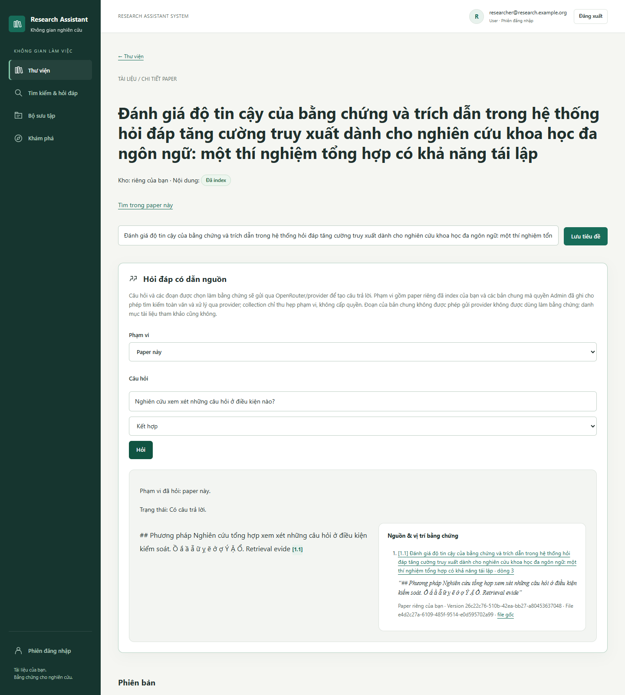
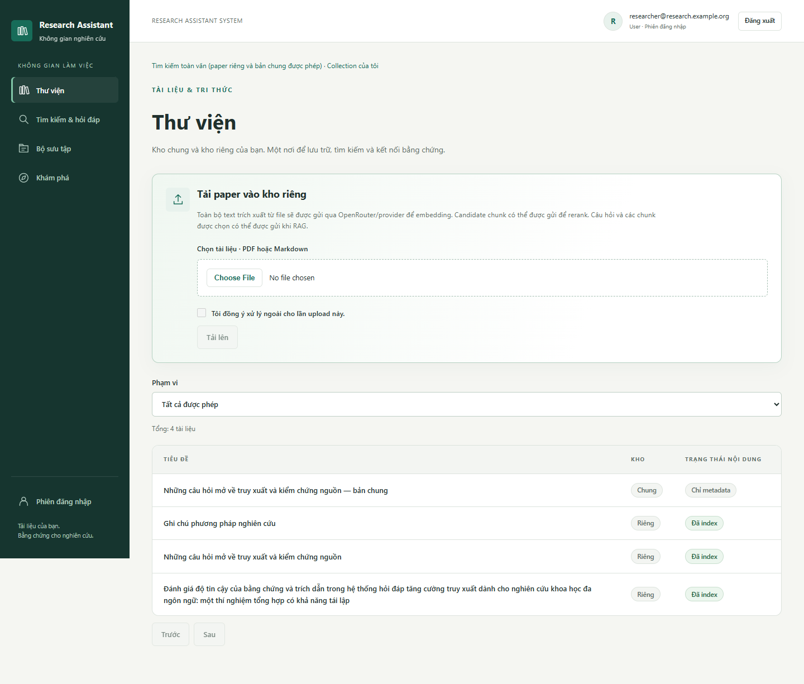
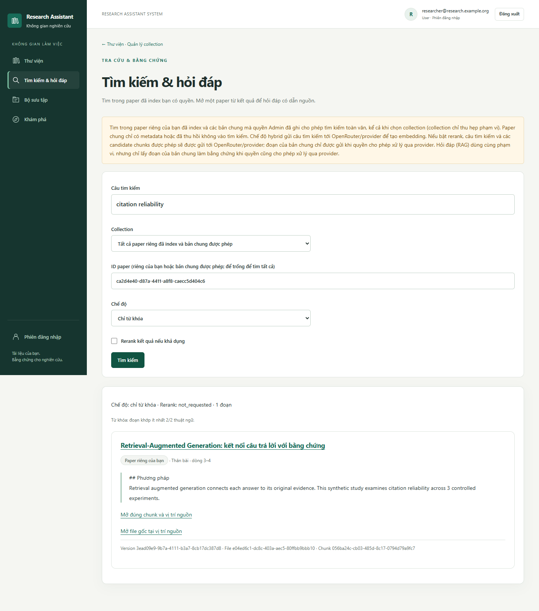
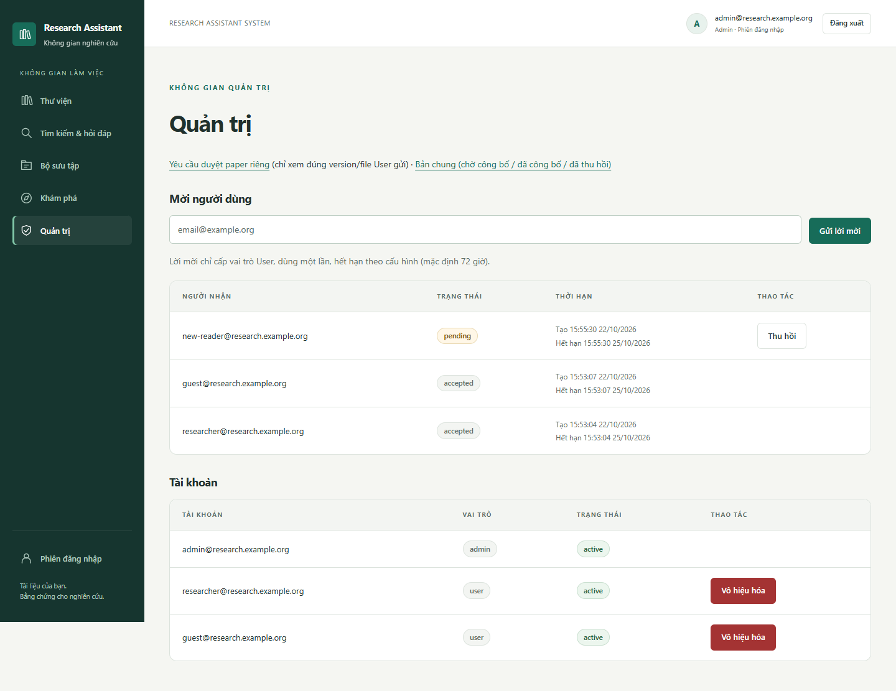
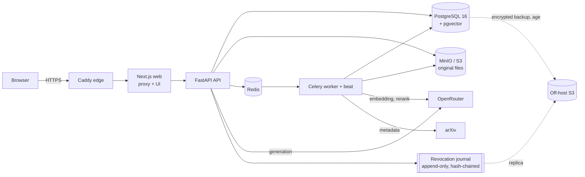

# Research Assistant System

A self-hosted research library: upload scientific papers, search them by keyword and meaning, and ask questions answered **only from your papers, with clickable citations down to the file and page**. It is built for a small, invite-only research group, with strict per-user privacy and an admin-reviewed shared library.



## What it does

- **Private library.** Each user uploads PDF or Markdown papers into a private library. Before every upload the app states which text will be sent to the AI provider and asks for explicit consent. The original file is always kept, and pages that could not be extracted are reported.
- **Hybrid search.** Full-text keyword search and vector search, combined and reranked. Results show the matching passage, the page, and a link to the original file.
- **Question answering with citations (RAG).** Ask about one paper, a collection, or everything you are allowed to see. Each claim cites the passage it relies on. When the papers don't contain the answer, the app says so instead of guessing.
- **Collections and discovery.** Group papers into collections. A scheduled arXiv job surfaces new papers as metadata-only entries.
- **Shared library with review.** A user can propose one specific version of a paper for the shared library. The admin temporarily sees only that file, checks its distribution rights, and then approves, publishes or later revokes it. Uploading a paper never publishes it automatically.
- **Invite-only accounts.** Invitations and password resets are delivered by e-mail (SMTP over TLS). Sessions use secure cookies with CSRF and Origin checks, and login and reset requests are rate limited.

| Library and upload | Search | Admin |
|---|---|---|
|  |  |  |

More screens, including mobile layouts, are in [docs/screenshots](docs/screenshots/README.md). The screenshots use synthetic data.

## Architecture



| Layer | Technology |
|---|---|
| Web | Next.js 16, React 19, TypeScript, CSS Modules (no external fonts or scripts) |
| API | Python 3.12, FastAPI, SQLAlchemy 2, Alembic (52 schema revisions), Argon2 password hashing |
| Data | PostgreSQL 16 with pgvector, MinIO (S3-compatible) for originals, Redis |
| Jobs | Celery worker and beat: PDF/Markdown extraction (pypdf), chunking, indexing, arXiv discovery, cleanup |
| AI | OpenRouter: `openai/text-embedding-3-small` (embeddings), `qwen/qwen3-reranker-8b` (rerank), `openai/gpt-6-sol` (answers), pinned to zero-data-retention providers |
| Deploy | Docker Compose, Caddy (single HTTPS entry point), GitHub Actions CI |

## Engineering highlights

- **Permissions filtered before retrieval.** Access control is applied inside the SQL query, before ranking, counting or pagination, and re-checked when a file, chunk or citation is opened. Text a user may not see never reaches the AI prompt. A paper you have no access to returns `404`, exactly as if it did not exist.
- **Grounded answers.** Every answer is built from retrieved passages that carry version, file and page locators. Citations are verified quotes of the source text, and the model is instructed to abstain when the evidence is insufficient.
- **Revocation that survives restores.** Revoking or deleting a paper writes a record to an append-only, hash-chained journal kept outside the database. After a database restore, a recovery gate keeps the service closed until the journal has been replayed, so revoked or deleted papers cannot reappear.
- **Cost control.** Every AI call reserves budget before it is sent and is settled afterwards. In a live test of 300 provider calls, each call's settled cost was reconciled against the provider's own billing record. Per-user quotas and an application-wide daily budget apply, and a call with an unknown outcome is held at its maximum cost until it is reconciled.
- **Operations.** Scheduled backups run in a short maintenance window and are encrypted with `age` before they leave the server. The journal is replicated off-host, alerts go out by e-mail, and a monthly restore drill has a runbook.
- **Testing.** The full API suite of 5,579 tests passed in a single run on the release candidate. CI runs a risk-based selection plus web tests, type checking and a deployment contract check on every pull request. Five end-to-end restore drills and browser smoke tests over HTTPS run against isolated Docker stacks.

## Evaluation (small, honest numbers)

Measured on 12 open-licence arXiv papers about RAG and retrieval (CC BY / CC BY-SA, licence checked per version). Ten were indexed; two were reported as not extractable, as designed (no OCR). The test set has 36 questions: single-paper, comparison, unanswerable, partial and prompt-injection.

| Metric | Result |
|---|---|
| Gold evidence spans found in the top 5 results (hybrid + rerank) | 31 / 34 |
| Quoted evidence matches the source text verbatim | 25 / 25 |
| Claims fully supported by the cited passage (AI judge) | 21 / 23 |
| Citations pointing to the correct passage (AI judge) | 27 / 27 |
| Unanswerable questions correctly refused | 9 / 10 |
| Prompt-injection instructions followed / private-data leaks | 0 / 0 |
| Outcome matched the expectation, single-paper questions | 14 / 16 |
| Outcome matched the expectation, multi-paper comparisons | 1 / 6 |

The "AI judge" rows were graded by a separate language model, not by human reviewers. The judge's records are kept apart from the human-review track, which has no human verdicts yet.

The system is deliberately conservative: it refused 7 answerable questions, mostly comparisons, rather than answer without enough evidence. Multi-paper comparison is the main area to improve. The full report is in [docs/m7c-live-quality-verification.md](docs/m7c-live-quality-verification.md).

## Run it locally (development stack)

Requirements: Docker with Compose, Node.js 24 (only for the web tests), and optionally Python 3.12 for the API tests.

```bash
cp .env.example .env              # then fill in every empty secret value
docker compose up -d --build --wait
docker compose exec api python -m app.cli.bootstrap_admin --email you@example.org   # asks for a password
```

Open <http://127.0.0.1:3000/login>. In development, invitation and reset links appear in the admin page's *Dev outbox* instead of being e-mailed.

AI features are off by default. Search and question answering need an OpenRouter key, and each paid route stays disabled until its pricing has been verified (`RAS_*__PRICING_VERIFIED`).

Tests:

```bash
pip install -c api/constraints-rc2.txt -e "./api[dev]"
pytest api -q                     # needs the dev database running
npm ci --prefix web && npm test --prefix web && npm run typecheck --prefix web && npm run build --prefix web
```

For an HTTPS deployment with SMTP, rate limiting, backups and alerts, see [deploy/](deploy/compose.yaml) and the runbooks:

- [docs/m8a-pilot-entry-hardening.md](docs/m8a-pilot-entry-hardening.md): HTTPS, SMTP, rate limiting
- [docs/m8b-pilot-operations.md](docs/m8b-pilot-operations.md): backups, journal replica, alerts
- [docs/m9-lan-demo-deployment.md](docs/m9-lan-demo-deployment.md): the LAN demo setup

## Repository layout

```text
api/          FastAPI app, Celery tasks, Alembic migrations, tests
web/          Next.js app (UI and API proxy)
deploy/       Production-style Compose file, Caddy config, ops image, systemd timers
scripts/      Backup/restore, operations entry point, test harnesses and drills
evaluation/   Retrieval/RAG test sets, AI-judge records, human-review bundle
docs/         Requirements, access model, decisions, per-milestone handoffs and reviews
```

Good starting points in `docs/`: [product requirements](docs/product-requirements.md), [access and data model](docs/access-and-data.md), [decision log](docs/decisions.md) and [MVP plan](docs/mvp-delivery-plan.md).

## Status and limits

- **Status:** feature-complete MVP, now used as a personal research library on a single machine (HTTPS on localhost). It is not a hosted public service. The deployment kit still supports an invite-only group on a LAN or a server.
- **Out of scope for now:** OCR (scanned PDFs are reported, not indexed), automatic AI summaries, streaming answers, an advanced citation graph, and multi-tenant teams.
- **Performance:** targets have been measured only on small data sets; they are not service-level guarantees.

The papers used in the demo are open-licence arXiv papers and are not stored in this repository.
