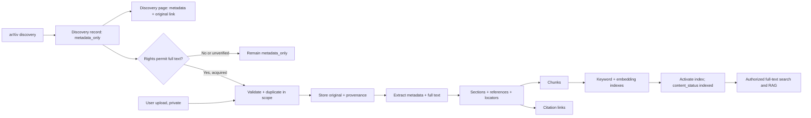

# Kiến trúc đề xuất

[Mục lục](README.md) · [Mô hình dữ liệu](data-model.md) · [Search và RAG](search-and-rag.md) · [Kiểm thử](testing.md)

## Ranh giới hệ thống

**Đã xác nhận:** Daily discovery và upload dùng chung pipeline: kiểm đầu vào/trùng, trích metadata và toàn văn, nhận diện cấu trúc/references, chia đoạn có vị trí, lập chỉ mục từ khóa và embedding, rồi phục vụ search/RAG. Giữ file gốc và nêu rõ phần không trích xuất được. Index toàn văn không có nghĩa đưa cả paper vào một prompt.

**Đã xác nhận:** Next.js cho web, FastAPI cho API; PostgreSQL + pgvector giữ metadata, keyword và vector search; Redis + Celery chạy job; file qua lớp S3-compatible (MinIO local); Docker Compose cho dev và triển khai đầu. OpenRouter dùng cho embedding (`openai/text-embedding-3-small`), rerank (`qwen/qwen3-reranker-8b`) và RAG generation (`openai/gpt-6-sol`). Model ID là cấu hình; khả dụng, vector dimensions và provider routing cần kiểm khi tích hợp, không chép giá/dimensions vào code.

**Đề xuất:** Tách module logic identity/session/quyền, library, discovery, ingest, file, search, RAG, citation và admin/audit. FastAPI xác thực session rồi kiểm ACL trên từng request; Next.js không là nguồn quyết định quyền. Session hết hạn phía server sau 30 phút idle hoặc 8 giờ từ login, tùy mốc nào trước; invite một lần 72 giờ, reset token một lần 30 phút và reset thu hồi session cũ. PostgreSQL là nguồn chân lý cho item, job, quyền, tombstone và usage; keyword index PostgreSQL và vector pgvector là dữ liệu dẫn xuất. Redis là broker/đệm job, không là nguồn chân lý. Celery worker chạy các bước có idempotency; scheduler tạo candidate daily. Secret OpenRouter/S3/DB chỉ ở phía backend và được cấp qua cấu hình triển khai.

**Đã xác nhận:** Daily bắt đầu từ arXiv, trước hết lưu metadata và link gốc; paper `metadata_only` hiện ở trang khám phá nhưng không vào full-text search/RAG. Chỉ lấy/lưu/hiển thị lại file toàn văn trong kho chung khi điều kiện sử dụng của **từng bài** cho phép; chỉ sau khi index thành công mới là `indexed`. [arXiv nêu rõ](https://github.com/arXiv/arxiv-docs/blob/develop/source/help/bulk_data.md) giấy phép mặc định cho arXiv phân phối không tự cấp cho dịch vụ khác quyền đăng lại. Hugging Face có thể bổ sung về sau. **Đề xuất:** Seed cấu hình theo `cs.AI`, `cs.LG`, `cs.CL` để theo dõi AI, học máy và NLP; Admin có thể đổi chủ đề. Đây là lựa chọn nội dung khởi đầu, không là giới hạn cố định ([taxonomy arXiv](https://arxiv.org/category_taxonomy)).

URL/DOI/arXiv ID là định danh hoặc link gốc, không chứng minh có quyền lưu full text. Quyền kho chung phải được kiểm trên **đúng version file**, ghi nguồn file, URL giấy phép/bằng chứng, ngày/người duyệt và phạm vi sử dụng. “Có toàn văn” nghĩa là có file PDF/Markdown gốc chứa phần thân paper; “đã index toàn văn” nghĩa là đã index **phần text thực sự trích xuất được**. Metadata, abstract riêng lẻ hoặc bibliography không đủ. Coverage ghi rõ phần thiếu của trang, bảng, hình/công thức. **Đề xuất cấu hình MVP, cần đo:** PDF ≤ 30 MB/100 trang, Markdown ≤ 2 MB; backend xác minh định dạng thực, parser có timeout/memory/CPU limit. PDF đủ body text để tự động index khi ≥ 70% trang thân có ≥ 100 ký tự/trang và tổng body ≥ 2.000 ký tự, không tính bìa/header/references. Không đạt thì `fulltext_rejected` hoặc `needs_review`, không index; ngưỡng phải được đánh giá trên paper nhiều hình/công thức. Không OCR. File gốc của upload lỗi được giữ có kiểm quyền trong job đến khi cleanup theo chính sách xóa, nhưng không searchable. Markdown/PDF đi qua adapter khác nhau rồi chung schema trung gian. [Quy tắc bằng chứng](search-and-rag.md).

## Pipeline và trạng thái

**Đề xuất:** Tách `content_status` của paper daily khỏi trạng thái `IngestionJob`. Discovery record được tạo với `content_status=metadata_only` và hiện ở trang khám phá; ban đầu không có file/chunk/vector full text hoặc active index. Khi có căn cứ quyền và file phù hợp, tạo job full text nhưng record **vẫn `metadata_only` trong lần index đầu**. Chỉ sau khi cả keyword và embedding index của version được kiểm xong, chuyển active index pointer và `content_status=indexed` trong cùng giao dịch. Nếu lần đầu thất bại, giữ `metadata_only`, hiển thị lỗi cho Admin; không trả hit/citation. Khi reindex paper đã `indexed`, giữ active version cũ cho đến khi version mới thành công. Nếu sau đó quyền full text bị thu hồi, chặn retrieval ngay, hạ về `metadata_only` và dọn index/file theo retention.

Mỗi ingest request có `origin`, scope đích, actor/source, `idempotency_key`, file/version, lịch sử step, lỗi và cảnh báo. Quyền riêng tư được gán **ngay khi nhận upload**, trước khi chạy worker. Kết quả từng bước được ghi bền vững; job `ready` chỉ khi active index version tương ứng đã sẵn sàng.

**Đã xác nhận:** Trước khi client truyền file private, hiển thị thông báo về embedding toàn bộ text trích xuất, rerank candidate chunk và RAG gửi câu hỏi/chunk được chọn tới OpenRouter/provider; yêu cầu User xác nhận tường minh cho upload ấy. UI tạo upload intent không chứa file sau xác nhận và chỉ gửi file khi API chấp nhận intent. Không coi việc User tiếp tục bấm “Upload” là bằng chứng xác nhận riêng. [Quyền và dữ liệu](access-and-data.md#hợp-đồng-xác-nhận-upload-riêng).

**Đề xuất giao thức nhận file:** `intent_created → file_submitted → intent_consumed` hoặc `intent_expired/cancelled`. Tạo intent chỉ ghi acknowledgement, owner, notice version và file dự kiến; chưa tạo `LibraryItem`, `SourceFile` hay `IngestionJob`. Bước gửi file kiểm intent thuộc session User, còn hiệu lực, chưa dùng và khớp upload dự kiến; khóa/tiêu thụ một lần nguyên tử trước khi công bố original và job `received`. Kiểm giới hạn/định dạng thật ở backend, dọn staging nếu thất bại. Nếu file request đến với intent sai, bytes có thể đã truyền trên mạng, nhưng API không giữ original hoặc tạo job. Giao thức chi tiết và ca race ở [testing](testing.md).

| Trạng thái | Ý nghĩa / đường tiếp |
| --- | --- |
| `received` | Đã nhận request và xác định scope; chờ validate |
| `validating` | Kiểm MIME/nội dung thật, kích thước/trang, an toàn file, nguồn/quyền phân phối, trùng trong scope; parser có giới hạn tài nguyên |
| `duplicate` | Đã liên kết đến item/version hiện có trong cùng scope; kết thúc có thông báo, không lộ scope khác |
| `stored` | File gốc đã lưu, hash và provenance ghi nhận |
| `extracting` | Metadata, text, section, references; có thể ghi coverage và cảnh báo từng trang/đoạn |
| `chunking` | Tạo chunk có locator vào version/file |
| `indexing` | Ghi keyword và embedding index, kiểm số lượng/phiên bản |
| `ready` | Keyword/vector index đã xong và active; paper tương ứng là `indexed`, có thể có `partial_extraction=true` và cảnh báo |
| `fulltext_rejected` | File upload/PDF không trích xuất được phần thân; kết thúc, thông báo lý do; không lập index hoặc coi là paper ready |
| `needs_review` | PDF không đạt ngưỡng thử hoặc parser không chắc vùng thân; Admin/owner được báo để kiểm tra, không `indexed` |
| `retryable_failed` / `terminal_failed` | Lỗi tạm thời hoặc lỗi cần can thiệp; giữ nguyên file gốc nếu đã nhận, hiển thị bước lỗi |
| `cancelled` | Bị hủy theo quyền; dọn dữ liệu dẫn xuất thích hợp |

`metadata_only`/`indexed` là **trạng thái nội dung của paper daily**, không phải trạng thái job. Job có thể đi từ bước bất kỳ sang `retryable_failed`; retry quay lại bước thất bại hoặc bước an toàn gần nhất. `ready` không có nghĩa trích xuất hoàn hảo. Coverage phân biệt `complete`, `partial`, `none` theo version, cùng trang/khối lỗi khi xác định được; `partial` chỉ được `ready` nếu có body text hữu dụng, và RAG không được suy diễn vùng thiếu. PDF scan/body rỗng không được `ready`. Pipeline cho phép owner xem file upload gốc khi lưu thành công mà không lẫn với trạng thái index.

## Trùng, retry, reindex

**Đề xuất:** Chống trùng bằng các mức: request idempotency; hash file trong **cùng scope**; DOI/arXiv và metadata chuẩn hóa là tín hiệu match cần xác minh, không dùng để gộp tự động các version khác nhau. Discovery đối chiếu trong kho chung; upload đối chiếu trong kho riêng của owner. Trùng xuyên scope chỉ được xử lý nội bộ nếu bảo đảm không tạo oracle rò rỉ; MVP nên không dùng kết quả đối chiếu xuyên scope trong luồng User. Hai bản thuộc các scope khác nhau giữ item và ACL độc lập.

Worker dùng lease/attempt count, retry giới hạn với backoff cho lỗi mạng và dịch vụ tạm thời; file hỏng, unsupported, không có body text hoặc lỗi quyền nguồn là lỗi kết thúc/cần can thiệp. Mỗi bước ghi theo khóa `(item, version, pipeline_version, step)` để chạy lại không nhân đôi chunk, embedding hay citation edge. Với embedding, chỉ gọi OpenRouter khi chưa có vector hợp lệ cho `(item, version, chunk_hash, model_id, dimensions, pipeline_version)`; không dùng cache xuyên owner/scope để khỏi rò rỉ. Worker kiểm trạng thái quyền và yêu cầu hủy trước mỗi bước, lần gọi provider và lần ghi/công bố kết quả, để job cũ không tái tạo dữ liệu sau `t_rev`; tín hiệu Celery revoke riêng lẻ không đủ. Giới hạn concurrency và theo dõi token, model, provider, chi phí theo job/loại tác vụ; lỗi 429/thiếu budget giữ job retryable có backoff. Phản hồi key do chủ dự án cung cấp xác nhận `limit=50`, `limit_reset=daily`: đây là **key spending cap**, không phải credit nạp mới mỗi ngày. Budget ứng dụng thử $10/ngày được cấu hình riêng, với quota per-request/per-user, cảnh báo gần hết và các bucket embedding/rerank/generation; kiểm usage động, không chép snapshot remaining vào config.

Nếu index ghi dở, dùng index version mới và chuyển con trỏ tìm kiếm sau khi hoàn tất; dọn index cũ theo job riêng. Khi đổi embedding model/dimensions, tạo bộ vector và pgvector index tương thích mới, tính lại query cùng model mới, đánh giá chất lượng/chi phí rồi chuyển đọc nguyên tử; giữ index cũ cho rollback đến khi dọn. Reindex parser/chunker/schema giữ original, metadata User sửa và provenance. Khi xóa/thu hồi item, giao dịch ghi tombstone, thu hồi ACL/active index và đặt `cancel_requested`; thời điểm commit `t_rev` là chốt quyền cho request mới. Mọi đường phục vụ file, search, RAG, citation và cache kiểm tombstone/rights epoch dù index vật lý chưa dọn. API tải file có kiểm quyền mỗi request, tránh link object dài hạn không thể vô hiệu. Request RAG đang chạy kiểm lại trước gửi provider/câu trả lời và từng phần stream; khi phát hiện thu hồi, dừng phần còn lại và hủy provider call nếu có thể. Nội dung/bytes đã gửi trước đó không thể lấy lại. Chunk/vector của item bị loại trong luồng xử lý, file gốc/dẫn xuất còn lại xóa trong 24 giờ, trừ bản vật lý còn gắn item hợp lệ khác. Backup mỗi ngày, giữ 30 ngày. **Đề xuất:** ghi tombstone vào nhật ký xóa bền vững **không bị rollback cùng snapshot PostgreSQL/object storage**; giữ nhật ký lâu hơn bản backup cũ nhất. Restore vào môi trường cách ly, replay tombstone và kiểm ACL/index/file trước khi mở traffic để bản đã xóa không tái hiện. [Hợp đồng thu hồi](access-and-data.md#hợp-đồng-thu-hồi-và-xóa).

## Lỗi và quan sát

**Đề xuất:** Phân biệt lỗi thu nhận, trích xuất, index, quyền, model và nguồn discovery; lỗi hiển thị cho User tránh tiết lộ thông tin nội bộ. Log/trace theo job và step, không ghi raw paper hay prompt vào log mặc định. Admin xem hàng đợi, retry, độ trễ, tỷ lệ lỗi, lượng metadata-only/partial; quyền quan sát paper riêng theo [chính sách quyền](access-and-data.md).

**Cần xác nhận qua đo/kiểm tích hợp:** khả dụng của ba model, vector dimensions, provider routing/retention và ngưỡng PDF trên fixture thực. Model ID, key cap, xác nhận upload, chính sách quyền, giới hạn file và thời hạn xóa/backup đã có trong [decisions](decisions.md).
