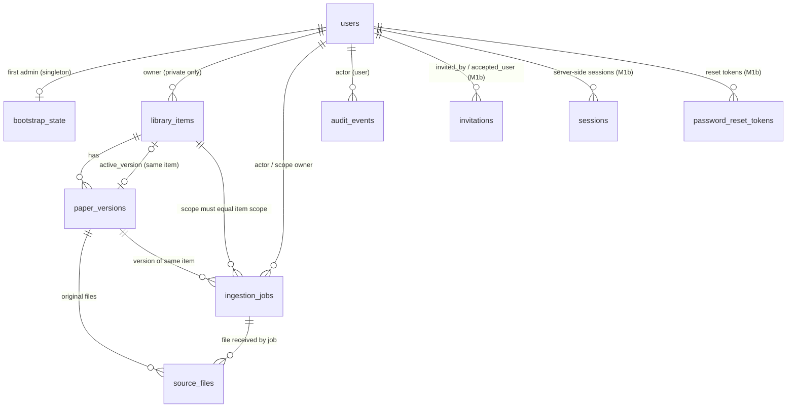

# Môi trường phát triển và schema (M1a–M5b-1)

[Mục lục](README.md) · [Mô hình dữ liệu](data-model.md) · [Roadmap](roadmap.md)

Tài liệu này mô tả phần **đã triển khai**: M1a (Compose dev, migration nền, bootstrap Admin), M1b (invite/session/CSRF/ACL), M1c (upload intent, lưu/tải original private — xem [mục M1c](#upload-intent-và-original-m1c)), M2a (worker Markdown, đã merge PR #4), M2b (PDF/coverage/references, đã merge PR #5), M3a và M3b (PR #7, merge `5911038`), M3c collection (PR #8, `6b0a96a`), M4a một paper riêng (PR #9, `6eaaf12`), M4b scope (PR #10, `2977142`), M4c bộ đánh giá (PR #11, `99e439d`), M4d (PR #12–#14 đã merge), M5a arXiv discovery (PR #15, `332a9b0`) và M5b-1 liên kết citation (PR #16, `a03c2c5`, [mục M5b-1](#m5b-1-liên-kết-citation-arxiv-chính-xác-pr-16-đã-merge)); sửa proxy web cho search/collections/RAG ở [mục proxy](#proxy-web-json-search-collections-và-rag) (PR #17, `8265c30`); M6a yêu cầu duyệt đúng version/file ở [mục M6a](#yêu-cầu-duyệt-paper-riêng-m6a), M6b-1 phê duyệt vào bản chung chờ công bố (PR #19, 5c0f28a) ở [mục M6b-1](#phê-duyệt-vào-bản-chung-chờ-công-bố-m6b-1) và M6b-2a công bố metadata/thu hồi ở [mục M6b-2a](#công-bố-metadata-và-thu-hồi-bản-chung-m6b-2a). Live smoke bằng dữ liệu tổng hợp đã qua adapter thật cho document embedding, query embedding và rerank; hai route OpenRouter trả `200`. Charge thực trên key chưa đối soát, nên `pricing_verified=false` tiếp tục chặn lời gọi trả phí trên dữ liệu riêng. Compose chỉ dành cho dev, không phải cấu hình production.

## M3c — collection cá nhân (PR #8 đã merge)

Revision `0015` thêm `collections` và `collection_items`, nâng từ DB `0014` có dữ liệu. API session/CSRF: `GET/POST /collections`, `PATCH/DELETE /collections/{id}`, `GET/POST /collections/{id}/items`, `DELETE /collections/{id}/items/{item_id}`. `POST /search` nhận `collection_id` tùy chọn, không đi kèm `item_id`. List collection có thể gồm item chung `metadata_only`; tìm kiếm toàn văn chỉ trả private item của owner có active index hợp lệ. Trang `/collections` quản lý membership, trang `/search` chọn collection và chỉ rõ item chỉ có metadata. Không bật `pricing_verified` từ live quote; test/demo dùng provider giả và không xác minh charge thực.

Kiểm thử host 2026-09-26: Conda `ras` chạy `pytest api -q --tb=short` **326 passed** (một cảnh báo deprecation Starlette). Migration test dùng PostgreSQL thật, nâng `0014` đã có item và search request ledger lên `0015`; ORM/schema khớp. `npm run test:search --prefix web` **2 passed**, `npm run typecheck --prefix web` và `npm run build --prefix web` đạt. Test top-k keyword/vector và payload rerank dùng provider giả, không chứng minh charge hoặc latency OpenRouter thật.

Compose dev sau build/upgrade healthy, `docker compose exec -T api alembic current` trả `0015 (head)` trên DB trước đó ở `0014`. Demo `& "$env:USERPROFILE\.conda\envs\ras\python.exe" scripts/demo_m3c_stack.py` qua HTTP API/UI: hai User, mỗi người một Markdown riêng đã index bằng fake embedding trên host, cùng một item chung `metadata_only` được thêm vào hai collection. Mỗi collection có 2 item metadata, search keyword scoped trả đúng 1 hit riêng của chủ; thêm item riêng người kia và đọc collection người kia bị `404`; `/collections` và `/search` đều trả `200`. `external_provider_calls=0`; demo này không đo chi phí, chất lượng rerank hay route provider live.

Review PR #8 đổi hai FK của `collection_items` trong revision `0015` từ `CASCADE` sang `RESTRICT` vì revision chưa merge; API xóa membership tường minh rồi collection trong một transaction. DB **mới** đi từ base đến `0015` nhận ràng buộc đúng. DB dev đã từng áp bản `0015` cũ không được Alembic chạy lại: trong workspace này hai constraint đã được đổi tại chỗ trong một transaction, giữ nguyên dữ liệu; kiểm `pg_constraint.confdeltype` cho cả hai là `r` và Alembic so ORM/schema trả `[]`. Môi trường dev khác đã áp `0015` cũ cần đổi hai constraint tương ứng sang `ON DELETE RESTRICT` trước khi thử endpoint xóa collection; chỉ chạy `alembic upgrade head` sẽ không đổi chúng.

Kiểm chứng review bằng Conda `ras` và PostgreSQL thật: nhóm migration/collection/search **53 passed**, toàn API suite **330 passed** (một cảnh báo deprecation Starlette). Test migration từ DB trống đến `0015 (head)`, hai FK `RESTRICT`, xóa trực tiếp bị FK từ chối, endpoint giữ nguyên item và lỗi giữa hai bước rollback. API Compose đã build lại và healthy với DB dev đã sửa constraint.

Hợp đồng và giới hạn M2b ở [PDF/coverage/references](m2b-pdf.md). Migration M2b `0008` thêm `pdf_pages`/`reference_entries`; M3a thêm `0009` (index generation) và `0010` (quota User), không sửa revision đã merge. Kiểm tra trên host bằng Conda `ras`: `& "$env:USERPROFILE\.conda\envs\ras\python.exe" -m pytest api -q`; dựng worker Linux, Redis/MinIO/PostgreSQL và nâng DB bằng `docker compose up -d --build --wait`, sau đó `docker compose exec -T api alembic current` phải là `0015 (head)` với image M3c hiện hành. API owner: `/library/items/{id}/coverage`, `/references`, `/chunks` và `/files/{file_id}/original`. Common `metadata_only` chưa mở file/dẫn xuất.

Kiểm thử M2b ngày 2026-09-25: `pytest api -q` trên Conda `ras`/PostgreSQL/MinIO đạt **224 passed**, một warning deprecation từ Starlette test client; Compose build/health đạt và `alembic current` là `0008 (head)`. Chạy `& "$env:USERPROFILE\.conda\envs\ras\python.exe" scripts/demo_m2b_stack.py` trên HTTP Next.js + worker Celery/Redis thật: PDF text tổng hợp → `awaiting_index`, PDF cover/abstract/references → `needs_review`, original vẫn tải cho owner; B/Admin nhận 404. Một lần đo: queue wait **4.610 s**, step validate **25 ms**, PDF extraction **658 ms**, chunk **18 ms**; đây không phải SLO hay thời gian index (M3 chưa chạy). Script tạo user/item fixture dev tồn tại sau demo, không dùng dữ liệu thật và không in credential.

Review PR #5 ngày 2026-09-26: thêm regression cho bibliography heading biến thể, heading không chắc, trang body rỗng giữa hai trang có text và locator/chunk bàn giao; **12 test liên quan passed**, toàn API suite trên Conda `ras` đạt **236 passed** (cùng một warning Starlette). `docker compose exec -T api alembic current` vẫn là `0008 (head)`; bản sửa không đổi schema. PDF parser gắn `layout-v2`; dữ liệu `layout-v1` cũ cần trích lại trước khi M3 index. Không chạy lại Compose demo cho thay đổi parser này; kiểm worker/API qua test integration PostgreSQL/MinIO.

**Cách kiểm chứng (2026-09-24):** Windows 11, Docker Desktop 28.4 (Compose v2.39, engine Linux), Windows PowerShell 5.1 và Git Bash. Mỗi lệnh dưới đây đã được chạy trong shell ghi kèm, trừ các chỗ ghi rõ **chưa chạy trực tiếp**. Lệnh không ghi shell chạy giống nhau ở cả hai. Chạy mọi lệnh từ **gốc repo**; Windows PowerShell 5.1 không có `&&`, nên tài liệu không dùng `cd … &&`.

Python trên host luôn là Conda env `ras` theo [AGENTS.md](../AGENTS.md), không tạo venv:

```powershell
# PowerShell
$py = "$env:USERPROFILE\.conda\envs\ras\python.exe"
```

```bash
# Git Bash
PY="$USERPROFILE/.conda/envs/ras/python.exe"
```

## Cấu trúc

| Thư mục | Nội dung |
| --- | --- |
| `api/` | FastAPI (`app/main.py`: `/healthz`, `/readyz` và router `auth`, `admin`, `library` trong `app/api/routes/`), model SQLAlchemy (`app/models/`), cấu hình tập trung (`app/config.py`), xác thực và quản lý phiên (`app/identity/`: `login.py`, `sessions.py`, `invitations.py`, `password_reset.py`, `users.py`, bootstrap), phân quyền (`app/authz.py`), CSRF/cookie (`app/api/`), delivery adapter (`app/delivery.py`), Alembic (`migrations/`), test (`tests/`) |
| `web/` | Next.js tối thiểu: `/login`, `/invite`, `/forgot-password`, `/reset-password`, thư viện `/` và `/items/[id]`, `/account` (phiên), `/admin` (lời mời, tài khoản, dev outbox). Route `app/api/[...path]` chuyển tiếp cùng origin tới `API_INTERNAL_URL`; web không giữ secret, không quyết định quyền |
| `docker-compose.yml` | `db` (PostgreSQL 16 + pgvector), `redis`, `minio`, `migrate` (one-shot), `api`, `web` |
| `.env.example` | Mẫu cấu hình, các secret để trống |

## Dựng môi trường

1. Tạo `.env` từ mẫu (file bị git-ignore):

   ```powershell
   Copy-Item .env.example .env      # PowerShell
   ```

   ```bash
   cp .env.example .env             # Git Bash
   ```

   Mở `.env` bằng editor và điền **mọi** giá trị trống (`POSTGRES_PASSWORD`, `REDIS_PASSWORD`, `MINIO_ROOT_PASSWORD`) bằng chuỗi ngẫu nhiên riêng, sinh bằng `& $py -c "import secrets; print(secrets.token_urlsafe(24))"` (PowerShell) hoặc `"$PY" -c "import secrets; print(secrets.token_urlsafe(24))"` (Git Bash). Nếu giá trị có `$`, `#` hoặc khoảng trắng, bọc trong nháy đơn, ví dụ `POSTGRES_PASSWORD='...'`: nháy đơn tắt nội suy biến và cú pháp comment của Compose (đã kiểm với mật khẩu chứa `@ : / ? # % $` và dấu cách). Giá trị không được chứa chính dấu nháy đơn. Các ký tự `@ : / ? %` không cần escape, vì ứng dụng không ghép mật khẩu vào URL (xem [kết nối DB](#kết-nối-database)). Thiếu giá trị bắt buộc thì Compose dừng với lỗi `required variable ... is missing a value`.

2. Build và chạy, chờ mọi healthcheck đạt:

   ```bash
   docker compose up -d --build --wait
   docker compose ps -a
   ```

   Service `migrate` chạy `alembic upgrade head` rồi thoát `Exited (0)`; `api` chỉ khởi động sau khi migrate thành công. Port chỉ bind `127.0.0.1`: API `8000`, web `3000`, PostgreSQL `5432`, MinIO console `9001` (đổi qua `*_HOST_PORT` trong `.env`). Redis không mở port ra host và yêu cầu mật khẩu.

3. Kiểm tra nhanh. Dùng `curl.exe` vì trong PowerShell 5.1, `curl` là alias của `Invoke-WebRequest`:

   ```bash
   curl.exe -s http://127.0.0.1:8000/healthz   # {"status":"ok"}
   curl.exe -s http://127.0.0.1:8000/readyz    # {"status":"ready"} khi DB đã migrate
   ```

   Trang `http://127.0.0.1:3000/login` hiển thị form đăng nhập; `curl.exe -s http://127.0.0.1:3000/api/library/items` trả `{"error":"not_authenticated"}` (proxy tới API hoạt động, khách không xem được metadata).

## Kết nối database

API, Alembic và lệnh bootstrap cùng đọc `Settings` trong `api/app/config.py`. Kết nối được truyền theo **từng thành phần** `RAS_DB__HOST`, `RAS_DB__PORT`, `RAS_DB__USER`, `RAS_DB__PASSWORD`, `RAS_DB__NAME` (Compose tự đặt từ `.env`), rồi dựng bằng `sqlalchemy.engine.URL.create()`. Nhờ vậy mật khẩu chứa ký tự phân cách URL vẫn đúng. Có thể dùng `RAS_DATABASE_URL` thay thế, nhưng phải là URL **đã percent-encode** (ví dụ `@` → `%40`). Đặt cả hai hoặc không đặt cái nào đều bị từ chối.

## Migration

- Chạy lại migration (no-op nếu đã ở head): `docker compose run --rm migrate`.
- Xem revision hiện tại: `docker compose exec -T api alembic current`.
- Tạo revision mới sau khi sửa model: chạy bên trong container để dùng sẵn kết nối DB, không phải gõ mật khẩu trên host. Bind-mount code hiện tại vào container:

  ```powershell
  # PowerShell
  docker compose run --rm -v ./api/app:/srv/api/app:ro -v ./api/migrations:/srv/api/migrations migrate alembic revision --autogenerate -m "mo ta"
  ```

  ```bash
  # Git Bash: MSYS_NO_PATHCONV ngăn Git Bash đổi /srv/... thành đường dẫn Windows
  MSYS_NO_PATHCONV=1 docker compose run --rm -v ./api/app:/srv/api/app:ro -v ./api/migrations:/srv/api/migrations migrate alembic revision --autogenerate -m "mo ta"
  ```

  Sau đó **đọc và sửa tay** file sinh ra: autogenerate không sinh trigger/extension và đặt sai thứ tự FK vòng. Test `test_orm_models_match_migrated_schema` bắt lệch giữa model và migration.

## Bootstrap Admin đầu tiên

Chạy **một lần** cho mỗi database. Không có tài khoản/mật khẩu mặc định; không có tùy chọn `--password`. Không đặt mật khẩu trong đối số, trong lệnh sẽ lưu vào history, hay trong file của repo.

**Tương tác (khuyến nghị):** CLI hỏi mật khẩu hai lần, không echo. Lệnh cần TTY, nên không thêm `-T`:

```bash
docker compose exec api python -m app.cli.bootstrap_admin --email admin@example.org
```

*Giới hạn kiểm chứng:* nhánh prompt đã được kiểm bằng pseudo-TTY bên trong container (không echo, tạo Admin thành công). Lệnh `docker compose exec` tương tác từ PowerShell/Git Bash **chưa chạy trực tiếp**, vì môi trường agent không có terminal tương tác. Nếu terminal báo không phải TTY, dùng cách không tương tác bên dưới.

**Không tương tác (`--password-stdin`):** mật khẩu được nhập ẩn vào một biến trong phiên shell, rồi pipe qua stdin; không có file tạm và không vào history.

```powershell
# PowerShell 5.1
$pw = Read-Host -AsSecureString "Admin password"
$OutputEncoding = [System.Text.UTF8Encoding]::new($false)   # bắt buộc nếu mật khẩu có ký tự ngoài ASCII
[System.Net.NetworkCredential]::new('', $pw).Password | docker compose exec -T api python -m app.cli.bootstrap_admin --email admin@example.org --password-stdin
Remove-Variable pw
```

```bash
# Git Bash
read -rs -p 'Admin password: ' RAS_ADMIN_PW; echo
printf '%s\n' "$RAS_ADMIN_PW" | docker compose exec -T api python -m app.cli.bootstrap_admin --email admin@example.org --password-stdin
unset RAS_ADMIN_PW
```

*Đã kiểm:* phần pipe của cả hai khối, trên DB tạm, với mật khẩu có ký tự `ü`: bootstrap thoát `0`, lần hai thoát `3`, verifier khớp đúng mật khẩu. Riêng dòng nhập `Read-Host -AsSecureString` / `read -rs` cần người gõ nên được thay bằng giá trị sinh sẵn. **Không bỏ dòng `$OutputEncoding`:** thiếu nó, PowerShell 5.1 pipe dạng ASCII và âm thầm đổi `ü` thành `?` (đã tái hiện), tức Admin nhận một mật khẩu khác với mật khẩu đã gõ. Không dùng cú pháp `< file` trong PowerShell: toán tử `<` không được hỗ trợ ở đó.

Mã thoát: `0` tạo thành công; `3` đã bootstrap (hoặc đã có user) — không tạo gì, ghi audit `denied`; `2` input không hợp lệ (mật khẩu < 12 ký tự, > 1024 ký tự, toàn khoảng trắng, trùng email, nhập lại không khớp, không có TTY mà thiếu `--password-stdin`, hoặc có đối số lạ — lỗi không in lại giá trị đối số); `1` lỗi khác (chỉ in tên loại lỗi).

## Xác thực, phiên và quyền (M1b)

Ba lớp tách riêng: **xác thực** (`app/identity/login.py`: email + mật khẩu Argon2id), **quản lý phiên** (`app/identity/sessions.py`: cấp, kiểm/cập nhật hoạt động, thu hồi session server-side) và **phân quyền** (`app/authz.py`: điều kiện ACL theo sở hữu item). Mọi request được bảo vệ đều kiểm session trong DB rồi mới tính quyền; Next.js chỉ hiển thị. Lý do các lựa chọn ở [decisions](decisions.md#ghi-nhận-khi-triển-khai-m1b-2026-09-24).

### Cấu hình

Thời hạn nằm ở `Settings.auth` (M1a): `RAS_AUTH__SESSION_IDLE` (mặc định `PT30M`), `RAS_AUTH__SESSION_ABSOLUTE` (`PT8H`), `RAS_AUTH__INVITE` (`PT72H`), `RAS_AUTH__PASSWORD_RESET` (`PT30M`). M1b thêm:

| Biến | Mặc định trong code (`Settings`) | Compose dev (đặt cứng) |
| --- | --- | --- |
| `RAS_ENVIRONMENT` | `production` (bắt buộc cookie Secure, cấm dev outbox) | `development` |
| `RAS_HTTP__COOKIE_SECURE` | `true` (cookie `__Host-ras_session`, `Secure`) | `false` (HTTP cục bộ, cookie `ras_session`) |
| `RAS_HTTP__ALLOWED_ORIGINS` | `[]` (JSON list; request ghi có `Origin` ngoài list bị từ chối) | `http://127.0.0.1:3000`, `http://localhost:3000` |
| `RAS_HTTP__PUBLIC_BASE_URL` | trống (bắt buộc khi có delivery) | `http://127.0.0.1:3000` |
| `RAS_DELIVERY__MODE` | `disabled` (không tạo được invitation) | `dev_outbox` |

`docker-compose.yml` là cấu hình **chỉ dành cho dev**: các giá trị trên được đặt cứng trong file (HTTP cục bộ, cookie không `Secure`, `dev_outbox`), không đọc từ `.env`, nên đặt biến môi trường trên host **không** biến stack này thành cấu hình HTTPS hay production. Cột “mặc định trong code” chỉ mô tả hành vi của `Settings` khi không có biến nào; repo chưa có cấu hình triển khai nào được kiểm chứng. **Dev outbox** giữ link mời/reset trong bộ nhớ tiến trình API, chỉ Admin đọc ở `/admin`; mất khi restart API và Admin xem được cả link reset của User.

### Trước khi đưa lên server

M1b **chưa** sẵn sàng triển khai ngoài máy dev. Điều kiện tối thiểu, đều chưa có trong repo:

1. Một cấu hình triển khai riêng (không dùng `docker-compose.yml` này), đã kiểm chứng, chạy sau HTTPS với cookie `Secure` (`RAS_ENVIRONMENT=production`, `RAS_HTTP__COOKIE_SECURE=true` — settings từ chối cookie không Secure khi `production`) và origin/`PUBLIC_BASE_URL` thật.
2. Không dùng `dev_outbox`; có delivery adapter cho kênh gửi invite/reset thật (kênh còn là quyết định mở).
3. Rate limit/khóa tạm cho login và yêu cầu reset.
4. Kiểm và xử lý **timing enumeration** của yêu cầu reset: hiện response cho email tồn tại và không tồn tại giống nhau về status/body, và việc gửi link chạy sau response, nhưng nhánh email tồn tại còn làm thêm việc DB (khóa dòng user, thu hồi token cũ, ghi token và audit), nên **chưa chứng minh** không phân biệt được qua thời gian phản hồi. Cần đo, rồi cân bằng (ví dụ xử lý nền cho cả hai nhánh) trước khi mở ra ngoài.

Theo dõi ở [decisions](decisions.md#cần-xác-nhận-hoặc-đo-trước-phần-phụ-thuộc).

### Luồng thử trên web

1. Bootstrap Admin như [mục trên](#bootstrap-admin-đầu-tiên), rồi mở `http://127.0.0.1:3000/login` và đăng nhập.
2. `/admin` → nhập email → **Gửi lời mời** (luôn là vai trò User, hết hạn 72 giờ). Mục **Dev outbox** hiện liên kết `http://127.0.0.1:3000/invite#token=…`.
3. Mở liên kết trong cửa sổ ẩn danh hoặc trình duyệt khác (để không dùng chung cookie của Admin), đặt mật khẩu, rồi đăng nhập ở `/login`.
4. Quên mật khẩu: `/forgot-password` luôn trả cùng thông báo; liên kết `/reset-password#token=…` xuất hiện ở dev outbox của Admin. Đổi mật khẩu xong, mọi phiên cũ của User bị thu hồi.
5. `/account` liệt kê và thu hồi phiên của chính mình; `/admin` vô hiệu hóa/kích hoạt tài khoản (vô hiệu hóa thu hồi mọi phiên ngay).

M1b không có đường nhập paper. Để thử ACL, thêm item metadata bằng **fixture SQL** (chỉ cho dev/test, không phải tính năng sản phẩm):

```powershell
# PowerShell 5.1: $OutputEncoding giữ đúng ký tự tiếng Việt khi pipe (như mục bootstrap)
$OutputEncoding = [System.Text.UTF8Encoding]::new($false)
"INSERT INTO library_items (visibility, publication_state, title) VALUES ('common', 'listed', 'Paper chung');
 INSERT INTO library_items (visibility, owner_user_id, title) SELECT 'private', id, 'Paper riêng của A' FROM users WHERE email = 'a@example.org';" | docker compose exec -T db sh -c 'psql -U $POSTGRES_USER -d $POSTGRES_DB'
```

```bash
# Git Bash
echo "INSERT INTO library_items (visibility, publication_state, title) VALUES ('common', 'listed', 'Paper chung');
 INSERT INTO library_items (visibility, owner_user_id, title) SELECT 'private', id, 'Paper riêng của A' FROM users WHERE email = 'a@example.org';" | docker compose exec -T db sh -c 'psql -U $POSTGRES_USER -d $POSTGRES_DB'
```

*Đã kiểm:* cả hai khối, trên DB dev (mỗi khối in `INSERT 0 1` cho item chung, `INSERT 0 0` khi chưa có `a@example.org`). Không bọc `$POSTGRES_USER` trong nháy kép ở PowerShell 5.1: nháy kép lồng trong đối số của lệnh native bị bỏ, làm hỏng lệnh `psql` (đã tái hiện).

*Smoke test trình duyệt (2026-09-24):* **Google Chrome 153.0.8010.53** chạy headless, điều khiển bằng Playwright 1.63 (cài trong Conda `ras`, chỉ là công cụ thử, không phải dependency của repo), trên stack Compose với DB vừa migrate trống. Mỗi người dùng một browser context riêng (cookie riêng). Đạt 11/11 bước:

1. Admin đăng nhập bằng form `/login` → vào thư viện, thanh điều hướng ghi “(Admin)”.
2. Sai mật khẩu → thông báo chung “Email hoặc mật khẩu không đúng.”, vẫn ở `/login`.
3. `/admin` → form **Gửi lời mời** → lời mời `pending`, link `/invite#token=…` hiện ở Dev outbox.
4. Mở link ở context khác → trang hiện email được mời, token bị xóa khỏi thanh địa chỉ; nhập tên, mật khẩu hai lần → “Đã tạo tài khoản”.
5. Mở lại cùng link → “Liên kết không hợp lệ, đã dùng hoặc đã hết hạn.”
6. User đăng nhập → thư viện (“(User)”, không có link Quản trị), mở chi tiết item chung, không có nút sửa.
7. User mở `/admin` → API trả forbidden, trang báo “Bạn không có quyền…”.
8. Nút **Đăng xuất** → về `/login`; mở lại `/` bị chuyển về `/login`.
9. `/forgot-password` với email có tài khoản và email không tồn tại → cùng một thông báo.
10. Dev outbox chỉ có link reset cho email có tài khoản.
11. Form `/reset-password` → “Đã đổi mật khẩu”; đăng nhập bằng mật khẩu cũ bị từ chối, mật khẩu mới vào được.

Console của Chrome chỉ ghi các response lỗi đúng dự kiến (401/400/403 của các bước sai quyền/sai mật khẩu/link đã dùng) và `404 /favicon.ico` (web chưa có favicon). *Giới hạn:* chạy headless trên Chrome cho Windows, chưa thử Firefox/Safari hay thiết bị di động; các form `/account` (thu hồi phiên), vô hiệu hóa/kích hoạt tài khoản ở `/admin` và sửa tiêu đề item **chưa** được thử bằng trình duyệt (chỉ có test API). Luồng API tương ứng cũng đã chạy qua proxy web bằng script HTTP — xem demo dưới.

### API

| Nhóm | Endpoint | Quyền |
| --- | --- | --- |
| Phiên | `GET /auth/csrf`, `POST /auth/login`, `POST /auth/logout`, `GET /auth/session`, `GET /auth/sessions`, `POST /auth/sessions/{id}/revoke`, `POST /auth/sessions/revoke-others` | login: khách; còn lại: session hợp lệ, chỉ phiên của chính mình |
| Lời mời | `POST /auth/invitations/inspect`, `POST /auth/invitations/accept` | người có token |
| Reset | `POST /auth/password-reset/request` (luôn `202`), `POST /auth/password-reset/confirm` | khách / người có token |
| Admin | `POST/GET /admin/invitations`, `POST /admin/invitations/{id}/revoke`, `GET /admin/users`, `POST /admin/users/{id}/disable|enable`, `GET /admin/dev-outbox` | Admin (khách `401`, User `403`) |
| Thư viện | `GET /library/items?scope=all|common|mine&limit&offset`, `GET /library/items/count`, `GET /library/items/{id}`, `PATCH /library/items/{id}` | session; lọc common + item riêng của chính mình trong SQL; item riêng trái quyền trả `404` như item không tồn tại |

Mọi `POST/PATCH/DELETE` cần header `X-CSRF-Token` bằng cookie `ras_csrf` (web tự gửi). Lỗi có dạng `{"error": "<code>"}`.

### Demo hai User đã chạy (2026-09-24)

Trên stack Compose (DB `0002`, trống), qua proxy web, bằng script HTTP: bootstrap Admin (`--password-stdin`) → Admin mời Alice và Bob → hai người nhận lời mời qua dev outbox (dùng lại link bị `400`) → thêm 1 item chung, 1 item riêng mỗi người bằng SQL fixture. Kết quả: Alice chỉ thấy item chung + của mình (count 2), Bob tương tự; Admin chỉ thấy item chung; Alice/ Admin `GET`/`PATCH` item của Bob đều `404` giống ID không tồn tại; Alice sửa item chung `403`, sửa item của mình `200`; Bob gọi route Admin `403`, khách `401`; `POST` thiếu CSRF hoặc `Origin` lạ `403`. Reset mật khẩu của Alice: phản hồi yêu cầu giống hệt với email không tồn tại, hai phiên cũ của Alice `401`, mật khẩu cũ bị từ chối. Bob logout → `401`; Admin vô hiệu hóa Bob → phiên đang mở `401` ngay. 13 secret (mật khẩu, token mời/reset/session) không xuất hiện trong log `api`/`web`/`migrate` hay trong các bảng invitation/session/reset/audit.

## Hạ môi trường

```bash
docker compose down      # dừng, giữ volume dữ liệu
docker compose down -v   # dừng và XÓA volume db/redis/minio (mất Admin đã bootstrap)
```

## Chạy test và build

Test API cần PostgreSQL của Compose (`docker compose up -d --wait db` là đủ). Mỗi test tạo database trống riêng `ras_test_*` (và role tạm cho test mật khẩu đặc biệt), rồi xóa sau khi chạy. Kết nối admin lấy từ `RAS_TEST_DATABASE_ADMIN_URL` (URL đã percent-encode); nếu không có thì đọc từng thành phần trong `.env` (`127.0.0.1:${POSTGRES_HOST_PORT:-5432}`, chấp nhận giá trị bọc nháy).

```powershell
# PowerShell
& $py -m pip install -e ".\api[dev]"     # một lần
& $py -m pytest api -q
npm ci --prefix web
npm run typecheck --prefix web
npm run build --prefix web
```

```bash
# Git Bash
"$PY" -m pip install -e "./api[dev]"     # một lần
"$PY" -m pytest api -q
npm ci --prefix web
npm run typecheck --prefix web
npm run build --prefix web
```

*Kết quả kiểm ngày 2026-09-24 (M1b):* `pytest api -q` → **181 passed** (PowerShell, Conda `ras`, Python 3.12); `npm run typecheck`/`npm run build` đạt; `docker compose up -d --build --wait` đạt với mọi service healthy và `alembic current` = `0002 (head)`, kể cả khi nâng DB dev đang ở `0001`. Test M1b chạy trên PostgreSQL thật với đồng hồ giả (`tests/helpers.py`) để kiểm biên idle 30 phút/absolute 8 giờ/invite 72 giờ/reset 30 phút; các ca đồng thời (hai request cùng token, login đua với reset) gọi service trong nhiều luồng. Kiểm đối chứng: bỏ điều kiện `owner_user_id` khỏi `visible_items_clause` làm 9 test ACL thất bại.

## Upload intent và original (M1c)

Mở `http://127.0.0.1:3000` bằng tài khoản User. Form upload hiển thị thông báo xử lý ngoài trả từ `GET /uploads/notice`, checkbox rỗng cho mỗi lần upload. UI tính size/SHA-256 trên file đã chọn, gọi `POST /uploads/intents` với xác nhận/notice version và metadata, rồi mới `PUT /uploads/original` với raw file. PDF tối đa 30 MiB/100 trang, Markdown tối đa 2 MiB (`Settings.files`). API kiểm bytes thực, UTF-8 Markdown hoặc PDF hợp lệ/số trang, chưa trích text hay gọi OpenRouter. Item mới private, `metadata_only`, job `received`. Trang item cho chủ sở hữu xem job, metadata và link tải original. Link `/api/files/{id}/original` qua API quyền mỗi lần; User khác và Admin nhận `404` cho file riêng.

Next.js có hai route streaming riêng cho upload/download, chuyển tiếp stream tới FastAPI cùng cookie, Origin và CSRF. Proxy `/api/[...path]` vẫn dùng cho JSON nhỏ. S3 adapter dùng MinIO dev ở `http://minio:9000`; host port mặc định `127.0.0.1:9000` dành cho test. Object key không trả ra client. Intent hết hạn sau 10 phút, gắn đúng User/session/file/notice; race được khóa dòng trong PostgreSQL. Migration `0003` tạo bảng acknowledgement/intent; `0004` thêm item key và FK kép giữ job/version cùng item kể cả khi có giao dịch đồng thời.

Nếu put object thành công nhưng DB commit lỗi, API kiểm `SourceFile` rồi chỉ xóa object chưa có tham chiếu. Nếu tiến trình crash hoặc DB không thể xác nhận kết quả commit, object không có record không thể mở qua API. Sau khi bảo đảm không có upload cũ còn chạy, dọn orphan quá 24 giờ (mặc định `Settings.files.orphan_grace`) bằng:

```powershell
docker compose exec api python -m app.cli.reconcile_originals
```

Kiểm suite dùng Conda `C:\Users\ADMIN\.conda\envs\ras` và PostgreSQL/MinIO thật. Script demo HTTP qua Next.js tạo ba tài khoản fixture dev mới (mật khẩu ngẫu nhiên, không in ra), item metadata chung, rồi Admin sửa metadata chung, A xác nhận/upload PDF gần 30 MiB/tải lại checksum, B và Admin thử list/ID/URL private:

```powershell
& "$env:USERPROFILE\.conda\envs\ras\python.exe" scripts/demo_m1c_stack.py
```

Ngày 2026-09-24, `pytest api -q` trên Conda `ras` đạt **193 passed** (1 cảnh báo deprecation từ Starlette/TestClient); `npm run typecheck`/`npm run build` và `docker compose up -d --build --wait` đạt, revision dev `0004 (head)`. Script HTTP đạt với PDF **30.409.152 byte** qua route streaming; A tải lại đúng SHA-256, B/Admin nhận `404` với item/file riêng, Admin sửa metadata chung `200`.

### Smoke test form M1c bằng Chrome thật

**Google Chrome 153.0.8010.53 headless**, Playwright **1.63.0** có sẵn trong Conda `ras`, Windows 11, stack Compose dev healthy. Chạy từ gốc repo:

```powershell
& "$env:USERPROFILE\.conda\envs\ras\python.exe" scripts/smoke_m1c_browser.py
```

Script tạo hai User fixture với email/mật khẩu ngẫu nhiên trong DB dev; cả hai đăng nhập qua form UI, mỗi người một browser context/cookie riêng. File Markdown thử là dữ liệu tổng hợp. Các thao tác upload/download và kiểm quyền đều qua Chrome; Playwright chỉ quan sát method/path, status và thứ tự request, không ghi header/body/token, screenshot, trace hay file tải về lâu dài. **Kết quả: 6/6 đạt.**

| Trường hợp | Quan sát trong Chrome |
| --- | --- |
| 1. Trạng thái đầu | Checkbox ban đầu không chọn; sau chọn file mới được bật. |
| 2. Không xác nhận | Nút upload bị vô hiệu hóa; không có `POST /api/uploads/intents` hay `PUT /api/uploads/original`. |
| 3. Intent thất bại | Playwright cho UI nhận notice version cũ qua `GET notice`; `POST intent` thực tới API trả `409`. UI hiển thị thông báo notice đã đổi; không có `PUT file`. |
| 4. Thứ tự thành công | Một `POST intent` trả `201` và sự kiện `requestfinished` xảy ra trước sự kiện bắt đầu `PUT file`; `PUT` trả `201`. |
| 5. Reset xác nhận | Checkbox vẫn rỗng khi không xác nhận, và trở lại rỗng sau lần intent lỗi lẫn lần upload thành công. |
| 6. Quyền file | A mở trang item, bấm link original và tải file đúng SHA-256 trong trình duyệt; B mở trực tiếp ID item thấy “Không tìm thấy”, mở URL file nhận `404 not_found`. |

**Giới hạn:** đây là Chrome headless trên Windows, chưa thử Chrome headed, Firefox/Safari, mobile hoặc throttling mạng. Ca UI dùng Markdown nhỏ; PDF gần 30 MiB đã được thử qua HTTP client/proxy ở trên. Tài khoản fixture và item thử còn trong DB dev; không dùng dữ liệu người dùng thật. Chưa có lịch chạy reconcile tự động, quan sát multipart orphan hoặc cấu hình production.

## Lựa chọn kỹ thuật ảnh hưởng M1b/M1c

- **Kết nối DB theo thành phần** (`RAS_DB__*` → `URL.create`) thay vì ghép URL, để mật khẩu có `@`, `%XX` hay tổ hợp ký tự phân cách không bị parse sai. M1b/M1c (và worker M2) phải lấy engine qua `app.db`/`Settings.sqlalchemy_url()`, không tự dựng chuỗi kết nối.
- **Alembic + SQLAlchemy 2 + psycopg 3.** Migration viết tay, có kiểm tự động model ↔ schema, downgrade về base và nâng lại. M1b/M1c thêm revision mới (`0002`, …) thay vì sửa `0001`.
- **Trạng thái/loại là `text` + `CHECK`**, không dùng PostgreSQL ENUM: thêm giá trị ở PR sau chỉ cần thay constraint, không vướng `ALTER TYPE` trong transaction.
- **Argon2id (argon2-cffi, tham số mặc định RFC 9106 low-memory)**, lưu chuỗi PHC trong `users.password_verifier`. DB có `CHECK` chỉ nhận `$argon2id$...` nên không thể lưu plaintext. Login M1b dùng `verify_password`/`needs_rehash` trong `app/identity/passwords.py` (rehash khi tham số đổi); accept invitation và reset dùng cùng `validate_password`/`Settings.password`.
- **Bootstrap đồng thời:** advisory lock giao dịch + hàng singleton `bootstrap_state` (khóa chính boolean chỉ nhận `true`) ghi cùng giao dịch với Admin; bootstrap cũng từ chối khi đã có bất kỳ user nào. Test 8 luồng đồng thời chỉ tạo đúng một Admin.
- **Cấu hình tập trung** ở `app/config.py` (`RAS_` prefix, nested `__`): thời hạn session/invite/reset, giới hạn file, ngưỡng PDF, cleanup/backup, budget ứng dụng và key cap. Phần lớn chưa được code dùng tới trước M1b–M3 nhưng đã có test giá trị mặc định/biên, để PR sau không hardcode rải rác.
- **Audit append-only** bằng trigger (chặn UPDATE/DELETE/TRUNCATE); `details` chỉ chứa định danh/mã lý do. Việc purge theo retention (M6) phải qua migration có review.
- **MinIO image** lấy từ `quay.io/minio/minio` (pin tag): Docker Hub không còn phục vụ `minio/minio` (lỗi `pull access denied` khi kiểm ngày 2026-09-24).

## Schema nền



| Bảng | Ràng buộc chính trong DB |
| --- | --- |
| `users` | email lưu dạng chuẩn hóa (lower/trim) + unique; `role ∈ {admin,user}` mặc định `user`; `status ∈ {active,disabled}`; verifier bắt buộc Argon2id; `password_changed_at` để M1b vô hiệu session sau reset |
| `bootstrap_state` | tối đa một hàng (`id = true`), trỏ Admin đầu tiên |
| `library_items` | `private` ⇔ có `owner_user_id`, `common` ⇔ không; visibility/owner **bất biến** (trigger) — promotion tạo item chung mới; `content_status ∈ {metadata_only, indexed}` mặc định `metadata_only`; `indexed` cần `active_version_id`, và version đó phải thuộc chính item (FK kép); `rights_epoch` cho thu hồi |
| `paper_versions` | thuộc một item; `coverage ∈ {complete,partial,none}`; khóa `(id, item_id)` làm đích FK kép |
| `source_files` | gắn version hoặc job; khi có cả hai, `item_id` và hai FK kép buộc cùng item (`0004`); MIME đã xác minh ∈ {PDF, Markdown}; `byte_size > 0`; SHA-256 hex; các cột định danh **bất biến** (trigger), `version_id`/`job_id`/`page_count` chỉ điền một lần từ NULL; `storage_key` không unique vì một object vật lý có thể phục vụ nhiều item hợp lệ; khóa `(id, version_id)` cho AccessRights |
| `ingestion_jobs` | `origin`/`state` theo [kiến trúc](architecture.md#pipeline-và-trạng-thái), mặc định `received`; scope `private`⇔owner; `upload` luôn private; scope phải trùng scope của item (trigger); version phải thuộc item (FK kép); `idempotency_key` unique trong scope (`NULLS NOT DISTINCT` cho kho chung); `cancel_requested` nhất quán với `cancel_requested_at`; `rights_epoch_at_start` |
| `audit_events` | append-only; `actor_type='user'` ⇔ có `actor_user_id`; `outcome ∈ {success, denied, failure}` |
| `invitations` (M1b, `0002`) | `token_hash` SHA-256 hex unique (không lưu token thô); email chuẩn hóa; không có cột vai trò (accept luôn tạo `user`); `accepted_at` ⇔ `accepted_user_id`, không vừa accepted vừa revoked; partial unique: tối đa một lời mời mở mỗi email |
| `sessions` (M1b) | `token_hash`, `csrf_token_hash` SHA-256 hex; `last_activity_at`, `absolute_expires_at`; `revoked_at` ⇔ `revoked_reason ∈ {logout, replaced, user_revoked, password_reset, user_disabled}` |
| `password_reset_tokens` (M1b) | `token_hash` SHA-256 hex unique; không vừa used vừa revoked; partial unique: tối đa một token mở mỗi user |

Mọi FK dùng `ON DELETE RESTRICT`: xóa/thu hồi đi qua tombstone và cleanup (M6), không cascade ngầm. Extension `vector` được tạo sẵn nhưng chưa có cột vector — số chiều phải kiểm khi tích hợp model (M3).

Các bảng M1b và M1c không có server default cho thời điểm intent/acknowledgement: API ghi từ đồng hồ ứng dụng để test expiry ở biên. M1c thêm `processing_acknowledgements`, `upload_intents` ở `0003`; `SourceFile` có cả `job_id` và `version_id` phải cùng item (`0004`: hai FK kép), và không được đổi item của job/version sau khi gắn file.

### Dành cho PR sau

M1b đã thêm `invitations`, `sessions`, `password_reset_tokens` ở revision `0002`; M1c thêm acknowledgement/intent và ràng buộc file ở `0003`/`0004`; M2a thêm step attempt, metadata candidate, section và chunk ở `0005`, rồi `0006` bổ sung locator theo trang PDF, backfill các hàng Markdown dev đã tạo.

| PR | Bảng/khóa sẽ thêm | Điểm nối đã chuẩn bị |
| --- | --- | --- |
| M2b | PDF adapter, raw references và coverage theo trang/vùng | Schema kết quả M2a và ngưỡng trong `Settings.pdf_body` |
| M3 | `embeddings` (pgvector theo model/dimensions), active index pointer, `provider_usage` | extension `vector`; `Settings.budget` |
| M5–M6 | `access_rights`, `discovery_*`, `promotion_requests`/`review_grants`, `deletion_tombstones`, backup manifest | khóa `(paper_versions.id, item_id)`, `(source_files.id, version_id)`, `checksum_sha256`, `library_items.rights_epoch`, `ingestion_jobs.cancel_requested` |

## Worker Markdown M2a (dev)

Đã merge PR #4: revision `0007` thêm `ingestion_jobs.extraction_finished_at` và chuyển mốc `finished_at` cũ của `awaiting_index` sang cột mới. Job ở `awaiting_index` chưa hoàn tất: API trả `extraction_finished_at`/`extraction_processing_ms`, còn `finished_at`/`processing_ms` là `null`. Hai API `/chunks` và `/metadata-candidates` chỉ trả dữ liệu dẫn xuất của item `private` cho đúng owner; item chung `metadata_only` trả 404 cho cả User và Admin dù có chunk/candidate lưu sẵn. `duplicate` chỉ cảnh báo trong cùng owner, chưa liên kết item/version hay dùng lại dữ liệu dẫn xuất. M3 cần gate quyền đúng file/version cho kho chung trước khi mở đọc/index/retrieval.

`docker compose up -d --build --wait` chạy thêm `worker` và `beat`. PostgreSQL giữ hàng job bền; beat quét mỗi 5 giây (config `Settings.ingest.poll_seconds`) và gửi chỉ UUID của job qua Redis. Worker claim lease dưới khóa dòng; commit riêng cho claim, bắt đầu step, và kết quả step. Kết quả extraction/section và chunk được commit nguyên tử với state tương ứng. Redis hoặc worker mất lúc upload không làm mất job `received`; beat sau khi khởi động lại quét cả job M1c cũ. Ở thời điểm M2a, chỉ job upload private Markdown được chọn; PDF chờ M2b và common/discovery/promotion chờ gate quyền đúng version ở M5. Không gọi provider.

Migration `0005` thêm `awaiting_index`, lease/token/next attempt, `ingest_step_attempts`, `metadata_candidates`, `sections`, `chunks`; `0006` thêm kiểu locator Markdown/PDF và backfill hàng Markdown sẵn có; `0007` thêm mốc bàn giao extraction và backfill `finished_at` cũ của `awaiting_index`. File gốc vẫn ở MinIO. `metadata_candidates` không sửa title User; section `references` được tách khỏi body. Locator Markdown dùng offset **code point UTF-8 decoded** bắt đầu 0 và dòng bắt đầu 1 trong original; chunk hash SHA-256 trên text chính xác. Cột trang/vùng dành cho adapter M2b, chưa có PDF extraction. `awaiting_index` vẫn để item `metadata_only`; không có keyword/vector index. `GET /library/items/{id}` trả state, attempt, error code, warnings, coverage và thời gian queue/extraction/job; `GET /library/items/{id}/chunks` và `/metadata-candidates` chỉ cho owner item private trong M2a.

Lệnh đã chạy từ gốc repo trên PowerShell với Conda `ras`:

```powershell
& "$env:USERPROFILE\.conda\envs\ras\python.exe" -m pip install -e ".\api[dev]"
docker compose up -d --wait db redis minio
& "$env:USERPROFILE\.conda\envs\ras\python.exe" -m pytest api -q --tb=short
npm run typecheck --prefix web
npm run build --prefix web
docker compose up -d --build --wait
docker compose exec -T api alembic current
```

Kết quả trước review PR #4: `pytest api` **210 passed** (một cảnh báo deprecation của Starlette test client); sau chỉnh khóa epoch, `pytest api/tests/test_ingest_worker.py` **9 passed**. Web typecheck/build thành công, Compose healthy và Alembic `0006 (head)`. Kết quả sau review và revision `0007` ghi bên dưới.

Kết quả sau review PR #4: `pytest api/tests/test_ingest_worker.py api/tests/test_migrations.py` **17 passed** trên PostgreSQL/MinIO thật; `pytest api` **211 passed**; `npm run typecheck --prefix web` và `npm run build --prefix web` thành công; `docker compose up -d --build --wait` healthy và `docker compose exec -T api alembic current` trả `0007 (head)`. Test migration còn nâng DB có job `awaiting_index`/terminal từ `0006`, kiểm backfill và CHECK mới. Cảnh báo còn lại là deprecation của Starlette test client.

Kiểm HTTP thật trên Compose trước review: tạo hai tài khoản fixture trong DB dev, A đăng nhập và thực hiện `GET /uploads/notice` → `POST /uploads/intents` → `PUT /uploads/original` với Markdown; API trả `received`, worker đưa tới `awaiting_index`, `coverage=complete`, 4 chunk, item vẫn `metadata_only`; B nhận 404 khi xem item và chunk. Fixture nhỏ ấy ghi **queue wait 2.229 giây**, **thời gian extraction 0.078 giây** (mốc cũ nay được migration chuyển sang extraction), chỉ là quan sát một lần, không là SLO/benchmark PDF. Thử dừng `worker`, `beat`, `redis` lúc A upload rồi khởi động lại: job giữ `received` lúc outage và lên `awaiting_index` sau restart. Thử hai container worker với 8 task cùng ID: job chỉ có 1 attempt, 1 chunk. Test tự động còn kiểm hai claim tranh cùng job, lease hết hạn, duplicate theo owner, retry storage/parser, epoch đổi giữa extraction và commit, ACL và locator. `0005` đã được thử nâng trên DB có job/file `0004` hiện hữu và không đổi bản ghi đó; `0006` backfill locator Markdown từ các hàng M2a đã có.

Giới hạn: parser Markdown hiện hỗ trợ ATX headings và bibliography heading thông dụng, bỏ qua heading trong fenced code; chưa đủ ngữ pháp Markdown phức tạp (Setext, bảng), chưa có PDF extraction/reference fields, chưa có cleanup/tombstone M6. MinIO/Redis/Compose ở đây chỉ là dev stack. Các tài khoản/item fixture HTTP nằm trong DB dev; không chứa paper người dùng thật.

## M3a — private keyword và embedding index (đã merge)

Revision `0009` nâng DB M2b có dữ liệu, thêm `index_generations`, `index_entries` (GIN tsvector), `embedding_calls` (pgvector không cố định chiều) và `embedding_budget_days`; `library_items.active_index_generation_id` chỉ đổi khi công bố. Revision `0010` thêm quota User. Worker/beat dùng cùng hàng job bền/lease của M2. Khi chưa có `OPENROUTER_API_KEY` hoặc `RAS_EMBEDDING__PRICING_VERIFIED=false`, job trích xuất vẫn dừng ở `awaiting_index`, không gọi provider. Sau khi đối chiếu charge thực trên key, đặt key qua `.env` hoặc secret manager và cờ xác minh rồi dựng lại `worker`/`beat`; không in key vào log hoặc commit `.env`. Endpoint/model cấu hình qua `RAS_EMBEDDING__*`; mặc định `https://openrouter.ai/api/v1/embeddings` và `openai/text-embedding-3-small`.

Chạy từ gốc repo bằng Conda `ras`:

```powershell
$py = "$env:USERPROFILE\.conda\envs\ras\python.exe"
& $py -m pip install -e ".\api[dev]"
& $py -m pytest api -q --tb=short
docker compose up -d --build --wait
docker compose exec -T api alembic current
& $py scripts/demo_m3a_stack.py
```

Demo dùng HTTP upload tổng hợp qua API và Celery extraction trên Compose; bước index gọi chính `process_job` của worker host với adapter embedding giả, ghi riêng queue wait, thời gian index, token giả và reservation ceiling. Đây là phép thử pipeline/DB/MinIO, không phải smoke OpenRouter. Khi có key an toàn, chỉ chạy smoke với text tổng hợp ngắn và kiểm `model`, độ dài vector, `usage`, route và giá thực trước dữ liệu riêng. `cost_status=unknown_reserved_ceiling` có nghĩa API chưa cung cấp hóa đơn đủ chắc; budget giữ toàn bộ reservation. Nghi vấn provider đã nhận request nhưng worker chết để `uncertain`, cần đối soát thủ công trước khi gửi lại. Common full text, endpoint hybrid search và RAG chưa có.

Quan sát M3a ngày 2026-09-26 trên một Markdown tổng hợp: `ready`, queue wait **1.583 s**, bước indexing qua `process_job` **437 ms**, **3 request**, **70 token giả** do fake adapter trả, chi phí thực **không xác định** (không có OpenRouter call trong demo này), reservation ceiling **$0.00005170**. Đây là một quan sát dev, không phải SLO. Compose healthy và `alembic current` trả `0009 (head)` sau khi nâng DB M2b đang có dữ liệu. Kết quả live smoke sau đó được ghi ở mục M3b bên dưới.

### Sửa chặn merge PR #6 (M3a)

Bucket embedding của toàn ứng dụng có ngưỡng cảnh báo riêng `RAS_BUDGET__EMBEDDING_WARNING_FRACTION` (mặc định `0.8`). Sau khi reservation nguyên tử được chấp nhận, nếu `committed_usd + reserved_usd` của bucket đạt ngưỡng so với giới hạn embedding/ngày, job nhận warning `embedding_bucket_near_limit`; quota User vẫn được tính và cảnh báo độc lập. Warning dựa trên số tiền ước tính đang giữ, có thể giảm sau đối soát usage.

Revision `0010` thêm `embedding_user_budget_days` và `embedding_calls.owner_user_id`; migration backfill ledger từ các call `0009` đã có. Default quota embedding mỗi User là `$1/ngày`, bên cạnh bucket embedding `$3/ngày` và tổng ứng dụng `$10/ngày`; cấu hình `RAS_BUDGET__USER_EMBEDDING_DAILY_USD` và `RAS_BUDGET__USER_EMBEDDING_WARNING_FRACTION` (mặc định `0.8`). Khi tổng đã dùng và đang giữ chỗ đạt ngưỡng, job nhận warning `embedding_user_quota_near_limit`. Hai worker khóa ledger trong transaction nên cùng User không thể đặt chỗ quá quota. Mỗi request đặt chỗ bằng `max_request_bytes * max_usd_per_million_tokens / 1e6`, làm tròn lên 8 chữ số thập phân. Sau response, `prompt_tokens` nhân đơn giá cấu hình được ghi là **ước tính** (`usage_price_estimate`); phần chênh được hoàn trả cho cả ledger User và ứng dụng. Lỗi provider xác nhận chưa xử lý (như 429) hoàn trả toàn bộ; outcome không chắc vẫn giữ reservation, cần đối soát thủ công. Nếu response thiếu usage, giữ toàn bộ ceiling. Giá mặc định `$0.10/M token` chỉ là trần ước tính cấu hình, không phải giá được nhà cung cấp bảo đảm.

`RAS_EMBEDDING__PRICING_VERIFIED` mặc định `false`: worker không gửi chunk riêng khi chưa đối soát charge thực. Với key được cấp qua biến môi trường an toàn, chạy `& "$env:USERPROFILE\.conda\envs\ras\python.exe" scripts/smoke_embedding_route.py`; script gửi một input tổng hợp ngắn qua adapter embedding, in model, dimensions, token cùng giá niêm yết/chi phí ước tính, không in key. Live smoke đã xác minh adapter chấp nhận response Azure 1536 chiều cho cả document và query embedding. Đối chiếu charge/usage thực của **chính key và route này** rồi mới cấu hình ceiling đủ cao và `RAS_EMBEDDING__PRICING_VERIFIED=true` cho worker. Thay đổi route, model hay giá cần kiểm lại. Key cap `$50/ngày` là giới hạn của key, không phải credit mới.

Markdown parser `markdown-lines-v2` nhận `References and Notes`, `References & Notes`, `Notes and References`, `References Cited`, `Literature Cited` cùng dạng đánh số; các heading bibliography đáng ngờ như `References to Earlier Work` đưa job vào `needs_review` và không tạo chunk. Indexer không dùng references làm content evidence. Bản `markdown-lines-v1` cũ không qua kiểm pipeline hiện hành, phải trích lại có kiểm soát. Trước mỗi request embedding PDF và trước công bố, indexer đọc bounded original trong MinIO và so SHA-256 với checksum upload; object thay bằng bytes khác dù cùng kích thước cho `checksum_mismatch`, không active generation. Việc đọc lại toàn PDF trước mỗi chunk có chi phí I/O; tối ưu sau cần giữ bảo đảm tương đương.

## M3b — private search (đã merge PR #7)

PR #6 đã merge ở `1c4a6f7`; nhánh M3b tạo từ `origin/main` tại commit đó. Revision `0011` thêm ledger search, nâng từ DB M3a có dữ liệu mà không sửa migration cũ. `POST /search` cần session + CSRF, body `{"query":"...","mode":"keyword|hybrid","item_id":null,"rerank":true}`; `item_id` có thể bỏ qua để tìm tất cả private item của owner. Trang `/search` có form tối thiểu, hiển thị mode/rerank/coverage và link file nguồn. Mode hybrid trả `503 search_embedding_unavailable` khi thiếu key hoặc chưa xác minh giá; keyword có thể dùng mà không có key. Rerank khi tắt hoặc lỗi trả trạng thái `degraded_*` và thứ tự fusion. `count` chỉ là số hit trả về.

Config `RAS_SEARCH__*` giới hạn query bytes, top-k, kết quả, request/User/ngày và ceiling query. `RAS_RERANK__*` giới hạn candidate/text/timeout/giá trần và mặc định `PRICING_VERIFIED=false`. `RAS_BUDGET__USER_RERANK_DAILY_USD` mặc định $0.5/ngày; tổng ứng dụng/bucket và user embedding vẫn dùng `Settings.budget`. API Compose nhận key/cờ qua `.env` sau khi smoke bằng dữ liệu tổng hợp. Chạy `scripts/smoke_embedding_route.py` và `scripts/smoke_rerank_route.py` với Conda `ras` và `OPENROUTER_API_KEY` trong process an toàn; live smoke đã xác minh route/model/provider/dimensions qua adapter, nhưng giá niêm yết và token trả chỉ là ước tính, chưa xác nhận hóa đơn. Đối chiếu charge thực của key trước khi bật cờ. Key cap $50/ngày không là credit mới.

Kiểm thử M3b: `& "$env:USERPROFILE\.conda\envs\ras\python.exe" -m pytest api -q --tb=short` đạt **288 passed** (một cảnh báo deprecation của Starlette test client), `npm run typecheck --prefix web` và `npm run build --prefix web` đều đạt, `docker compose up -d --build --wait` healthy, `docker compose exec -T api alembic current` trả `0011 (head)`. Demo `& "$env:USERPROFILE\.conda\envs\ras\python.exe" scripts/demo_m3b_stack.py` tạo hai User với paper Markdown tổng hợp qua HTTP upload/API và Celery extraction, index bằng fake embedding trong host, rồi mỗi User search qua HTTP API và xác nhận chỉ một hit thuộc mình; trang web `/search` trả 200. Lần chạy 2026-09-26: A và B đều `mode=keyword`, `hits=1`, `owner_only=true`, `rerank=not_requested`; `external_provider_calls=0`. Đây là demo chức năng, không phải benchmark hay xác minh route provider. Mục tiêu p95 ở docs vẫn là đề xuất cần đo, chưa benchmark. Khi thu hồi trong request, epoch được kiểm lại trước provider/response; dữ liệu đã phát trước khi phát hiện không thể lấy lại.

### Review PR #7 trước merge

Revision `0012` thêm `search_usage.warnings`, nâng từ DB `0011` có ledger hiện hữu mà giữ nguyên trạng thái/chi phí cũ. `RAS_EMBEDDING__MAX_CONCURRENT_REQUESTS` áp dụng chung cho document và query embedding; `RAS_RERANK__MAX_CONCURRENT_REQUESTS` áp dụng cho rerank. API và worker Compose nhận cùng giá trị embedding concurrency/budget/warning từ `.env`. `RAS_BUDGET__RERANK_WARNING_FRACTION` mặc định `0.8`; warning được trả trong `cost.*.warnings` và lưu ledger. Rerank mặc định tắt trên web/API, User bật sau khi đọc thông báo về query và candidate chunks gửi provider. Chạy `npm run test:search --prefix web` bên cạnh typecheck/build. Kết quả test sau sửa review được ghi trong PR.

Revision `0013` thêm lease cho `embedding_calls` và `search_usage`. `RAS_EMBEDDING__RESERVATION_LEASE_SECONDS` mặc định 90 giây; `RAS_RERANK__RESERVATION_LEASE_SECONDS` mặc định 60 giây. Mỗi lease phải vượt timeout provider tương ứng ít nhất 10 giây; luồng heartbeat gia hạn khi provider còn chạy. Admission tiếp theo thu hồi reservation quá hạn trong transaction riêng, nên cả request bị từ chối sau đó cũng không hoàn tác thu hồi. Trạng thái chuyển `uncertain` nhưng quota/budget vẫn giữ USD đã đặt; không retry tự động. Reservation `reserved` cũ trên DB `0012` được migration chuyển `uncertain`; cần đối soát trước khi quyết định gửi lại. Warning quota embedding User bao gồm cả document và query của cùng ngày.

Review lease/quota PR #7: nhóm search/index/migration/config đạt **109 passed**; toàn bộ API suite bằng Conda `ras` đạt **311 passed**, một warning deprecation của Starlette test client. `docker compose up -d --build --wait` healthy và `docker compose exec -T api alembic current` trả `0013 (head)` sau khi nâng DB dev `0012` có dữ liệu. Test tích hợp dùng PostgreSQL/pgvector và provider giả; không phát sinh chi phí OpenRouter thật.

Live smoke của chủ dự án bằng dữ liệu tổng hợp **đã qua adapter thật**: document embedding và query embedding yêu cầu `openai/text-embedding-3-small`, nhận response `text-embedding-3-small` từ Azure, mỗi vector 1536 chiều; rerank yêu cầu `qwen/qwen3-reranker-8b`, nhận response `accounts/fireworks/models/qwen3-reranker-8b` từ Fireworks với đủ kết quả. Cả hai endpoint OpenRouter trả `200`. `scripts/smoke_embedding_route.py` và `scripts/smoke_rerank_route.py` gọi adapter, in requested/response model, upstream provider và usage, không in key. Revision `0014` thêm hai cột audit response identity vào mỗi ledger và không suy diễn dữ liệu cũ. [Trang model OpenRouter](https://openrouter.ai/openai/text-embedding-3-small) liệt kê cả Azure và OpenAI và có chuyển tuyến; adapter hiện chỉ chấp nhận cặp response đã xác minh từ Azure. Nếu request bị chuyển sang OpenAI, adapter từ chối có kiểm soát cho đến khi tuyến đó được xác minh và thêm vào allowlist. Các smoke script vẫn giữ `pricing_verified=false`. Quote catalog hoặc `GET /api/v1/key` chưa đổi trong khoảng đo ngắn không chứng minh charge bằng 0: **chi phí thực chưa đối soát**, không bật giá cho dữ liệu riêng trước khi đối chiếu charge trên key.

Review identity PR #7: nhóm test embedding transport/search/private index/smoke/migration trên Conda `ras` đạt **81 passed**; toàn bộ API suite đạt **323 passed**, một warning deprecation Starlette. `docker compose up -d --build --wait` healthy và `docker compose exec -T api alembic current` trả `0014 (head)` sau khi nâng DB dev có dữ liệu. Trong lượt sửa adapter, smoke script được chạy bằng HTTP giả; live smoke tổng hợp của chủ dự án sau đó đã qua adapter thật như ghi trên. Chưa xác minh được charge thực từ lần gọi live.

Kiểm chứng ở revision `0012` trước live smoke: `pytest api -q --tb=short` bằng Conda `ras` **300 passed** (một cảnh báo deprecation Starlette test client); `test_search.py`, migration, config và private index **98 passed**; `npm run test:search --prefix web` **2 passed**, typecheck/build đạt; `docker compose up -d --build --wait` healthy và Alembic `0012 (head)`. Các phép đo fake provider trong lượt đó không chứng minh latency hoặc charge thực.

## M4a — RAG một paper riêng

Revision `0016` mở rộng `search_usage` cho `generation` và thêm `rag_request_days`. Chạy `docker compose run --rm migrate` trên DB M3c có dữ liệu, rồi `docker compose up -d --build --wait`; không sửa revision `0015`. API `POST /rag/ask` nhận `{ "item_id": "...", "question": "...", "mode": "keyword" }`. Trang `/items/{id}` có form hỏi trên paper private `indexed`; citation mở `/sources/{chunkId}` và file gốc qua route kiểm quyền.

Mặc định `RAS_GENERATION__PRICING_VERIFIED=false`, nên API trả `503 rag_generation_unavailable_unverified_pricing` trước khi gửi private evidence. Chỉ bật sau khi đối soát route/model/provider, giá input/output và charge trên key thật. Key dùng chung `RAS_EMBEDDING__API_KEY`; không ghi key, question, evidence hay answer vào ledger/log. Các giới hạn request, User/ngày, concurrency, evidence, token và timeout ở `GenerationPolicy`/`ProviderBudget`; Compose chuyển bucket generation cho API và worker để app cap đồng nhất. `cost.estimated_usd` là ước tính, không phải hóa đơn.

Test M4a: Conda `ras` chạy `python -m pytest api -q`; web chạy `npm run test:search --prefix web`, `npm run typecheck --prefix web`, `npm run build --prefix web`. `test_rag.py` dựng paper tổng hợp và provider giả trên PostgreSQL/pgvector thật, kiểm locator citation và ACL A/B/Admin. M4a không streaming nên chưa đo token đầu. Phạm vi M4b sau đó đã được chốt là collection/toàn kho, không streaming.

Kiểm chứng M4a trên host: API suite **345 passed** (1 warning Starlette) trước bổ sung cuối về coverage/quota; nhóm `test_rag.py` + `test_config.py` sau bổ sung **58 passed**. Web `test:search` **2 passed**, typecheck và build đạt. Compose `up -d --build --wait` healthy; DB dev M3c có dữ liệu nâng lên `0016 (head)`, sau nâng còn 31 `library_items` và 2 `collections`. Demo API qua `RAS_M4A_DEMO=1` với `pytest api/tests/test_rag.py::test_private_paper_citation_and_acl -q -s` dùng paper/provider tổng hợp: `answered`, citation Markdown dòng 1, version/file khớp viewer, viewer `200`; B và Admin `404`. Không gửi key hoặc paper riêng ra OpenRouter trong demo, charge thực chưa đối soát.

Review sau commit `b4907ae`: image API đã được build lại từ commit này; container mới healthy và Alembic ở `0016 (head)`. Phiên review này chưa có OpenRouter key nên chưa smoke generation thật. Test với provider giả không xác minh charge thực; `pricing_verified=false` vẫn là mặc định.

## M4b — RAG scope collection/toàn kho

PR #9 M4a đã merge tại `6eaaf12`; nhánh M4b scope tạo từ `origin/main` ở merge commit đó. `POST /rag/ask` nhận đúng một trong `item_id`, `collection_id` hoặc `scope: "all"`; response mang scope đã hỏi và citation có title/item/version/file/locator. Trường `item_id` giữ tương thích M4a. UI tại `/items/{id}` cho chọn paper này, collection hoặc tất cả item có quyền. Evidence pack giới hạn số chunk, số paper và byte qua `RAS_GENERATION__*`. Không có migration mới: dùng collection membership và active index hiện có. Chỉ private full text của owner đang vào retrieval; common `metadata_only` không có quyền toàn văn/index và bị loại. Không streaming trong PR này.

Kiểm thử M4b dùng Conda `ras`, PostgreSQL/pgvector và MinIO thật, generation/embedding giả. Chạy `& "$env:USERPROFILE\.conda\envs\ras\python.exe" -m pytest api -q`, `npm test --prefix web`, `npm run typecheck --prefix web`, `npm run build --prefix web`, `docker compose up -d --build --wait`, `docker compose exec -T api alembic current`, rồi `& "$env:USERPROFILE\.conda\envs\ras\python.exe" scripts/demo_m4b_stack.py`. Demo tạo hai User tổng hợp qua HTTP API Compose, upload và Celery extraction thật, host fake embedding để index và host fake generation kết nối cùng PostgreSQL; API Compose vẫn khóa generation bằng pricing gate. Vì fake generation chỉ được thay ở process host, demo không chứng minh provider thật hoặc đường HTTP generation thành công. Không bật `RAS_GENERATION__PRICING_VERIFIED` với provider thật trước khi đối soát route/giá/charge trên key; kết quả fake provider không chứng minh charge hay p95.

Kết quả lượt M4b 2026-09-28: API suite `350 passed` trên PostgreSQL/MinIO thật (1 cảnh báo deprecation Starlette); sau ca hybrid mới, riêng `test_rag.py` `14 passed`. Web `npm test` `5 passed`, typecheck và production build đạt. Schema không đổi, Alembic `0016 (head)`. Demo hai User qua Compose đạt: mỗi User có một hit riêng, collection gồm item của mình và common `metadata_only`; host fake generation trả `answered` cho collection/all với citation của đúng owner, User kia không mở được chunk, container API trả `503` do pricing gate. Không có call provider thật. `docker compose up -d --build --wait` được thử hai lần nhưng build Python image thất bại khi PyPI timeout ở `python-dateutil`; pip diễn giải thành lỗi resolver Celery. Để chạy demo, image API M4a đã cài đủ dependency được dùng làm base, chỉ chép source M4b, rồi `docker compose up -d --no-build --wait api web` healthy. Đây là kiểm chứng chạy trên stack hiện có; **clean Compose build chưa được xác nhận** và chỉ được đổi trạng thái sau khi lệnh build sạch thành công. Kết quả này không đo p95 hay xác nhận charge.

Review hai lỗi chặn merge PR #10: pack so sánh dành trước một chunk hợp lệ cho mỗi paper trong giới hạn, rồi dùng chỗ còn lại theo rank. Answer so sánh chỉ `answered` nếu ít nhất một claim so sánh có citation từ hai paper trong cùng claim; đây chỉ là gate cấu trúc. Conda `ras` chạy `test_rag.py`: **16 passed**; toàn bộ API suite: **353 passed**, 1 warning deprecation Starlette. `git diff --check` sạch. Không thử lại clean Compose build trong lượt review này; trạng thái vẫn **chưa được xác nhận** vì lần build trước timeout PyPI. Không dùng kết quả demo host fake làm bằng chứng clean build.

## M4c — bộ đánh giá retrieval/RAG

PR #10 M4b đã merge tại `2977142`; nhánh M4c tạo từ merge commit đó. Không có migration mới, Alembic vẫn `0016 (head)`; không đổi web. Chi tiết dữ liệu, metric và giới hạn ở [rag-evaluation](rag-evaluation.md). Lệnh chạy từ gốc repo bằng Conda `ras` (package `api` đã cài editable):

```powershell
$py = "$env:USERPROFILE\.conda\envs\ras\python.exe"
& $py -m app.evaluation validate
& $py -m app.evaluation build-pdfs --check
docker compose up -d --wait db minio
& $py -m app.evaluation run --output evaluation\rag\reports
& $py -m pytest api -q
```

`run` tạo và xóa database `ras_eval_*` cùng bucket MinIO tạm, không đụng DB dev; cần `.env` có `POSTGRES_*` và `MINIO_ROOT_*`. Outbound HTTP bị chặn, embedding là embedder băm cục bộ, generation chỉ ghi payload; `pricing_verified` mặc định/`.env` không đổi.

Kết quả 2026-09-28: `validate` OK (80 câu, 16 holdout, 15 paper), `build-pdfs --check` khớp SHA-256; `pytest api -q` **367 passed** (1 warning deprecation Starlette), trong đó `test_evaluation.py` 14 passed. `run` trên commit `5be6ce7` mất khoảng 2 phút, 0 vi phạm ACL.

Sửa theo review PR #11 (luật phủ trọn span, `rag_pack` là phủ toàn pack ≤ 6 chunk, chấm grounded chỉ trên response đã chấm đủ): `validate` và `build-pdfs --check` vẫn OK; `pytest api -q` **371 passed** (1 warning deprecation Starlette), `test_evaluation.py` 18 passed. `run` trên commit `04070f1` (tree sạch) cho cùng 55/63 side Recall@5 hybrid và 57/63 side phủ pack hybrid, 0 vi phạm ACL; báo cáo ở `evaluation/rag/reports/rag-eval-2026-09-28.md`. Không chạy Compose build hay web vì PR không đổi image/web; trạng thái clean Compose build của M4b vẫn như ghi ở trên.

## M4d-1 — keyword query giới hạn

PR #11 M4c đã merge tại `99e439d`; nhánh M4d-1 tạo từ merge commit đó. Không có migration mới, Alembic vẫn `0016 (head)`; không đổi cấu hình text search `simple` hay index. Hành vi ở [search-and-rag](search-and-rag.md#m4d-1--keyword-query-giới-hạn), số đo ở [rag-evaluation](rag-evaluation.md#m4d-1--keyword-query-cho-câu-hỏi-tự-nhiên-đo-trướcsau).

Config mới trong `SearchPolicy` (đặt qua `.env`/môi trường nếu cần; mặc định đã có test):

| Biến | Mặc định | Ý nghĩa |
| --- | --- | --- |
| `RAS_SEARCH__KEYWORD_MAX_TERMS` | 8 (1–32) | Số term khác nhau tối đa giữ lại theo thứ tự |
| `RAS_SEARCH__KEYWORD_MIN_TERM_CHARS` | 2 | Lexeme ngắn hơn bị bỏ |
| `RAS_SEARCH__KEYWORD_MAX_TERM_CHARS` | 64 (≤ 256) | Lexeme dài hơn bị bỏ |
| `RAS_SEARCH__KEYWORD_MIN_MATCH_FRACTION` | 0.5 (0–1] | Tỷ lệ term chunk phải khớp |
| `RAS_SEARCH__KEYWORD_MIN_MATCH_TERMS` | 2 | Sàn số term phải khớp (không vượt số term có) |

`POST /search` trả thêm `keyword_query` (`status` `ok`/`no_terms`, `terms`, `min_match`, `dropped_terms`); `POST /rag/ask` mode keyword có thể trả `reason: "keyword_query_without_terms"`. Trang `/search` và `/items/{id}` hiển thị thông tin này.

Kiểm chứng 2026-09-28 bằng Conda `ras` trên PostgreSQL/MinIO của Compose:

```powershell
$py = "$env:USERPROFILE\.conda\envs\ras\python.exe"
& $py -m pytest api -q                       # 381 passed, 1 warning deprecation Starlette
& $py -m pytest api/tests/test_keyword_query.py -q
& $py -m app.evaluation run --output evaluation\rag\reports
npm test --prefix web; npm run typecheck --prefix web; npm run build --prefix web
docker compose up -d --build --wait; docker compose exec -T api alembic current
```

- API suite **381 passed** (1 warning deprecation Starlette), gồm `test_keyword_query.py` 9 test và test config keyword. Kiểm đối chứng thủ công: tạm bỏ điều kiện owner chỉ trong SQL keyword (hydrate vẫn lọc) làm test ACL top-k fail vì slot duy nhất bị chunk của B chiếm; đã khôi phục.
- Web `npm test` 5 passed, typecheck và production build đạt.
- `docker compose up -d --build --wait` build lại image api/worker/beat/migrate/web và mọi service healthy; `alembic current` trả `0016 (head)`; builder trong container API dựng đúng term cho câu hỏi mẫu. Lệnh không dùng `--no-cache`, nên layer dependency có thể lấy từ cache Docker cục bộ; đây là xác nhận build thành công từ source hiện tại, không phải bằng chứng PyPI khả dụng trên máy sạch.
- `run` trên `3e7d3b5` (tree sạch) khoảng 2 phút, 0 vi phạm ACL, 0 lời gọi provider ngoài; báo cáo `evaluation/rag/reports/rag-eval-2026-09-28-m4d1-keyword.{md,json}` (file sinh ra tên `rag-eval-<ngày>` được đổi tên để không ghi đè báo cáo M4c cùng ngày).
- Không chạy provider thật; `pricing_verified` mặc định/`.env` không đổi.

## M4d-2 — nhận diện câu so sánh

Không có migration, biến môi trường hay thay đổi web mới. Hành vi ở [search-and-rag](search-and-rag.md#m4d-2--nhận-diện-câu-so-sánh). Kiểm chứng 2026-09-28 bằng Conda `ras` trên PostgreSQL/MinIO của Compose:

```powershell
$py = "$env:USERPROFILE\.conda\envs\ras\python.exe"
docker compose up -d --wait db minio
& $py -m pytest api -q                       # 386 passed, 1 warning deprecation Starlette
& $py -m pytest api/tests/test_rag.py -q -k differ
& $py -m app.evaluation validate
& $py -m app.evaluation run --output <thư mục tạm>
```

- API suite **386 passed** (1 warning deprecation Starlette), gồm 4 test “differ” mới trong `test_rag.py` (một test thêm theo review PR #13) và 1 test báo cáo trong `test_evaluation.py`. Kiểm đối chứng thủ công: tạm đổi `is_comparison` về luật cũ làm các test mới fail; đã khôi phục.
- `validate`: 80 câu, 16 holdout, 15 paper OK. `run` trên `0660c80` (tree sạch, sau sửa review PR #13; lần trước trên `12f614c` cho cùng tổng), 0 vi phạm ACL, 0 lời gọi provider ngoài; báo cáo được đổi tên thành `evaluation/rag/reports/rag-eval-2026-09-28-m4d2-comparison.{md,json}` để không ghi đè báo cáo cùng ngày.
- Trước/sau cùng seed đo bằng script tạm ngoài repo (không commit), mô tả ở [rag-evaluation](rag-evaluation.md#m4d-2--nhận-diện-câu-so-sánh-đo-trướcsau).
- Không sửa web nên không chạy `npm`. Không chạy provider thật; `pricing_verified` mặc định/`.env` không đổi.
# M5a arXiv discovery (PR #15 đã merge)

`docker compose up -d --build --wait` nâng migration `0018` và chạy Celery beat/worker. `RAS_DISCOVERY__TOPICS` là JSON array trong môi trường Compose (mặc định `["cs.AI","cs.LG","cs.CL"]`); đổi chủ đề bằng env khi khởi động, không cần sửa `.env` đang có. `RAS_DISCOVERY__INITIAL_LOOKBACK_DAYS=7`, `RAS_DISCOVERY__MAX_PAGES_PER_TOPIC=2`, `RAS_DISCOVERY__POLL_SECONDS=86400`, `RAS_DISCOVERY__MAX_RESPONSE_BYTES=4194304`, `RAS_DISCOVERY__TIMEOUT_SECONDS=20`, `RAS_DISCOVERY__MIN_REQUEST_INTERVAL_SECONDS=3`; các giá trị khác (retry 60–3600 giây) ở `DiscoveryPolicy` trong `api/app/config.py`. Beat kiểm tra mỗi 5 phút để tiếp tục cửa sổ chưa xong; `POLL_SECONDS` là khoảng cách sau lần hoàn tất. `RAS_DISCOVERY__ENABLED=false` tắt request arXiv cho môi trường không cần discovery. Sau khi đổi config, dựng lại worker và beat; topic đã có vẫn giữ cursor trong DB, topic mới bắt đầu từ cửa sổ lookback. API chỉ đọc: `/discovery/topics`, `/discovery/papers?topic=cs.AI&limit=20&offset=0` cho phiên đăng nhập; `/discovery/sources` chỉ Admin. Trang web: `/discovery`.

Chạy một lượt thủ công trên worker: `docker compose exec -T worker python -c "from app.config import get_settings; from app.db import get_engine; from app.discovery import run_sync; print(run_sync(get_engine(), get_settings().discovery))"`. Scheduler tiếp tục mỗi ngày; thao tác thủ công cùng lúc sẽ trả `busy` nếu lock đang được giữ. Mỗi lượt tối đa 2 trang/topic mặc định; nếu số trang nhiều hơn, token nằm trong DB và lượt ngày sau tiếp tục, có thể chạy thủ công thêm khi cần. OAI token arXiv có thể hết hạn mỗi ngày; hệ thống quét lại cùng cửa sổ và upsert theo arXiv ID. Sau lỗi, xem `last_error`/`next_attempt_at` ở `/discovery/sources`; không xoá Redis/DB cursor để retry. Giới hạn: chưa có giao diện Admin sửa chủ đề; cấu hình qua env, chưa làm full text hay duyệt quyền; nhịp 3 giây chỉ phối hợp các worker dùng **cùng DB**.

Migration `0018` thêm `discovery_paper_licenses` (URL giấy phép theo version **đã quan sát**, không cấp quyền) và `discovery_deleted_records` (OAI tombstone). `arXivRaw` chỉ cấp một license URL cho metadata hiện tại; URL thiếu/sai định dạng bị bỏ qua, URL CC hợp lệ được giữ, version cũ không được suy giấy phép từ version mới. Nếu đã chạy bản parser trước review, URL CC bị lọc trước khi lưu: chỉ harvest lại cửa sổ ngày phù hợp mới khôi phục được provenance đó. Khi arXiv trả 406, giữ `error`, `last_success_at=NULL` nếu chưa hoàn tất, cursor/token của trang cuối thành công và retry theo `next_attempt_at`; không coi chủ đề đã đồng bộ. Record `deleted` theo chính sách `persistent` được lưu tombstone và ẩn khỏi API discovery sau khi trang được checkpoint.

Demo offline trên PostgreSQL của Compose từ một DB tạm **trống**, không đụng DB ứng dụng hay mạng arXiv: `& "$env:USERPROFILE\.conda\envs\ras\python.exe" scripts/demo_m5a_discovery.py`. Script tạo DB, migrate, chạy feed cố định hai lần rồi xóa DB tạm. Kết quả ngày 2026-09-29 trước review: lượt đầu `pages=2, records=2, first_count=2`; lượt sau `pages=2, records=2, second_count=2, new_on_second=0`; tổng dòng file/chunk/index `0`. Không cần mạng ngoài cho test/demo.

Kiểm chứng stack ngày 2026-09-29 trước review: `docker compose config --quiet` và `docker compose up -d --build --wait` thành công, mọi service healthy; revision khi đó là `0017 (head)`. `npm run typecheck --prefix web` và `npm run build --prefix web` thành công, route `/discovery` có trong build. Full API suite sau khi cập nhật test route cũ của M4a đạt **396 passed, 1 warning**. `GET /discovery` trên web trả 200 và API guest `/discovery/papers` trả 401. Demo DB trống ở trên dùng để kiểm không tạo file/chunk/index; DB ứng dụng đã có dữ liệu cũ nên tổng dòng index ở đó không chứng minh ảnh hưởng của discovery.

Chẩn đoán live review PR #15: beat tạm dừng, ba request OAI duy nhất chạy tuần tự qua một kết nối và `discovery_request_clock` (ít nhất 3 giây giữa request). `ListRecords` cho `cs:cs:CL` và `cs:cs:LG` trong cửa sổ 2026-09-22 đến 2026-09-29 đều trả HTTP 406, body rỗng; `Identify` cùng endpoint/header trả 200, `deletedRecord=persistent`. URL, header, set spec và phản hồi đã khử dữ liệu nhạy cảm ở [quyết định](decisions.md#m5a-2026-09-29--metadata-arxiv). Nguyên nhân 406 chưa xác định. Tại thời điểm chẩn đoán: `cs.AI` từng nhận một trang 1.300 records nhưng chưa hoàn tất và đang `error`/backoff; `cs.CL` và `cs.LG` chưa nhận trang nào, `last_success_at=NULL`, `error`/backoff. Không coi 1.300 là kỳ vọng test hoặc các topic lỗi là đã đồng bộ.

Kiểm chứng sau review PR #15: `& "$env:USERPROFILE\.conda\envs\ras\python.exe" -m pytest api/tests/test_discovery.py api/tests/test_migrations.py -q` đạt **25 passed, 1 warning**; `& "$env:USERPROFILE\.conda\envs\ras\python.exe" -m pytest api -q` đạt **400 passed, 1 warning** (Starlette test client deprecation). `docker compose build migrate api worker`, `docker compose run --rm migrate` và `docker compose exec -T api alembic current` thành công, revision `0018 (head)`. Demo DB tạm trống trên migration `0018` lặp lại cho `first_count=2`, `second_count=2`, `new_on_second=0`, `file_chunk_index_rows=0`. GitHub Markdown render của bảng `data-model.md` cho một bảng 23 hàng, đoạn M5a đứng sau bảng; `git diff --check` sạch. Trạng thái PostgreSQL sau migration giữ `cs.AI` 1 trang/1.300 bản ghi/token còn lưu và `cs.CL`/`cs.LG` 0 trang/0 bản ghi, cả ba `last_success_at=NULL`, `last_error=http_406`.

# M5b-1 liên kết citation arXiv chính xác (PR #16 đã merge)

Migration `0019` thêm `reference_citation_links` (một hàng cho mỗi reference entry). `docker compose up -d --build --wait` nâng migration; worker tự tính link khi extract reference mới, mỗi trang discovery tính lại đích của link cùng arXiv ID, và beat chạy `ras.citations.reconcile` để backfill reference đã có hoặc hàng lệch hash/matcher version. Cấu hình ở `CitationPolicy` (`api/app/config.py`): `RAS_CITATIONS__ENABLED=true`, `RAS_CITATIONS__RECONCILE_POLL_SECONDS=300`, `RAS_CITATIONS__RECONCILE_BATCH_SIZE=500`, `RAS_CITATIONS__RECONCILE_MAX_BATCHES=20`. Backfill thủ công, chạy lại an toàn và chỉ in số đếm: `docker compose exec -T worker python -m app.cli.reconcile_citations`.

API: `GET /library/items/{id}/references` (chỉ owner item private) thêm `id`, `ordinal`, `pipeline_version` và `citation_link` gồm `status`, `method`, `id_form`, `arxiv_id`, `cited_version`, `id_span` (code point trong raw citation), `relation=cites` và `target` khi `linked` (title, `original_url`, `cited_version_url`, `latest_metadata_version`, `label=metadata-only`). `GET /discovery/papers/{id}/citing-items?limit=20&offset=0` trả item private của chính caller có reference liên kết tới paper; paper không tồn tại hoặc có tombstone trả `404`. Web: mục “Tài liệu tham khảo được trích xuất” ở `/items/{id}` và nút “Paper của tôi trích dẫn bài này” ở `/discovery`.

Demo hai User offline trên PostgreSQL/MinIO của Compose, DB và bucket tạm, feed OAI cố định, không gọi arXiv/OpenRouter: `& "$env:USERPROFILE\.conda\envs\ras\python.exe" scripts/demo_m5b1_citations.py` (PowerShell) hoặc `"$USERPROFILE/.conda/envs/ras/python.exe" scripts/demo_m5b1_citations.py` (Git Bash). Script upload cùng Markdown 15 reference cho A và B, chạy worker thật, in ma trận A/B/Admin và số match trên fixture rồi xóa DB/bucket tạm.

Kiểm chứng ngày 2026-09-29: `& "$env:USERPROFILE\.conda\envs\ras\python.exe" -m pytest api/tests/test_citations.py -q` đạt **41 passed**; `-m pytest api -q` đạt **442 passed, 1 warning** (Starlette test client deprecation). `npm run typecheck`, `npm test` (8 passed) và `npm run build --prefix web` thành công. `docker compose build migrate api worker beat web` rồi `docker compose up -d --wait` thành công, `alembic current` = `0019 (head)`, beat có `citation-link-reconcile`; `python -m app.cli.reconcile_citations` trên DB dev trả `{'batches': 1, 'references': 16}`, 0 link `linked` vì citation của 16 reference cũ không nêu ID nào trong 6.439 paper discovery đã có. Qua proxy web, khách gọi `/api/discovery/topics` và `/api/discovery/papers/{id}/citing-items` nhận `401`. Demo hai User offline cho: A thấy `/references` của A (`200`), B và Admin nhận `404`; `citing-items` của paper `2609.00011` trả A → chỉ item A, B → chỉ item B, Admin → `total=0`; không response nào chứa ID item của người kia. Chưa demo qua trình duyệt với tài khoản thật trên DB dev. `/api/search`, `/api/rag/*`, `/api/collections` qua proxy vẫn `404` (lỗi có từ trước, xem [quyết định](decisions.md#quyết-định-triển-khai-m5b-1-2026-09-29)); đã sửa ở PR proxy sau đó, xem [mục proxy](#proxy-web-json-search-collections-và-rag).

Kiểm chứng sau sửa review PR #16 (`arxiv-exact-v2`): `-m pytest api/tests/test_citations.py -q` đạt **72 passed**; `-m pytest api -q` đạt **473 passed, 1 warning**. Sau `docker compose build api worker beat` và `up -d --wait`, `python -m app.cli.reconcile_citations` tính lại 16 hàng v1 trên DB dev (`{'batches': 1, 'references': 16}`), lần chạy thứ hai `{'batches': 0, 'references': 0}`; cả 16 hàng nay `arxiv-exact-v2`, `no_arxiv_id`. Web và proxy không đổi trong lần sửa này nên không build lại web.

# Proxy web JSON: search, collections và RAG

Trình duyệt gọi `/api/*` trên origin web. `web/lib/proxy.ts` chuyển tiếp tới `API_INTERNAL_URL` cho các tiền tố `auth`, `admin`, `library`, `uploads`, `discovery`, `search`, `collections`, `rag`; tiền tố khác (kể cả `/api/readyz`, `/api/docs`) và dot segment nhận `404 not_found` từ proxy. Upload/download không đi proxy này mà đi route streaming M1c. Lý do và giới hạn ở [quyết định](decisions.md#sửa-proxy-web-cho-search-collections-và-rag-2026-09-29).

Timeout đặt qua env của service `web` trong Compose, là số nguyên giây từ 1 đến 300. Không cần sửa `.env`; nếu muốn đổi, thêm biến vào `.env` hoặc shell rồi chạy `docker compose up -d --wait web`.

| Biến | Mặc định | Áp dụng |
| --- | --- | --- |
| `WEB_PROXY_TIMEOUT_SECONDS` | 15 | Mọi route JSON khác |
| `WEB_PROXY_PROVIDER_TIMEOUT_SECONDS` | 120 | `POST /rag/ask`, `POST /search`; phải ≥ biến trên và lớn hơn tổng `RAS_EMBEDDING__REQUEST_TIMEOUT_SECONDS` + `RAS_GENERATION__REQUEST_TIMEOUT_SECONDS` của API (30 + 60) |

Deadline tính cả chờ header và đọc body. Các lỗi của proxy: `504 api_timeout`, `502 api_unreachable`, `502 api_response_incomplete`, `400 request_body_unreadable`, và `503 api_not_configured` khi thiếu `API_INTERNAL_URL` hoặc timeout sai định dạng. Lỗi của API (`401`, `403 csrf_failed`, `404`, `503 rag_generation_unavailable_unverified_pricing`, …) được chuyển nguyên status và body.

Test web (`npm test --prefix web`, trong đó có `web/tests/proxy.test.mjs`) dùng upstream HTTP giả trên `127.0.0.1`. Các ca được kiểm:

- method/path/query/body cùng `cookie`, `x-csrf-token`, `Origin`, `accept`, `content-type` cho 10 lời gọi search/chunk/collection/RAG;
- status 200/201/204, `set-cookie` và việc lọc header nội bộ;
- status và body lỗi của API được chuyển nguyên;
- 13 path bị chặn không tới upstream;
- parse cấu hình và chọn timeout theo route;
- response RAG trả sau 16 giây với cấu hình mặc định vẫn nhận đủ, trong khi `GET /collections` chậm tương tự nhận `504` ở giây thứ 15;
- không có header trước deadline, body treo sau header, đứt kết nối giữa body và API không chạy đều trả lỗi có kiểm soát; ở cấu hình test 0,2/0,4 giây, hai ca timeout kết thúc trong dưới 3 giây.

Kiểm đối chứng thủ công: dùng một timeout cho mọi route làm 3 test fail, bỏ bắt lỗi đọc body làm 2 test fail, bỏ kiểm dot segment làm 1 test fail, trả allowlist về như cũ làm 7 test fail; đã khôi phục. Đây là upstream giả, không phải benchmark.

**Browser smoke trên Compose cô lập.** Script chạy trên một project Compose riêng có volume và port riêng, nên không đụng DB/MinIO dev. Script từ chối chạy nếu DB có tài khoản không phải fixture `proxy-smoke-*`. Lệnh đã chạy bằng Git Bash từ gốc repo:

```bash
export POSTGRES_HOST_PORT=55432 API_HOST_PORT=58000 WEB_HOST_PORT=53000 \
  MINIO_API_HOST_PORT=59000 MINIO_CONSOLE_HOST_PORT=59001 \
  OPENROUTER_API_KEY= RAS_DISCOVERY__ENABLED=false
docker compose -p ras-proxy-smoke up -d --build --wait
"$USERPROFILE/.conda/envs/ras/python.exe" scripts/smoke_proxy_browser.py
docker compose -p ras-proxy-smoke down -v   # chỉ xóa volume của project smoke
```

PowerShell 5.1 không đặt được biến môi trường rỗng (gán `""` sẽ xóa biến), nên `OPENROUTER_API_KEY` sẽ lấy giá trị từ `.env`. Pricing gate mặc định vẫn chặn mọi lời gọi provider, nhưng nếu cần bảo đảm key không vào container thì dùng Git Bash. Script tạo trực tiếp trong DB cô lập ba tài khoản fixture (A, B, Admin) với mật khẩu ngẫu nhiên. A và B mỗi người upload một Markdown tổng hợp qua `/api/uploads/*` của origin web; worker Compose trích xuất, còn process host index bằng fake embedding. Sau đó mọi thao tác chạy trong Chrome headless, mỗi tài khoản một browser context. Script chỉ in method/path/status và kết quả đạt/lỗi, không in cookie, token, mật khẩu, body, screenshot hay trace.

Kết quả ngày 2026-09-29 (Chrome 154.0.8037.58, Playwright 1.63.0) là **8/8 đạt**, với 44 response search/collections/rag qua proxy và 0 lời gọi provider ngoài:

1. A tạo và xóa một collection, tạo collection khác, đổi tên, thêm/bỏ/thêm lại paper của mình. Khi thêm paper của B, A nhận `404` và UI báo “Không tìm thấy.”
2. A tìm keyword và nhận đúng một chunk của A.
3. A mở trang `/sources/{chunk}` và `GET /api/search/chunks/{id}` trả `200`.
4. Search giới hạn trong collection trả chunk của A.
5. Form RAG ở phạm vi paper, collection và toàn kho đều gửi `POST /api/rag/ask`; API trả `503`, UI hiện “Hỏi đáp hiện chưa khả dụng vì chi phí và provider chưa được xác minh.”
6. `POST` thiếu CSRF tới `collections`/`rag` bị API trả `403 csrf_failed`; `/api/readyz` và `/api/docs` bị proxy trả `404`.
7. B chỉ thấy chunk của B. Chunk, collection (GET/PATCH) và scope RAG item/collection của A đều trả `404` cho B.
8. Admin tìm được 0 hit. Chunk, item, collection và scope RAG của A đều trả `404` cho Admin.

Kiểm đối chứng: chạy cùng script với image web dựng từ `origin/main` thì smoke fail ngay ở bước collection đầu tiên, và `GET /api/collections` trả `404` từ proxy. Với image của nhánh này, khách nhận `401 not_authenticated`. Log container của project smoke không chứa cookie, CSRF token, intent token, key hay text paper tổng hợp. Stack dev `ras` được build lại web và kiểm bằng khách: `/api/collections` trả `401`, `/api/readyz` trả `404`.

**Giới hạn:** smoke không có ca RAG `answered`, vì pricing gate mặc định chặn generation và PR không bật `pricing_verified`. Ca RAG thành công và ca chờ hơn 15 giây chỉ được kiểm bằng upstream giả trong test proxy. Hybrid search và rerank không chạy vì cần provider. Smoke chỉ chạy Chrome headless trên Windows. Tài khoản fixture là tài khoản tạo trực tiếp trong DB, không qua lời mời. API không đổi nên không chạy lại API suite.

## Yêu cầu duyệt paper riêng (M6a)

Revision `0020` thêm `review_requests`; quyết định và giới hạn ở [decisions](decisions.md#quyết-định-triển-khai-m6a-2026-09-29). API (mọi POST cần session, `X-CSRF-Token` và `Origin` thuộc `RAS_HTTP__ALLOWED_ORIGINS`):

| Ai | Route | Ghi chú |
| --- | --- | --- |
| User | `GET /review-requests/notice` | Text + version (`RAS_REVIEW__NOTICE_VERSION`) cho ô xác nhận |
| User | `GET /review-requests?item_id=&limit=&offset=`, `GET /review-requests/{id}` | Chỉ request của chính mình; ID khác/không tồn tại/sai định dạng → `404` |
| User | `POST /review-requests` | `acknowledged=true`, notice version, `item_id`/`version_id`/`source_file_id`, `declared_source`, `declared_rights`, URL tùy chọn; sai cặp hoặc không phải của mình → `404`; đã có request mở → `409 review_request_open`; Admin → `403` |
| User | `POST /review-requests/{id}/withdraw` | Đóng request đang mở; đã đóng → `409 review_request_closed` |
| Admin | `GET /admin/review-requests?status=open\|closed` | `closed` chỉ có ID/trạng thái/mốc thời gian/reason code |
| Admin | `GET /admin/review-requests/{id}` | `review_available=true` kèm metadata chỉ khi grant còn hiệu lực |
| Admin | `GET /admin/review-requests/{id}/files/{file_id}/original` | Stream original sau khi xác minh SHA-256; lệch → `409 review_file_integrity_failed` |
| Admin | `POST /admin/review-requests/{id}/reject` | `reason_code` (`rights_not_established`, `insufficient_evidence`, `wrong_file_or_version`, `out_of_scope`, `other`), `note` ≤ 500 ký tự tùy chọn |

UI: phần “Đề nghị đưa vào kho chung” ở trang `/items/{id}` của chủ item private; Admin vào `/admin` → “Yêu cầu duyệt paper riêng” (`/admin/reviews`, `/admin/reviews/{id}`). Tải original đi qua route streaming `/api/admin/review-requests/{id}/files/{file_id}/original` của Next.js; proxy JSON `/api/*` chuyển tiếp thêm tiền tố `review-requests` nhưng trả `404` cho mọi path kết thúc bằng `original`.

**Kiểm chứng ngày 2026-09-29 (Windows 11, Conda `ras`, Git Bash):**

- `"$PY" -m pytest api -q`: **483 passed** (một cảnh báo deprecation Starlette), gồm `api/tests/test_review_requests.py` (8 test trên PostgreSQL/MinIO thật), test migration `0020` từ DB `0019` có dữ liệu và test ORM/schema.
- Kiểm đối chứng thủ công: bỏ điều kiện `open` khỏi gate làm 3 test fail; bỏ kiểm `rights_epoch`, bỏ kiểm lại gate sau xác minh, bỏ kiểm checksum đều làm 1 test fail; bỏ ràng buộc file ở cả join lẫn gate làm test “chỉ đúng file” fail (API trả `409` thay vì `404` nhờ checksum). Đã khôi phục.
- `npm test --prefix web`: **23 passed** (thêm `web/tests/review.test.mjs`: body yêu cầu, link tải chỉ qua route streaming, helper stream chỉ chuyển cookie và trả lỗi cố định, proxy chuyển JSON review nhưng chặn `original`); `npm run typecheck --prefix web` và `npm run build --prefix web` đạt.
- `docker compose up -d --build --wait` trên stack dev: healthy, `alembic current` trả `0020 (head)` sau khi nâng DB dev đang có dữ liệu từ `0019` (34 item, 29 file giữ nguyên). Khách gọi `/api/review-requests` và route tải review nhận `401`.

**Browser smoke trên Compose cô lập** (không đụng DB/MinIO dev; script từ chối DB có tài khoản không phải fixture `review-smoke-*`):

```bash
export POSTGRES_HOST_PORT=55432 API_HOST_PORT=58000 WEB_HOST_PORT=53000 MINIO_API_HOST_PORT=59000 MINIO_CONSOLE_HOST_PORT=59001 OPENROUTER_API_KEY= RAS_DISCOVERY__ENABLED=false
docker compose -p ras-review-smoke up -d --build --wait
"$USERPROFILE/.conda/envs/ras/python.exe" scripts/smoke_m6a_review_browser.py
docker compose -p ras-review-smoke down -v   # chỉ xóa volume của project smoke
```

Script tạo A, B, Admin fixture với mật khẩu ngẫu nhiên, upload một Markdown tổng hợp cho mỗi User qua origin web; worker Compose trích xuất, process host index file của A bằng fake embedding. Mọi bước kiểm chạy trong Chrome headless, mỗi tài khoản một browser context; script chỉ in method/path/status và đạt/lỗi, file tải về chỉ được băm rồi bị xóa cùng context. Kết quả (Chrome 154.0.8037.58, Playwright 1.63.0): **6/6 đạt**, 26 response review-request, 0 lời gọi provider ngoài:

1. A chọn đúng version/file, ô xác nhận không chọn sẵn (nút gửi bị khóa tới khi chọn), gửi → `POST /api/review-requests 201`; UI ghi rõ chưa phải là công bố và bỏ chọn ô sau khi gửi.
2. B không thấy request của A trong danh sách; GET/withdraw theo ID của A và gửi request cho file của A → `404`; route Admin → `403`.
3. Admin mở danh sách → chi tiết thấy checksum, lời khai “chưa được Admin xác minh”, câu “chưa phải là công bố”, không có nút phê duyệt/công bố; tải original qua route streaming `200`, SHA-256 khớp bản A upload.
4. Admin dùng route review với file của B → `404`; route original thường, item, chunks, chunk viewer, RAG item của A → `404`; search keyword 0 hit.
5. Admin từ chối với reason code và ghi chú → trang ẩn file; URL tải cũ → `404`.
6. A thấy trạng thái từ chối và ghi chú; gửi lại (Admin tải `200`), withdraw thiếu CSRF → `403`, withdraw → cả URL mới và cũ của Admin → `404`.

Log container của project smoke (232 dòng) không chứa cookie, CSRF token, intent token, text paper tổng hợp, lời khai hay ghi chú từ chối; access log chỉ có method/path/ID.

**Giới hạn chưa kiểm:** chưa chạy smoke đối chứng bằng image web cũ; chưa đo latency tải file lớn (API ghi file tạm để xác minh SHA-256 trước khi gửi, nên PDF 30 MB phải đọc hết từ MinIO trước byte đầu tiên); chưa thử ngắt kết nối giữa lúc stream; bytes đã truyền trước khi đóng request không thể thu hồi và không có phép thử nào chứng minh điều ngược lại. Smoke chỉ chạy Chrome headless trên Windows với tài khoản tạo trực tiếp trong DB. Không gọi OpenRouter, không đổi `pricing_verified`.

## Phê duyệt vào bản chung chờ công bố (M6b-1)

Revision `0021` thêm trạng thái `approved`, `library_items.publication_state` và `access_rights`; quyết định, luồng lỗi và hợp đồng bàn giao ở [decisions](decisions.md#quyết-định-triển-khai-m6b-1-2026-09-29). **Rights đã được Admin ghi nhận chưa phải là đã công bố:** bản chung tạo ra ở `pending`, không route thường nào thấy nó, chưa có index/job/lời gọi provider.

| Ai | Route | Ghi chú |
| --- | --- | --- |
| Admin | `POST /admin/review-requests/{id}/approve` | Session + CSRF + `Origin`. Body: `confirm_verified=true`, `file_checksum_sha256` (phải bằng checksum của request), `title`, `verified_source`, `verified_source_url?`, `license_url?`, `evidence_note?` (cần ít nhất một trong hai), `checked_on` (YYYY-MM-DD, không quá ngày UTC + 1), `scope{audience:"instance_users", original_download, fulltext_search, external_processing, conditions?}`. Field khác, kể cả `declared_*`, → `422`. Lỗi: `404`, `409 review_request_closed` / `review_grant_inactive` / `checksum_confirmation_mismatch` / `review_file_integrity_failed`, `422 rights_evidence_required` / `rights_scope_inconsistent` / `checked_on_in_future`, `503 approval_storage_unavailable` / `approval_unavailable` (không có gì được ghi) / `approval_outcome_uncertain` (tải lại trang để xem trạng thái) |
| Admin | `GET /admin/pending-publications?limit=&offset=`, `GET /admin/pending-publications/{item_id}` | Chỉ bản `pending`: metadata item/version/file (không key object) và rights đã ghi. Không bytes, chunk hay thao tác sửa/công bố. User → `403` |
| User | `GET /review-requests/{id}` | Trạng thái `approved` + ghi chú “chờ công bố”; không có ID bản chung hay bằng chứng Admin |

UI: Admin vào `/admin/reviews/{id}`. Form “Phê duyệt và ghi nhận quyền” nằm dưới lời khai của User; mọi ô trống, ô xác nhận không chọn sẵn, nút khóa tới khi đủ nguồn, ngày kiểm, URL giấy phép hoặc bằng chứng, và ô xác nhận. `/admin/publications` liệt kê bản chờ công bố (link từ `/admin` và từ trang review sau khi approve). Chủ item thấy trạng thái trong phần “Đề nghị đưa vào kho chung” ở `/items/{id}`.

Fixture SQL cho item chung phải ghi `publication_state`: dùng `'listed'` để có hành vi metadata như trước (ví dụ ở [mục M1b](#xác-thực-phiên-và-quyền-m1b)). Thiếu thì DB từ chối. Item riêng không mang trạng thái. Object bản sao nằm cùng tiền tố `originals/`; bản sao mồ côi (lỗi giữa chừng, commit không rõ kết quả) được `docker compose exec api python -m app.cli.reconcile_originals` xóa sau `RAS_FILES__ORPHAN_GRACE` (mặc định 24 giờ), chỉ khi không `SourceFile` nào tham chiếu.

**Kiểm chứng ngày 2026-09-29 (Windows 11, Conda `ras`):**

- `& $py -m pytest api -q` (PowerShell): **496 passed** (một cảnh báo deprecation Starlette). Gồm `api/tests/test_review_approval.py` (12 test, PostgreSQL/MinIO thật; ba ca đóng trong lúc sao chép là test tham số), test migration `0021` từ DB `0020` có dữ liệu, test ORM/schema, và test route (approve + hai route pending chỉ `GET`, không có route publish). Fixture dùng tài khoản chèn thẳng DB, Markdown tổng hợp; index private của A dùng hàm embedding giả trên bản sao settings trong bộ nhớ (như M6a). Config mặc định không đổi, không gọi provider.
- Kiểm đối chứng thủ công (tạm sửa code rồi khôi phục, 6/6 bị test bắt): bỏ điều kiện `listed` khỏi `visible_items_clause`; bỏ kiểm trạng thái sau khi khóa; bỏ kiểm lại grant sau khi khóa (ca đổi epoch fail); không xóa bản sao khi close thắng; không đọc lại bản sao; xóa bản sao dù commit đã được tham chiếu.
- `npm test --prefix web`: **24 passed** (thêm ca body approve chỉ gồm phát hiện của Admin, cần ô xác nhận, và proxy JSON chuyển `approve`/`pending-publications`); `npm run typecheck --prefix web` và `npm run build --prefix web` đạt (có route `/admin/publications`).
- `docker compose up -d --build --wait` trên stack dev: mọi service healthy, `alembic current` = `0021 (head)` sau khi nâng DB dev từ `0020` (34 item, 29 file giữ nguyên; 5 item chung thành `listed`, 29 item riêng `NULL`, 0 rights). Khách gọi `GET /api/admin/pending-publications` qua proxy → `401`; `POST .../approve` không CSRF → `403`.

**Browser smoke trên Compose cô lập** (Git Bash; không đụng DB/MinIO dev; dùng lại fixture `review-smoke-*` của M6a và từ chối DB có tài khoản khác):

```bash
export POSTGRES_HOST_PORT=55432 API_HOST_PORT=58000 WEB_HOST_PORT=53000 MINIO_API_HOST_PORT=59000 MINIO_CONSOLE_HOST_PORT=59001 OPENROUTER_API_KEY= RAS_DISCOVERY__ENABLED=false
docker compose -p ras-approval-smoke up -d --build --wait
"$USERPROFILE/.conda/envs/ras/python.exe" scripts/smoke_m6b1_approval_browser.py
docker compose -p ras-approval-smoke down -v   # chỉ xóa volume của project smoke
```

Kết quả (Chrome 154.0.8037.58 headless, Playwright 1.63.0, mỗi tài khoản một browser context): **7/7 đạt**.

1. A gửi đúng version/file (ô xác nhận M6a không chọn sẵn) và thêm item vào một collection.
2. Admin mở trang review: bốn ô rights trống, ô xác nhận không chọn sẵn, nút phê duyệt khóa; thông báo nêu arXiv/Hugging Face và “chờ công bố”; lời khai User hiện ở phần riêng.
3. Admin điền nguồn/bằng chứng/ngày/phạm vi, tick xác nhận → `POST .../approve 200`; request `approved`, `review_available=false`, URL tải review cũ → `404`; approve lại với body rỗng → `422`.
4. `/admin/publications` hiện bản chờ với nguồn, bằng chứng do Admin nhập và SHA-256.
5. B, Admin và A: bản chờ không có trong library list/count; ID, chunks, file original, thêm vào collection, RAG → `404`; B mở `/items/{id}` thấy “Không tìm thấy”; B và Admin search 0 đoạn; B gọi route pending → `403`; Admin vẫn `404` với item riêng của A.
6. A: trạng thái “Admin đã ghi nhận quyền”; JSON chi tiết item, collection, SHA-256 file tải về và search của chính A không đổi; response request của A không chứa ID bản chung.
7. DB/MinIO: key object của bản chung khác key private; cả hai object băm ra đúng SHA-256 đã gửi; rights mang checksum đó và ID request.

Sau smoke: container API không có `OPENROUTER_API_KEY`/`RAS_EMBEDDING__API_KEY`. DB smoke có 1 `embedding_calls` (index giả của A chạy ở host, không có provider phản hồi), 0 `search_usage`, 0 `rag_request_days`, 1 rights, 1 bản chờ. Log container (240 dòng) không chứa text paper, lời khai, nguồn/bằng chứng Admin, title bản chung, cookie, CSRF hay intent token.

**Giới hạn chưa kiểm/đo:** chưa đo thời gian approve với PDF lớn (API đọc object riêng vào file tạm, upload, rồi đọc lại bản sao; PDF 30 MB đi qua MinIO ba lần). Ca “commit xảy ra nhưng mất phản hồi” và “DB không trả lời lúc dọn” được giả lập bằng cách thay `commit`/`scalar` của session trong test, chưa thử ngắt mạng thật. `reconcile_originals` được thử bằng đồng hồ giả, chưa chạy định kỳ. Smoke chỉ chạy Chrome headless trên Windows. Không có phép thử nào công bố hay index bản chung, vì PR chưa có đường đó. Không gọi OpenRouter, không bật `pricing_verified` trong config.

## Công bố metadata và thu hồi bản chung (M6b-2a)

Revision `0022` thêm trạng thái `revoked`, cột thu hồi của `access_rights`, `common_publications` và `deletion_tombstones`; `0023` (sửa theo review PR #20) thêm xóa metadata mặc định sau thu hồi và bảng `revocation_metadata_retentions`; quyết định, luồng lỗi, phần dữ liệu còn giữ và hợp đồng bàn giao ở [decisions](decisions.md#quyết-định-triển-khai-m6b-2a-2026-09-30). **`publication_state=listed` không phải `content_status=indexed`:** bản đã công bố chỉ có metadata; file gốc, chunk, search và RAG của nó vẫn `404`/0 hit, kể cả khi rights ghi `permits_original_download=true`.

| Ai | Route | Ghi chú |
| --- | --- | --- |
| Admin | `GET /admin/common-copies?state=pending\|listed\|revoked&limit=&offset=`, `GET /admin/common-copies/{item_id}` | Chỉ bản chung tạo từ review: metadata, file (không key object), rights đã ghi (+ cột thu hồi), `publication`, `duplicate_published_item_id` (bản chờ), `tombstone` (hạn cleanup, số lần thử, lỗi gần nhất, `overdue`). Item riêng và item chung cũ → `404`; User → `403` |
| Admin | `POST /admin/common-copies/{item_id}/publish` | Session + CSRF + `Origin`. Body `confirm_publish=true`, `file_checksum_sha256`. Lỗi: `404`, `409 already_published` / `common_copy_revoked` / `rights_not_publishable` / `checksum_confirmation_mismatch` / `duplicate_published_checksum` / `common_file_integrity_failed`, `422`, `503 publication_storage_unavailable` / `publication_unavailable` |
| Admin | `POST /admin/common-copies/{item_id}/revoke` | Body `confirm_revoke=true`, `reason_code` (`rights_recorded_in_error`, `rights_withdrawn`, `rights_expired`, `wrong_file_or_version`, `duplicate_copy`, `other`), tùy chọn `retain=[{field, policy_source, scope, reason}]` + `confirm_retention_basis=true` để giữ từng trường metadata sau cleanup (`field` ∈ `title`, `source_url`, `original_filename`, `verified_source`, `license_url`, `evidence_note`, `scope_conditions`). Dùng cho cả hủy bản chờ lẫn thu hồi bản đã công bố; cuối cùng. Lỗi: `404`, `409 common_copy_revoked`, `422` (gồm `retention_confirmation_required`, `retention_field_repeated`), `503 revocation_unavailable` |
| Admin | `GET /admin/pending-publications[/{item_id}]` | Như M6b-1 (chỉ `GET`, chỉ bản chờ), thêm `fulltext_available=false` |
| Mọi tài khoản | `GET /library/items[...]`, `/collections/{id}/items` | Bản `listed` hiện như item chung `metadata_only` (`files=[]`, `jobs=[]`); bản `pending`/`revoked` không hiện |

UI: `/admin/publications` có ba tab (chờ công bố / đã công bố metadata / đã thu hồi). Bản chờ có form công bố (ô xác nhận không chọn sẵn, nêu rõ toàn văn chưa mở; cảnh báo nếu trùng SHA-256 với bản đang công bố) và form hủy; bản đã công bố có form thu hồi (chọn lý do + ô xác nhận). Tab đã thu hồi hiện trạng thái cleanup, trường metadata đã xóa/giữ và căn cứ giữ; form thu hồi trên web không gửi căn cứ (luôn mặc định xóa). Trang `/items/{id}` của mọi item chung chưa `indexed` ghi “Toàn văn chưa khả dụng”.

### Cleanup và restore

```bash
docker compose exec worker python -m app.cli.cleanup_revoked        # beat cũng chạy mỗi RAS_RETENTION__CLEANUP_POLL_SECONDS (900)
docker compose exec api python -m app.cli.tombstones export --out /tmp/tombstones.jsonl   # thủ công; lưu NGOÀI backup DB
```

Cấu hình: `RAS_RETENTION__DELETED_CLEANUP_DEADLINE` (24 giờ, thành `purge_due_at`), `RAS_RETENTION__CLEANUP_POLL_SECONDS` (900; phải cho ít nhất bốn lần chạy trong hạn), `RAS_RETENTION__CLEANUP_BATCH_SIZE` (50). Cleanup xóa object của bản chung bị thu hồi khi không `source_files` nào khác (không `revoked`) còn trỏ cùng key, xóa membership collection của bản đó, và **xóa metadata** của bản đó: title, URL/identifier/nhãn version, tên file, và nguồn/URL nguồn/URL giấy phép/ghi chú bằng chứng/điều kiện trong rights. Trường chỉ được giữ khi lúc thu hồi Admin gửi căn cứ cho đúng trường đó (`retain=[{field, policy_source, scope, reason}]` + `confirm_retention_basis=true`, chỉ qua API); DB từ chối `purged_at` nếu còn trường không căn cứ. Hàng private của User không bị đụng. `reconcile_originals` không đổi: object còn được `SourceFile` tham chiếu (kể cả bản đã thu hồi chưa dọn) không bị nó xóa; cleanup theo tombstone là đường xóa duy nhất cho bản chung.

**Restore — giới hạn chưa đáp ứng.** `tombstones export/apply` là bước phục hồi **thủ công**. Test `test_restored_backup_serves_the_copy_until_the_journal_is_applied` cho thấy DB backup cũ hơn lúc thu hồi **phục vụ lại** bản chung cho tới khi `apply` chạy. Chưa có lịch export journal độc lập với backup, nơi lưu, hay chốt chặn khởi động từ chối traffic khi journal chưa áp; hệ thống backup cũng chưa có. Vì vậy **không được coi “restore không làm bản đã thu hồi xuất hiện lại” là đã bảo đảm**. Thứ tự bắt buộc nếu phải restore trước khi có gate:

1. Giữ `api`, `web`, `worker`, `beat` **tắt** (`docker compose stop api web worker beat`); không mở traffic ở bất kỳ bước nào dưới đây.
2. Restore DB và object store vào môi trường cách ly.
3. `docker compose run --rm migrate` (tới `head`).
4. Áp journal **mới nhất, lưu ngoài backup**: `docker compose run --rm --no-deps api python -m app.cli.tombstones apply --in /path/tombstones.jsonl`. Journal phải được export sau lần thu hồi cuối; thu hồi xảy ra sau journal sẽ không được áp và bản đó có thể xuất hiện lại.
5. `docker compose run --rm --no-deps worker python -m app.cli.cleanup_revoked`, lặp tới khi `SELECT count(*) FROM deletion_tombstones WHERE purged_at IS NULL` = 0 và không còn `last_cleanup_error`.
6. Kiểm: mọi item trong journal ở `publication_state='revoked'`; mới bật `api`, `web`, `worker`, `beat`.

**Kiểm chứng ngày 2026-09-30 (Windows 11, Conda `ras`):**

- `& $py -m pytest api -q` (PowerShell): **510 passed** (một cảnh báo deprecation Starlette). Gồm `api/tests/test_publication.py` (11 test, PostgreSQL/MinIO thật), test migration `0022` từ DB `0021` có bản chờ và item chung cũ, test ORM/schema, test route (publish/revoke chỉ `POST` trên `/admin/common-copies`, pending vẫn chỉ `GET`) và test config. Hai test cũ được sửa theo trigger mới (thông điệp schema M6b-1; test `0021` nâng tới `0021` thay vì `head`). Index private của A dùng embedding giả trên bản sao settings trong bộ nhớ; config mặc định không đổi, không gọi provider.
- Lần chạy đầu có 2 fail ở `test_rag`/`test_search`: hai test M3b/M4 hạ `rights_epoch` để dựng lại fixture, bị quy tắc “epoch không giảm” mới chặn. Quy tắc được thu hẹp về bản chung có rights (item riêng chưa có đường thu hồi trong PR này) thay vì sửa các test đó.
- Kiểm đối chứng thủ công (tạm sửa code rồi khôi phục, 5/5 bị test bắt): bỏ kiểm object chung trước publish; bỏ khóa item khi publish (test tất định kiểm revoke phải chờ khóa); cho `visible_items_clause` nhận `revoked`; cleanup bỏ qua key còn được dùng chung; apply journal không thu hồi lại. Khi bỏ khóa, trigger DB vẫn chặn đưa bản đã thu hồi về `listed`; lỗi đó nay trả `409 rights_not_publishable` (audit `db_gate`) thay vì gán nhầm là trùng checksum.
- `npm test --prefix web`: **25 passed** (body publish/revoke cần ô xác nhận, revoke chỉ gửi reason code thuộc danh sách — ca `toString` bắt lỗi dùng `in` và đã sửa bằng `Object.hasOwn` —, proxy JSON chuyển `common-copies`); `npm run typecheck --prefix web` và `npm run build --prefix web` đạt.
- `docker compose up -d --build --wait` trên stack dev: mọi service healthy, `alembic current` = `0022 (head)` sau khi nâng DB dev từ `0021` (5 item chung `listed`, 29 item riêng, 29 file giữ nguyên; 0 rights/publication/tombstone). Khách gọi `GET /api/admin/common-copies` qua proxy → `401`; `POST .../revoke` không CSRF → `403`.

**Demo trên Compose cô lập** (Git Bash; không đụng DB/MinIO dev; dùng lại fixture `review-smoke-*` của M6a, Admin + User A + User B tạo thẳng trong DB smoke):

```bash
export POSTGRES_HOST_PORT=55432 API_HOST_PORT=58000 WEB_HOST_PORT=53000 MINIO_API_HOST_PORT=59000 MINIO_CONSOLE_HOST_PORT=59001 OPENROUTER_API_KEY= RAS_DISCOVERY__ENABLED=false
docker compose -p ras-publish-smoke up -d --build --wait
"$USERPROFILE/.conda/envs/ras/python.exe" scripts/smoke_m6b2a_publish_browser.py
docker compose -p ras-publish-smoke down -v   # chỉ xóa volume của project smoke
```

Kết quả (Chrome 154.0.8037.58 headless, Playwright 1.63.0, mỗi tài khoản một browser context): **7/7 đạt**.

1. A gửi yêu cầu trong UI, Admin approve (qua API; form approve đã smoke ở M6b-1) → bản chờ; A, B và library của Admin không thấy; B gọi `/admin/common-copies` → `403`.
2. `/admin/publications`: ô xác nhận công bố không chọn sẵn, nút khóa, thông báo “vẫn chưa mở”; tick → `POST .../publish 200`; tab đã công bố ghi “Toàn văn chưa khả dụng”.
3. B thấy title trong thư viện và trang item có ghi chú “Toàn văn chưa khả dụng”; JSON `metadata_only`, `files=[]`, `jobs=[]`; file original, chunks, references và RAG → `404` với A, B, Admin (rights cho tải file vẫn chưa mở); B search 0 đoạn; B thêm bản vào collection được.
4. A gửi lại cùng file, Admin approve thành bản chờ thứ hai: Admin thấy `duplicate_published_item_id` và cảnh báo trên trang, publish → `409 duplicate_published_checksum`; Admin hủy bản chờ trong UI (lý do `duplicate_copy`); A/B không nhận thông tin gì.
5. Admin thu hồi bản đã công bố trong UI (nút khóa tới khi chọn lý do và tick) → `200`; từ commit A/B/Admin: list/count/ID/file ẩn, collection của B còn 0 item, trang B “Không tìm thấy”, publish lại → `409 common_copy_revoked`.
6. Cleanup (code `app.publication` chạy trên host, trỏ vào DB/MinIO smoke) → `{"deleted": 2}`, chạy lại no-op; hai object chung không còn, object private của A và B băm đúng SHA-256; tab đã thu hồi hiện “đã xóa object chung”.
7. A: JSON chi tiết item riêng, SHA-256 file tải về và search của chính A không đổi.

Sau demo, trong container: `python -m app.cli.cleanup_revoked` (worker) → “nothing to do”; `tombstones export` → 2 dòng, `apply` lại → `present=2`; worker đăng ký task `ras.revocation.cleanup`. DB smoke: 0 `search_usage`, 0 `rag_request_days`, 0 job cho item chung. Container API không có `OPENROUTER_API_KEY`/`RAS_EMBEDDING__API_KEY`. Log container (275 dòng) không chứa text paper, nguồn/bằng chứng Admin, title bản chung, cookie hay CSRF token, và không có traceback.

**Giới hạn chưa kiểm/đo:** chưa đo thời gian publish với PDF lớn (API đọc lại toàn bộ object chung trong lúc giữ khóa hàng item; revoke cùng item phải chờ trong thời gian đó). Cleanup trong demo được gọi trực tiếp, chưa quan sát beat chạy theo lịch 15 phút; quá hạn chỉ hiện trên trang Admin, chưa có alert. Restore được mô phỏng bằng `CREATE DATABASE … TEMPLATE` trong test và cho thấy backup cũ phục vụ lại bản đã thu hồi tới khi `apply`; chưa có backup thật, lịch export journal hay gate khởi động ([giới hạn chưa đáp ứng](#cleanup-và-restore)). Căn cứ giữ metadata không có hạn máy thi hành. Chưa có dữ liệu dẫn xuất cho bản chung nên nhánh xóa chunk/index chưa tồn tại (cleanup từ chối `derived_rows_present`). Smoke chỉ chạy Chrome headless trên Windows. Không gọi OpenRouter, không bật `pricing_verified` trong config.

**Kiểm chứng sau review PR #20 (2026-09-30, revision `0023`):**

- `& $py -m pytest api -q`: **514 passed** (một cảnh báo deprecation Starlette). `test_publication.py` có **14 test** (thêm: mặc định xóa metadata; giữ đúng trường có căn cứ; DB từ chối purge còn trường không căn cứ); test migration `0023` từ `0022` có bản đã purge còn metadata (backfill). Nhóm liên quan (`test_publication`, `test_migrations`, `test_review_approval`, `test_schema_constraints`, `test_health`, `test_config`) chạy riêng: **128 passed**.
- `npm test --prefix web`: **25 passed**; typecheck và build đạt.
- Demo Compose cô lập `ras-publish-smoke` (`alembic current` = `0023 (head)`): **7/7**; bước 6 kiểm thêm trong DB không còn title/tên file/nguồn/bằng chứng của bản chung, tên file private của A còn, tab đã thu hồi hiện “(metadata đã xóa)” và không còn title. Log container 274 dòng không chứa text paper, nguồn/bằng chứng Admin, title bản chung, cookie hay CSRF, không traceback. Không gọi OpenRouter.
- Stack dev nâng từ `0022` lên `0023 (head)`: 34 item, 29 file giữ nguyên; 0 rights/tombstone/căn cứ.

