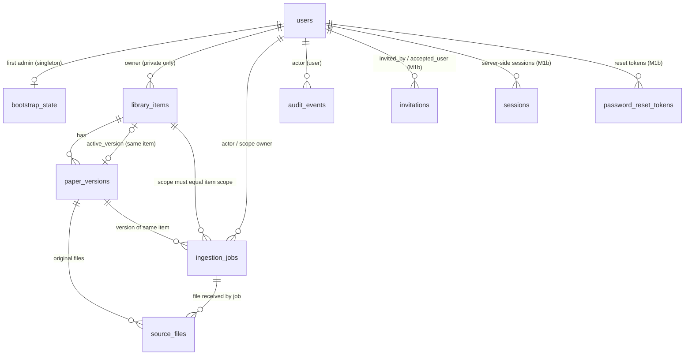

# Môi trường phát triển và schema (M1a–M1c)

[Mục lục](README.md) · [Mô hình dữ liệu](data-model.md) · [Roadmap](roadmap.md)

Tài liệu này mô tả phần **đã triển khai**: M1a (Compose dev, migration nền, bootstrap Admin), M1b (invite/session/CSRF/ACL) và M1c (upload intent, lưu/tải original private — xem [mục M1c](#upload-intent-và-original-m1c)). **Chưa** có worker, provider, search hay RAG. Compose chỉ dành cho dev, không phải cấu hình production.

**Cách kiểm chứng (2026-09-24):** Windows 11, Docker Desktop 28.4 (Compose v2.39, engine Linux), Windows PowerShell 5.1 và Git Bash. Mỗi lệnh dưới đây đã được chạy trong shell ghi kèm, trừ các chỗ ghi rõ **chưa chạy trực tiếp**. Lệnh không ghi shell chạy giống nhau ở cả hai. Chạy mọi lệnh từ **gốc repo**; Windows PowerShell 5.1 không có `&&`, nên tài liệu không dùng `cd … &&`.

Python trên host luôn là Conda env `ras` theo [AGENTS.md](../AGENTS.md), không tạo venv:

```powershell
# PowerShell
$py = "$env:USERPROFILE\.conda\envs\ras\python.exe"
```

```bash
# Git Bash
PY="$USERPROFILE/.conda/envs/ras/python.exe"
```

## Cấu trúc

| Thư mục | Nội dung |
| --- | --- |
| `api/` | FastAPI (`app/main.py`: `/healthz`, `/readyz` và router `auth`, `admin`, `library` trong `app/api/routes/`), model SQLAlchemy (`app/models/`), cấu hình tập trung (`app/config.py`), xác thực và quản lý phiên (`app/identity/`: `login.py`, `sessions.py`, `invitations.py`, `password_reset.py`, `users.py`, bootstrap), phân quyền (`app/authz.py`), CSRF/cookie (`app/api/`), delivery adapter (`app/delivery.py`), Alembic (`migrations/`), test (`tests/`) |
| `web/` | Next.js tối thiểu: `/login`, `/invite`, `/forgot-password`, `/reset-password`, thư viện `/` và `/items/[id]`, `/account` (phiên), `/admin` (lời mời, tài khoản, dev outbox). Route `app/api/[...path]` chuyển tiếp cùng origin tới `API_INTERNAL_URL`; web không giữ secret, không quyết định quyền |
| `docker-compose.yml` | `db` (PostgreSQL 16 + pgvector), `redis`, `minio`, `migrate` (one-shot), `api`, `web` |
| `.env.example` | Mẫu cấu hình, các secret để trống |

## Dựng môi trường

1. Tạo `.env` từ mẫu (file bị git-ignore):

   ```powershell
   Copy-Item .env.example .env      # PowerShell
   ```

   ```bash
   cp .env.example .env             # Git Bash
   ```

   Mở `.env` bằng editor và điền **mọi** giá trị trống (`POSTGRES_PASSWORD`, `REDIS_PASSWORD`, `MINIO_ROOT_PASSWORD`) bằng chuỗi ngẫu nhiên riêng, sinh bằng `& $py -c "import secrets; print(secrets.token_urlsafe(24))"` (PowerShell) hoặc `"$PY" -c "import secrets; print(secrets.token_urlsafe(24))"` (Git Bash). Nếu giá trị có `$`, `#` hoặc khoảng trắng, bọc trong nháy đơn, ví dụ `POSTGRES_PASSWORD='...'`: nháy đơn tắt nội suy biến và cú pháp comment của Compose (đã kiểm với mật khẩu chứa `@ : / ? # % $` và dấu cách). Giá trị không được chứa chính dấu nháy đơn. Các ký tự `@ : / ? %` không cần escape, vì ứng dụng không ghép mật khẩu vào URL (xem [kết nối DB](#kết-nối-database)). Thiếu giá trị bắt buộc thì Compose dừng với lỗi `required variable ... is missing a value`.

2. Build và chạy, chờ mọi healthcheck đạt:

   ```bash
   docker compose up -d --build --wait
   docker compose ps -a
   ```

   Service `migrate` chạy `alembic upgrade head` rồi thoát `Exited (0)`; `api` chỉ khởi động sau khi migrate thành công. Port chỉ bind `127.0.0.1`: API `8000`, web `3000`, PostgreSQL `5432`, MinIO console `9001` (đổi qua `*_HOST_PORT` trong `.env`). Redis không mở port ra host và yêu cầu mật khẩu.

3. Kiểm tra nhanh. Dùng `curl.exe` vì trong PowerShell 5.1, `curl` là alias của `Invoke-WebRequest`:

   ```bash
   curl.exe -s http://127.0.0.1:8000/healthz   # {"status":"ok"}
   curl.exe -s http://127.0.0.1:8000/readyz    # {"status":"ready"} khi DB đã migrate
   ```

   Trang `http://127.0.0.1:3000/login` hiển thị form đăng nhập; `curl.exe -s http://127.0.0.1:3000/api/library/items` trả `{"error":"not_authenticated"}` (proxy tới API hoạt động, khách không xem được metadata).

## Kết nối database

API, Alembic và lệnh bootstrap cùng đọc `Settings` trong `api/app/config.py`. Kết nối được truyền theo **từng thành phần** `RAS_DB__HOST`, `RAS_DB__PORT`, `RAS_DB__USER`, `RAS_DB__PASSWORD`, `RAS_DB__NAME` (Compose tự đặt từ `.env`), rồi dựng bằng `sqlalchemy.engine.URL.create()`. Nhờ vậy mật khẩu chứa ký tự phân cách URL vẫn đúng. Có thể dùng `RAS_DATABASE_URL` thay thế, nhưng phải là URL **đã percent-encode** (ví dụ `@` → `%40`). Đặt cả hai hoặc không đặt cái nào đều bị từ chối.

## Migration

- Chạy lại migration (no-op nếu đã ở head): `docker compose run --rm migrate`.
- Xem revision hiện tại: `docker compose exec -T api alembic current`.
- Tạo revision mới sau khi sửa model: chạy bên trong container để dùng sẵn kết nối DB, không phải gõ mật khẩu trên host. Bind-mount code hiện tại vào container:

  ```powershell
  # PowerShell
  docker compose run --rm -v ./api/app:/srv/api/app:ro -v ./api/migrations:/srv/api/migrations migrate alembic revision --autogenerate -m "mo ta"
  ```

  ```bash
  # Git Bash: MSYS_NO_PATHCONV ngăn Git Bash đổi /srv/... thành đường dẫn Windows
  MSYS_NO_PATHCONV=1 docker compose run --rm -v ./api/app:/srv/api/app:ro -v ./api/migrations:/srv/api/migrations migrate alembic revision --autogenerate -m "mo ta"
  ```

  Sau đó **đọc và sửa tay** file sinh ra: autogenerate không sinh trigger/extension và đặt sai thứ tự FK vòng. Test `test_orm_models_match_migrated_schema` bắt lệch giữa model và migration.

## Bootstrap Admin đầu tiên

Chạy **một lần** cho mỗi database. Không có tài khoản/mật khẩu mặc định; không có tùy chọn `--password`. Không đặt mật khẩu trong đối số, trong lệnh sẽ lưu vào history, hay trong file của repo.

**Tương tác (khuyến nghị):** CLI hỏi mật khẩu hai lần, không echo. Lệnh cần TTY, nên không thêm `-T`:

```bash
docker compose exec api python -m app.cli.bootstrap_admin --email admin@example.org
```

*Giới hạn kiểm chứng:* nhánh prompt đã được kiểm bằng pseudo-TTY bên trong container (không echo, tạo Admin thành công). Lệnh `docker compose exec` tương tác từ PowerShell/Git Bash **chưa chạy trực tiếp**, vì môi trường agent không có terminal tương tác. Nếu terminal báo không phải TTY, dùng cách không tương tác bên dưới.

**Không tương tác (`--password-stdin`):** mật khẩu được nhập ẩn vào một biến trong phiên shell, rồi pipe qua stdin; không có file tạm và không vào history.

```powershell
# PowerShell 5.1
$pw = Read-Host -AsSecureString "Admin password"
$OutputEncoding = [System.Text.UTF8Encoding]::new($false)   # bắt buộc nếu mật khẩu có ký tự ngoài ASCII
[System.Net.NetworkCredential]::new('', $pw).Password | docker compose exec -T api python -m app.cli.bootstrap_admin --email admin@example.org --password-stdin
Remove-Variable pw
```

```bash
# Git Bash
read -rs -p 'Admin password: ' RAS_ADMIN_PW; echo
printf '%s\n' "$RAS_ADMIN_PW" | docker compose exec -T api python -m app.cli.bootstrap_admin --email admin@example.org --password-stdin
unset RAS_ADMIN_PW
```

*Đã kiểm:* phần pipe của cả hai khối, trên DB tạm, với mật khẩu có ký tự `ü`: bootstrap thoát `0`, lần hai thoát `3`, verifier khớp đúng mật khẩu. Riêng dòng nhập `Read-Host -AsSecureString` / `read -rs` cần người gõ nên được thay bằng giá trị sinh sẵn. **Không bỏ dòng `$OutputEncoding`:** thiếu nó, PowerShell 5.1 pipe dạng ASCII và âm thầm đổi `ü` thành `?` (đã tái hiện), tức Admin nhận một mật khẩu khác với mật khẩu đã gõ. Không dùng cú pháp `< file` trong PowerShell: toán tử `<` không được hỗ trợ ở đó.

Mã thoát: `0` tạo thành công; `3` đã bootstrap (hoặc đã có user) — không tạo gì, ghi audit `denied`; `2` input không hợp lệ (mật khẩu < 12 ký tự, > 1024 ký tự, toàn khoảng trắng, trùng email, nhập lại không khớp, không có TTY mà thiếu `--password-stdin`, hoặc có đối số lạ — lỗi không in lại giá trị đối số); `1` lỗi khác (chỉ in tên loại lỗi).

## Xác thực, phiên và quyền (M1b)

Ba lớp tách riêng: **xác thực** (`app/identity/login.py`: email + mật khẩu Argon2id), **quản lý phiên** (`app/identity/sessions.py`: cấp, kiểm/cập nhật hoạt động, thu hồi session server-side) và **phân quyền** (`app/authz.py`: điều kiện ACL theo sở hữu item). Mọi request được bảo vệ đều kiểm session trong DB rồi mới tính quyền; Next.js chỉ hiển thị. Lý do các lựa chọn ở [decisions](decisions.md#ghi-nhận-khi-triển-khai-m1b-2026-09-24).

### Cấu hình

Thời hạn nằm ở `Settings.auth` (M1a): `RAS_AUTH__SESSION_IDLE` (mặc định `PT30M`), `RAS_AUTH__SESSION_ABSOLUTE` (`PT8H`), `RAS_AUTH__INVITE` (`PT72H`), `RAS_AUTH__PASSWORD_RESET` (`PT30M`). M1b thêm:

| Biến | Mặc định trong code (`Settings`) | Compose dev (đặt cứng) |
| --- | --- | --- |
| `RAS_ENVIRONMENT` | `production` (bắt buộc cookie Secure, cấm dev outbox) | `development` |
| `RAS_HTTP__COOKIE_SECURE` | `true` (cookie `__Host-ras_session`, `Secure`) | `false` (HTTP cục bộ, cookie `ras_session`) |
| `RAS_HTTP__ALLOWED_ORIGINS` | `[]` (JSON list; request ghi có `Origin` ngoài list bị từ chối) | `http://127.0.0.1:3000`, `http://localhost:3000` |
| `RAS_HTTP__PUBLIC_BASE_URL` | trống (bắt buộc khi có delivery) | `http://127.0.0.1:3000` |
| `RAS_DELIVERY__MODE` | `disabled` (không tạo được invitation) | `dev_outbox` |

`docker-compose.yml` là cấu hình **chỉ dành cho dev**: các giá trị trên được đặt cứng trong file (HTTP cục bộ, cookie không `Secure`, `dev_outbox`), không đọc từ `.env`, nên đặt biến môi trường trên host **không** biến stack này thành cấu hình HTTPS hay production. Cột “mặc định trong code” chỉ mô tả hành vi của `Settings` khi không có biến nào; repo chưa có cấu hình triển khai nào được kiểm chứng. **Dev outbox** giữ link mời/reset trong bộ nhớ tiến trình API, chỉ Admin đọc ở `/admin`; mất khi restart API và Admin xem được cả link reset của User.

### Trước khi đưa lên server

M1b **chưa** sẵn sàng triển khai ngoài máy dev. Điều kiện tối thiểu, đều chưa có trong repo:

1. Một cấu hình triển khai riêng (không dùng `docker-compose.yml` này), đã kiểm chứng, chạy sau HTTPS với cookie `Secure` (`RAS_ENVIRONMENT=production`, `RAS_HTTP__COOKIE_SECURE=true` — settings từ chối cookie không Secure khi `production`) và origin/`PUBLIC_BASE_URL` thật.
2. Không dùng `dev_outbox`; có delivery adapter cho kênh gửi invite/reset thật (kênh còn là quyết định mở).
3. Rate limit/khóa tạm cho login và yêu cầu reset.
4. Kiểm và xử lý **timing enumeration** của yêu cầu reset: hiện response cho email tồn tại và không tồn tại giống nhau về status/body, và việc gửi link chạy sau response, nhưng nhánh email tồn tại còn làm thêm việc DB (khóa dòng user, thu hồi token cũ, ghi token và audit), nên **chưa chứng minh** không phân biệt được qua thời gian phản hồi. Cần đo, rồi cân bằng (ví dụ xử lý nền cho cả hai nhánh) trước khi mở ra ngoài.

Theo dõi ở [decisions](decisions.md#cần-xác-nhận-hoặc-đo-trước-phần-phụ-thuộc).

### Luồng thử trên web

1. Bootstrap Admin như [mục trên](#bootstrap-admin-đầu-tiên), rồi mở `http://127.0.0.1:3000/login` và đăng nhập.
2. `/admin` → nhập email → **Gửi lời mời** (luôn là vai trò User, hết hạn 72 giờ). Mục **Dev outbox** hiện liên kết `http://127.0.0.1:3000/invite#token=…`.
3. Mở liên kết trong cửa sổ ẩn danh hoặc trình duyệt khác (để không dùng chung cookie của Admin), đặt mật khẩu, rồi đăng nhập ở `/login`.
4. Quên mật khẩu: `/forgot-password` luôn trả cùng thông báo; liên kết `/reset-password#token=…` xuất hiện ở dev outbox của Admin. Đổi mật khẩu xong, mọi phiên cũ của User bị thu hồi.
5. `/account` liệt kê và thu hồi phiên của chính mình; `/admin` vô hiệu hóa/kích hoạt tài khoản (vô hiệu hóa thu hồi mọi phiên ngay).

M1b không có đường nhập paper. Để thử ACL, thêm item metadata bằng **fixture SQL** (chỉ cho dev/test, không phải tính năng sản phẩm):

```powershell
# PowerShell 5.1: $OutputEncoding giữ đúng ký tự tiếng Việt khi pipe (như mục bootstrap)
$OutputEncoding = [System.Text.UTF8Encoding]::new($false)
"INSERT INTO library_items (visibility, title) VALUES ('common', 'Paper chung');
 INSERT INTO library_items (visibility, owner_user_id, title) SELECT 'private', id, 'Paper riêng của A' FROM users WHERE email = 'a@example.org';" | docker compose exec -T db sh -c 'psql -U $POSTGRES_USER -d $POSTGRES_DB'
```

```bash
# Git Bash
echo "INSERT INTO library_items (visibility, title) VALUES ('common', 'Paper chung');
 INSERT INTO library_items (visibility, owner_user_id, title) SELECT 'private', id, 'Paper riêng của A' FROM users WHERE email = 'a@example.org';" | docker compose exec -T db sh -c 'psql -U $POSTGRES_USER -d $POSTGRES_DB'
```

*Đã kiểm:* cả hai khối, trên DB dev (mỗi khối in `INSERT 0 1` cho item chung, `INSERT 0 0` khi chưa có `a@example.org`). Không bọc `$POSTGRES_USER` trong nháy kép ở PowerShell 5.1: nháy kép lồng trong đối số của lệnh native bị bỏ, làm hỏng lệnh `psql` (đã tái hiện).

*Smoke test trình duyệt (2026-09-24):* **Google Chrome 153.0.8010.53** chạy headless, điều khiển bằng Playwright 1.63 (cài trong Conda `ras`, chỉ là công cụ thử, không phải dependency của repo), trên stack Compose với DB vừa migrate trống. Mỗi người dùng một browser context riêng (cookie riêng). Đạt 11/11 bước:

1. Admin đăng nhập bằng form `/login` → vào thư viện, thanh điều hướng ghi “(Admin)”.
2. Sai mật khẩu → thông báo chung “Email hoặc mật khẩu không đúng.”, vẫn ở `/login`.
3. `/admin` → form **Gửi lời mời** → lời mời `pending`, link `/invite#token=…` hiện ở Dev outbox.
4. Mở link ở context khác → trang hiện email được mời, token bị xóa khỏi thanh địa chỉ; nhập tên, mật khẩu hai lần → “Đã tạo tài khoản”.
5. Mở lại cùng link → “Liên kết không hợp lệ, đã dùng hoặc đã hết hạn.”
6. User đăng nhập → thư viện (“(User)”, không có link Quản trị), mở chi tiết item chung, không có nút sửa.
7. User mở `/admin` → API trả forbidden, trang báo “Bạn không có quyền…”.
8. Nút **Đăng xuất** → về `/login`; mở lại `/` bị chuyển về `/login`.
9. `/forgot-password` với email có tài khoản và email không tồn tại → cùng một thông báo.
10. Dev outbox chỉ có link reset cho email có tài khoản.
11. Form `/reset-password` → “Đã đổi mật khẩu”; đăng nhập bằng mật khẩu cũ bị từ chối, mật khẩu mới vào được.

Console của Chrome chỉ ghi các response lỗi đúng dự kiến (401/400/403 của các bước sai quyền/sai mật khẩu/link đã dùng) và `404 /favicon.ico` (web chưa có favicon). *Giới hạn:* chạy headless trên Chrome cho Windows, chưa thử Firefox/Safari hay thiết bị di động; các form `/account` (thu hồi phiên), vô hiệu hóa/kích hoạt tài khoản ở `/admin` và sửa tiêu đề item **chưa** được thử bằng trình duyệt (chỉ có test API). Luồng API tương ứng cũng đã chạy qua proxy web bằng script HTTP — xem demo dưới.

### API

| Nhóm | Endpoint | Quyền |
| --- | --- | --- |
| Phiên | `GET /auth/csrf`, `POST /auth/login`, `POST /auth/logout`, `GET /auth/session`, `GET /auth/sessions`, `POST /auth/sessions/{id}/revoke`, `POST /auth/sessions/revoke-others` | login: khách; còn lại: session hợp lệ, chỉ phiên của chính mình |
| Lời mời | `POST /auth/invitations/inspect`, `POST /auth/invitations/accept` | người có token |
| Reset | `POST /auth/password-reset/request` (luôn `202`), `POST /auth/password-reset/confirm` | khách / người có token |
| Admin | `POST/GET /admin/invitations`, `POST /admin/invitations/{id}/revoke`, `GET /admin/users`, `POST /admin/users/{id}/disable|enable`, `GET /admin/dev-outbox` | Admin (khách `401`, User `403`) |
| Thư viện | `GET /library/items?scope=all|common|mine&limit&offset`, `GET /library/items/count`, `GET /library/items/{id}`, `PATCH /library/items/{id}` | session; lọc common + item riêng của chính mình trong SQL; item riêng trái quyền trả `404` như item không tồn tại |

Mọi `POST/PATCH/DELETE` cần header `X-CSRF-Token` bằng cookie `ras_csrf` (web tự gửi). Lỗi có dạng `{"error": "<code>"}`.

### Demo hai User đã chạy (2026-09-24)

Trên stack Compose (DB `0002`, trống), qua proxy web, bằng script HTTP: bootstrap Admin (`--password-stdin`) → Admin mời Alice và Bob → hai người nhận lời mời qua dev outbox (dùng lại link bị `400`) → thêm 1 item chung, 1 item riêng mỗi người bằng SQL fixture. Kết quả: Alice chỉ thấy item chung + của mình (count 2), Bob tương tự; Admin chỉ thấy item chung; Alice/ Admin `GET`/`PATCH` item của Bob đều `404` giống ID không tồn tại; Alice sửa item chung `403`, sửa item của mình `200`; Bob gọi route Admin `403`, khách `401`; `POST` thiếu CSRF hoặc `Origin` lạ `403`. Reset mật khẩu của Alice: phản hồi yêu cầu giống hệt với email không tồn tại, hai phiên cũ của Alice `401`, mật khẩu cũ bị từ chối. Bob logout → `401`; Admin vô hiệu hóa Bob → phiên đang mở `401` ngay. 13 secret (mật khẩu, token mời/reset/session) không xuất hiện trong log `api`/`web`/`migrate` hay trong các bảng invitation/session/reset/audit.

## Hạ môi trường

```bash
docker compose down      # dừng, giữ volume dữ liệu
docker compose down -v   # dừng và XÓA volume db/redis/minio (mất Admin đã bootstrap)
```

## Chạy test và build

Test API cần PostgreSQL của Compose (`docker compose up -d --wait db` là đủ). Mỗi test tạo database trống riêng `ras_test_*` (và role tạm cho test mật khẩu đặc biệt), rồi xóa sau khi chạy. Kết nối admin lấy từ `RAS_TEST_DATABASE_ADMIN_URL` (URL đã percent-encode); nếu không có thì đọc từng thành phần trong `.env` (`127.0.0.1:${POSTGRES_HOST_PORT:-5432}`, chấp nhận giá trị bọc nháy).

```powershell
# PowerShell
& $py -m pip install -e ".\api[dev]"     # một lần
& $py -m pytest api -q
npm ci --prefix web
npm run typecheck --prefix web
npm run build --prefix web
```

```bash
# Git Bash
"$PY" -m pip install -e "./api[dev]"     # một lần
"$PY" -m pytest api -q
npm ci --prefix web
npm run typecheck --prefix web
npm run build --prefix web
```

*Kết quả kiểm ngày 2026-09-24 (M1b):* `pytest api -q` → **181 passed** (PowerShell, Conda `ras`, Python 3.12); `npm run typecheck`/`npm run build` đạt; `docker compose up -d --build --wait` đạt với mọi service healthy và `alembic current` = `0002 (head)`, kể cả khi nâng DB dev đang ở `0001`. Test M1b chạy trên PostgreSQL thật với đồng hồ giả (`tests/helpers.py`) để kiểm biên idle 30 phút/absolute 8 giờ/invite 72 giờ/reset 30 phút; các ca đồng thời (hai request cùng token, login đua với reset) gọi service trong nhiều luồng. Kiểm đối chứng: bỏ điều kiện `owner_user_id` khỏi `visible_items_clause` làm 9 test ACL thất bại.

## Upload intent và original (M1c)

Mở `http://127.0.0.1:3000` bằng tài khoản User. Form upload hiển thị thông báo xử lý ngoài trả từ `GET /uploads/notice`, checkbox rỗng cho mỗi lần upload. UI tính size/SHA-256 trên file đã chọn, gọi `POST /uploads/intents` với xác nhận/notice version và metadata, rồi mới `PUT /uploads/original` với raw file. PDF tối đa 30 MiB/100 trang, Markdown tối đa 2 MiB (`Settings.files`). API kiểm bytes thực, UTF-8 Markdown hoặc PDF hợp lệ/số trang, chưa trích text hay gọi OpenRouter. Item mới private, `metadata_only`, job `received`. Trang item cho chủ sở hữu xem job, metadata và link tải original. Link `/api/files/{id}/original` qua API quyền mỗi lần; User khác và Admin nhận `404` cho file riêng.

Next.js có hai route streaming riêng cho upload/download, chuyển tiếp stream tới FastAPI cùng cookie, Origin và CSRF. Proxy `/api/[...path]` vẫn dùng cho JSON nhỏ. S3 adapter dùng MinIO dev ở `http://minio:9000`; host port mặc định `127.0.0.1:9000` dành cho test. Object key không trả ra client. Intent hết hạn sau 10 phút, gắn đúng User/session/file/notice; race được khóa dòng trong PostgreSQL. Migration `0003` tạo bảng acknowledgement/intent; `0004` thêm item key và FK kép giữ job/version cùng item kể cả khi có giao dịch đồng thời.

Nếu put object thành công nhưng DB commit lỗi, API kiểm `SourceFile` rồi chỉ xóa object chưa có tham chiếu. Nếu tiến trình crash hoặc DB không thể xác nhận kết quả commit, object không có record không thể mở qua API. Sau khi bảo đảm không có upload cũ còn chạy, dọn orphan quá 24 giờ (mặc định `Settings.files.orphan_grace`) bằng:

```powershell
docker compose exec api python -m app.cli.reconcile_originals
```

Kiểm suite dùng Conda `C:\Users\ADMIN\.conda\envs\ras` và PostgreSQL/MinIO thật. Script demo HTTP qua Next.js tạo ba tài khoản fixture dev mới (mật khẩu ngẫu nhiên, không in ra), item metadata chung, rồi Admin sửa metadata chung, A xác nhận/upload PDF gần 30 MiB/tải lại checksum, B và Admin thử list/ID/URL private:

```powershell
& "$env:USERPROFILE\.conda\envs\ras\python.exe" scripts/demo_m1c_stack.py
```

Ngày 2026-09-24, `pytest api -q` trên Conda `ras` đạt **193 passed** (1 cảnh báo deprecation từ Starlette/TestClient); `npm run typecheck`/`npm run build` và `docker compose up -d --build --wait` đạt, revision dev `0004 (head)`. Script HTTP đạt với PDF **30.409.152 byte** qua route streaming; A tải lại đúng SHA-256, B/Admin nhận `404` với item/file riêng, Admin sửa metadata chung `200`.

### Smoke test form M1c bằng Chrome thật

**Google Chrome 153.0.8010.53 headless**, Playwright **1.63.0** có sẵn trong Conda `ras`, Windows 11, stack Compose dev healthy. Chạy từ gốc repo:

```powershell
& "$env:USERPROFILE\.conda\envs\ras\python.exe" scripts/smoke_m1c_browser.py
```

Script tạo hai User fixture với email/mật khẩu ngẫu nhiên trong DB dev; cả hai đăng nhập qua form UI, mỗi người một browser context/cookie riêng. File Markdown thử là dữ liệu tổng hợp. Các thao tác upload/download và kiểm quyền đều qua Chrome; Playwright chỉ quan sát method/path, status và thứ tự request, không ghi header/body/token, screenshot, trace hay file tải về lâu dài. **Kết quả: 6/6 đạt.**

| Trường hợp | Quan sát trong Chrome |
| --- | --- |
| 1. Trạng thái đầu | Checkbox ban đầu không chọn; sau chọn file mới được bật. |
| 2. Không xác nhận | Nút upload bị vô hiệu hóa; không có `POST /api/uploads/intents` hay `PUT /api/uploads/original`. |
| 3. Intent thất bại | Playwright cho UI nhận notice version cũ qua `GET notice`; `POST intent` thực tới API trả `409`. UI hiển thị thông báo notice đã đổi; không có `PUT file`. |
| 4. Thứ tự thành công | Một `POST intent` trả `201` và sự kiện `requestfinished` xảy ra trước sự kiện bắt đầu `PUT file`; `PUT` trả `201`. |
| 5. Reset xác nhận | Checkbox vẫn rỗng khi không xác nhận, và trở lại rỗng sau lần intent lỗi lẫn lần upload thành công. |
| 6. Quyền file | A mở trang item, bấm link original và tải file đúng SHA-256 trong trình duyệt; B mở trực tiếp ID item thấy “Không tìm thấy”, mở URL file nhận `404 not_found`. |

**Giới hạn:** đây là Chrome headless trên Windows, chưa thử Chrome headed, Firefox/Safari, mobile hoặc throttling mạng. Ca UI dùng Markdown nhỏ; PDF gần 30 MiB đã được thử qua HTTP client/proxy ở trên. Tài khoản fixture và item thử còn trong DB dev; không dùng dữ liệu người dùng thật. Chưa có lịch chạy reconcile tự động, quan sát multipart orphan hoặc cấu hình production.

## Lựa chọn kỹ thuật ảnh hưởng M1b/M1c

- **Kết nối DB theo thành phần** (`RAS_DB__*` → `URL.create`) thay vì ghép URL, để mật khẩu có `@`, `%XX` hay tổ hợp ký tự phân cách không bị parse sai. M1b/M1c (và worker M2) phải lấy engine qua `app.db`/`Settings.sqlalchemy_url()`, không tự dựng chuỗi kết nối.
- **Alembic + SQLAlchemy 2 + psycopg 3.** Migration viết tay, có kiểm tự động model ↔ schema, downgrade về base và nâng lại. M1b/M1c thêm revision mới (`0002`, …) thay vì sửa `0001`.
- **Trạng thái/loại là `text` + `CHECK`**, không dùng PostgreSQL ENUM: thêm giá trị ở PR sau chỉ cần thay constraint, không vướng `ALTER TYPE` trong transaction.
- **Argon2id (argon2-cffi, tham số mặc định RFC 9106 low-memory)**, lưu chuỗi PHC trong `users.password_verifier`. DB có `CHECK` chỉ nhận `$argon2id$...` nên không thể lưu plaintext. Login M1b dùng `verify_password`/`needs_rehash` trong `app/identity/passwords.py` (rehash khi tham số đổi); accept invitation và reset dùng cùng `validate_password`/`Settings.password`.
- **Bootstrap đồng thời:** advisory lock giao dịch + hàng singleton `bootstrap_state` (khóa chính boolean chỉ nhận `true`) ghi cùng giao dịch với Admin; bootstrap cũng từ chối khi đã có bất kỳ user nào. Test 8 luồng đồng thời chỉ tạo đúng một Admin.
- **Cấu hình tập trung** ở `app/config.py` (`RAS_` prefix, nested `__`): thời hạn session/invite/reset, giới hạn file, ngưỡng PDF, cleanup/backup, budget ứng dụng và key cap. Phần lớn chưa được code dùng tới trước M1b–M3 nhưng đã có test giá trị mặc định/biên, để PR sau không hardcode rải rác.
- **Audit append-only** bằng trigger (chặn UPDATE/DELETE/TRUNCATE); `details` chỉ chứa định danh/mã lý do. Việc purge theo retention (M6) phải qua migration có review.
- **MinIO image** lấy từ `quay.io/minio/minio` (pin tag): Docker Hub không còn phục vụ `minio/minio` (lỗi `pull access denied` khi kiểm ngày 2026-09-24).

## Schema nền



| Bảng | Ràng buộc chính trong DB |
| --- | --- |
| `users` | email lưu dạng chuẩn hóa (lower/trim) + unique; `role ∈ {admin,user}` mặc định `user`; `status ∈ {active,disabled}`; verifier bắt buộc Argon2id; `password_changed_at` để M1b vô hiệu session sau reset |
| `bootstrap_state` | tối đa một hàng (`id = true`), trỏ Admin đầu tiên |
| `library_items` | `private` ⇔ có `owner_user_id`, `common` ⇔ không; visibility/owner **bất biến** (trigger) — promotion tạo item chung mới; `content_status ∈ {metadata_only, indexed}` mặc định `metadata_only`; `indexed` cần `active_version_id`, và version đó phải thuộc chính item (FK kép); `rights_epoch` cho thu hồi |
| `paper_versions` | thuộc một item; `coverage ∈ {complete,partial,none}`; khóa `(id, item_id)` làm đích FK kép |
| `source_files` | gắn version hoặc job; khi có cả hai, `item_id` và hai FK kép buộc cùng item (`0004`); MIME đã xác minh ∈ {PDF, Markdown}; `byte_size > 0`; SHA-256 hex; các cột định danh **bất biến** (trigger), `version_id`/`job_id`/`page_count` chỉ điền một lần từ NULL; `storage_key` không unique vì một object vật lý có thể phục vụ nhiều item hợp lệ; khóa `(id, version_id)` cho AccessRights |
| `ingestion_jobs` | `origin`/`state` theo [kiến trúc](architecture.md#pipeline-và-trạng-thái), mặc định `received`; scope `private`⇔owner; `upload` luôn private; scope phải trùng scope của item (trigger); version phải thuộc item (FK kép); `idempotency_key` unique trong scope (`NULLS NOT DISTINCT` cho kho chung); `cancel_requested` nhất quán với `cancel_requested_at`; `rights_epoch_at_start` |
| `audit_events` | append-only; `actor_type='user'` ⇔ có `actor_user_id`; `outcome ∈ {success, denied, failure}` |
| `invitations` (M1b, `0002`) | `token_hash` SHA-256 hex unique (không lưu token thô); email chuẩn hóa; không có cột vai trò (accept luôn tạo `user`); `accepted_at` ⇔ `accepted_user_id`, không vừa accepted vừa revoked; partial unique: tối đa một lời mời mở mỗi email |
| `sessions` (M1b) | `token_hash`, `csrf_token_hash` SHA-256 hex; `last_activity_at`, `absolute_expires_at`; `revoked_at` ⇔ `revoked_reason ∈ {logout, replaced, user_revoked, password_reset, user_disabled}` |
| `password_reset_tokens` (M1b) | `token_hash` SHA-256 hex unique; không vừa used vừa revoked; partial unique: tối đa một token mở mỗi user |

Mọi FK dùng `ON DELETE RESTRICT`: xóa/thu hồi đi qua tombstone và cleanup (M6), không cascade ngầm. Extension `vector` được tạo sẵn nhưng chưa có cột vector — số chiều phải kiểm khi tích hợp model (M3).

Các bảng M1b và M1c không có server default cho thời điểm intent/acknowledgement: API ghi từ đồng hồ ứng dụng để test expiry ở biên. M1c thêm `processing_acknowledgements`, `upload_intents` ở `0003`; `SourceFile` có cả `job_id` và `version_id` phải cùng item (`0004`: hai FK kép), và không được đổi item của job/version sau khi gắn file.

### Dành cho PR sau (chưa có trong migration `0001`–`0004`)

M1b đã thêm `invitations`, `sessions`, `password_reset_tokens` ở revision `0002`; M1c thêm acknowledgement/intent và ràng buộc file ở `0003`/`0004`.

| PR | Bảng/khóa sẽ thêm | Điểm nối đã chuẩn bị |
| --- | --- | --- |
| M2 | `step_attempts`, `sections`, `chunks`, `references`; trạng thái coverage chi tiết | `ingestion_jobs.state/attempt_count/warnings`, `paper_versions.coverage`; ngưỡng trong `Settings.pdf_body` |
| M3 | `embeddings` (pgvector theo model/dimensions), active index pointer, `provider_usage` | extension `vector`; `Settings.budget` |
| M5–M6 | `access_rights`, `discovery_*`, `promotion_requests`/`review_grants`, `deletion_tombstones`, backup manifest | khóa `(paper_versions.id, item_id)`, `(source_files.id, version_id)`, `checksum_sha256`, `library_items.rights_epoch`, `ingestion_jobs.cancel_requested` |
