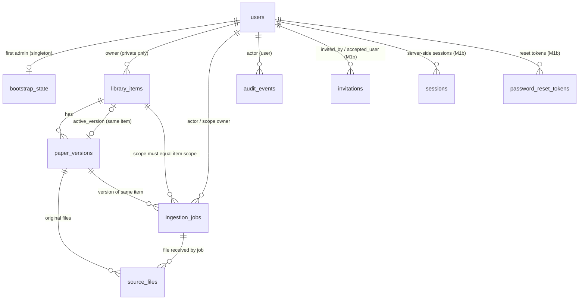

# Môi trường phát triển và schema

**C4 đã kiểm cô lập, source `0051`, chờ review:** [Runbook C4](c4-integrated-runtime-cutover.md) chốt migrate/provision/init mới, hold trước upgrade/restore và kiểm runtime readiness. Compose cần credentials runtime/recovery riêng, cùng image cho các Python service. Không áp các lệnh này lên dev trong task; các lệnh/kết quả phía dưới giữ lịch sử theo source đã ghi. Pricing thật vẫn tắt.

**Discovery runtime C2d-5f2, source `0046`, chờ review:** [handoff/inventory](c2d5f2-discovery-runtime.md) giữ lệnh thực chạy và kết quả. Entrypoint `python -m app.cli.sync_arxiv` dùng runtime từ `RAS_DB__*`, không endpoint tùy ý. `--force` chỉ bỏ lịch poll thành công, không bỏ lease/pacing/backoff/Retry-After/gate. Exit 0 completed/bound/disabled, 1 error/halted, 2 config thiếu, 3 busy. Direct và `ras.discovery.sync` cùng boundary; demo owner M5a đã retired. Migration/provision chỉ trên môi trường được giao, không tự nâng dev. Safety pending tới C4; CLI production pending vẫn đóng.

**Hiện hành 2026-10-11:** PR #55 đã merge `e6b5991`, source `0045`, không suy revision DB dev; safety pending tới C4. [Kế hoạch MVP](mvp-delivery-plan.md) và [task C2d-5f2](tasks/m6c2b2c2d5f2-discovery-runtime.md) mới giao tài liệu, chưa có lệnh hay kết quả kiểm vận hành mới. Các trạng thái OPEN và lệnh kiểm phía dưới giữ lịch sử theo source; không khắc phục stack dev bằng tắt gate pending.

**Review PR #55 tại `bca5d90`: không phát hiện điểm chặn merge mới trong phạm vi citation reconcile runtime.** Reviewer thực chạy **121/121 pass** (119 ca repo + hai smoke Linux CLI/Celery SIGKILL); đối chiếu riêng **313 artifact hash**, agent **1.203 unique pass / 3.534 not-run**, 327 source hash và 10 countercheck. PR **OPEN, chưa merge**, source `0045`, **safety pending tới C4**. [Môi trường thử và cleanup](reviews/pr55-c2d5f1-citation-reconcile-runtime.md). Không có lệnh vận hành dev mới. Chín container có sẵn giữ ID/image; worker/beat RestartCount 1107 → 1111 và StartedAt đổi trong lúc review, chưa xác định nguyên nhân.

PR #54 đã merge `37edd5c9`, source `0045`; merge tree khớp `cf66f1c`, chưa rerun tại merge. C2d-5f1 citation runtime đã triển khai trên nhánh review (chưa merge): [handoff](c2d5f1-citation-reconcile-runtime.md); discovery harvesting là C2d-5f2. Lệnh đã chạy chỉ trong môi trường cô lập (mục dưới); không có lệnh vận hành dev mới, lệnh backfill owner cũ đã superseded. Safety pending tới C4; các hướng dẫn/lượt kiểm dưới đây giữ theo source lịch sử, không là chứng nhận dev/cutover.

## C2d-5f1 citation reconcile cô lập

Chỉ chạy với PG/MinIO/Redis/journal/role cô lập, context ngoài repo; không đọc `.env`, không chạm stack dev. Lệnh đã chạy (PowerShell, `$py` là Python Conda `ras`):

```powershell
& $py scripts/c2d5f1_test_host.py --context <ctx ngoài repo> setup
& $py scripts/c2d5f1_test_host.py --context <ctx> test api/tests/test_c2d5f1_citation_runtime.py api/tests/test_c2d5f1_worker_hooks.py -q
docker build -q -t rasc2d5f1-worker:20261010 api   # cho test_c2d5f1_process_smoke.py; gỡ tag sau
& $py scripts/c2d5f1_counterchecks.py --context <ctx> --out <thư mục ngoài repo>
& $py scripts/c2d5f1_seal.py --context <ctx> --name <tên lượt>
```

Backfill citation chỉ chạy bằng login runtime đã provision và gate mở: `python -m app.cli.reconcile_citations` (exit 0 hết/bound/busy, 1 halted, 2 thiếu cấu hình) hoặc task `ras.citations.reconcile`. Trước C4 gate production luôn `auth_safety_pending`, nên chỉ chạy được trong môi trường thử có cutover scoped. Kết quả và giới hạn: [handoff](c2d5f1-citation-reconcile-runtime.md).

## C2d-5e2 orphan reconcile cô lập

Chỉ môi trường thử cô lập, không `.env`/dev: `& $py scripts/c2d5e2_test_host.py --context <thư mục ngoài repo> setup` rồi `… test <pytest args>`; countercheck `& $py scripts/c2d5e2_counterchecks.py --context <ctx> --out <thư mục mới>`; seal `& $py scripts/c2d5e2_seal.py --context <ctx> --name <tên mới>`. Smoke CLI Linux cần tag image thử `rasc2d5e2-cli:20261010` (tag của `rasc2d5d2a-worker:20261009`, gỡ sau lượt). Runbook vận hành ở [handoff](c2d5e2-orphan-original-reconcile-runtime.md#runbook-quiescence-điều-kiện-vận-hành-hiện-hành); lệnh chưa chạy trên stack dev. Safety pending tới C4.

*(Lịch sử khi giao, đã được thay bởi mục trên.)* **PR #53 đã merge `b2e76edb`, source `0044`; [C2d-5e2 reconcile orphan runtime](tasks/m6c2b2c2d5e2-orphan-original-reconcile-runtime.md) mới giao tài liệu, chưa triển khai/kiểm.** CLI reconcile hiện hành vẫn legacy; các lệnh M1c/M6b bên dưới là lịch sử, chưa chứng nhận runtime/cutover. Task mới phải cập nhật runbook: dừng writers, settle mọi attempt/SDK/DB thread cũ rồi mới dọn; grace không chứng minh quiescence. Pending/hold vẫn chặn runtime, không dùng owner/recovery fallback. Không thêm lệnh mới chưa chạy; không thao tác stack dev trong task. Safety pending tới C4.

## C2d-5e1 cleanup runtime cô lập

[Handoff](c2d5e1-revoked-common-cleanup-runtime.md) · [Inventory](c2d5e1-test-inventory.json). Conda ras, context ngoài repo, project/cổng sinh riêng (`scripts/c2d5e1_test_host.py --context <ctx> setup`, rồi `test <pytest args>`), explicit env-file rỗng; không `.env`/dev/provider. Smoke worker+beat dùng tag thử `rasc2d5e1-worker:20261010` tạo từ image dependency có sẵn, source mount read-only. Migration 0044 cần provision lại login roles (`app.db_roles.provision`) hoặc khối DO trong migration cấp quyền cho role đã provision. `python -m app.cli.cleanup_revoked` nay chỉ chạy với login runtime + gate mở; Compose mặc định (owner) bị từ chối. Source `0044` không là revision DB dev. Safety pending tới C4.

## C2d-5d2b document runtime cô lập

[Handoff](c2d5d2b-document-index-runtime.md) · [Inventory](c2d5d2b-test-inventory.json). Chỉ Conda ras, context ngoài repo, project/cổng sinh riêng và explicit env-file rỗng; không đọc `.env`, dev hoặc provider thật. Setup/migrate/provision chạy trên host; worker/beat chỉ nhận runtime credentials. `scripts/compose.worker-runtime.yml` vẫn tắt pricing/key; fake transport và bản Settings bật pricing nằm trong test harness, không switch production. Source `0043` không là revision DB dev. Các lệnh/kết quả đã thực chạy và cleanup nằm trong inventory; không dùng chúng để mở cutover. Safety pending tới C4.

**Lịch sử tại lúc giao C2d-5d2b:** [prompt document embedding/index runtime](tasks/m6c2b2c2d5d2b-document-index-runtime.md). Không có lệnh triển khai/kiểm mới được chứng nhận trong lượt giao. PR #51 đã merge `9fb8890`, source `0042`; không suy revision DB dev hoặc áp override vào dev. Safety pending tới C4.

**C2d-5d2a:** [handoff worker runtime/extraction](c2d5d2a-worker-runtime-extraction.md), [selection/JUnit/hash](c2d5d2a-test-inventory.json). Code `dfca84a`, source `0042`, không migration/grants mới. Compose mặc định còn truyền `POSTGRES_USER` cho API/worker/beat; runtime check sẽ từ chối owner. Không áp override/restart dev hoặc tuyên bố mặc định đã cutover; safety pending tới C4.

## C2d-5d2a cô lập

Host chỉ Conda `C:\Users\ADMIN\.conda\envs\ras\python.exe`. Runner `scripts/c2d5d2a_test_host.py --context <thư mục ngoài repo> setup` tạo project ngẫu nhiên `rasc2d5d2a*`, PostgreSQL/MinIO/Redis port cao riêng và credentials bên ngoài repo. Lệnh này đã chạy với context `%TEMP%\ras-c2d5d2a-20261009-run`; project `rasc2d5d2acb44053b`. Test chạy bằng cùng script với action `test <node/file> -q --junitxml=<ngoài repo>`; selection/argv thật ở inventory. Không dùng `.env`; env thử luôn tường minh. Setup/provision owner chỉ ở host/fixture gắn nhãn, worker không có credential đó.

Smoke `test_c2d5d2a_process_smoke.py` đã thực chạy Compose gốc + `scripts/compose.worker-runtime.yml` + overlay thử ngoài repo, explicit `--env-file`/project/network; runtime credentials bắt buộc `RAS_WORKER_RUNTIME_USER`/`RAS_WORKER_RUNTIME_PASSWORD`, không default. Image thử dựng bằng lệnh đã chạy `docker build -t rasc2d5d2a-worker:20261009 api` (PowerShell wrapper trả 1 nhưng raw build hoàn tất; image ID kiểm riêng). Source app mount read-only; identity/permissions và UUID payload ghi từ worker/beat. Chỉ schedule extraction trong harness; Redis thật stop/start. Key provider trống, pricing false; harness chặn egress ngoài PG/MinIO/Redis. Đừng dùng cấu hình này làm chứng nhận discovery/reconcile/cleanup runtime hoặc C4; phần business của ba task đó còn legacy.

Tám đối chứng đã chạy tuần tự qua `scripts/c2d5d2a_counterchecks.py --context <context thử>` bằng Conda, XML/log riêng và khôi phục đúng bytes trước suite cuối. Raw preparation, manifest source/JUnit và lỗi/not-run ngoài repo; không commit paper/journal/secret. Bốn lỗi baseline PR #50 giữ debt riêng. Không web/proxy thay đổi, không Chrome/npm ở task này.

**Mốc merge hiện hành:** PR #51 đã merge `9fb8890`, head migration `0042`; không suy revision DB dev. [C2d-5d1 HTTP index request](c2d5d1-common-index-request.md) đã merge; lệnh/kết quả cô lập ở mục dưới. Extraction worker C2d-5d2a ở handoff trên đã merge; index/provider tiếp C2d-5d2b. **Safety pending tới C4**, readiness dev đóng không phải lý do tự mở cutover. Các lệnh/kết quả dưới đây giữ theo task/source đã ghi.

## C2d-5d1 cô lập

[Handoff](c2d5d1-common-index-request.md) · [Inventory](c2d5d1-test-inventory.json). Conda `C:\Users\ADMIN\.conda\envs\ras\python.exe`; PostgreSQL `127.0.0.1:58579`, MinIO `59579`, label `ras.task=c2d5d1-20261009`; socket API `58589`/Next `53589`/Chrome installed headless. Runner ngoài repo (`run.py`) đặt explicit admin/runtime/recovery/storage và key provider trống trước import, chặn HTTP ngoài; không đọc `.env`, không chạm stack dev. Lệnh đã chạy: `python run.py <tests> -q --junitxml=...` từ gốc repo, `npm test|run typecheck|run build --prefix web`. Pytest rootdir là `api/`: `--deselect` dùng node ID `tests/...`. Không migration mới; source `0042`. **Safety pending tới C4.**

## C2d-5c2 cô lập

[Handoff](c2d5c2-common-revoke.md) · [Inventory commands/JUnit/source](c2d5c2-test-inventory.json). Conda hiện có `C:\Users\ADMIN\.conda\envs\ras\python.exe`; PostgreSQL `127.0.0.1:58479`, MinIO `59479`, label `ras.task=c2d5c2-20261009`; socket API `58489`/Next `53489`/Chrome installed headless. Credentials/journal/evidence ngoài repo, explicit admin/runtime/recovery/storage trước import, provider keys trống và chặn HTTP ngoài; không fallback `.env` hoặc dev. Migration source `0042`, không suy revision DB dev. HTTP revoke qua runtime, fixtures operator/corruption dùng engine riêng có nhãn; cleanup/recovery/worker chưa chuyển boundary. Normal proxy revoke 15 s; không thêm pool/deadline/config. Business cutover scoped, pending HTTP không patch; safety pending tới C4. Các lệnh Compose dev và kết quả lịch sử bên dưới không là lệnh môi trường thử này.

Kiểm cuối gồm 528 ca tại `964b9f6` và một Chrome publish tại `30cb729`, chỉ test
Chrome đổi để gọi fixture runtime qua executor ngoài event loop Playwright sync.
Vòng bổ sung dùng socket API `58486`/Next `53486`; source production/shared fixtures
giữ nguyên. Tổng cleanup hai vòng: 4 container/4 volume, hai bộ ba file credentials;
9 baseline giữ nguyên theo các mốc metadata đã ghi trong inventory.

## C2d-5c2 — mốc giao trước triển khai (lịch sử)

PR #48 đã merge `1eede17` ngày 2026-10-09; source AST head `0041`, không query revision DB dev. [Prompt revoke](tasks/m6c2b2c2d5c2-common-revoke.md) chưa triển khai hoặc có lệnh runtime mới được kiểm. Cần môi trường thử PostgreSQL/MinIO/journal/credentials riêng, explicit test URLs trước import, Conda ras, không đọc `.env` hay migrate/restart dev. Không cập nhật runbook vận hành bằng lệnh chưa chạy. Safety pending tới C4; provider/pricing không đổi. Kết quả/lệnh các mốc bên dưới giữ thời điểm lịch sử.


## C2d-5b cô lập

Host Conda `C:\Users\ADMIN\.conda\envs\ras\python.exe` (interpreter/pip đã kiểm), PostgreSQL riêng `127.0.0.1:58475`, MinIO riêng `127.0.0.1:59475`, label `ras.task=c2d5b-20261007`; credentials generated ngoài repo, đặt `RAS_TEST_DATABASE_ADMIN_URL`, `RAS_STORAGE__*`, `RAS_C1_*` trước import fixture, không fallback `.env`. Restore C2c2 dùng container riêng `58442` (label lịch sử bắt buộc + owner C2d-5b). Proxy smoke: Uvicorn `58476`, Next `53476`, Chrome headless đã cài; `npm run build --prefix web` trước smoke. Wrapper/evidence ngoài repo `%TEMP%/ras-c2d5b-20261007` (`run.py`, `final_runs.py`, `mutants.py`); lệnh/kết quả thực chạy trong [inventory](c2d5b-test-inventory.json). Biến mới: `RAS_FILES__APPROVAL_COPY_MAX_CONCURRENT` (2), `RAS_FILES__APPROVAL_COPY_DEADLINE_SECONDS` (90), `WEB_PROXY_REVIEW_APPROVAL_TIMEOUT_SECONDS` (120) — giá trị đề xuất cần đo. Không dev DB/restart/provider/pricing/readiness. Safety pending tới C4.

## C2d-5a cô lập

Đã chạy host Conda `C:\Users\ADMIN\.conda\envs\ras\python.exe`, PostgreSQL riêng `127.0.0.1:58467`, MinIO riêng `127.0.0.1:59467`; credentials generated ngoài repo, explicit `RAS_TEST_DATABASE_ADMIN_URL` và C1 runtime/recovery passwords trước import. Không `.env`/dev/provider/pricing/readiness. Proxy thử Uvicorn `58468`, Next `53467`, Chrome headless hiện có. Script wrapper/evidence ngoài repo ở `C:\Users\ADMIN\AppData\Local\Temp\ras-c2d5a-20261007`; xem [inventory](c2d5a-test-inventory.json) cho lệnh thực chạy, source/hash/JUnit/cleanup. Đây là run đã kiểm cô lập, không runbook cutover hoặc cấp credentials privileged cho API. Safety pending tới C4.

**PR #45 đã merge `070cb37` (2026-10-07 Asia/Saigon), source `0039`.** [C2d-5a ba JSON review writer](tasks/m6c2b2c2d5a-review-json-writers.md) đã giao, chưa triển khai/chưa kiểm; routine runtime/migration mới và lệnh mới phải có chứng cứ trước thêm runbook. Không suy revision DB dev hoặc mở safety pending tới C4; các lệnh/kết quả C2d-4c dưới đây giữ theo source thử trước merge.

**Sau merge PR #44 (2026-10-06):** main `dd8bdc6`, source migration `0039`, không query DB dev. [Task C2d-4c original downloads](tasks/m6c2b2c2d4c-original-downloads.md) đã triển khai trên nhánh review (code `4c49919`, [handoff](c2d4c-original-downloads.md), [inventory](c2d4c-test-inventory.json)), chưa merge; không có lệnh vận hành dev mới. Chỉ dùng runtime/PostgreSQL/MinIO/journal cô lập với credentials tường minh; không đọc `.env` hoặc nâng/restart dev. Safety pending tới C4. Các lệnh và trạng thái review dưới đây là evidence lịch sử, không suy dev sẽ healthy.

## C2d-4c cô lập

Source code chốt `4c49919203db085dacd0778b3ce62e6787fd3823`, base `dd8bdc6`; [handoff](c2d4c-original-downloads.md) và [inventory](c2d4c-test-inventory.json) là chứng cứ hiện hành. Python/pip đã kiểm đúng Conda ras; không cài hoặc tạo venv. Evidence ngoài repo `%TEMP%/ras-c2d4c-20261006`, journal riêng trong thư mục test tạm ngoài repo. PostgreSQL `pgvector/pgvector:pg16` tại 58457, MinIO `RELEASE.2025-09-07T16-13-09Z` tại 59457, label `ras.task=c2d4c-20261006`; chỉ bind 127.0.0.1. Mọi credentials DB/MinIO thử cấp tường minh trước import fixture, không fallback `.env`.

Đã chạy host runner ngoài repo qua `& $py <evidence>/run.py <các file/node trong selection inventory> -q --tb=short -s --junitxml=<evidence>/final-api.xml`; orchestration `final.py` ghi source hashes trước/sau, đối chiếu selected/unique JUnit/missing/extra/duplicate. Đối chứng `mutants.py` chạy nối tiếp trước suite cuối, restore byte/hash từng guard. Runner chặn HTTP ngoài local; không khởi động worker/beat/provider. `npm test --prefix web`, `npm run typecheck --prefix web`, `npm run build --prefix web` ghi log riêng. Socket smoke khởi động Uvicorn 58458 và Next 53457 bằng fixture, stop cả hai trong finally; Chrome headless dùng bản đã cài, không tự tải trình duyệt.

Auth/GET/audit runtime thật; chỉ resource setup/corruption và POST của legacy fixture chưa chuyển đổi dùng engine đặc quyền cô lập. Không thêm grants hoặc chứng nhận các writer đó runtime-ready. Pending HTTP giữ gate thật đóng. Các lệnh trên là kiểm chứng cô lập, không lệnh mở dev/cutover; các số cũ bên dưới giữ theo source lịch sử. Cleanup có metadata ownership/mount/sole-consumer và đối chiếu tài nguyên có sẵn trong inventory; giữ journal/JUnit/log ngoài repo, xóa credentials thử sau suite.

## Review lại P2 PR #44 cô lập

[Report và giới hạn](reviews/pr44-c2d4b-upload-original.md#review-lại-p2-tại-5504810): head `5504810`, code `adfdb72`, 76 API chọn pass độc lập và hai ca fault/control riêng pass; không phát hiện điểm chặn merge scope C2d-4b. Web không đổi, không chạy lại. PR chưa merge, safety pending tới C4.

Conda ras interpreter/pip đã xác minh; evidence `%TEMP%/ras-pr44-p2-review-20261006`. PostgreSQL port 58457, MinIO 59457, label `ras.task=pr44-p2-review-20261006`, credentials tường minh; chỉ HTTP local. Chạy `& $py <evidence>/runner.py <các node chọn ghi trong report> -q --basetemp=<evidence>/pytest --junitxml=<evidence>/review-p2.xml`; `uncertain-close-repro.py`/`uncertain-close-control.py` chạy riêng đúng node fixture ghi trong script. `artifact_checks.py` đối chiếu 463 artifact agent và 262 hash; đây là công cụ kiểm ngoài repo, không là lệnh vận hành dev. Đã gỡ đúng 2 container/2 exclusive volume và xóa 3 file credentials sau ownership checks; 24 container có sẵn giữ nguyên ID/image/StartedAt. Các mục dưới giữ evidence những lượt trước.

## P2 PR #44 cô lập

Source `adfdb72`; Conda ras interpreter/pip xác minh. PostgreSQL `ras-pr44-p2-db-20261006` port 58457, MinIO `ras-pr44-p2-minio-20261006` port 59457, label `ras.task=pr44-p2-20261006`; journal/credentials/evidence ngoài repo `%TEMP%/ras-pr44-p2-20261006`. Runtime c1_runtime, credentials tường minh trước fixture import, key provider bỏ khỏi process env, HTTP ngoài local bị chặn; không `.env`/dev/provider/cutover.

Lệnh đã chạy: `python <evidence>/setup.py`; `python <evidence>/runner.py api/tests/test_c2d4b_upload_original.py -q -k outcome_survives --junitxml=<evidence>/before.xml` (7 fail/1 pass trước sửa); after2 (8 pass), focused 10 pass; `python -m py_compile api/app/api/upload_original.py`; `python <evidence>/runner.py api --collect-only -q`; `python <evidence>/suite.py` (ba selection rời, **463 pass**, **2.452 not-run**). [Inventory, phần p2_fix](c2d4b-test-inventory.json) và [handoff](c2d4b-upload-original.md#sửa-p2-outcome-độc-lập-với-teardown) giữ source/node/JUnit/hash và lượt collection lỗi indentation riêng. Web không đổi, không chạy lại lệnh web trong lượt sửa này.

Cleanup đã kiểm exact ID/name/label/image/ports/mount/sole consumer rồi gỡ hai container/hai volume P2, xóa đúng ba credentials, giữ evidence/journal; 24 container cũ giữ ID/image/StartedAt. Safety pending tới C4. Đây là lệnh kiểm cô lập ngoài repo, không vận hành dev.


## Review PR #44 cô lập

[Report và giới hạn](reviews/pr44-c2d4b-upload-original.md): head `b578082`, source `68950f3`, 230 API chọn/51 web/typecheck đạt; fault commit + close lỗi tái hiện P2 xóa object, cần sửa trước merge. Reviewer không chạy lại build/browser DOM/full API. Safety pending tới C4, không thao tác dev.

Conda ras đã xác minh; evidence `%TEMP%/ras-pr44-review-20261006`. PostgreSQL standalone port 58456 và MinIO port 59456, label `ras.task=pr44-review-20261006`, credentials tường minh, external HTTP bị chặn. Đã chạy `& $py <evidence>/runner.py api/tests/test_c2d4b_upload_original.py api/tests/test_uploads.py api/tests/test_migrations.py::test_orm_models_match_migrated_schema -q --basetemp=<evidence>/pytest --junitxml=<evidence>/review.xml`; thêm `uncertain-close-repro.py`/`uncertain-close-control.py` cho fault/control trong bộ nhớ, source disk không đổi. Công cụ này ở ngoài repo, không là lệnh vận hành dev. Đã cleanup exact 2 container/2 exclusive volume, xóa credentials; 24 container cũ giữ ID/image/StartedAt.

## C2d-4b PUT original cô lập

Base `632ec68`, source head `0039`; nhánh review, **safety pending tới C4**. [Boundary/config/giới hạn](c2d4b-upload-original.md). PostgreSQL `ras-c2d4b-db-20261006` port 58455, MinIO `ras-c2d4b-minio-20261006` port 59455, label `ras.task=c2d4b-20261006`; credentials/journal/evidence ở `%TEMP%/ras-c2d4b-20261006`, ngoài repo. Runner explicit DB/runtime/recovery/MinIO credentials trước import fixture và chặn external HTTP/urllib3. Không dùng `.env`/dev hoặc provider.

Lệnh đã thực chạy bằng Conda ras: `python <evidence>/setup.py`; `python <evidence>/runner.py api --collect-only -q`; pytest preparation/refined với `--junitxml=<evidence>/...xml`. Suite cuối dùng `python <evidence>/final_suite.py`, ba selection rời nhau từ collect đầy đủ; source `68950f3`, 808 pass/2.097 not-run, [inventory/JUnit/hash](c2d4b-test-inventory.json). Web đã chạy `npm test --prefix web`, `npm run typecheck --prefix web`, `npm run build --prefix web`; 51 pass/typecheck/build đạt. Các lượt chuẩn bị không cộng vào kết quả cuối. Đây là lệnh thử cô lập, không vận hành dev.

Runtime config mới: `RAS_FILES__UPLOAD_MAX_CONCURRENT`, `RAS_FILES__UPLOAD_BODY_TIMEOUT_SECONDS`, `RAS_STORAGE__CONNECT_TIMEOUT_SECONDS`, `RAS_STORAGE__READ_TIMEOUT_SECONDS`, `RAS_STORAGE__MAX_ATTEMPTS`. Settings có bounds/test; khi deploy container phải truyền env vào process/container, không chỉ đặt env trên host. Không đổi Compose/dev trong task này. Timeout SDK/socket/body không là tổng deadline request. Reconcile chỉ sau quiescence/grace, chưa có multipart cleanup riêng.

**Cập nhật sau merge PR #43:** main `632ec68`, head source `0039`, không suy revision DB dev. [C2d-4b PUT original](c2d4b-upload-original.md) trên nhánh review, kết quả giữ ở handoff; chưa có lệnh vận hành mới. Chỉ test cô lập với DB/MinIO credentials tường minh; không dùng `.env` hoặc stack dev. Safety pending tới C4.

## C2d-4a notice và intent cô lập

Base `99db528`, code/test cuối `610e52d`, web kiểm tại `27dd4c5` và không đổi sau đó; source migration `0039`, **đã merge PR #43 `632ec68`, safety pending tới C4**. Conda ras interpreter/pip đã xác minh, không venv/cài thêm. PostgreSQL standalone `ras-c2d4a-db-20261006`, label `ras.task=c2d4a-20261006`, bind `127.0.0.1:58454`; credentials/admin URL/DB parts tường minh, runtime/recovery LOGIN thật. Journal/evidence ngoài repo `%TEMP%/ras-c2d4a-20261006`; runner chặn external HTTP sync/async, không fallback `.env`. Scoped cutover chỉ trong fixture nghiệp vụ; hai pending HTTP giữ gate thật.

Lệnh thực chạy từ root với `$py = "$env:USERPROFILE\.conda\envs\ras\python.exe"`: `& $py <evidence>/setup.py`, `& $py <evidence>/runner.py api --collect-only -q`, `& $py <evidence>/mutants.py`, `& $py <evidence>/final_suite.py` (selection hai nhóm và JUnit riêng). `final_suite.py` gọi `runner.py api -q --ras-selected --selection=<core/reg-nodes.json> --basetemp=<thư mục riêng> --junitxml=<final-core/reg.xml>`. Đây là evidence runner cô lập, **không là lệnh vận hành dev**.

Web: `npm test --prefix web` đạt 47/47; `npm run typecheck --prefix web` và `npm run build --prefix web` đạt. Smoke callback form thật qua proxy tới HTTP upstream tổng hợp; không browser DOM/full product hay file transfer. [Handoff và kết quả API theo source](c2d4a-upload-notice-intent.md). Không đọc/sửa `.env`, query/nâng/restart dev, provider/pricing hoặc mở readiness. PUT/download/C3/C4 còn riêng.

API cuối `610e52d`: 579/579, core 313 / 783,825 s, reg 266 / 409,836 s; JUnit/selection/source hashes khớp, 2.106 not-run. Suite đầu `27dd4c5`, regression Admin metadata fail trước sửa, cùng ca pass sau sửa và ba mutants chạy lại giữ ở history/inventory riêng. Hai lượt container thử đã dọn sau ownership checks; 24 container cũ giữ metadata. Evidence đầu ở `history-27dd4c5`, basetemp/journal hai lượt khác nhau, không xóa để ghi đè lịch sử.

## Sửa final read clock: kiểm cô lập 2026-10-06

**Suite cuối trên code `18faa30`: 1094/1094 pass, 0 failure/error/skip; collect 2530 unique nodes, 1436 not-run.** Ba JUnit không trùng, hợp đúng selection; SHA-256 218 API Python/SQL file không đổi trước/sau cả ba nhóm. final-core: 653.292 s / final-resources: 1308.332 s / final-reviews: 740.548 s. Không cộng các lượt trước/sau/đối chứng hoặc kết quả lịch sử PR #41. Safety pending tới C4.

Conda ras interpreter/pip đã xác minh, không cài thêm/venv. PostgreSQL `ras-final-read-clock-db-20261006`, label `ras.task=final-read-clock-20261006`, bind `127.0.0.1:58453`; explicit admin URL/DB parts trước import fixture, runtime/recovery LOGIN và journal thật. Runner chặn external HTTP; không `.env`, query/nâng/restart dev, provider/pricing/safety changes. Evidence `%TEMP%/ras-final-read-clock-20261006` giữ scripts/log/JUnit/source/selection/journal tổng hợp ngoài repo.

Lệnh evidence thực chạy từ gốc repo bằng Conda Python: `setup.py`; `runner.py` cho preparation/regression-before/after/empty/empty-after và collect; `mutants.py`; `run_final.py` (ba tiến trình pytest riêng, DB/basetemp/journal khác nhau); `inventory.py`; `quality.py`; `cleanup.py`. Đây là evidence thử cô lập, không runbook dev hoặc dependency của suite repo. `python -m compileall -q api/app api/tests api/migrations`, `python -m alembic -c api/alembic.ini heads` và `git diff --check` đạt.

Đã kiểm ID/label/image/port/mount/sole consumer trước khi xóa container/anonymous volume thử, xóa credentials; 24 preexisting container giữ ID/image/StartedAt. [Handoff/kết quả/giới hạn](c2d-final-read-clock.md) · [Inventory](c2d-final-read-clock-test-inventory.json). Source `0039` không là revision DB dev; safety pending tới C4.

**Cập nhật 2026-10-06:** PR #42 đã merge `99db528`, source migration `0039`; [handoff/evidence sửa clock](c2d-final-read-clock.md) giữ theo source đã kiểm. [C2d-4a notice/intent](tasks/m6c2b2c2d4a-upload-notice-intent.md) đã merge PR #43 `632ec68`; C2d-4b trên nhánh review; kết quả theo handoff riêng. Không có lệnh vận hành dev mới. Safety pending tới C4, không suy revision DB dev.

## Review PR #41 cô lập

270/270 API chọn pass tại `1bad143`, 529,945 s; web 45/45 và typecheck đạt. Một GET clock bổ sung fail đúng ở helper cũ, đối chứng fixture sau SQL pass; tách với suite agent. PostgreSQL `ras-pr41-review-db-20261005`, labels `ras.review=pr41-20261005`/`ras.task=c2d3-review-20261005`, port 58450; runtime/journal thật, external HTTP chặn, evidence `%TEMP%/ras-pr41-review-20261005`. Container/volume/credentials đã dọn, metadata 9 dev container không đổi. [Report/source/JUnit và giới hạn](reviews/pr41-c2d3-resource-writes.md). Không runbook/lệnh vận hành dev mới; safety pending tới C4.

## C2d-3 cô lập

**Suite cuối tại code `12ffccc`: 1095/1095 pass**, 0 failure/error/skip, 2208.995 s; collect 2465 unique nodes, **1370 not-run**. Gồm C2d-3 252 (6 pending HTTP thật), C2d-1 93, C2d-2a 301, C2d-2b 260, login/session 68, reset/status 103, library ACL/CRUD 12, collection GET/CRUD 5 và ORM/schema 1. JUnit khớp đúng selection, không thiếu/trùng; SHA-256 217 API Python/SQL file không đổi. 10/10 đối chứng bị assertions bắt, khôi phục source bytes/hash; web 45/45, typecheck/build đạt.

Đã kiểm ID/name/label/image/port/mount và consumer volume trước khi dọn đúng PostgreSQL cô lập cùng anonymous volume, xóa hai file credentials tổng hợp. Metadata ID/image/StartedAt của 24 container có trước task giữ nguyên, không query/nâng/restart DB dev. Evidence/journal/JUnit/log/scripts giữ ngoài repo. Không `.env`, provider/pricing hoặc safety ready.


[Bàn giao](c2d3-library-collection-json-writes.md) · [Inventory](c2d3-test-inventory.json). Conda ras interpreter/pip đã xác minh, không venv/cài thêm. PostgreSQL standalone `ras-c2d3-db-20261005`, label `ras.task=c2d3-20261005`, bind `127.0.0.1:58449`, runtime/recovery LOGIN và definer/migrator NOLOGIN. Explicit admin URL/DB parts trước import fixture; HTTPTransport sync/async bị chặn, không fallback `.env`. Journal/credentials/evidence ở `%TEMP%/ras-c2d3-20261005`, ngoài repo.

Lệnh thực chạy từ gốc repo bằng Conda Python: `setup.py`, `runner.py` cho các lượt smoke/expanded/targeted/late/fresh; `mutants.py`; `final_suite.py --collect`; `final_suite.py`, `quality.py`, `cleanup.py`, `final_inventory.py`. Scripts đó là evidence ngoài repo, không runbook dev. Đã chạy `python -m compileall -q api/app api/tests api/migrations`, `git diff --check`, `npm test --prefix web`, `npm run typecheck --prefix web`, `npm run build --prefix web`. Không query/restart/migrate dev hoặc provider/pricing/safety changes. Source head không là revision DB dev; safety pending tới C4.

**Trạng thái hiện hành (2026-10-06): PR #41 đã merge `5100ff6`; source migration `0039`.** [Bàn giao 9 GET](c2d2b-review-publication-json-reads.md) · [Inventory](c2d2b-test-inventory.json). [C2d-3 — 6 JSON writer](tasks/m6c2b2c2d3-library-collection-json-writes.md) đã merge; task tiếp sửa final read clock ở đầu file; chưa có lệnh vận hành mới. Safety pending tới C4; không chạy Compose up/migrate/recover trên dev để mở readiness. Source head không xác nhận revision DB dev; lệnh bên dưới là chứng cứ môi trường cô lập.

## C2d-2b cô lập

Review độc lập PR #40 tại `11da731`: 261/261 test chọn pass (260 C2d-2b + 1 ORM/schema), 551,837 s; giữ riêng với kết quả agent dưới đây. PostgreSQL standalone `ras-pr40-review-db-20261005`, labels `ras.review=pr40-20261005`/`ras.task=c2d2b-review-20261005`, port 58448; explicit credentials ngoài repo, runtime/journal thật, external HTTP bị chặn. Đã dọn container/anonymous volume/credentials và kiểm metadata 9 container dev giữ nguyên. [Report, JUnit/source và giới hạn](reviews/pr40-c2d2b-review-publication-reads.md). Không lệnh vận hành dev/cutover mới; safety pending tới C4.

Conda `C:\Users\ADMIN\.conda\envs\ras\python.exe` và pip `26.2.1` đã xác minh đúng môi trường; không cài thêm/venv. PostgreSQL standalone `ras-c2d2b-db-20261005`, image `pgvector/pgvector:pg16`, label `ras.task=c2d2b-20261005`, bind `127.0.0.1:58446`. Runtime/recovery LOGIN, migrator/definer NOLOGIN; credentials/admin URL/DB parts explicit trước fixture import. Runner chặn sync/async external HTTPTransport; không fallback `.env`, không query/nâng/restart dev, provider/pricing hoặc mở safety ready.

Lệnh thực chạy từ gốc repo, scripts/JUnit ở `%TEMP%\ras-c2d2b-20261005` (ngoài repo):

```powershell
$py = "$env:USERPROFILE\.conda\envs\ras\python.exe"
& $py -c "import sys; print(sys.executable)"
& $py -m pip --version
& $py "$env:TEMP\ras-c2d2b-20261005\final_suite.py" --collect
& $py "$env:TEMP\ras-c2d2b-20261005\mutants.py"
& $py "$env:TEMP\ras-c2d2b-20261005\final_suite.py"
& $py "$env:TEMP\ras-c2d2b-20261005\runner.py" -p pool_probe api/tests/test_c2d2b_review_publication_reads.py::test_nine_success_same_transaction_fresh_proofs_no_dml -q --junitxml="$env:TEMP\ras-c2d2b-20261005\pool-probe.xml"
& $py -m compileall -q api/app api/tests api/migrations
git diff --check
```

Cũng đã chạy `python -m alembic heads` bằng Conda ở thư mục `api`: `0039 (head)`; kiểm AST writer/storage/shared formatter nguyên vẹn so base. Controller chọn chính xác node qua plugin; không tính whole mixed writer file là đã kiểm. Đây là lệnh chứng cứ, không runbook vận hành dev; sau dọn credentials cần dựng lại môi trường thử riêng để chạy lại.

**Suite cuối tại code `749a31d`: 734/734 pass**, 0 failure/error/skip, 1458.049 s; collect 2213 unique nodes, **1479 not-run**, 3 warning hiện có. Gồm C2d-2b 260 (9 pending HTTP thật), C2d-2a 301 (13 GET), C2d-1 93, C2a login/session 68, library GET 9, collection GET 1, discovery GET 1 và ORM/schema 1. JUnit khớp chính xác 734 node đã chọn, không thiếu/trùng; SHA-256 215 API Python/SQL file không đổi trong suite.

Kiểm bổ sung riêng **9/9 pass**, 21.287 s, không cộng vào 734: plugin ngoài repo quan sát transaction final inactive sau response và `app.db.get_engine().pool.checkedout() == 0` cho đủ 9 GET. Assertion pool trong success test gốc thuộc fixture Engine; probe này kiểm chính Engine HTTP API.

**9/9 đối chứng** đều có đúng 1 assertion failure, 0 error/skip và source khôi phục đúng byte/hash trước suite cuối; không tính là pass thêm. Lượt chuẩn bị riêng có lỗi resource fixture/storage/observer; lượt 260/260 trước commit cũng chồng nhau, giữ trong inventory và không cộng vào suite cuối. Không có lượt test bị dừng.

Đã kiểm tuyệt đối đường dẫn/ID/label/port và volume chỉ thuộc container thử trước khi dọn; xóa container cô lập, một anonymous volume và hai file credentials/postgres.env tổng hợp. Chín container dev giữ nguyên ID/image/StartedAt qua snapshot metadata chỉ đọc; không query DB dev. Evidence/JUnit/log/scripts và journal tổng hợp giữ ngoài repo.

Web tests/typecheck/build/browser not-run vì không đổi web. Writer/file/storage/provider/worker/full HTTP/restore/drill/C3/C4 vẫn riêng; không suy readiness production từ các GET JSON.

## C2d-2a cô lập

[Hợp đồng/boundary](c2d2a-resource-json-reads.md) · [Inventory](c2d2a-test-inventory.json). Conda ras interpreter/pip đã kiểm; PostgreSQL standalone `ras-c2d2a-db-20261005`, label `ras.task=c2d2a-20261005`, bind `127.0.0.1:58445`. Explicit admin URL và `RAS_DB__*` thử trước import fixture; runtime/recovery LOGIN thật, definer/migrator NOLOGIN. Runner ngoài repo `%TEMP%/ras-c2d2a-20261005/runner.py` chặn HTTPTransport sync/async, kiểm hash API Python/SQL trước/sau suite; credentials/journal/JUnit ngoài repo. Chỉ fixture cutover scoped ở nghiệp vụ, pending thật kiểm riêng; không `.env`, query/nâng/restart dev, provider hoặc đổi pricing/safety.

Lệnh đã chạy: Python/pip xác minh Conda; runner `api --collect-only -q`, các node C2d-2a/GET contract và đối chứng tuần tự (inventory giữ node/lệnh/JUnit); `npm test --prefix web`, `npm run typecheck --prefix web`, `npm run build --prefix web`; compileall/diff check. Suite cuối dùng `final_suite.py` ngoài repo để chọn chính xác GET và nhóm hồi quy; không tính toàn file mixed writer là đã chạy. Những lệnh này chỉ là chứng cứ môi trường cô lập, không lệnh mở readiness hoặc vận hành dev. Chi tiết kết quả/cleanup theo inventory và bàn giao.

Lệnh cuối thực chạy từ root repo bằng PowerShell; scripts ngoài repo là evidence của lượt kiểm, credentials đã xóa sau cleanup:

```powershell
$py = "$env:USERPROFILE\.conda\envs\ras\python.exe"
$c2d2aEvidence = Join-Path $env:TEMP 'ras-c2d2a-20261005'
& $py (Join-Path $c2d2aEvidence 'final_suite.py')
& $py (Join-Path $c2d2aEvidence 'cleanup.py')
& $py (Join-Path $c2d2aEvidence 'final_inventory.py')
& $py (Join-Path $c2d2aEvidence 'final_quality.py')
```

**Suite cuối tại code `37b7484`: 538/538 pass, 0 failure/error/skip, 1052.260 s; collect 1953 unique nodes, 1415 not-run, 3 warning hiện có.** C2d-2a 301 (13 pending HTTP thật), C2d-1 93, C2a login/session 68, citation 64, library GET 9, collection GET 1, discovery GET 1 và ORM/schema 1. JUnit khớp chính xác 538 node đã chọn, không thiếu/trùng; SHA-256 213 API Python/SQL file giữ nguyên trong suite. Không cộng các lượt chồng nhau vào kết quả cuối.

Đối chứng 6/6, web 44/44/typecheck/build đạt. Đã dọn container/anonymous volume thử sau ownership check, xóa credentials tổng hợp; evidence giữ ngoài repo. Sáu dev container giữ ID/image/StartedAt qua inspect chỉ đọc; không query DB dev. Chi tiết các lượt fail/giới hạn trong inventory.

**PR #38 đã merge `d06664e` (C2d-1, head mã nguồn `0039`).** [Bàn giao](c2d1-final-caller-reads.md) · [Lệnh cô lập](#c2d-1-final-caller-reads-cô-lập) · [Inventory](c2d1-test-inventory.json). C2d-2a/2b đã merge PR #39/#40, xem mục cô lập phía trên; các lệnh/kết quả bên dưới là chứng cứ lịch sử C2d-1, không phải runbook mở dev. Safety pending tới C4; không suy revision DB dev hoặc chạy lệnh lịch sử để mở traffic. Không truy vấn/nâng/restart DB dev.

## C2d-1 final caller reads cô lập

Ngày 2026-10-05, base `ca4a623`, code `13af731`, head source giữ `0039`. Conda ras interpreter/pip đã xác minh, không cài dependency hoặc tạo venv. Container standalone `ras-c2d1-db-20261005`, label `ras.task=c2d1-20261005`, PostgreSQL pgvector 16, bind `127.0.0.1:58443`; explicit URL/DB parts và credentials tổng hợp trước import fixture, không fallback `.env`. Runner chặn sync/async HTTPTransport, so hash API source trước/sau suite. Chỉ cutover được scoped ở HTTP nghiệp vụ; pending có nhóm gate thật riêng.

Lệnh đã thực chạy từ repo root trong PowerShell; scripts/evidence tổng hợp ngoài repo, container đã dọn. Các lệnh này không nối dev:

```powershell
$py = "$env:USERPROFILE\.conda\envs\ras\python.exe"
$c2d1Evidence = Join-Path $env:TEMP 'ras-c2d1-20261005'
& $py (Join-Path $c2d1Evidence 'setup.py')
& $py (Join-Path $c2d1Evidence 'counterfactual.py')
& $py (Join-Path $c2d1Evidence 'runner.py') api --collect-only -q
& $py (Join-Path $c2d1Evidence 'runner.py') `
  api/tests/test_c2d1_final_caller.py api/tests/test_c2a_login_sessions.py `
  api/tests/test_c2b_reset_status.py api/tests/test_c2c2_invitations.py `
  api/tests/test_invitations.py api/tests/test_config.py `
  api/tests/test_migrations.py::test_orm_models_match_migrated_schema `
  -q --tb=short "--junitxml=$c2d1Evidence\final.xml"
& $py -m compileall -q api/app api/tests
& $py -m alembic -c api/alembic.ini heads
& $py (Join-Path $c2d1Evidence 'cleanup.py')
```

**Suite cuối tại code `13af731`: 490/490 pass, 0 fail/error/skip, 1009.010 s; collect 1649, 1159 not-run.** Gồm C2d-1 93 (pending thật 5), C2a login/session 68, C2b reset/status 103, C2c-2 invitation 151, HTTP invitation/outbox 20, config 54 và ORM/schema 1. JUnit đủ 490 node unique, subset collect; SHA-256 210 API Python/SQL file không đổi trong suite. Web không đổi, test/typecheck/build/browser not-run.

Lượt chuẩn bị đầu 76 pass/4 lỗi setup (3 owner-rebinding bị generation fence chặn, 1 production settings/cookie sai); lượt hai 91 pass/1 lỗi setup (runtime không được khóa bootstrap_state). Sửa riêng setup: corruption owner đặc quyền trong DB thử, settings cookie đúng, tài nguyên thử là private library item; không mở runtime grant hoặc hạ assertion. Race chọn sau sửa 3 pass. Lượt 489 tại `901960d` đã chủ động dừng trước sửa source vì tự review phát hiện cần giữ phép min idle/absolute của API cũ; không JUnit đầy đủ nên không tính là đạt. Bổ sung giữ tham chiếu ORM cũ và test expiry cap, nhóm chọn 2 pass; chạy lại đối chứng rồi suite cuối trên source đã sửa. Các lỗi read-only PowerShell/path, script dấu câu docs và chuyển log khi file còn mở cũng ghi trong inventory. Không cộng các lượt chồng nhau vào suite cuối.

Bốn đối chứng **4/4** bị đúng assertions bắt, mỗi lượt 1 failure/0 errors: bỏ exact session/User binding, clock mới, current Admin role hoặc post-audit-commit guard trước đọc entries. Khôi phục đúng bytes/SHA-256 trong finally trước suite cuối; không sửa code/migration/mutant khi suite đang chạy. Race có Event/deadline và quan sát advisory wait thật, kiểm writer thắng/reader thắng cùng transaction và không thêm User/session row lock sau resource/journal.

Đã kiểm ownership tên/label/image/port/mount rồi xóa đúng container thử và anonymous volume; credentials tổng hợp một lần đã xóa, evidence scripts/log/JUnit/source manifest/journal tổng hợp giữ ngoài repo. Đối chiếu chỉ đọc container dev trước/sau: ID/image/StartedAt nguyên vẹn; không query DB dev. Compileall, Alembic heads `0039`, merged-migration diff trống, diff check và link/control-character checks đạt. Không gọi provider, đổi pricing flag hoặc tác động stack dev. Không storage/proxy/full backup/cutover drill; safety pending tới C4. Response đã qua final boundary và bytes đã gửi không thu hồi; audit có thể đã commit khi hậu kiểm trả lỗi.

## C2c-2 invitation cô lập

Conda ras interpreter/pip đã xác minh, không cài thêm dependency hoặc tạo venv. Chỉ container standalone PostgreSQL pgvector 16 **`ras-c2c2-db-20261004`**, label **`ras.task=c2c2-20261004`**, bind **`127.0.0.1:58442`**; không Compose/project dev, API/web/worker/beat hoặc MinIO. Dữ liệu/journal hoàn toàn tổng hợp. Runtime/recovery LOGIN và definer NOLOGIN thật. Setup kiểm tên chưa tồn tại và port trống; restore test kiểm lại label/port/URL trước `docker exec` vào đúng container thử.

Runner/JUnit/log/source hashes ở `%TEMP%/ras-c2c2-20261004`, ngoài repo. Runner xóa biến `RAS_*` kế thừa rồi đặt admin URL và `RAS_DB__*` explicit bằng SQLAlchemy URL, cùng credentials riêng; prerequisite `c1_migrator` NOLOGIN không membership. Explicit admin URL có trước import fixture nên không fallback `.env`. Chặn external HTTPTransport sync/async. Chỉ fixture scoped thay cutover; routine/receipt/head/integrity/clock/commit đều thật. Runner giữ SHA-256 mọi file Python/SQL trong API trước/sau suite, không sửa source/mutant trong lúc suite chạy.

Lệnh thực chạy từ gốc repo, PowerShell, với runner cô lập đã chuẩn bị ngoài repo (không phải hướng dẫn nối DB dev):

```powershell
$py = 'C:\Users\ADMIN\.conda\envs\ras\python.exe'
$c2c2Evidence = Join-Path $env:TEMP 'ras-c2c2-20261004'
& $py (Join-Path $c2c2Evidence 'runner.py') `
  api/tests/test_c2c2_invitations.py api/tests/test_c2c2_migration.py api/tests/test_c2c2_restore.py `
  api/tests/test_invitations.py api/tests/test_c2c1_bootstrap.py api/tests/test_c2c1_installation.py `
  api/tests/test_c2c1_migration.py api/tests/test_bootstrap.py api/tests/test_auth_safety_foundation.py `
  api/tests/test_c2a_login_sessions.py api/tests/test_c2a_origin.py api/tests/test_c2a_migration.py `
  api/tests/test_c2b_reset_status.py api/tests/test_c2b_migration.py api/tests/test_config.py `
  api/tests/test_migrations.py api/tests/test_schema_constraints.py `
  -q --junitxml=(Join-Path $c2c2Evidence 'final.xml')
& $py (Join-Path $c2c2Evidence 'runner.py') api --collect-only -q
```

Collect đầu thiếu repo root trong `sys.path` của runner (`scripts` không import được): 1554 collected/1 error; sửa runner ngoài repo, lượt sau **1556 collected/0 errors**. Lượt 800 đầu ở `2b69f85` có **795 pass/5 fail**: recovery đọc marker mới trên snapshot `0034`–`0037`. Sửa phần đọc closure, không sửa migration cũ hoặc hạ assertion; nhóm nâng cấp + dump/restore **10/10 pass** tại `b8a0967`. Kết quả suite cuối và node mapping nằm trong inventory; không cộng lượt chọn trùng nhau thành full API.

**Suite cuối tại `b8a0967`: 800/800 pass, 0 fail/error/skip, 3 warning hiện có, 1167,00 s**, ORM/schema xanh. Collect 1556, 756 not-run; JUnit/node/source inventory khớp, **208** file API Python/SQL giữ hash. Compileall, diff check, head `0039` và merged `0033`–`0038` không đổi đều pass. Năm đối chứng tuần tự bỏ grant/pair/final TTL/final actor/compensation đều test fail đúng assertion, không setup error; khôi phục đúng bytes trước suite cuối. Real pg_dump trước accept → hai lần restore vào DB mới với bản sao journal hiện hành riêng → hold/recover hai lần mỗi DB bằng recovery LOGIN; không dựng account/receipt/accepted FK, journal nguồn không đổi.

Cleanup kiểm lại đúng tên/label/port/image/mount của container thử rồi `docker rm -f -v ras-c2c2-db-20261004`; container và volume anonymous đã xóa. Xóa credentials tổng hợp `credentials.json`/`postgres.env` đúng thư mục evidence ngoài repo; giữ scripts/JUnit/log/manifest. Không cleanup dev. Không object-store/full backup artifact/proxy/cutover drill; fault fsync Python không chứng minh độ bền mất điện. Test/drill invitation `0032` vẫn là lịch sử không tương thích actor/binding C2, chưa chạy lại, cần port trước C4. Web không sửa, test/typecheck/build/browser không chạy lại. Safety pending tới C4.

## Sửa P2 installation PR #36, cô lập

Ngày 2026-10-04, sửa theo [prompt review](reviews/pr36-c2c1-bootstrap.md), từ source `64cf342`/`0037`; thêm `0038` và giữ `0037`. Conda interpreter/pip đã xác minh; không cài thêm dependency hoặc tạo venv. Project Compose **`rasc2c1p2_20261004`**, PostgreSQL pgvector 16 riêng bind **`127.0.0.1:56438`**; runtime/recovery LOGIN và NOLOGIN definer thật, prerequisite đối chứng `c1_migrator` không membership. Setup/credentials/runner/JUnit/log ở `%TEMP%/ras-c2c1-p2-20261004`, ngoài repo. Không đọc/sửa `.env`, truy vấn/nâng/restart dev hoặc gọi provider.

Runner tự lấy credentials tổng hợp từ file riêng để đặt explicit `RAS_TEST_DATABASE_ADMIN_URL` **trước pytest**, dùng URL parts, root/API sys.path; chặn HTTPTransport sync/async và kiểm hash Python/SQL API trước/sau. Chỉ fixture `auth_safety.cutover` thay kết quả; integrity/hold/SQL/grants/receipt/commit giữ thật. Các lệnh thực chạy từ root:

```powershell
$py = 'C:\Users\ADMIN\.conda\envs\ras\python.exe'
$p2Evidence = Join-Path $env:TEMP 'ras-c2c1-p2-20261004'
& $py -c "import sys; print(sys.executable)"
& $py -m pip --version
& $py "$p2Evidence\setup.py"
docker compose --project-name rasc2c1p2_20261004 --file "$p2Evidence\compose.yaml" up -d --wait db
& $py "$p2Evidence\runner.py" api/tests/test_c2c1_installation.py -k direct_existing -q --tb=short --junitxml="$p2Evidence\before.xml"
& $py "$p2Evidence\runner.py" api/tests/test_c2c1_installation.py -q --tb=short --junitxml="$p2Evidence\after.xml"
& $py "$p2Evidence\runner.py" api/tests/test_c2c1_migration.py -q --tb=short --junitxml="$p2Evidence\migration.xml"
& $py "$p2Evidence\countercheck.py"
& $py "$p2Evidence\prerequisite.py"
& $py -m compileall -q api/app api/migrations api/tests
git diff --check
& $py "$p2Evidence\runner.py" api --collect-only -q > "$p2Evidence\collect.log"
& $py "$p2Evidence\runner.py" api/tests/test_c2c1_installation.py api/tests/test_c2c1_bootstrap.py api/tests/test_c2c1_migration.py api/tests/test_bootstrap.py api/tests/test_c2b_reset_status.py api/tests/test_c2b_migration.py api/tests/test_c2a_login_sessions.py api/tests/test_c2a_migration.py api/tests/test_c2a_origin.py api/tests/test_auth_safety_foundation.py api/tests/test_migrations.py api/tests/test_schema_constraints.py api/tests/test_config.py -q --tb=short --junitxml="$p2Evidence\final.xml" > "$p2Evidence\final.log"
```

Trước sửa **1 fail đúng P2** (prepare không raise), sau sửa nhóm installation **26 pass**, migration **5 pass**; không cộng các lượt chọn với suite cuối. Bỏ riêng guard SQL mới → **1 failure / 0 errors**, rồi khôi phục nguyên bytes trước suite cuối. Ca existing đi qua `register_existing`/recover thật; malformed registration/genesis do migrator setup riêng, routine chạy runtime. Kiểm new-install trực tiếp + cặp receipt/login thật. Inventory cuối tách source/lượt lịch sử; ConPTY/pg_dump restore ở `0037` bên dưới không chạy lại trong P2. Safety pending tới C4, không có thao tác vận hành trên dev hoặc lệnh mở gate.

**Suite cuối tại code `d222fb1`: 626/626 pass / 834,11 s**, 0 failure/error/skip, 3 warning hiện có, ORM/schema xanh; **202** file API giữ SHA-256. Collect **1402**, **776 chưa chạy** ngoài nhóm chọn trên source `0038`. [Inventory P2](c2c1-p2-test-inventory.json) khớp node/JUnit, tách lịch sử và source. Compileall/diff check pass. Sau kiểm labels project/container/volume đều `rasc2c1p2_20261004`, đã `docker compose --project-name rasc2c1p2_20261004 --file "$p2Evidence\compose.yaml" down -v`; xóa `credentials.json` và `compose.yaml` dùng một lần, giữ scripts/JUnit/log ngoài repo. Không cleanup dev.

## C2c-1 bootstrap cô lập

Ngày 2026-10-04, fetch/base `1d3e558`, chứa PR #35 và `f2ba336`; head source `0036` → `0037`. Compose riêng `rasc2c1_20261004`, chỉ PostgreSQL `pgvector/pgvector:pg16`, bind `127.0.0.1:56437`; fixture mỗi test tạo/drop DB mới. Runtime/recovery LOGIN thật và NOLOGIN definer; role đối chứng `c1_migrator` NOLOGIN không có membership runtime. Compose/credentials/runner/ConPTY/counterchecks/JUnit/log ngoài repo `%TEMP%/ras-c2c1-20261004`. Không `.env` hoặc tài nguyên dev. Interpreter và pip đều ở Conda ras; `pywinpty 3.0.5` chỉ cài vào Conda này để kiểm Windows ConPTY, không thêm venv hoặc dependency production.

Các commands sau đã chạy từ root. Script/env dưới đây là evidence của phiên thử tổng hợp, không script vận hành production; cần dựng tài nguyên cô lập và secrets mới để lặp lại. Không dùng test patch để mở readiness:

```powershell
$taskRoot = Join-Path $env:TEMP 'ras-c2c1-20261004'
. "$taskRoot\test-env.ps1" # explicit isolated admin URL, generated disposable role credentials
$env:PYTHONPATH = (Get-Location).Path
& C:\Users\ADMIN\.conda\envs\ras\python.exe -m pip --version
docker compose --project-name rasc2c1_20261004 --file "$taskRoot\compose.yaml" up -d --wait db
& C:\Users\ADMIN\.conda\envs\ras\python.exe "$taskRoot\runner.py" api --collect-only -q
& C:\Users\ADMIN\.conda\envs\ras\python.exe "$taskRoot\runner.py" -p tests.conftest "$taskRoot\test_conpty.py" -q --tb=short --junitxml="$taskRoot\conpty.xml"
& C:\Users\ADMIN\.conda\envs\ras\python.exe "$taskRoot\runner.py" -p tests.conftest "$taskRoot\test_real_restore.py" -q --tb=short --junitxml="$taskRoot\real-restore.xml"
& C:\Users\ADMIN\.conda\envs\ras\python.exe "$taskRoot\counterchecks.py"
& C:\Users\ADMIN\.conda\envs\ras\python.exe "$taskRoot\runner.py" api/tests/test_c2c1_bootstrap.py api/tests/test_c2c1_migration.py api/tests/test_bootstrap.py api/tests/test_c2b_reset_status.py api/tests/test_c2b_migration.py api/tests/test_c2a_login_sessions.py api/tests/test_c2a_migration.py api/tests/test_c2a_origin.py api/tests/test_auth_safety_foundation.py api/tests/test_migrations.py api/tests/test_schema_constraints.py api/tests/test_config.py -q --tb=short --junitxml="$taskRoot\final-after-setup.xml"
```

Runner buộc admin URL tường minh trước fixture, chặn external sync/async HTTPTransport và kiểm SHA-256 API source không đổi trong từng lượt. Writer fixture chỉ thay kết quả `auth_safety.cutover` từng test; integrity/hold/journal/routines/receipt/commit thật. ConPTY scoped success thay riêng boundary đó trong process test-only chạy CLI module thật; mismatch và pending chạy CLI `-m` không patch. Stdin CLI runtime thật cũng có nhóm pending không patch, không session/link.

Restore bổ sung thực chạy `pg_dump -Fc` trước bootstrap rồi `pg_restore` vào DB fixture mới trong đúng container đã kiểm label project, journal nguồn giữ hiện hành ngoài dump. Bootstrap nguồn dùng runtime, còn hold/recover hai lần ở DB restore dùng **recovery LOGIN thật**; report reconciliation complete nhưng safety pending, không User/receipt/singleton và recovery không EXEC prepare. Không chạy hai DB writer đồng thời vào journal đó hoặc dùng object store/paper. Đây là drill DB bootstrap cô lập, không thay full backup/restore/proxy C4.

Lượt cuối tại code `51f5714`: **597/597 API pass / 764,18 s**, 0 failure/error/skip, 3 warning hiện có; 199 file API giữ nguyên SHA-256. ConPTY **3/3**, restore **1/1**, đối chứng **3/3** guard bị phát hiện; collect **1373**, **776 not-run**. Compileall và diff check pass. Đã dọn container/network/volume thử sau kiểm label; xóa `test-env.ps1` và Compose credentials dùng một lần, giữ evidence ngoài repo.

[Inventory node/lượt chạy](c2c1-test-inventory.json) giữ lỗi chuẩn bị và kết quả cuối riêng. Full HTTP/proxy/cutover C4, invitation lifecycle C2c-2, resource final callers C2d và operator C3 chưa kiểm hoàn chỉnh; web không đổi/không chạy. Không phép thử nào chứng minh mất điện, provider charge, latency hoặc storage production. Không cleanup dev.

**Baseline main trước C2c-1:** PR #32/#33 đã merge; C1 head `0034`; [C2a](c2a-login-session-predicates.md) đã merge PR #34 `78e0880` (`0035`); [C2b](c2b-reset-status.md) đã merge PR #35 `1d3e558`, chứa `f2ba336`, head **mã nguồn** `0036`. [Task C2c-1 bootstrap/initial receipt](tasks/m6c2b2c2c1-bootstrap-initial-receipts.md) khi đó chưa triển khai; invocation và lệnh của các lượt kiểm bên dưới là lịch sử. Nền `0033`–`0036` chỉ thử cô lập, safety pending tới C4. Không truy vấn/nâng DB hoặc restart dev; source không là revision DB dev. [Runbook invitation](#journal-invitation-m6c-2b2b2) và các lệnh milestone cũ không phải lệnh vận hành auth mới trên dev. [C1 auth safety cô lập](#c1-auth-safety-cô-lập) ghi đúng lệnh đã chạy.

**Vận hành auth restore hoàn chỉnh C2–C4 — chưa triển khai:**

[Quy trình đề xuất](auth-restore-safety.md#recovery-nâng-cấp-và-khả-năng-phục-vụ) giữ restore → hold trước migrate → replay/backfill → mọi hậu điều kiện → cutover C4. C1 recover chỉ hoàn tất reconciliation, không mở pending. Không có lệnh `auth_recovery`: [CLI User/Admin](auth-restore-safety.md#cli-đề-xuất-cho-user-và-admin-duy-nhất) thuộc C3, không bootstrap lại vượt quarantine. `--confirm-db-is-current` không là bằng chứng credential/status. Operator/inventory UUID/approval/initial status/delivery còn mở; không tự dùng dev outbox để khôi phục khi mọi Admin bị chặn. Journal/artifact ngoài repo, storage độc lập và chỉ một DB writer còn phải hoàn thiện trước production; fault/fsync chưa chứng minh mất điện.

[Mục lục](README.md) · [Mô hình dữ liệu](data-model.md) · [Roadmap](roadmap.md)

## Docker khi auth safety còn pending

Source hiện hành chủ động trả `auth_safety_pending` từ `auth_safety.cutover` khi phiên bản nền hợp lệ. Gate chặn nghiệp vụ tới C4; hoàn tất migration hoặc journal reconciliation không đồng nghĩa hệ thống được phép phục vụ. Không có lệnh `recover` mở safety pending trong C1–C3.

Compose dùng `/readyz` làm healthcheck API và `web.depends_on.api.condition = service_healthy`. Vì vậy, khi pending, `docker compose up -d --build --wait` báo API `unhealthy` và web có thể còn `Created`, dù process API đã khởi động thành công và `/healthz` trả `200`. Worker/beat có thể chạy process nhưng vẫn phải tuân gate. Các hướng dẫn `up --wait` và demo healthy ở milestone trước C1 dưới đây là chứng cứ lịch sử, không cam kết source C1–C3 hiện chạy được nghiệp vụ trên dev.

Chẩn đoán chỉ đọc:

```powershell
docker compose ps -a
docker compose logs --tail 20 api migrate recovery-init
docker compose exec -T api python -m app.cli.recovery status
```

`status` trả mã thoát khác 0 khi gate đóng; đây cũng là kết quả chẩn đoán. Kiểm `/healthz` và `/readyz` riêng. Nếu reason khác `auth_safety_pending` (ví dụ journal không khớp hoặc DB chưa migrate), điều tra lỗi đó theo runbook tương ứng; không quy mọi lỗi `unhealthy` cho pending.

**Chứng cứ ngày 2026-10-04:** sau khi chủ dự án báo lỗi Docker trên dev, orchestrator chỉ đọc trạng thái/log và gọi health/status: API `running`, startup complete; `/healthz` **200**, `/readyz` **503**; `gate=auth_safety_pending`, journal và DB cùng seq **1**, không unconfirmed/unjournaled records hay recovery đang mở. `migrate` và `recovery-init` thoát **0**, init bỏ qua DB đã đăng ký; web còn `Created`. Không đọc/sửa `.env`, sửa DB/journal, restart hoặc mở gate. Chứng cứ này không xác nhận revision DB dev hay độ an toàn production.

Không cần tăng timeout hoặc đổi healthcheck để làm trạng thái này xanh: readiness vẫn phải báo chưa sẵn sàng khi safety pending. Không downgrade/xóa volume để tránh gate. Tiếp tục thử C2/C3 trong môi trường cô lập; chỉ mở phục vụ ở C4 sau khi writer/caller, recovery và cutover đã được kiểm chứng.

## C2a login/session cô lập

Ngày 2026-10-04, base sau fetch `c98bd33` chứa `c647d6e`, source head `0034` → `0035`, giữ nguyên migration đã merge. Container PostgreSQL riêng `ras-c2a-test-20261004`, label `ras.task=c2a-20261004`, port `127.0.0.1:58435`; runtime/recovery LOGIN khác nhau, definer NOLOGIN. Journal/credentials/runner/XML/log tổng hợp ở `C:\Users\ADMIN\AppData\Local\Temp\ras-c2a-20261004`, ngoài repo. Conda ras interpreter và pip đã xác minh. Không `.env`, compose dev, object store dev hoặc provider.

Runner host ngoài repo đặt `RAS_TEST_DATABASE_ADMIN_URL`, mật khẩu test roles và key embedding trống **trước pytest**, thêm root/API sys.path, chặn sync/async HTTPTransport. Các commands sau đã thực chạy từ root; runner là evidence của phiên thử, không script vận hành/deploy:

```powershell
& C:\Users\ADMIN\.conda\envs\ras\python.exe "$env:TEMP\ras-c2a-20261004\counterchecks.py"
& C:\Users\ADMIN\.conda\envs\ras\python.exe "$env:TEMP\ras-c2a-20261004\runner.py" api --collect-only -q > "$env:TEMP\ras-c2a-20261004\collect.log"
& C:\Users\ADMIN\.conda\envs\ras\python.exe "$env:TEMP\ras-c2a-20261004\runner.py" api/tests/test_c2a_login_sessions.py api/tests/test_c2a_migration.py api/tests/test_c2a_origin.py api/tests/test_auth_safety_foundation.py api/tests/test_migrations.py api/tests/test_config.py -q --tb=short --maxfail=4 --junitxml="$env:TEMP\ras-c2a-20261004\final.xml"
& C:\Users\ADMIN\.conda\envs\ras\python.exe "$env:TEMP\ras-c2a-20261004\runner.py" api/tests/test_c2a_login_sessions.py -q --tb=short --maxfail=4 --junitxml="$env:TEMP\ras-c2a-20261004\final-session.xml"
npm test --prefix web
npm run typecheck --prefix web
npm run build --prefix web
```

Lượt đầy đủ đầu **367 passed / 378,62 s**; sau ba đối chứng tuần tự và khôi phục bytes, lượt đầy đủ cuối **367 passed / 379,77 s**, exit 0, không failure/error/skip. **131 C2a + 236 hồi quy thực chạy lại**, gồm ORM/schema. Sau đó chỉ bổ sung import tên enum dùng trong annotation của `sessions.py`, chạy lại nhóm session/login **63/63 / 123,72 s**; không đổi logic predicate/writer. Compileall/diff check xanh. Web **43/43**, typecheck/build thành công. Ba warning API và warning module type web hiện có; không nâng dependency ngoài phạm vi.

Collect **1186** nodes, đối chiếu JUnit **367 unique** pass, còn **819 chưa chạy**; inventory chuẩn hóa prefix rootdir và UUID sinh ngẫu nhiên trong parameter ID, không gộp test khác. [Inventory theo file/node](c2a-test-inventory.json), [lỗi các lượt chuẩn bị/race/giới hạn và bàn giao](c2a-login-session-predicates.md). Runner inventory đầu mismatch prefix `tests/` so với `api/tests/`; sửa harness, không tính lỗi đối chiếu đó là test fail/pass.

Fixture writer chỉ thay boundary cutover; pending production thật giữ nguyên. Chưa Docker smoke API/web/Celery/beat mới, MinIO streaming drill, full business HTTP/proxy/browser hay restore/cutover C4. Fault injection không chứng minh mất điện hoặc journal production độc lập. C2b/C2c/C2d và operator/delivery C3 còn mở. Đã dọn container/volume sở hữu sau kiểm label; năm container dev ghi trước task giữ nguyên ID/image/StartedAt qua đối chiếu chỉ đọc. Evidence ngoài repo được giữ.

### Sửa P2 listing PR #34

Parent `a8cb586`, source vẫn `0035`, pending tới C4. Container PostgreSQL riêng `ras-c2a-p2-test-20261004` có label `ras.task=c2a-p2-20261004`, port `127.0.0.1:58436`; fixture provision runtime/recovery LOGIN và NOLOGIN definer thật. Conda ras Python 3.12.14/pip 26.2.1 đã xác minh. Runner ngoài repo như lượt trước, test URL tường minh và HTTP transports bị chặn, không `.env`/dev/provider. Lệnh đã chạy:

```powershell
& C:\Users\ADMIN\.conda\envs\ras\python.exe "$env:TEMP\ras-c2a-p2-20261004\runner.py" api/tests/test_c2a_login_sessions.py -q -k session_listing_rechecks --tb=short --junitxml="$env:TEMP\ras-c2a-p2-20261004\before.xml"
& C:\Users\ADMIN\.conda\envs\ras\python.exe "$env:TEMP\ras-c2a-p2-20261004\runner.py" api/tests/test_c2a_login_sessions.py -q -k session_listing_rechecks --tb=short --junitxml="$env:TEMP\ras-c2a-p2-20261004\targeted.xml"
& C:\Users\ADMIN\.conda\envs\ras\python.exe "$env:TEMP\ras-c2a-p2-20261004\runner.py" api --collect-only -q > "$env:TEMP\ras-c2a-p2-20261004\collect.log"
& C:\Users\ADMIN\.conda\envs\ras\python.exe "$env:TEMP\ras-c2a-p2-20261004\runner.py" api/tests/test_c2a_login_sessions.py api/tests/test_c2a_migration.py api/tests/test_c2a_origin.py api/tests/test_auth_safety_foundation.py api/tests/test_migrations.py api/tests/test_config.py -q --tb=short --maxfail=4 --junitxml="$env:TEMP\ras-c2a-p2-20261004\final.xml"
```

Trước sửa **4 failed/1 passed / 11,12 s** đúng lỗi 200 thay vì 401; sau sửa **5 passed / 11,74 s**. Suite cuối **372 passed / 411,31 s**, không failure/error/skip, ba warning API hiện có. **136 C2a + 236 hồi quy thực chạy lại**, ORM/schema xanh. JUnit đối chiếu collect **1191**, **372 unique pass**, **819 chưa chạy**; [inventory](c2a-test-inventory.json) tách rõ lịch sử 367 và web 43 tại `a8cb586`, không chạy lại web trong P2. Code/test không đổi trong suite chính; dependency/migration/grants giữ nguyên. Compileall/diff check xanh. Đã dọn container/volume thử sau kiểm label; container dev ghi trước lượt thử giữ nguyên ID/image/StartedAt. Evidence/journal giữ ngoài repo; C2b/C2c/C2d và C4 integration vẫn mở.

## C1 auth safety cô lập

Lệnh và số đo phần này là lịch sử C1; kết quả source C2a xem [nhóm C2a](#c2a-loginsession-cô-lập).

Sau review P2 PR #33, dùng DB Compose riêng `rasc1reset3136add3`, context/journal/credentials ngoài repo `ras-c1-reset-uxjegtuu`, PostgreSQL 16/pgvector thật. Giữ nguyên `0033`, thêm `0034` vì chưa xác minh đủ DB lâu dài đã áp revision cũ. Không truy vấn/nâng/restart dev hoặc đọc `.env`. Đã chạy các lệnh sau từ root bằng Conda ras; nhóm đầu trên code `0033` trước sửa exit 1 đúng bốn ca lỗi, không tính là suite pass:

```powershell
& 'C:\Users\ADMIN\.conda\envs\ras\python.exe' scripts/c1_test_host.py --context C:\Users\ADMIN\AppData\Local\Temp\ras-c1-reset-uxjegtuu\context.json api/tests/test_auth_safety_foundation.py -q -k 'reset_token_rejects_status_head or reset_token_current_status_receipt' --junitxml=C:\Users\ADMIN\AppData\Local\Temp\ras-c1-reset-uxjegtuu\red.xml
& 'C:\Users\ADMIN\.conda\envs\ras\python.exe' scripts/c1_test_host.py --context C:\Users\ADMIN\AppData\Local\Temp\ras-c1-reset-uxjegtuu\context.json api/tests/test_auth_safety_foundation.py -q -k 'reset_token_rejects_status_head or reset_token_current_status_receipt or test_0034' --tb=short --junitxml=C:\Users\ADMIN\AppData\Local\Temp\ras-c1-reset-uxjegtuu\targeted.xml
& 'C:\Users\ADMIN\.conda\envs\ras\python.exe' scripts/c1_test_host.py --context C:\Users\ADMIN\AppData\Local\Temp\ras-c1-reset-uxjegtuu\context.json api/tests/test_auth_safety_foundation.py api/tests/test_migrations.py api/tests/test_config.py -q --tb=short --junitxml=C:\Users\ADMIN\AppData\Local\Temp\ras-c1-reset-uxjegtuu\final.xml
& 'C:\Users\ADMIN\.conda\envs\ras\python.exe' scripts/c1_test_host.py --context C:\Users\ADMIN\AppData\Local\Temp\ras-c1-reset-uxjegtuu\context.json api --collect-only -q
```

Kết quả mới: targeted cuối 8 pass; suite 236 pass/0 fail-error-skip/3 warning; collect 1055 unique, 819 chưa chạy, giữ HTTP nghiệp vụ hoãn C4. Upgrade từ `0033` có dữ liệu/quyền thật giữ journal/receipt/head/User/progress/OID/owner/ACL, token normal/quarantine hợp lệ vẫn được cấp; downgrade có lịch sử bị chặn. Safety vẫn pending, không chạy lại web/Compose smoke trong review fix này. [Chi tiết lượt fail/đối chiếu JUnit](testing.md#c1-auth-safety-foundation). Các lệnh/smoke `0033` dưới đây là lịch sử C1 trước review.

Sau khi kiểm label ownership đúng project, đã dọn DB thử bằng `docker compose --env-file C:\Users\ADMIN\AppData\Local\Temp\ras-c1-reset-uxjegtuu\empty.env -p rasc1reset3136add3 -f C:\Users\ADMIN\AppData\Local\Temp\ras-c1-reset-uxjegtuu\compose.json down --volumes --remove-orphans`. Chín container dev giữ nguyên ID/image/StartedAt trước/sau **cleanup**; không suy phép so này là truy vấn revision DB. Log/JUnit/journal/đối chiếu vẫn ở temp ngoài repo; context đã hết container, không là lệnh vận hành dev.

Đã chạy bằng Conda ras; không venv mới. Context thử nằm tại `C:\Users\ADMIN\AppData\Local\Temp\ras-c1-__a7mdmn\context.json`, chứa credentials tổng hợp, **không commit/print**. Compose JSON, empty env-file, journal/log nằm cùng temp ngoài repo, project `rasc1d6fc401c`, ports host tự cấp. DB owner thử `c1_migrator` tạo DB fixtures/roles; runtime `c1_runtime`, recovery `c1_recovery`, NOLOGIN definer `c1_definer`. Không dùng compose dev, `.env`, tài nguyên hoặc secrets dev.

Lệnh thực chạy từ root (context này là artifact thử cục bộ, không runbook production):

```powershell
& 'C:\Users\ADMIN\.conda\envs\ras\python.exe' -c "import sys; print(sys.executable)"
& 'C:\Users\ADMIN\.conda\envs\ras\python.exe' -m pip --version
& 'C:\Users\ADMIN\.conda\envs\ras\python.exe' scripts/c1_guard_counterchecks.py --context C:\Users\ADMIN\AppData\Local\Temp\ras-c1-__a7mdmn\context.json
& 'C:\Users\ADMIN\.conda\envs\ras\python.exe' scripts/c1_test_host.py --context C:\Users\ADMIN\AppData\Local\Temp\ras-c1-__a7mdmn\context.json api/tests/test_auth_safety_foundation.py api/tests/test_migrations.py api/tests/test_config.py -q --tb=short --junit-xml=C:\Users\ADMIN\AppData\Local\Temp\ras-c1-__a7mdmn\c1-final.xml
& 'C:\Users\ADMIN\.conda\envs\ras\python.exe' scripts/c1_test_host.py --context C:\Users\ADMIN\AppData\Local\Temp\ras-c1-__a7mdmn\context.json api/tests/test_auth_safety_foundation.py -q -k fault_matrix --tb=short --junit-xml=C:\Users\ADMIN\AppData\Local\Temp\ras-c1-__a7mdmn\c1-fsync-final.xml
& 'C:\Users\ADMIN\.conda\envs\ras\python.exe' scripts/c1_test_host.py --context C:\Users\ADMIN\AppData\Local\Temp\ras-c1-__a7mdmn\context.json api --collect-only -q
& 'C:\Users\ADMIN\.conda\envs\ras\python.exe' scripts/c1_pending_smoke.py --context C:\Users\ADMIN\AppData\Local\Temp\ras-c1-__a7mdmn\context.json
npm test --prefix web
npm run typecheck --prefix web
```

Runner test đặt `RAS_TEST_DATABASE_ADMIN_URL` từ các phần URL qua SQLAlchemy URL.create để fixture không fallback đọc `.env`, đồng thời cấp runtime/recovery password chỉ qua env. Smoke dừng **bốn service của project thử** trước migration/recover; dùng migrator `alembic upgrade head`, `app.cli.recovery init --if-new`, `app.cli.provision_auth_roles --runtime c1_runtime --recovery c1_recovery --definer c1_definer`, sau đó recovery login chạy `app.cli.recovery recover`. Tất cả kết nối host lấy `RAS_DB__*`; credentials role do context thử cấp, không hardcode vào code. Script build API/web, chạy worker/beat với runtime login và journal bind riêng. Không dùng `/readyz` để đợi API mở; chờ `/healthz` rồi kiểm `/readyz` thật vẫn 503, không thay dependency/config readiness dev. Không flag/header/route/CLI bypass pending.

Kết quả [testing](testing.md#c1-auth-safety-foundation): 228 test pass, 1047 collect/819 chưa chạy, đối chứng 3/3, smoke HTTP/API/proxy/worker/beat pending pass, web 42/typecheck pass. Recover C1 không mở safety ready dù đối soát xong. Runtime code cũ bị chặn và chưa đủ quyền writer mới tới C2. Không CLI recovery User/Admin/delivery production, không restore tổng thể C4, không migrate/restart dev hoặc tuyên bố mất điện/production safety.

Tài liệu này mô tả phần **đã triển khai**: M1a (Compose dev, migration nền, bootstrap Admin), M1b (invite/session/CSRF/ACL), M1c (upload intent, lưu/tải original private — xem [mục M1c](#upload-intent-và-original-m1c)), M2a (worker Markdown, đã merge PR #4), M2b (PDF/coverage/references, đã merge PR #5), M3a và M3b (PR #7, merge `5911038`), M3c collection (PR #8, `6b0a96a`), M4a một paper riêng (PR #9, `6eaaf12`), M4b scope (PR #10, `2977142`), M4c bộ đánh giá (PR #11, `99e439d`), M4d (PR #12–#14 đã merge), M5a arXiv discovery (PR #15, `332a9b0`) và M5b-1 liên kết citation (PR #16, `a03c2c5`, [mục M5b-1](#m5b-1-liên-kết-citation-arxiv-chính-xác-pr-16-đã-merge)); sửa proxy web cho search/collections/RAG ở [mục proxy](#proxy-web-json-search-collections-và-rag) (PR #17, `8265c30`); M6a yêu cầu duyệt đúng version/file ở [mục M6a](#yêu-cầu-duyệt-paper-riêng-m6a), M6b-1 phê duyệt vào bản chung chờ công bố (PR #19, 5c0f28a) ở [mục M6b-1](#phê-duyệt-vào-bản-chung-chờ-công-bố-m6b-1) M6b-2a công bố metadata/thu hồi (PR #20, `458b5dd`) ở [mục M6b-2a](#công-bố-metadata-và-thu-hồi-bản-chung-m6b-2a) M6b-2b1 tải original bản chung theo quyền (PR #21, `87a200e`) ở [mục M6b-2b1](#tải-original-bản-chung-theo-quyền-m6b-2b1), M6b-2b2a cleanup dữ liệu dẫn xuất bản chung đã thu hồi (PR #22, `cf12319`) ở [mục M6b-2b2a](#cleanup-dữ-liệu-dẫn-xuất-bản-chung-đã-thu-hồi-m6b-2b2a), M6b-2b2b lập chỉ mục bản chung (PR #23, `d01ea57`, revision `0025`) ở [mục M6b-2b2b](#lập-chỉ-mục-bản-chung-đã-công-bố-m6b-2b2b), M6b-2b3a tìm kiếm toàn văn bản chung (PR #24, `3fd3374`) ở [mục M6b-2b3a](#tìm-kiếm-toàn-văn-bản-chung-m6b-2b3a) và M6b-2b3b RAG trên bản chung (PR #25, `80a07ca`, không migration) ở [mục M6b-2b3b](#hỏi-đáp-rag-trên-bản-chung-m6b-2b3b), và M6c-1 journal thu hồi + recovery gate sau restore (PR #26, `35501f5`, revision `0026`/`0027`) ở [mục M6c-1](#journal-thu-hồi-và-recovery-gate-m6c-1), và M6c-2a backup/restore có manifest + diễn tập (PR đang review, không migration) ở [mục M6c-2a](#backup-restore-và-diễn-tập-m6c-2a). Live smoke bằng dữ liệu tổng hợp đã qua adapter thật cho document embedding, query embedding và rerank; hai route OpenRouter trả `200`. Charge thực trên key chưa đối soát, nên `pricing_verified=false` tiếp tục chặn lời gọi trả phí trên dữ liệu riêng và bản chung (embedding, rerank, generation); test và smoke của M6b dùng provider giả. Compose chỉ dành cho dev, không phải cấu hình production.

## M3c — collection cá nhân (PR #8 đã merge)

Revision `0015` thêm `collections` và `collection_items`, nâng từ DB `0014` có dữ liệu. API session/CSRF: `GET/POST /collections`, `PATCH/DELETE /collections/{id}`, `GET/POST /collections/{id}/items`, `DELETE /collections/{id}/items/{item_id}`. `POST /search` nhận `collection_id` tùy chọn, không đi kèm `item_id`. List collection có thể gồm item chung `metadata_only`; tìm kiếm toàn văn chỉ trả private item của owner có active index hợp lệ. Trang `/collections` quản lý membership, trang `/search` chọn collection và chỉ rõ item chỉ có metadata. Không bật `pricing_verified` từ live quote; test/demo dùng provider giả và không xác minh charge thực.

Kiểm thử host 2026-09-26: Conda `ras` chạy `pytest api -q --tb=short` **326 passed** (một cảnh báo deprecation Starlette). Migration test dùng PostgreSQL thật, nâng `0014` đã có item và search request ledger lên `0015`; ORM/schema khớp. `npm run test:search --prefix web` **2 passed**, `npm run typecheck --prefix web` và `npm run build --prefix web` đạt. Test top-k keyword/vector và payload rerank dùng provider giả, không chứng minh charge hoặc latency OpenRouter thật.

Compose dev sau build/upgrade healthy, `docker compose exec -T api alembic current` trả `0015 (head)` trên DB trước đó ở `0014`. Demo `& "$env:USERPROFILE\.conda\envs\ras\python.exe" scripts/demo_m3c_stack.py` qua HTTP API/UI: hai User, mỗi người một Markdown riêng đã index bằng fake embedding trên host, cùng một item chung `metadata_only` được thêm vào hai collection. Mỗi collection có 2 item metadata, search keyword scoped trả đúng 1 hit riêng của chủ; thêm item riêng người kia và đọc collection người kia bị `404`; `/collections` và `/search` đều trả `200`. `external_provider_calls=0`; demo này không đo chi phí, chất lượng rerank hay route provider live.

Review PR #8 đổi hai FK của `collection_items` trong revision `0015` từ `CASCADE` sang `RESTRICT` vì revision chưa merge; API xóa membership tường minh rồi collection trong một transaction. DB **mới** đi từ base đến `0015` nhận ràng buộc đúng. DB dev đã từng áp bản `0015` cũ không được Alembic chạy lại: trong workspace này hai constraint đã được đổi tại chỗ trong một transaction, giữ nguyên dữ liệu; kiểm `pg_constraint.confdeltype` cho cả hai là `r` và Alembic so ORM/schema trả `[]`. Môi trường dev khác đã áp `0015` cũ cần đổi hai constraint tương ứng sang `ON DELETE RESTRICT` trước khi thử endpoint xóa collection; chỉ chạy `alembic upgrade head` sẽ không đổi chúng.

Kiểm chứng review bằng Conda `ras` và PostgreSQL thật: nhóm migration/collection/search **53 passed**, toàn API suite **330 passed** (một cảnh báo deprecation Starlette). Test migration từ DB trống đến `0015 (head)`, hai FK `RESTRICT`, xóa trực tiếp bị FK từ chối, endpoint giữ nguyên item và lỗi giữa hai bước rollback. API Compose đã build lại và healthy với DB dev đã sửa constraint.

Hợp đồng và giới hạn M2b ở [PDF/coverage/references](m2b-pdf.md). Migration M2b `0008` thêm `pdf_pages`/`reference_entries`; M3a thêm `0009` (index generation) và `0010` (quota User), không sửa revision đã merge. Kiểm tra trên host bằng Conda `ras`: `& "$env:USERPROFILE\.conda\envs\ras\python.exe" -m pytest api -q`; dựng worker Linux, Redis/MinIO/PostgreSQL và nâng DB bằng `docker compose up -d --build --wait`, sau đó `docker compose exec -T api alembic current` phải là `0015 (head)` với image M3c hiện hành. API owner: `/library/items/{id}/coverage`, `/references`, `/chunks` và `/files/{file_id}/original`. Common `metadata_only` chưa mở file/dẫn xuất.

Kiểm thử M2b ngày 2026-09-25: `pytest api -q` trên Conda `ras`/PostgreSQL/MinIO đạt **224 passed**, một warning deprecation từ Starlette test client; Compose build/health đạt và `alembic current` là `0008 (head)`. Chạy `& "$env:USERPROFILE\.conda\envs\ras\python.exe" scripts/demo_m2b_stack.py` trên HTTP Next.js + worker Celery/Redis thật: PDF text tổng hợp → `awaiting_index`, PDF cover/abstract/references → `needs_review`, original vẫn tải cho owner; B/Admin nhận 404. Một lần đo: queue wait **4.610 s**, step validate **25 ms**, PDF extraction **658 ms**, chunk **18 ms**; đây không phải SLO hay thời gian index (M3 chưa chạy). Script tạo user/item fixture dev tồn tại sau demo, không dùng dữ liệu thật và không in credential.

Review PR #5 ngày 2026-09-26: thêm regression cho bibliography heading biến thể, heading không chắc, trang body rỗng giữa hai trang có text và locator/chunk bàn giao; **12 test liên quan passed**, toàn API suite trên Conda `ras` đạt **236 passed** (cùng một warning Starlette). `docker compose exec -T api alembic current` vẫn là `0008 (head)`; bản sửa không đổi schema. PDF parser gắn `layout-v2`; dữ liệu `layout-v1` cũ cần trích lại trước khi M3 index. Không chạy lại Compose demo cho thay đổi parser này; kiểm worker/API qua test integration PostgreSQL/MinIO.

**Cách kiểm chứng (2026-09-24):** Windows 11, Docker Desktop 28.4 (Compose v2.39, engine Linux), Windows PowerShell 5.1 và Git Bash. Mỗi lệnh dưới đây đã được chạy trong shell ghi kèm, trừ các chỗ ghi rõ **chưa chạy trực tiếp**. Lệnh không ghi shell chạy giống nhau ở cả hai. Chạy mọi lệnh từ **gốc repo**; Windows PowerShell 5.1 không có `&&`, nên tài liệu không dùng `cd … &&`.

Python trên host luôn là Conda env `ras` theo [AGENTS.md](../AGENTS.md), không tạo venv:

```powershell
# PowerShell
$py = "$env:USERPROFILE\.conda\envs\ras\python.exe"
```

```bash
# Git Bash
PY="$USERPROFILE/.conda/envs/ras/python.exe"
```

## Cấu trúc

| Thư mục | Nội dung |
| --- | --- |
| `api/` | FastAPI (`app/main.py`: `/healthz`, `/readyz` và router `auth`, `admin`, `library` trong `app/api/routes/`), model SQLAlchemy (`app/models/`), cấu hình tập trung (`app/config.py`), xác thực và quản lý phiên (`app/identity/`: `login.py`, `sessions.py`, `invitations.py`, `password_reset.py`, `users.py`, bootstrap), phân quyền (`app/authz.py`), CSRF/cookie (`app/api/`), delivery adapter (`app/delivery.py`), Alembic (`migrations/`), test (`tests/`) |
| `web/` | Next.js tối thiểu: `/login`, `/invite`, `/forgot-password`, `/reset-password`, thư viện `/` và `/items/[id]`, `/account` (phiên), `/admin` (lời mời, tài khoản, dev outbox). Route `app/api/[...path]` chuyển tiếp cùng origin tới `API_INTERNAL_URL`; web không giữ secret, không quyết định quyền |
| `docker-compose.yml` | `db` (PostgreSQL 16 + pgvector), `redis`, `minio`, `migrate` và `recovery-init` (one-shot), `api`, `worker`, `beat`, `web`; volume `revocation-journal` riêng cho journal thu hồi (M6c-1) |
| `.env.example` | Mẫu cấu hình, các secret để trống |

## Dựng môi trường

1. Tạo `.env` từ mẫu (file bị git-ignore):

   ```powershell
   Copy-Item .env.example .env      # PowerShell
   ```

   ```bash
   cp .env.example .env             # Git Bash
   ```

   Mở `.env` bằng editor và điền **mọi** giá trị trống (`POSTGRES_PASSWORD`, `REDIS_PASSWORD`, `MINIO_ROOT_PASSWORD`) bằng chuỗi ngẫu nhiên riêng, sinh bằng `& $py -c "import secrets; print(secrets.token_urlsafe(24))"` (PowerShell) hoặc `"$PY" -c "import secrets; print(secrets.token_urlsafe(24))"` (Git Bash). Nếu giá trị có `$`, `#` hoặc khoảng trắng, bọc trong nháy đơn, ví dụ `POSTGRES_PASSWORD='...'`: nháy đơn tắt nội suy biến và cú pháp comment của Compose (đã kiểm với mật khẩu chứa `@ : / ? # % $` và dấu cách). Giá trị không được chứa chính dấu nháy đơn. Các ký tự `@ : / ? %` không cần escape, vì ứng dụng không ghép mật khẩu vào URL (xem [kết nối DB](#kết-nối-database)). Thiếu giá trị bắt buộc thì Compose dừng với lỗi `required variable ... is missing a value`.

2. Build và chạy, chờ mọi healthcheck đạt:

   ```bash
   docker compose up -d --build --wait
   docker compose ps -a
   ```

   Service `migrate` chạy `alembic upgrade head` rồi thoát `Exited (0)`; `recovery-init` (M6c-1) đăng ký DB **mới, rỗng** với journal thu hồi mới rồi thoát; `api`, `worker`, `beat` chỉ khởi động sau hai bước đó. DB đã có nội dung từ trước M6c-1 không được tự đăng ký: `api` sẽ không healthy (`/readyz` 503) cho tới khi chạy một lần `docker compose run --rm --no-deps api python -m app.cli.recovery register-existing --confirm-db-is-current` (xem [restore](#cleanup-và-restore)). Port chỉ bind `127.0.0.1`: API `8000`, web `3000`, PostgreSQL `5432`, MinIO console `9001` (đổi qua `*_HOST_PORT` trong `.env`). Redis không mở port ra host và yêu cầu mật khẩu.

3. Kiểm tra nhanh. Dùng `curl.exe` vì trong PowerShell 5.1, `curl` là alias của `Invoke-WebRequest`:

   ```bash
   curl.exe -s http://127.0.0.1:8000/healthz   # {"status":"ok"}
   curl.exe -s http://127.0.0.1:8000/readyz    # {"status":"ready"} khi DB đã migrate và recovery gate mở (M6c-1)
   ```

   Trang `http://127.0.0.1:3000/login` hiển thị form đăng nhập; `curl.exe -s http://127.0.0.1:3000/api/library/items` trả `{"error":"not_authenticated"}` (proxy tới API hoạt động, khách không xem được metadata).

## Kết nối database

API, Alembic và lệnh bootstrap cùng đọc `Settings` trong `api/app/config.py`. Kết nối được truyền theo **từng thành phần** `RAS_DB__HOST`, `RAS_DB__PORT`, `RAS_DB__USER`, `RAS_DB__PASSWORD`, `RAS_DB__NAME` (Compose tự đặt từ `.env`), rồi dựng bằng `sqlalchemy.engine.URL.create()`. Nhờ vậy mật khẩu chứa ký tự phân cách URL vẫn đúng. Có thể dùng `RAS_DATABASE_URL` thay thế, nhưng phải là URL **đã percent-encode** (ví dụ `@` → `%40`). Đặt cả hai hoặc không đặt cái nào đều bị từ chối.

## Migration

- Chạy lại migration (no-op nếu đã ở head): `docker compose run --rm migrate`.
- Xem revision hiện tại: `docker compose exec -T api alembic current`.
- Tạo revision mới sau khi sửa model: chạy bên trong container để dùng sẵn kết nối DB, không phải gõ mật khẩu trên host. Bind-mount code hiện tại vào container:

  ```powershell
  # PowerShell
  docker compose run --rm -v ./api/app:/srv/api/app:ro -v ./api/migrations:/srv/api/migrations migrate alembic revision --autogenerate -m "mo ta"
  ```

  ```bash
  # Git Bash: MSYS_NO_PATHCONV ngăn Git Bash đổi /srv/... thành đường dẫn Windows
  MSYS_NO_PATHCONV=1 docker compose run --rm -v ./api/app:/srv/api/app:ro -v ./api/migrations:/srv/api/migrations migrate alembic revision --autogenerate -m "mo ta"
  ```

  Sau đó **đọc và sửa tay** file sinh ra: autogenerate không sinh trigger/extension và đặt sai thứ tự FK vòng. Test `test_orm_models_match_migrated_schema` bắt lệch giữa model và migration.

## Bootstrap Admin đầu tiên

Chạy **một lần** cho mỗi database. Không có tài khoản/mật khẩu mặc định; không có tùy chọn `--password`. Không đặt mật khẩu trong đối số, trong lệnh sẽ lưu vào history, hay trong file của repo.

**Tương tác (khuyến nghị):** CLI hỏi mật khẩu hai lần, không echo. Lệnh cần TTY, nên không thêm `-T`:

```bash
docker compose exec api python -m app.cli.bootstrap_admin --email admin@example.org
```

*Giới hạn kiểm chứng:* nhánh prompt đã được kiểm bằng pseudo-TTY bên trong container (không echo, tạo Admin thành công). Lệnh `docker compose exec` tương tác từ PowerShell/Git Bash **chưa chạy trực tiếp**, vì môi trường agent không có terminal tương tác. Nếu terminal báo không phải TTY, dùng cách không tương tác bên dưới.

**Không tương tác (`--password-stdin`):** mật khẩu được nhập ẩn vào một biến trong phiên shell, rồi pipe qua stdin; không có file tạm và không vào history.

```powershell
# PowerShell 5.1
$pw = Read-Host -AsSecureString "Admin password"
$OutputEncoding = [System.Text.UTF8Encoding]::new($false)   # bắt buộc nếu mật khẩu có ký tự ngoài ASCII
[System.Net.NetworkCredential]::new('', $pw).Password | docker compose exec -T api python -m app.cli.bootstrap_admin --email admin@example.org --password-stdin
Remove-Variable pw
```

```bash
# Git Bash
read -rs -p 'Admin password: ' RAS_ADMIN_PW; echo
printf '%s\n' "$RAS_ADMIN_PW" | docker compose exec -T api python -m app.cli.bootstrap_admin --email admin@example.org --password-stdin
unset RAS_ADMIN_PW
```

*Đã kiểm:* phần pipe của cả hai khối, trên DB tạm, với mật khẩu có ký tự `ü`: bootstrap thoát `0`, lần hai thoát `3`, verifier khớp đúng mật khẩu. Riêng dòng nhập `Read-Host -AsSecureString` / `read -rs` cần người gõ nên được thay bằng giá trị sinh sẵn. **Không bỏ dòng `$OutputEncoding`:** thiếu nó, PowerShell 5.1 pipe dạng ASCII và âm thầm đổi `ü` thành `?` (đã tái hiện), tức Admin nhận một mật khẩu khác với mật khẩu đã gõ. Không dùng cú pháp `< file` trong PowerShell: toán tử `<` không được hỗ trợ ở đó.

Mã thoát: `0` tạo thành công; `3` đã bootstrap (hoặc đã có user) — không tạo gì, ghi audit `denied`; `2` input không hợp lệ (mật khẩu < 12 ký tự, > 1024 ký tự, toàn khoảng trắng, trùng email, nhập lại không khớp, không có TTY mà thiếu `--password-stdin`, hoặc có đối số lạ — lỗi không in lại giá trị đối số); `1` lỗi khác (chỉ in tên loại lỗi).

## Xác thực, phiên và quyền (M1b)

Ba lớp tách riêng: **xác thực** (`app/identity/login.py`: email + mật khẩu Argon2id), **quản lý phiên** (`app/identity/sessions.py`: cấp, kiểm/cập nhật hoạt động, thu hồi session server-side) và **phân quyền** (`app/authz.py`: điều kiện ACL theo sở hữu item). Mọi request được bảo vệ đều kiểm session trong DB rồi mới tính quyền; Next.js chỉ hiển thị. Lý do các lựa chọn ở [decisions](decisions.md#ghi-nhận-khi-triển-khai-m1b-2026-09-24).

### Cấu hình

Thời hạn nằm ở `Settings.auth` (M1a): `RAS_AUTH__SESSION_IDLE` (mặc định `PT30M`), `RAS_AUTH__SESSION_ABSOLUTE` (`PT8H`), `RAS_AUTH__INVITE` (`PT72H`), `RAS_AUTH__PASSWORD_RESET` (`PT30M`). M1b thêm:

| Biến | Mặc định trong code (`Settings`) | Compose dev (đặt cứng) |
| --- | --- | --- |
| `RAS_ENVIRONMENT` | `production` (bắt buộc cookie Secure, cấm dev outbox) | `development` |
| `RAS_HTTP__COOKIE_SECURE` | `true` (cookie `__Host-ras_session`, `Secure`) | `false` (HTTP cục bộ, cookie `ras_session`) |
| `RAS_HTTP__ALLOWED_ORIGINS` | `[]` (JSON list; request ghi có `Origin` ngoài list bị từ chối) | `http://127.0.0.1:3000`, `http://localhost:3000` |
| `RAS_HTTP__PUBLIC_BASE_URL` | trống (bắt buộc khi có delivery) | `http://127.0.0.1:3000` |
| `RAS_DELIVERY__MODE` | `disabled` (không tạo được invitation) | `dev_outbox` |

`docker-compose.yml` là cấu hình **chỉ dành cho dev**: các giá trị trên được đặt cứng trong file (HTTP cục bộ, cookie không `Secure`, `dev_outbox`), không đọc từ `.env`, nên đặt biến môi trường trên host **không** biến stack này thành cấu hình HTTPS hay production. Cột “mặc định trong code” chỉ mô tả hành vi của `Settings` khi không có biến nào; repo chưa có cấu hình triển khai nào được kiểm chứng. **Dev outbox** giữ link mời/reset trong bộ nhớ tiến trình API, chỉ Admin đọc ở `/admin`; mất khi restart API và Admin xem được cả link reset của User.

### Trước khi đưa lên server

`docker-compose.yml` này chỉ là stack dev (HTTP, cookie không Secure, dev outbox, limiter tắt). M8a thêm cấu hình triển khai nhóm thử **riêng** ở [`deploy/`](../deploy/compose.yaml): Caddy HTTPS là điểm vào duy nhất, `RAS_ENVIRONMENT=production`, cookie Secure/`__Host-`, Origin/`PUBLIC_BASE_URL` HTTPS tường minh, SMTP qua TLS có xác minh certificate và rate limit auth bằng Redis. Cách chạy, topology, secret và giới hạn ở [handoff M8a](m8a-pilot-entry-hardening.md). M8a chỉ được kiểm trên project cô lập với CA/SMTP thử; **chưa** có domain, host, SMTP account, operator hay nơi lưu journal độc lập thật, chưa cutover/nghiệm thu production (M8b và cutover còn riêng). Điều kiện cũ:

1. ~~Cấu hình triển khai riêng sau HTTPS với cookie `Secure`~~ — M8a `deploy/compose.yaml` (kiểm cô lập, chưa chạy trên host thật).
2. ~~Delivery adapter thật~~ — M8a `RAS_DELIVERY__MODE=smtp`; production từ chối `dev_outbox`.
3. ~~Rate limit login/reset~~ — M8a limiter Redis (429/`Retry-After`), giá trị khởi đầu chưa benchmark.
4. **Còn mở:** kiểm và xử lý **timing enumeration** của yêu cầu reset: hiện response cho email tồn tại và không tồn tại giống nhau về status/body, và việc gửi link chạy sau response, nhưng nhánh email tồn tại còn làm thêm việc DB (khóa dòng user, thu hồi token cũ, ghi token và audit), nên **chưa chứng minh** không phân biệt được qua thời gian phản hồi. Cần đo, rồi cân bằng (ví dụ xử lý nền cho cả hai nhánh) trước khi mở ra ngoài.

Theo dõi ở [decisions](decisions.md#cần-xác-nhận-hoặc-đo-trước-phần-phụ-thuộc).

### Luồng thử trên web

1. Bootstrap Admin như [mục trên](#bootstrap-admin-đầu-tiên), rồi mở `http://127.0.0.1:3000/login` và đăng nhập.
2. `/admin` → nhập email → **Gửi lời mời** (luôn là vai trò User, hết hạn 72 giờ). Mục **Dev outbox** hiện liên kết `http://127.0.0.1:3000/invite#token=…`.
3. Mở liên kết trong cửa sổ ẩn danh hoặc trình duyệt khác (để không dùng chung cookie của Admin), đặt mật khẩu, rồi đăng nhập ở `/login`.
4. Quên mật khẩu: `/forgot-password` luôn trả cùng thông báo; liên kết `/reset-password#token=…` xuất hiện ở dev outbox của Admin. Đổi mật khẩu xong, mọi phiên cũ của User bị thu hồi.
5. `/account` liệt kê và thu hồi phiên của chính mình; `/admin` vô hiệu hóa/kích hoạt tài khoản (vô hiệu hóa thu hồi mọi phiên ngay).

M1b không có đường nhập paper. Để thử ACL, thêm item metadata bằng **fixture SQL** (chỉ cho dev/test, không phải tính năng sản phẩm):

```powershell
# PowerShell 5.1: $OutputEncoding giữ đúng ký tự tiếng Việt khi pipe (như mục bootstrap)
$OutputEncoding = [System.Text.UTF8Encoding]::new($false)
"INSERT INTO library_items (visibility, publication_state, title) VALUES ('common', 'listed', 'Paper chung');
 INSERT INTO library_items (visibility, owner_user_id, title) SELECT 'private', id, 'Paper riêng của A' FROM users WHERE email = 'a@example.org';" | docker compose exec -T db sh -c 'psql -U $POSTGRES_USER -d $POSTGRES_DB'
```

```bash
# Git Bash
echo "INSERT INTO library_items (visibility, publication_state, title) VALUES ('common', 'listed', 'Paper chung');
 INSERT INTO library_items (visibility, owner_user_id, title) SELECT 'private', id, 'Paper riêng của A' FROM users WHERE email = 'a@example.org';" | docker compose exec -T db sh -c 'psql -U $POSTGRES_USER -d $POSTGRES_DB'
```

*Đã kiểm:* cả hai khối, trên DB dev (mỗi khối in `INSERT 0 1` cho item chung, `INSERT 0 0` khi chưa có `a@example.org`). Không bọc `$POSTGRES_USER` trong nháy kép ở PowerShell 5.1: nháy kép lồng trong đối số của lệnh native bị bỏ, làm hỏng lệnh `psql` (đã tái hiện).

*Smoke test trình duyệt (2026-09-24):* **Google Chrome 153.0.8010.53** chạy headless, điều khiển bằng Playwright 1.63 (cài trong Conda `ras`, chỉ là công cụ thử, không phải dependency của repo), trên stack Compose với DB vừa migrate trống. Mỗi người dùng một browser context riêng (cookie riêng). Đạt 11/11 bước:

1. Admin đăng nhập bằng form `/login` → vào thư viện, thanh điều hướng ghi “(Admin)”.
2. Sai mật khẩu → thông báo chung “Email hoặc mật khẩu không đúng.”, vẫn ở `/login`.
3. `/admin` → form **Gửi lời mời** → lời mời `pending`, link `/invite#token=…` hiện ở Dev outbox.
4. Mở link ở context khác → trang hiện email được mời, token bị xóa khỏi thanh địa chỉ; nhập tên, mật khẩu hai lần → “Đã tạo tài khoản”.
5. Mở lại cùng link → “Liên kết không hợp lệ, đã dùng hoặc đã hết hạn.”
6. User đăng nhập → thư viện (“(User)”, không có link Quản trị), mở chi tiết item chung, không có nút sửa.
7. User mở `/admin` → API trả forbidden, trang báo “Bạn không có quyền…”.
8. Nút **Đăng xuất** → về `/login`; mở lại `/` bị chuyển về `/login`.
9. `/forgot-password` với email có tài khoản và email không tồn tại → cùng một thông báo.
10. Dev outbox chỉ có link reset cho email có tài khoản.
11. Form `/reset-password` → “Đã đổi mật khẩu”; đăng nhập bằng mật khẩu cũ bị từ chối, mật khẩu mới vào được.

Console của Chrome chỉ ghi các response lỗi đúng dự kiến (401/400/403 của các bước sai quyền/sai mật khẩu/link đã dùng) và `404 /favicon.ico` (web chưa có favicon). *Giới hạn:* chạy headless trên Chrome cho Windows, chưa thử Firefox/Safari hay thiết bị di động; các form `/account` (thu hồi phiên), vô hiệu hóa/kích hoạt tài khoản ở `/admin` và sửa tiêu đề item **chưa** được thử bằng trình duyệt (chỉ có test API). Luồng API tương ứng cũng đã chạy qua proxy web bằng script HTTP — xem demo dưới.

### API

| Nhóm | Endpoint | Quyền |
| --- | --- | --- |
| Phiên | `GET /auth/csrf`, `POST /auth/login`, `POST /auth/logout`, `GET /auth/session`, `GET /auth/sessions`, `POST /auth/sessions/{id}/revoke`, `POST /auth/sessions/revoke-others` | login: khách; còn lại: session hợp lệ, chỉ phiên của chính mình |
| Lời mời | `POST /auth/invitations/inspect`, `POST /auth/invitations/accept` | người có token |
| Reset | `POST /auth/password-reset/request` (luôn `202`), `POST /auth/password-reset/confirm` | khách / người có token |
| Admin | `POST/GET /admin/invitations`, `POST /admin/invitations/{id}/revoke`, `GET /admin/users`, `POST /admin/users/{id}/disable|enable`, `GET /admin/dev-outbox` | Admin (khách `401`, User `403`) |
| Thư viện | `GET /library/items?scope=all|common|mine&limit&offset`, `GET /library/items/count`, `GET /library/items/{id}`, `PATCH /library/items/{id}` | session; lọc common + item riêng của chính mình trong SQL; item riêng trái quyền trả `404` như item không tồn tại |

Mọi `POST/PATCH/DELETE` cần header `X-CSRF-Token` bằng cookie `ras_csrf` (web tự gửi). Lỗi có dạng `{"error": "<code>"}`.

### Demo hai User đã chạy (2026-09-24)

Trên stack Compose (DB `0002`, trống), qua proxy web, bằng script HTTP: bootstrap Admin (`--password-stdin`) → Admin mời Alice và Bob → hai người nhận lời mời qua dev outbox (dùng lại link bị `400`) → thêm 1 item chung, 1 item riêng mỗi người bằng SQL fixture. Kết quả: Alice chỉ thấy item chung + của mình (count 2), Bob tương tự; Admin chỉ thấy item chung; Alice/ Admin `GET`/`PATCH` item của Bob đều `404` giống ID không tồn tại; Alice sửa item chung `403`, sửa item của mình `200`; Bob gọi route Admin `403`, khách `401`; `POST` thiếu CSRF hoặc `Origin` lạ `403`. Reset mật khẩu của Alice: phản hồi yêu cầu giống hệt với email không tồn tại, hai phiên cũ của Alice `401`, mật khẩu cũ bị từ chối. Bob logout → `401`; Admin vô hiệu hóa Bob → phiên đang mở `401` ngay. 13 secret (mật khẩu, token mời/reset/session) không xuất hiện trong log `api`/`web`/`migrate` hay trong các bảng invitation/session/reset/audit.

## Hạ môi trường

```bash
docker compose down      # dừng, giữ volume dữ liệu
docker compose down -v   # dừng và XÓA volume db/redis/minio (mất Admin đã bootstrap)
```

## Chạy test và build

**Dependency (sửa review PR #70, 2026-10-22):** Conda `ras`, CI và image cùng dùng pin của image rc2 trong
[`api/constraints-rc2.txt`](../api/constraints-rc2.txt) (sinh từ `pip freeze` của `rasm8c-api:rc2`, không mạng). Trước đó
Conda chạy pypdf 6.19.0 còn image/CI 6.21.1, nên nhãn evaluation và test host kiểm parser khác bản đang chạy. Cài/cập
nhật Conda bằng `& $py -m pip install -c ".\api\constraints-rc2.txt" -e ".\api[dev]"`. Gói chỉ có ở `[dev]` (pytest,
reportlab, cryptography, pyrage) giữ khoảng của `pyproject.toml`. Image build sau này phải dùng constraints này hoặc
digest đã nghiệm thu; các lệnh `pip install -e` không `-c` ở các mục lịch sử bên dưới không còn là cách cài hiện hành.

Test API cần PostgreSQL của Compose (`docker compose up -d --wait db` là đủ). Mỗi test tạo database trống riêng `ras_test_*` (và role tạm cho test mật khẩu đặc biệt), rồi xóa sau khi chạy. Kết nối admin lấy từ `RAS_TEST_DATABASE_ADMIN_URL` (URL đã percent-encode); nếu không có thì đọc từng thành phần trong `.env` (`127.0.0.1:${POSTGRES_HOST_PORT:-5432}`, chấp nhận giá trị bọc nháy).

```powershell
# PowerShell
& $py -m pip install -c ".\api\constraints-rc2.txt" -e ".\api[dev]"     # một lần; cùng pin với image rc2
& $py -m pytest api -q
npm ci --prefix web
npm run typecheck --prefix web
npm run build --prefix web
```

```bash
# Git Bash
"$PY" -m pip install -c "./api/constraints-rc2.txt" -e "./api[dev]"     # một lần; cùng pin với image rc2
"$PY" -m pytest api -q
npm ci --prefix web
npm run typecheck --prefix web
npm run build --prefix web
```

*Kết quả kiểm ngày 2026-09-24 (M1b):* `pytest api -q` → **181 passed** (PowerShell, Conda `ras`, Python 3.12); `npm run typecheck`/`npm run build` đạt; `docker compose up -d --build --wait` đạt với mọi service healthy và `alembic current` = `0002 (head)`, kể cả khi nâng DB dev đang ở `0001`. Test M1b chạy trên PostgreSQL thật với đồng hồ giả (`tests/helpers.py`) để kiểm biên idle 30 phút/absolute 8 giờ/invite 72 giờ/reset 30 phút; các ca đồng thời (hai request cùng token, login đua với reset) gọi service trong nhiều luồng. Kiểm đối chứng: bỏ điều kiện `owner_user_id` khỏi `visible_items_clause` làm 9 test ACL thất bại.

### Tầng test và chạy song song (M12, 2026-10-30)

Cách chạy API test hiện hành cho agent là harness [`scripts/m8a_test_host.py`](../scripts/m8a_test_host.py):
- N bộ PostgreSQL/Redis/MinIO riêng, mỗi worker xdist một bộ;
- DB mẫu đã migrate, clone cho từng test;
- pha `timing` chạy tuần tự sau pha song song.

Context phải là đường dẫn ngắn ngoài repo (giới hạn MAX_PATH) và là thư mục mới cho mỗi bộ lượt. `cleanup` chỉ dọn Docker, giữ log/metadata; `setup` từ chối thư mục đã có `context.json`. Tầng, shard, lọc đường dẫn CI và lý do các file chưa vào CI ở [handoff M12](m12-fast-ci.md).

```powershell
$py = "$env:USERPROFILE\.conda\envs\ras\python.exe"
$ctx = "$env:USERPROFILE\rt\m12-$([guid]::NewGuid().ToString('N').Substring(0,6))"
& $py -m pip install -c .\api\constraints-rc2.txt -c .\api\constraints-dev.txt -e ".\api[dev]"   # thêm pytest-xdist
& $py scripts\m8a_test_host.py --context $ctx setup --workers 8
& $py scripts\m8a_test_host.py --context $ctx test --junit "$ctx\fast.xml" -- (& $py scripts\ci_tiers.py files --tier fast).Split(' ') -m "not slow"
# Một lượt full khi cần trước push: gồm slow, 8 worker; worksteal là mặc định của harness.
& $py scripts\m8a_test_host.py --context $ctx test --junit "$ctx\full.xml" -- (& $py scripts\ci_tiers.py files --tier full).Split(' ') --ras-shuffle 20261103 --dist worksteal
# Bổ sung khi điều tra ảnh hưởng thứ tự (như task M12), không phải mặc định cho mọi PR.
& $py scripts\m8a_test_host.py --context $ctx test --junit "$ctx\full-order.xml" -- (& $py scripts\ci_tiers.py files --tier full).Split(' ') --ras-shuffle 20261102 --dist loadfile
& $py scripts\m8a_test_host.py --context $ctx test -- tests\test_search.py -m "not slow"   # lọc file/marker
& $py scripts\m8a_test_host.py --context $ctx cleanup
```

*Đo 2026-10-30 trên máy này (20 CPU, demo `ras-pilot` vẫn chạy):*
- Tầng nhanh 8 worker: 1.362 test song song + 45 `timing` pass, trong 680 s (`--ras-shuffle 20261030`, `worksteal`) và 818 s (`--ras-shuffle 7919`, `--dist loadfile`).
- Ba file auth chạy tuần tự: 616 s với conftest cũ (migrate từng test), 398 s với DB mẫu.

*Full local đo ngày 2026-11-03 trên source `637d60c`, 8 worker, gồm cả `slow` và pha timing:*

| Seed / phân phối | Kết quả | Wall gồm hai pha |
|---|---|---|
| `20261102` / `loadfile` | 5.717/5.717 pass, 0 skip | 7.770,91 s (2h09m31s) |
| `20261103` / `worksteal` | 5.717/5.717 pass, 0 skip | 6.335,30 s (1h45m35s) |

Sau hai lượt này, `99780fb` chỉ sửa observer của test C2; fixture/harness/app/workflow giữ nguyên.
Toàn file C2 sau sửa pass 260 test trong 741,16 s. Số đo CI và giới hạn điều tra failure cũ nằm trong
[handoff M12](m12-fast-ci.md).

## Upload intent và original (M1c)

Mở `http://127.0.0.1:3000` bằng tài khoản User. Form upload hiển thị thông báo xử lý ngoài trả từ `GET /uploads/notice`, checkbox rỗng cho mỗi lần upload. UI tính size/SHA-256 trên file đã chọn, gọi `POST /uploads/intents` với xác nhận/notice version và metadata, rồi mới `PUT /uploads/original` với raw file. PDF tối đa 30 MiB/100 trang, Markdown tối đa 2 MiB (`Settings.files`). API kiểm bytes thực, UTF-8 Markdown hoặc PDF hợp lệ/số trang, chưa trích text hay gọi OpenRouter. Item mới private, `metadata_only`, job `received`. Trang item cho chủ sở hữu xem job, metadata và link tải original. Link `/api/files/{id}/original` qua API quyền mỗi lần; User khác và Admin nhận `404` cho file riêng.

Next.js có hai route streaming riêng cho upload/download, chuyển tiếp stream tới FastAPI cùng cookie, Origin và CSRF. Proxy `/api/[...path]` vẫn dùng cho JSON nhỏ. S3 adapter dùng MinIO dev ở `http://minio:9000`; host port mặc định `127.0.0.1:9000` dành cho test. Object key không trả ra client. Intent hết hạn sau 10 phút, gắn đúng User/session/file/notice; race được khóa dòng trong PostgreSQL. Migration `0003` tạo bảng acknowledgement/intent; `0004` thêm item key và FK kép giữ job/version cùng item kể cả khi có giao dịch đồng thời.

Nếu put object thành công nhưng DB commit lỗi, API kiểm `SourceFile` rồi chỉ xóa object chưa có tham chiếu. Nếu tiến trình crash hoặc DB không thể xác nhận kết quả commit, object không có record không thể mở qua API. Lệnh M1c cũ `docker compose exec api python -m app.cli.reconcile_originals` (login owner của Compose) là **superseded từ C2d-5e2**: CLI nay chỉ chạy bằng login runtime đã provision, gate mở, mặc định preview và cần `--apply`; owner bị từ chối trước mọi lời gọi storage. Runbook quiescence và lệnh đã thực chạy (chỉ môi trường cô lập) ở [C2d-5e2](c2d5e2-orphan-original-reconcile-runtime.md#runbook-quiescence-điều-kiện-vận-hành-hiện-hành); không chạy trên stack dev.

Kiểm suite dùng Conda `C:\Users\ADMIN\.conda\envs\ras` và PostgreSQL/MinIO thật. Script demo HTTP qua Next.js tạo ba tài khoản fixture dev mới (mật khẩu ngẫu nhiên, không in ra), item metadata chung, rồi Admin sửa metadata chung, A xác nhận/upload PDF gần 30 MiB/tải lại checksum, B và Admin thử list/ID/URL private:

```powershell
& "$env:USERPROFILE\.conda\envs\ras\python.exe" scripts/demo_m1c_stack.py
```

Ngày 2026-09-24, `pytest api -q` trên Conda `ras` đạt **193 passed** (1 cảnh báo deprecation từ Starlette/TestClient); `npm run typecheck`/`npm run build` và `docker compose up -d --build --wait` đạt, revision dev `0004 (head)`. Script HTTP đạt với PDF **30.409.152 byte** qua route streaming; A tải lại đúng SHA-256, B/Admin nhận `404` với item/file riêng, Admin sửa metadata chung `200`.

### Smoke test form M1c bằng Chrome thật

**Google Chrome 153.0.8010.53 headless**, Playwright **1.63.0** có sẵn trong Conda `ras`, Windows 11, stack Compose dev healthy. Chạy từ gốc repo:

```powershell
& "$env:USERPROFILE\.conda\envs\ras\python.exe" scripts/smoke_m1c_browser.py
```

Script tạo hai User fixture với email/mật khẩu ngẫu nhiên trong DB dev; cả hai đăng nhập qua form UI, mỗi người một browser context/cookie riêng. File Markdown thử là dữ liệu tổng hợp. Các thao tác upload/download và kiểm quyền đều qua Chrome; Playwright chỉ quan sát method/path, status và thứ tự request, không ghi header/body/token, screenshot, trace hay file tải về lâu dài. **Kết quả: 6/6 đạt.**

| Trường hợp | Quan sát trong Chrome |
| --- | --- |
| 1. Trạng thái đầu | Checkbox ban đầu không chọn; sau chọn file mới được bật. |
| 2. Không xác nhận | Nút upload bị vô hiệu hóa; không có `POST /api/uploads/intents` hay `PUT /api/uploads/original`. |
| 3. Intent thất bại | Playwright cho UI nhận notice version cũ qua `GET notice`; `POST intent` thực tới API trả `409`. UI hiển thị thông báo notice đã đổi; không có `PUT file`. |
| 4. Thứ tự thành công | Một `POST intent` trả `201` và sự kiện `requestfinished` xảy ra trước sự kiện bắt đầu `PUT file`; `PUT` trả `201`. |
| 5. Reset xác nhận | Checkbox vẫn rỗng khi không xác nhận, và trở lại rỗng sau lần intent lỗi lẫn lần upload thành công. |
| 6. Quyền file | A mở trang item, bấm link original và tải file đúng SHA-256 trong trình duyệt; B mở trực tiếp ID item thấy “Không tìm thấy”, mở URL file nhận `404 not_found`. |

**Giới hạn:** đây là Chrome headless trên Windows, chưa thử Chrome headed, Firefox/Safari, mobile hoặc throttling mạng. Ca UI dùng Markdown nhỏ; PDF gần 30 MiB đã được thử qua HTTP client/proxy ở trên. Tài khoản fixture và item thử còn trong DB dev; không dùng dữ liệu người dùng thật. Chưa có lịch chạy reconcile tự động, quan sát multipart orphan hoặc cấu hình production.

## Lựa chọn kỹ thuật ảnh hưởng M1b/M1c

- **Kết nối DB theo thành phần** (`RAS_DB__*` → `URL.create`) thay vì ghép URL, để mật khẩu có `@`, `%XX` hay tổ hợp ký tự phân cách không bị parse sai. M1b/M1c (và worker M2) phải lấy engine qua `app.db`/`Settings.sqlalchemy_url()`, không tự dựng chuỗi kết nối.
- **Alembic + SQLAlchemy 2 + psycopg 3.** Migration viết tay, có kiểm tự động model ↔ schema, downgrade về base và nâng lại. M1b/M1c thêm revision mới (`0002`, …) thay vì sửa `0001`.
- **Trạng thái/loại là `text` + `CHECK`**, không dùng PostgreSQL ENUM: thêm giá trị ở PR sau chỉ cần thay constraint, không vướng `ALTER TYPE` trong transaction.
- **Argon2id (argon2-cffi, tham số mặc định RFC 9106 low-memory)**, lưu chuỗi PHC trong `users.password_verifier`. DB có `CHECK` chỉ nhận `$argon2id$...` nên không thể lưu plaintext. Login M1b dùng `verify_password`/`needs_rehash` trong `app/identity/passwords.py` (rehash khi tham số đổi); accept invitation và reset dùng cùng `validate_password`/`Settings.password`.
- **Bootstrap đồng thời:** advisory lock giao dịch + hàng singleton `bootstrap_state` (khóa chính boolean chỉ nhận `true`) ghi cùng giao dịch với Admin; bootstrap cũng từ chối khi đã có bất kỳ user nào. Test 8 luồng đồng thời chỉ tạo đúng một Admin.
- **Cấu hình tập trung** ở `app/config.py` (`RAS_` prefix, nested `__`): thời hạn session/invite/reset, giới hạn file, ngưỡng PDF, cleanup/backup, budget ứng dụng và key cap. Phần lớn chưa được code dùng tới trước M1b–M3 nhưng đã có test giá trị mặc định/biên, để PR sau không hardcode rải rác.
- **Audit append-only** bằng trigger (chặn UPDATE/DELETE/TRUNCATE); `details` chỉ chứa định danh/mã lý do. Việc purge theo retention (M6) phải qua migration có review.
- **MinIO image** lấy từ `quay.io/minio/minio` (pin tag): Docker Hub không còn phục vụ `minio/minio` (lỗi `pull access denied` khi kiểm ngày 2026-09-24).

## Schema nền



| Bảng | Ràng buộc chính trong DB |
| --- | --- |
| `users` | email lưu dạng chuẩn hóa (lower/trim) + unique; `role ∈ {admin,user}` mặc định `user`; `status ∈ {active,disabled}`; verifier bắt buộc Argon2id; `password_changed_at` để M1b vô hiệu session sau reset |
| `bootstrap_state` | tối đa một hàng (`id = true`), trỏ Admin đầu tiên |
| `library_items` | `private` ⇔ có `owner_user_id`, `common` ⇔ không; visibility/owner **bất biến** (trigger) — promotion tạo item chung mới; `content_status ∈ {metadata_only, indexed}` mặc định `metadata_only`; `indexed` cần `active_version_id`, và version đó phải thuộc chính item (FK kép); `rights_epoch` cho thu hồi |
| `paper_versions` | thuộc một item; `coverage ∈ {complete,partial,none}`; khóa `(id, item_id)` làm đích FK kép |
| `source_files` | gắn version hoặc job; khi có cả hai, `item_id` và hai FK kép buộc cùng item (`0004`); MIME đã xác minh ∈ {PDF, Markdown}; `byte_size > 0`; SHA-256 hex; các cột định danh **bất biến** (trigger), `version_id`/`job_id`/`page_count` chỉ điền một lần từ NULL; `storage_key` không unique vì một object vật lý có thể phục vụ nhiều item hợp lệ; khóa `(id, version_id)` cho AccessRights |
| `ingestion_jobs` | `origin`/`state` theo [kiến trúc](architecture.md#pipeline-và-trạng-thái), mặc định `received`; scope `private`⇔owner; `upload` luôn private; scope phải trùng scope của item (trigger); version phải thuộc item (FK kép); `idempotency_key` unique trong scope (`NULLS NOT DISTINCT` cho kho chung); `cancel_requested` nhất quán với `cancel_requested_at`; `rights_epoch_at_start` |
| `audit_events` | append-only; `actor_type='user'` ⇔ có `actor_user_id`; `outcome ∈ {success, denied, failure}` |
| `invitations` (M1b, `0002`) | `token_hash` SHA-256 hex unique (không lưu token thô); email chuẩn hóa; không có cột vai trò (accept luôn tạo `user`); `accepted_at` ⇔ `accepted_user_id`, không vừa accepted vừa revoked; partial unique: tối đa một lời mời mở mỗi email |
| `sessions` (M1b) | `token_hash`, `csrf_token_hash` SHA-256 hex; `last_activity_at`, `absolute_expires_at`; `revoked_at` ⇔ `revoked_reason ∈ {logout, replaced, user_revoked, password_reset, user_disabled}` |
| `password_reset_tokens` (M1b) | `token_hash` SHA-256 hex unique; không vừa used vừa revoked; partial unique: tối đa một token mở mỗi user |

Mọi FK dùng `ON DELETE RESTRICT`: xóa/thu hồi đi qua tombstone và cleanup (M6), không cascade ngầm. Extension `vector` được tạo sẵn nhưng chưa có cột vector — số chiều phải kiểm khi tích hợp model (M3).

Các bảng M1b và M1c không có server default cho thời điểm intent/acknowledgement: API ghi từ đồng hồ ứng dụng để test expiry ở biên. M1c thêm `processing_acknowledgements`, `upload_intents` ở `0003`; `SourceFile` có cả `job_id` và `version_id` phải cùng item (`0004`: hai FK kép), và không được đổi item của job/version sau khi gắn file.

### Dành cho PR sau

M1b đã thêm `invitations`, `sessions`, `password_reset_tokens` ở revision `0002`; M1c thêm acknowledgement/intent và ràng buộc file ở `0003`/`0004`; M2a thêm step attempt, metadata candidate, section và chunk ở `0005`, rồi `0006` bổ sung locator theo trang PDF, backfill các hàng Markdown dev đã tạo.

| PR | Bảng/khóa sẽ thêm | Điểm nối đã chuẩn bị |
| --- | --- | --- |
| M2b | PDF adapter, raw references và coverage theo trang/vùng | Schema kết quả M2a và ngưỡng trong `Settings.pdf_body` |
| M3 | `embeddings` (pgvector theo model/dimensions), active index pointer, `provider_usage` | extension `vector`; `Settings.budget` |
| M5–M6 | `access_rights`, `discovery_*`, `promotion_requests`/`review_grants`, `deletion_tombstones`, backup manifest | khóa `(paper_versions.id, item_id)`, `(source_files.id, version_id)`, `checksum_sha256`, `library_items.rights_epoch`, `ingestion_jobs.cancel_requested` |

## Worker Markdown M2a (dev)

Đã merge PR #4: revision `0007` thêm `ingestion_jobs.extraction_finished_at` và chuyển mốc `finished_at` cũ của `awaiting_index` sang cột mới. Job ở `awaiting_index` chưa hoàn tất: API trả `extraction_finished_at`/`extraction_processing_ms`, còn `finished_at`/`processing_ms` là `null`. Hai API `/chunks` và `/metadata-candidates` chỉ trả dữ liệu dẫn xuất của item `private` cho đúng owner; item chung `metadata_only` trả 404 cho cả User và Admin dù có chunk/candidate lưu sẵn. `duplicate` chỉ cảnh báo trong cùng owner, chưa liên kết item/version hay dùng lại dữ liệu dẫn xuất. M3 cần gate quyền đúng file/version cho kho chung trước khi mở đọc/index/retrieval.

`docker compose up -d --build --wait` chạy thêm `worker` và `beat`. PostgreSQL giữ hàng job bền; beat quét mỗi 5 giây (config `Settings.ingest.poll_seconds`) và gửi chỉ UUID của job qua Redis. Worker claim lease dưới khóa dòng; commit riêng cho claim, bắt đầu step, và kết quả step. Kết quả extraction/section và chunk được commit nguyên tử với state tương ứng. Redis hoặc worker mất lúc upload không làm mất job `received`; beat sau khi khởi động lại quét cả job M1c cũ. Ở thời điểm M2a, chỉ job upload private Markdown được chọn; PDF chờ M2b và common/discovery/promotion chờ gate quyền đúng version ở M5. Không gọi provider.

Migration `0005` thêm `awaiting_index`, lease/token/next attempt, `ingest_step_attempts`, `metadata_candidates`, `sections`, `chunks`; `0006` thêm kiểu locator Markdown/PDF và backfill hàng Markdown sẵn có; `0007` thêm mốc bàn giao extraction và backfill `finished_at` cũ của `awaiting_index`. File gốc vẫn ở MinIO. `metadata_candidates` không sửa title User; section `references` được tách khỏi body. Locator Markdown dùng offset **code point UTF-8 decoded** bắt đầu 0 và dòng bắt đầu 1 trong original; chunk hash SHA-256 trên text chính xác. Cột trang/vùng dành cho adapter M2b, chưa có PDF extraction. `awaiting_index` vẫn để item `metadata_only`; không có keyword/vector index. `GET /library/items/{id}` trả state, attempt, error code, warnings, coverage và thời gian queue/extraction/job; `GET /library/items/{id}/chunks` và `/metadata-candidates` chỉ cho owner item private trong M2a.

Lệnh đã chạy từ gốc repo trên PowerShell với Conda `ras`:

```powershell
& "$env:USERPROFILE\.conda\envs\ras\python.exe" -m pip install -e ".\api[dev]"
docker compose up -d --wait db redis minio
& "$env:USERPROFILE\.conda\envs\ras\python.exe" -m pytest api -q --tb=short
npm run typecheck --prefix web
npm run build --prefix web
docker compose up -d --build --wait
docker compose exec -T api alembic current
```

Kết quả trước review PR #4: `pytest api` **210 passed** (một cảnh báo deprecation của Starlette test client); sau chỉnh khóa epoch, `pytest api/tests/test_ingest_worker.py` **9 passed**. Web typecheck/build thành công, Compose healthy và Alembic `0006 (head)`. Kết quả sau review và revision `0007` ghi bên dưới.

Kết quả sau review PR #4: `pytest api/tests/test_ingest_worker.py api/tests/test_migrations.py` **17 passed** trên PostgreSQL/MinIO thật; `pytest api` **211 passed**; `npm run typecheck --prefix web` và `npm run build --prefix web` thành công; `docker compose up -d --build --wait` healthy và `docker compose exec -T api alembic current` trả `0007 (head)`. Test migration còn nâng DB có job `awaiting_index`/terminal từ `0006`, kiểm backfill và CHECK mới. Cảnh báo còn lại là deprecation của Starlette test client.

Kiểm HTTP thật trên Compose trước review: tạo hai tài khoản fixture trong DB dev, A đăng nhập và thực hiện `GET /uploads/notice` → `POST /uploads/intents` → `PUT /uploads/original` với Markdown; API trả `received`, worker đưa tới `awaiting_index`, `coverage=complete`, 4 chunk, item vẫn `metadata_only`; B nhận 404 khi xem item và chunk. Fixture nhỏ ấy ghi **queue wait 2.229 giây**, **thời gian extraction 0.078 giây** (mốc cũ nay được migration chuyển sang extraction), chỉ là quan sát một lần, không là SLO/benchmark PDF. Thử dừng `worker`, `beat`, `redis` lúc A upload rồi khởi động lại: job giữ `received` lúc outage và lên `awaiting_index` sau restart. Thử hai container worker với 8 task cùng ID: job chỉ có 1 attempt, 1 chunk. Test tự động còn kiểm hai claim tranh cùng job, lease hết hạn, duplicate theo owner, retry storage/parser, epoch đổi giữa extraction và commit, ACL và locator. `0005` đã được thử nâng trên DB có job/file `0004` hiện hữu và không đổi bản ghi đó; `0006` backfill locator Markdown từ các hàng M2a đã có.

Giới hạn: parser Markdown hiện hỗ trợ ATX headings và bibliography heading thông dụng, bỏ qua heading trong fenced code; chưa đủ ngữ pháp Markdown phức tạp (Setext, bảng), chưa có PDF extraction/reference fields, chưa có cleanup/tombstone M6. MinIO/Redis/Compose ở đây chỉ là dev stack. Các tài khoản/item fixture HTTP nằm trong DB dev; không chứa paper người dùng thật.

## M3a — private keyword và embedding index (đã merge)

Revision `0009` nâng DB M2b có dữ liệu, thêm `index_generations`, `index_entries` (GIN tsvector), `embedding_calls` (pgvector không cố định chiều) và `embedding_budget_days`; `library_items.active_index_generation_id` chỉ đổi khi công bố. Revision `0010` thêm quota User. Worker/beat dùng cùng hàng job bền/lease của M2. Khi chưa có `OPENROUTER_API_KEY` hoặc `RAS_EMBEDDING__PRICING_VERIFIED=false`, job trích xuất vẫn dừng ở `awaiting_index`, không gọi provider. Sau khi đối chiếu charge thực trên key, đặt key qua `.env` hoặc secret manager và cờ xác minh rồi dựng lại `worker`/`beat`; không in key vào log hoặc commit `.env`. Endpoint/model cấu hình qua `RAS_EMBEDDING__*`; mặc định `https://openrouter.ai/api/v1/embeddings` và `openai/text-embedding-3-small`.

Chạy từ gốc repo bằng Conda `ras`:

```powershell
$py = "$env:USERPROFILE\.conda\envs\ras\python.exe"
& $py -m pip install -e ".\api[dev]"
& $py -m pytest api -q --tb=short
docker compose up -d --build --wait
docker compose exec -T api alembic current
& $py scripts/demo_m3a_stack.py
```

Demo dùng HTTP upload tổng hợp qua API và Celery extraction trên Compose; bước index gọi chính `process_job` của worker host với adapter embedding giả, ghi riêng queue wait, thời gian index, token giả và reservation ceiling. Đây là phép thử pipeline/DB/MinIO, không phải smoke OpenRouter. Khi có key an toàn, chỉ chạy smoke với text tổng hợp ngắn và kiểm `model`, độ dài vector, `usage`, route và giá thực trước dữ liệu riêng. `cost_status=unknown_reserved_ceiling` có nghĩa API chưa cung cấp hóa đơn đủ chắc; budget giữ toàn bộ reservation. Nghi vấn provider đã nhận request nhưng worker chết để `uncertain`, cần đối soát thủ công trước khi gửi lại. Common full text, endpoint hybrid search và RAG chưa có.

Quan sát M3a ngày 2026-09-26 trên một Markdown tổng hợp: `ready`, queue wait **1.583 s**, bước indexing qua `process_job` **437 ms**, **3 request**, **70 token giả** do fake adapter trả, chi phí thực **không xác định** (không có OpenRouter call trong demo này), reservation ceiling **$0.00005170**. Đây là một quan sát dev, không phải SLO. Compose healthy và `alembic current` trả `0009 (head)` sau khi nâng DB M2b đang có dữ liệu. Kết quả live smoke sau đó được ghi ở mục M3b bên dưới.

### Sửa chặn merge PR #6 (M3a)

Bucket embedding của toàn ứng dụng có ngưỡng cảnh báo riêng `RAS_BUDGET__EMBEDDING_WARNING_FRACTION` (mặc định `0.8`). Sau khi reservation nguyên tử được chấp nhận, nếu `committed_usd + reserved_usd` của bucket đạt ngưỡng so với giới hạn embedding/ngày, job nhận warning `embedding_bucket_near_limit`; quota User vẫn được tính và cảnh báo độc lập. Warning dựa trên số tiền ước tính đang giữ, có thể giảm sau đối soát usage.

Revision `0010` thêm `embedding_user_budget_days` và `embedding_calls.owner_user_id`; migration backfill ledger từ các call `0009` đã có. Default quota embedding mỗi User là `$1/ngày`, bên cạnh bucket embedding `$3/ngày` và tổng ứng dụng `$10/ngày`; cấu hình `RAS_BUDGET__USER_EMBEDDING_DAILY_USD` và `RAS_BUDGET__USER_EMBEDDING_WARNING_FRACTION` (mặc định `0.8`). Khi tổng đã dùng và đang giữ chỗ đạt ngưỡng, job nhận warning `embedding_user_quota_near_limit`. Hai worker khóa ledger trong transaction nên cùng User không thể đặt chỗ quá quota. Mỗi request đặt chỗ bằng `max_request_bytes * max_usd_per_million_tokens / 1e6`, làm tròn lên 8 chữ số thập phân. Sau response, `prompt_tokens` nhân đơn giá cấu hình được ghi là **ước tính** (`usage_price_estimate`); phần chênh được hoàn trả cho cả ledger User và ứng dụng. Lỗi provider xác nhận chưa xử lý (như 429) hoàn trả toàn bộ; outcome không chắc vẫn giữ reservation, cần đối soát thủ công. Nếu response thiếu usage, giữ toàn bộ ceiling. Giá mặc định `$0.10/M token` chỉ là trần ước tính cấu hình, không phải giá được nhà cung cấp bảo đảm.

`RAS_EMBEDDING__PRICING_VERIFIED` mặc định `false`: worker không gửi chunk riêng khi chưa đối soát charge thực. Với key được cấp qua biến môi trường an toàn, chạy `& "$env:USERPROFILE\.conda\envs\ras\python.exe" scripts/smoke_embedding_route.py`; script gửi một input tổng hợp ngắn qua adapter embedding, in model, dimensions, token cùng giá niêm yết/chi phí ước tính, không in key. Live smoke đã xác minh adapter chấp nhận response Azure 1536 chiều cho cả document và query embedding. Đối chiếu charge/usage thực của **chính key và route này** rồi mới cấu hình ceiling đủ cao và `RAS_EMBEDDING__PRICING_VERIFIED=true` cho worker. Thay đổi route, model hay giá cần kiểm lại. Key cap `$50/ngày` là giới hạn của key, không phải credit mới.

Markdown parser `markdown-lines-v2` nhận `References and Notes`, `References & Notes`, `Notes and References`, `References Cited`, `Literature Cited` cùng dạng đánh số; các heading bibliography đáng ngờ như `References to Earlier Work` đưa job vào `needs_review` và không tạo chunk. Indexer không dùng references làm content evidence. Bản `markdown-lines-v1` cũ không qua kiểm pipeline hiện hành, phải trích lại có kiểm soát. Trước mỗi request embedding PDF và trước công bố, indexer đọc bounded original trong MinIO và so SHA-256 với checksum upload; object thay bằng bytes khác dù cùng kích thước cho `checksum_mismatch`, không active generation. Việc đọc lại toàn PDF trước mỗi chunk có chi phí I/O; tối ưu sau cần giữ bảo đảm tương đương.

## M3b — private search (đã merge PR #7)

PR #6 đã merge ở `1c4a6f7`; nhánh M3b tạo từ `origin/main` tại commit đó. Revision `0011` thêm ledger search, nâng từ DB M3a có dữ liệu mà không sửa migration cũ. `POST /search` cần session + CSRF, body `{"query":"...","mode":"keyword|hybrid","item_id":null,"rerank":true}`; `item_id` có thể bỏ qua để tìm tất cả private item của owner. Trang `/search` có form tối thiểu, hiển thị mode/rerank/coverage và link file nguồn. Mode hybrid trả `503 search_embedding_unavailable` khi thiếu key hoặc chưa xác minh giá; keyword có thể dùng mà không có key. Rerank khi tắt hoặc lỗi trả trạng thái `degraded_*` và thứ tự fusion. `count` chỉ là số hit trả về.

Config `RAS_SEARCH__*` giới hạn query bytes, top-k, kết quả, request/User/ngày và ceiling query. `RAS_RERANK__*` giới hạn candidate/text/timeout/giá trần và mặc định `PRICING_VERIFIED=false`. `RAS_BUDGET__USER_RERANK_DAILY_USD` mặc định $0.5/ngày; tổng ứng dụng/bucket và user embedding vẫn dùng `Settings.budget`. API Compose nhận key/cờ qua `.env` sau khi smoke bằng dữ liệu tổng hợp. Chạy `scripts/smoke_embedding_route.py` và `scripts/smoke_rerank_route.py` với Conda `ras` và `OPENROUTER_API_KEY` trong process an toàn; live smoke đã xác minh route/model/provider/dimensions qua adapter, nhưng giá niêm yết và token trả chỉ là ước tính, chưa xác nhận hóa đơn. Đối chiếu charge thực của key trước khi bật cờ. Key cap $50/ngày không là credit mới.

Kiểm thử M3b: `& "$env:USERPROFILE\.conda\envs\ras\python.exe" -m pytest api -q --tb=short` đạt **288 passed** (một cảnh báo deprecation của Starlette test client), `npm run typecheck --prefix web` và `npm run build --prefix web` đều đạt, `docker compose up -d --build --wait` healthy, `docker compose exec -T api alembic current` trả `0011 (head)`. Demo `& "$env:USERPROFILE\.conda\envs\ras\python.exe" scripts/demo_m3b_stack.py` tạo hai User với paper Markdown tổng hợp qua HTTP upload/API và Celery extraction, index bằng fake embedding trong host, rồi mỗi User search qua HTTP API và xác nhận chỉ một hit thuộc mình; trang web `/search` trả 200. Lần chạy 2026-09-26: A và B đều `mode=keyword`, `hits=1`, `owner_only=true`, `rerank=not_requested`; `external_provider_calls=0`. Đây là demo chức năng, không phải benchmark hay xác minh route provider. Mục tiêu p95 ở docs vẫn là đề xuất cần đo, chưa benchmark. Khi thu hồi trong request, epoch được kiểm lại trước provider/response; dữ liệu đã phát trước khi phát hiện không thể lấy lại.

### Review PR #7 trước merge

Revision `0012` thêm `search_usage.warnings`, nâng từ DB `0011` có ledger hiện hữu mà giữ nguyên trạng thái/chi phí cũ. `RAS_EMBEDDING__MAX_CONCURRENT_REQUESTS` áp dụng chung cho document và query embedding; `RAS_RERANK__MAX_CONCURRENT_REQUESTS` áp dụng cho rerank. API và worker Compose nhận cùng giá trị embedding concurrency/budget/warning từ `.env`. `RAS_BUDGET__RERANK_WARNING_FRACTION` mặc định `0.8`; warning được trả trong `cost.*.warnings` và lưu ledger. Rerank mặc định tắt trên web/API, User bật sau khi đọc thông báo về query và candidate chunks gửi provider. Chạy `npm run test:search --prefix web` bên cạnh typecheck/build. Kết quả test sau sửa review được ghi trong PR.

Revision `0013` thêm lease cho `embedding_calls` và `search_usage`. `RAS_EMBEDDING__RESERVATION_LEASE_SECONDS` mặc định 90 giây; `RAS_RERANK__RESERVATION_LEASE_SECONDS` mặc định 60 giây. Mỗi lease phải vượt timeout provider tương ứng ít nhất 10 giây; luồng heartbeat gia hạn khi provider còn chạy. Admission tiếp theo thu hồi reservation quá hạn trong transaction riêng, nên cả request bị từ chối sau đó cũng không hoàn tác thu hồi. Trạng thái chuyển `uncertain` nhưng quota/budget vẫn giữ USD đã đặt; không retry tự động. Reservation `reserved` cũ trên DB `0012` được migration chuyển `uncertain`; cần đối soát trước khi quyết định gửi lại. Warning quota embedding User bao gồm cả document và query của cùng ngày.

Review lease/quota PR #7: nhóm search/index/migration/config đạt **109 passed**; toàn bộ API suite bằng Conda `ras` đạt **311 passed**, một warning deprecation của Starlette test client. `docker compose up -d --build --wait` healthy và `docker compose exec -T api alembic current` trả `0013 (head)` sau khi nâng DB dev `0012` có dữ liệu. Test tích hợp dùng PostgreSQL/pgvector và provider giả; không phát sinh chi phí OpenRouter thật.

Live smoke của chủ dự án bằng dữ liệu tổng hợp **đã qua adapter thật**: document embedding và query embedding yêu cầu `openai/text-embedding-3-small`, nhận response `text-embedding-3-small` từ Azure, mỗi vector 1536 chiều; rerank yêu cầu `qwen/qwen3-reranker-8b`, nhận response `accounts/fireworks/models/qwen3-reranker-8b` từ Fireworks với đủ kết quả. Cả hai endpoint OpenRouter trả `200`. `scripts/smoke_embedding_route.py` và `scripts/smoke_rerank_route.py` gọi adapter, in requested/response model, upstream provider và usage, không in key. Revision `0014` thêm hai cột audit response identity vào mỗi ledger và không suy diễn dữ liệu cũ. [Trang model OpenRouter](https://openrouter.ai/openai/text-embedding-3-small) liệt kê cả Azure và OpenAI và có chuyển tuyến; adapter hiện chỉ chấp nhận cặp response đã xác minh từ Azure. Nếu request bị chuyển sang OpenAI, adapter từ chối có kiểm soát cho đến khi tuyến đó được xác minh và thêm vào allowlist. Các smoke script vẫn giữ `pricing_verified=false`. Quote catalog hoặc `GET /api/v1/key` chưa đổi trong khoảng đo ngắn không chứng minh charge bằng 0: **chi phí thực chưa đối soát**, không bật giá cho dữ liệu riêng trước khi đối chiếu charge trên key.

Review identity PR #7: nhóm test embedding transport/search/private index/smoke/migration trên Conda `ras` đạt **81 passed**; toàn bộ API suite đạt **323 passed**, một warning deprecation Starlette. `docker compose up -d --build --wait` healthy và `docker compose exec -T api alembic current` trả `0014 (head)` sau khi nâng DB dev có dữ liệu. Trong lượt sửa adapter, smoke script được chạy bằng HTTP giả; live smoke tổng hợp của chủ dự án sau đó đã qua adapter thật như ghi trên. Chưa xác minh được charge thực từ lần gọi live.

Kiểm chứng ở revision `0012` trước live smoke: `pytest api -q --tb=short` bằng Conda `ras` **300 passed** (một cảnh báo deprecation Starlette test client); `test_search.py`, migration, config và private index **98 passed**; `npm run test:search --prefix web` **2 passed**, typecheck/build đạt; `docker compose up -d --build --wait` healthy và Alembic `0012 (head)`. Các phép đo fake provider trong lượt đó không chứng minh latency hoặc charge thực.

## M4a — RAG một paper riêng

Revision `0016` mở rộng `search_usage` cho `generation` và thêm `rag_request_days`. Chạy `docker compose run --rm migrate` trên DB M3c có dữ liệu, rồi `docker compose up -d --build --wait`; không sửa revision `0015`. API `POST /rag/ask` nhận `{ "item_id": "...", "question": "...", "mode": "keyword" }`. Trang `/items/{id}` có form hỏi trên paper private `indexed`; citation mở `/sources/{chunkId}` và file gốc qua route kiểm quyền.

Mặc định `RAS_GENERATION__PRICING_VERIFIED=false`, nên API trả `503 rag_generation_unavailable_unverified_pricing` trước khi gửi private evidence. Chỉ bật sau khi đối soát route/model/provider, giá input/output và charge trên key thật. Key dùng chung `RAS_EMBEDDING__API_KEY`; không ghi key, question, evidence hay answer vào ledger/log. Các giới hạn request, User/ngày, concurrency, evidence, token và timeout ở `GenerationPolicy`/`ProviderBudget`; Compose chuyển bucket generation cho API và worker để app cap đồng nhất. `cost.estimated_usd` là ước tính, không phải hóa đơn.

Test M4a: Conda `ras` chạy `python -m pytest api -q`; web chạy `npm run test:search --prefix web`, `npm run typecheck --prefix web`, `npm run build --prefix web`. `test_rag.py` dựng paper tổng hợp và provider giả trên PostgreSQL/pgvector thật, kiểm locator citation và ACL A/B/Admin. M4a không streaming nên chưa đo token đầu. Phạm vi M4b sau đó đã được chốt là collection/toàn kho, không streaming.

Kiểm chứng M4a trên host: API suite **345 passed** (1 warning Starlette) trước bổ sung cuối về coverage/quota; nhóm `test_rag.py` + `test_config.py` sau bổ sung **58 passed**. Web `test:search` **2 passed**, typecheck và build đạt. Compose `up -d --build --wait` healthy; DB dev M3c có dữ liệu nâng lên `0016 (head)`, sau nâng còn 31 `library_items` và 2 `collections`. Demo API qua `RAS_M4A_DEMO=1` với `pytest api/tests/test_rag.py::test_private_paper_citation_and_acl -q -s` dùng paper/provider tổng hợp: `answered`, citation Markdown dòng 1, version/file khớp viewer, viewer `200`; B và Admin `404`. Không gửi key hoặc paper riêng ra OpenRouter trong demo, charge thực chưa đối soát.

Review sau commit `b4907ae`: image API đã được build lại từ commit này; container mới healthy và Alembic ở `0016 (head)`. Phiên review này chưa có OpenRouter key nên chưa smoke generation thật. Test với provider giả không xác minh charge thực; `pricing_verified=false` vẫn là mặc định.

## M4b — RAG scope collection/toàn kho

PR #9 M4a đã merge tại `6eaaf12`; nhánh M4b scope tạo từ `origin/main` ở merge commit đó. `POST /rag/ask` nhận đúng một trong `item_id`, `collection_id` hoặc `scope: "all"`; response mang scope đã hỏi và citation có title/item/version/file/locator. Trường `item_id` giữ tương thích M4a. UI tại `/items/{id}` cho chọn paper này, collection hoặc tất cả item có quyền. Evidence pack giới hạn số chunk, số paper và byte qua `RAS_GENERATION__*`. Không có migration mới: dùng collection membership và active index hiện có. Chỉ private full text của owner đang vào retrieval; common `metadata_only` không có quyền toàn văn/index và bị loại. Không streaming trong PR này.

Kiểm thử M4b dùng Conda `ras`, PostgreSQL/pgvector và MinIO thật, generation/embedding giả. Chạy `& "$env:USERPROFILE\.conda\envs\ras\python.exe" -m pytest api -q`, `npm test --prefix web`, `npm run typecheck --prefix web`, `npm run build --prefix web`, `docker compose up -d --build --wait`, `docker compose exec -T api alembic current`, rồi `& "$env:USERPROFILE\.conda\envs\ras\python.exe" scripts/demo_m4b_stack.py`. Demo tạo hai User tổng hợp qua HTTP API Compose, upload và Celery extraction thật, host fake embedding để index và host fake generation kết nối cùng PostgreSQL; API Compose vẫn khóa generation bằng pricing gate. Vì fake generation chỉ được thay ở process host, demo không chứng minh provider thật hoặc đường HTTP generation thành công. Không bật `RAS_GENERATION__PRICING_VERIFIED` với provider thật trước khi đối soát route/giá/charge trên key; kết quả fake provider không chứng minh charge hay p95.

Kết quả lượt M4b 2026-09-28: API suite `350 passed` trên PostgreSQL/MinIO thật (1 cảnh báo deprecation Starlette); sau ca hybrid mới, riêng `test_rag.py` `14 passed`. Web `npm test` `5 passed`, typecheck và production build đạt. Schema không đổi, Alembic `0016 (head)`. Demo hai User qua Compose đạt: mỗi User có một hit riêng, collection gồm item của mình và common `metadata_only`; host fake generation trả `answered` cho collection/all với citation của đúng owner, User kia không mở được chunk, container API trả `503` do pricing gate. Không có call provider thật. `docker compose up -d --build --wait` được thử hai lần nhưng build Python image thất bại khi PyPI timeout ở `python-dateutil`; pip diễn giải thành lỗi resolver Celery. Để chạy demo, image API M4a đã cài đủ dependency được dùng làm base, chỉ chép source M4b, rồi `docker compose up -d --no-build --wait api web` healthy. Đây là kiểm chứng chạy trên stack hiện có; **clean Compose build chưa được xác nhận** và chỉ được đổi trạng thái sau khi lệnh build sạch thành công. Kết quả này không đo p95 hay xác nhận charge.

Review hai lỗi chặn merge PR #10: pack so sánh dành trước một chunk hợp lệ cho mỗi paper trong giới hạn, rồi dùng chỗ còn lại theo rank. Answer so sánh chỉ `answered` nếu ít nhất một claim so sánh có citation từ hai paper trong cùng claim; đây chỉ là gate cấu trúc. Conda `ras` chạy `test_rag.py`: **16 passed**; toàn bộ API suite: **353 passed**, 1 warning deprecation Starlette. `git diff --check` sạch. Không thử lại clean Compose build trong lượt review này; trạng thái vẫn **chưa được xác nhận** vì lần build trước timeout PyPI. Không dùng kết quả demo host fake làm bằng chứng clean build.

## M4c — bộ đánh giá retrieval/RAG

PR #10 M4b đã merge tại `2977142`; nhánh M4c tạo từ merge commit đó. Không có migration mới, Alembic vẫn `0016 (head)`; không đổi web. Chi tiết dữ liệu, metric và giới hạn ở [rag-evaluation](rag-evaluation.md). Lệnh chạy từ gốc repo bằng Conda `ras` (package `api` đã cài editable):

```powershell
$py = "$env:USERPROFILE\.conda\envs\ras\python.exe"
& $py -m app.evaluation validate
& $py -m app.evaluation build-pdfs --check
docker compose up -d --wait db minio
& $py -m app.evaluation run --output evaluation\rag\reports
& $py -m pytest api -q
```

`run` tạo và xóa database `ras_eval_*` cùng bucket MinIO tạm, không đụng DB dev; cần `.env` có `POSTGRES_*` và `MINIO_ROOT_*`. Outbound HTTP bị chặn, embedding là embedder băm cục bộ, generation chỉ ghi payload; `pricing_verified` mặc định/`.env` không đổi.

Kết quả 2026-09-28: `validate` OK (80 câu, 16 holdout, 15 paper), `build-pdfs --check` khớp SHA-256; `pytest api -q` **367 passed** (1 warning deprecation Starlette), trong đó `test_evaluation.py` 14 passed. `run` trên commit `5be6ce7` mất khoảng 2 phút, 0 vi phạm ACL.

Sửa theo review PR #11 (luật phủ trọn span, `rag_pack` là phủ toàn pack ≤ 6 chunk, chấm grounded chỉ trên response đã chấm đủ): `validate` và `build-pdfs --check` vẫn OK; `pytest api -q` **371 passed** (1 warning deprecation Starlette), `test_evaluation.py` 18 passed. `run` trên commit `04070f1` (tree sạch) cho cùng 55/63 side Recall@5 hybrid và 57/63 side phủ pack hybrid, 0 vi phạm ACL; báo cáo ở `evaluation/rag/reports/rag-eval-2026-09-28.md`. Không chạy Compose build hay web vì PR không đổi image/web; trạng thái clean Compose build của M4b vẫn như ghi ở trên.

## M4d-1 — keyword query giới hạn

PR #11 M4c đã merge tại `99e439d`; nhánh M4d-1 tạo từ merge commit đó. Không có migration mới, Alembic vẫn `0016 (head)`; không đổi cấu hình text search `simple` hay index. Hành vi ở [search-and-rag](search-and-rag.md#m4d-1--keyword-query-giới-hạn), số đo ở [rag-evaluation](rag-evaluation.md#m4d-1--keyword-query-cho-câu-hỏi-tự-nhiên-đo-trướcsau).

Config mới trong `SearchPolicy` (đặt qua `.env`/môi trường nếu cần; mặc định đã có test):

| Biến | Mặc định | Ý nghĩa |
| --- | --- | --- |
| `RAS_SEARCH__KEYWORD_MAX_TERMS` | 8 (1–32) | Số term khác nhau tối đa giữ lại theo thứ tự |
| `RAS_SEARCH__KEYWORD_MIN_TERM_CHARS` | 2 | Lexeme ngắn hơn bị bỏ |
| `RAS_SEARCH__KEYWORD_MAX_TERM_CHARS` | 64 (≤ 256) | Lexeme dài hơn bị bỏ |
| `RAS_SEARCH__KEYWORD_MIN_MATCH_FRACTION` | 0.5 (0–1] | Tỷ lệ term chunk phải khớp |
| `RAS_SEARCH__KEYWORD_MIN_MATCH_TERMS` | 2 | Sàn số term phải khớp (không vượt số term có) |

`POST /search` trả thêm `keyword_query` (`status` `ok`/`no_terms`, `terms`, `min_match`, `dropped_terms`); `POST /rag/ask` mode keyword có thể trả `reason: "keyword_query_without_terms"`. Trang `/search` và `/items/{id}` hiển thị thông tin này.

Kiểm chứng 2026-09-28 bằng Conda `ras` trên PostgreSQL/MinIO của Compose:

```powershell
$py = "$env:USERPROFILE\.conda\envs\ras\python.exe"
& $py -m pytest api -q                       # 381 passed, 1 warning deprecation Starlette
& $py -m pytest api/tests/test_keyword_query.py -q
& $py -m app.evaluation run --output evaluation\rag\reports
npm test --prefix web; npm run typecheck --prefix web; npm run build --prefix web
docker compose up -d --build --wait; docker compose exec -T api alembic current
```

- API suite **381 passed** (1 warning deprecation Starlette), gồm `test_keyword_query.py` 9 test và test config keyword. Kiểm đối chứng thủ công: tạm bỏ điều kiện owner chỉ trong SQL keyword (hydrate vẫn lọc) làm test ACL top-k fail vì slot duy nhất bị chunk của B chiếm; đã khôi phục.
- Web `npm test` 5 passed, typecheck và production build đạt.
- `docker compose up -d --build --wait` build lại image api/worker/beat/migrate/web và mọi service healthy; `alembic current` trả `0016 (head)`; builder trong container API dựng đúng term cho câu hỏi mẫu. Lệnh không dùng `--no-cache`, nên layer dependency có thể lấy từ cache Docker cục bộ; đây là xác nhận build thành công từ source hiện tại, không phải bằng chứng PyPI khả dụng trên máy sạch.
- `run` trên `3e7d3b5` (tree sạch) khoảng 2 phút, 0 vi phạm ACL, 0 lời gọi provider ngoài; báo cáo `evaluation/rag/reports/rag-eval-2026-09-28-m4d1-keyword.{md,json}` (file sinh ra tên `rag-eval-<ngày>` được đổi tên để không ghi đè báo cáo M4c cùng ngày).
- Không chạy provider thật; `pricing_verified` mặc định/`.env` không đổi.

## M4d-2 — nhận diện câu so sánh

Không có migration, biến môi trường hay thay đổi web mới. Hành vi ở [search-and-rag](search-and-rag.md#m4d-2--nhận-diện-câu-so-sánh). Kiểm chứng 2026-09-28 bằng Conda `ras` trên PostgreSQL/MinIO của Compose:

```powershell
$py = "$env:USERPROFILE\.conda\envs\ras\python.exe"
docker compose up -d --wait db minio
& $py -m pytest api -q                       # 386 passed, 1 warning deprecation Starlette
& $py -m pytest api/tests/test_rag.py -q -k differ
& $py -m app.evaluation validate
& $py -m app.evaluation run --output <thư mục tạm>
```

- API suite **386 passed** (1 warning deprecation Starlette), gồm 4 test “differ” mới trong `test_rag.py` (một test thêm theo review PR #13) và 1 test báo cáo trong `test_evaluation.py`. Kiểm đối chứng thủ công: tạm đổi `is_comparison` về luật cũ làm các test mới fail; đã khôi phục.
- `validate`: 80 câu, 16 holdout, 15 paper OK. `run` trên `0660c80` (tree sạch, sau sửa review PR #13; lần trước trên `12f614c` cho cùng tổng), 0 vi phạm ACL, 0 lời gọi provider ngoài; báo cáo được đổi tên thành `evaluation/rag/reports/rag-eval-2026-09-28-m4d2-comparison.{md,json}` để không ghi đè báo cáo cùng ngày.
- Trước/sau cùng seed đo bằng script tạm ngoài repo (không commit), mô tả ở [rag-evaluation](rag-evaluation.md#m4d-2--nhận-diện-câu-so-sánh-đo-trướcsau).
- Không sửa web nên không chạy `npm`. Không chạy provider thật; `pricing_verified` mặc định/`.env` không đổi.
# M5a arXiv discovery (PR #15 đã merge)

`docker compose up -d --build --wait` nâng migration `0018` và chạy Celery beat/worker. `RAS_DISCOVERY__TOPICS` là JSON array trong môi trường Compose (mặc định `["cs.AI","cs.LG","cs.CL"]`); đổi chủ đề bằng env khi khởi động, không cần sửa `.env` đang có. `RAS_DISCOVERY__INITIAL_LOOKBACK_DAYS=7`, `RAS_DISCOVERY__MAX_PAGES_PER_TOPIC=2`, `RAS_DISCOVERY__POLL_SECONDS=86400`, `RAS_DISCOVERY__MAX_RESPONSE_BYTES=4194304`, `RAS_DISCOVERY__TIMEOUT_SECONDS=20`, `RAS_DISCOVERY__MIN_REQUEST_INTERVAL_SECONDS=3`; các giá trị khác (retry 60–3600 giây) ở `DiscoveryPolicy` trong `api/app/config.py`. Beat kiểm tra mỗi 5 phút để tiếp tục cửa sổ chưa xong; `POLL_SECONDS` là khoảng cách sau lần hoàn tất. `RAS_DISCOVERY__ENABLED=false` tắt request arXiv cho môi trường không cần discovery. Sau khi đổi config, dựng lại worker và beat; topic đã có vẫn giữ cursor trong DB, topic mới bắt đầu từ cửa sổ lookback. API chỉ đọc: `/discovery/topics`, `/discovery/papers?topic=cs.AI&limit=20&offset=0` cho phiên đăng nhập; `/discovery/sources` chỉ Admin. Trang web: `/discovery`.

Chạy một lượt thủ công trên worker: `docker compose exec -T worker python -c "from app.config import get_settings; from app.db import get_engine; from app.discovery import run_sync; print(run_sync(get_engine(), get_settings().discovery))"`. Scheduler tiếp tục mỗi ngày; thao tác thủ công cùng lúc sẽ trả `busy` nếu lock đang được giữ. Mỗi lượt tối đa 2 trang/topic mặc định; nếu số trang nhiều hơn, token nằm trong DB và lượt ngày sau tiếp tục, có thể chạy thủ công thêm khi cần. OAI token arXiv có thể hết hạn mỗi ngày; hệ thống quét lại cùng cửa sổ và upsert theo arXiv ID. Sau lỗi, xem `last_error`/`next_attempt_at` ở `/discovery/sources`; không xoá Redis/DB cursor để retry. Giới hạn: chưa có giao diện Admin sửa chủ đề; cấu hình qua env, chưa làm full text hay duyệt quyền; nhịp 3 giây chỉ phối hợp các worker dùng **cùng DB**.

Migration `0018` thêm `discovery_paper_licenses` (URL giấy phép theo version **đã quan sát**, không cấp quyền) và `discovery_deleted_records` (OAI tombstone). `arXivRaw` chỉ cấp một license URL cho metadata hiện tại; URL thiếu/sai định dạng bị bỏ qua, URL CC hợp lệ được giữ, version cũ không được suy giấy phép từ version mới. Nếu đã chạy bản parser trước review, URL CC bị lọc trước khi lưu: chỉ harvest lại cửa sổ ngày phù hợp mới khôi phục được provenance đó. Khi arXiv trả 406, giữ `error`, `last_success_at=NULL` nếu chưa hoàn tất, cursor/token của trang cuối thành công và retry theo `next_attempt_at`; không coi chủ đề đã đồng bộ. Record `deleted` theo chính sách `persistent` được lưu tombstone và ẩn khỏi API discovery sau khi trang được checkpoint.

Demo offline trên PostgreSQL của Compose từ một DB tạm **trống**, không đụng DB ứng dụng hay mạng arXiv: `& "$env:USERPROFILE\.conda\envs\ras\python.exe" scripts/demo_m5a_discovery.py`. Script tạo DB, migrate, chạy feed cố định hai lần rồi xóa DB tạm. Kết quả ngày 2026-09-29 trước review: lượt đầu `pages=2, records=2, first_count=2`; lượt sau `pages=2, records=2, second_count=2, new_on_second=0`; tổng dòng file/chunk/index `0`. Không cần mạng ngoài cho test/demo.

Kiểm chứng stack ngày 2026-09-29 trước review: `docker compose config --quiet` và `docker compose up -d --build --wait` thành công, mọi service healthy; revision khi đó là `0017 (head)`. `npm run typecheck --prefix web` và `npm run build --prefix web` thành công, route `/discovery` có trong build. Full API suite sau khi cập nhật test route cũ của M4a đạt **396 passed, 1 warning**. `GET /discovery` trên web trả 200 và API guest `/discovery/papers` trả 401. Demo DB trống ở trên dùng để kiểm không tạo file/chunk/index; DB ứng dụng đã có dữ liệu cũ nên tổng dòng index ở đó không chứng minh ảnh hưởng của discovery.

Chẩn đoán live review PR #15: beat tạm dừng, ba request OAI duy nhất chạy tuần tự qua một kết nối và `discovery_request_clock` (ít nhất 3 giây giữa request). `ListRecords` cho `cs:cs:CL` và `cs:cs:LG` trong cửa sổ 2026-09-22 đến 2026-09-29 đều trả HTTP 406, body rỗng; `Identify` cùng endpoint/header trả 200, `deletedRecord=persistent`. URL, header, set spec và phản hồi đã khử dữ liệu nhạy cảm ở [quyết định](decisions.md#m5a-2026-09-29--metadata-arxiv). Nguyên nhân 406 chưa xác định. Tại thời điểm chẩn đoán: `cs.AI` từng nhận một trang 1.300 records nhưng chưa hoàn tất và đang `error`/backoff; `cs.CL` và `cs.LG` chưa nhận trang nào, `last_success_at=NULL`, `error`/backoff. Không coi 1.300 là kỳ vọng test hoặc các topic lỗi là đã đồng bộ.

Kiểm chứng sau review PR #15: `& "$env:USERPROFILE\.conda\envs\ras\python.exe" -m pytest api/tests/test_discovery.py api/tests/test_migrations.py -q` đạt **25 passed, 1 warning**; `& "$env:USERPROFILE\.conda\envs\ras\python.exe" -m pytest api -q` đạt **400 passed, 1 warning** (Starlette test client deprecation). `docker compose build migrate api worker`, `docker compose run --rm migrate` và `docker compose exec -T api alembic current` thành công, revision `0018 (head)`. Demo DB tạm trống trên migration `0018` lặp lại cho `first_count=2`, `second_count=2`, `new_on_second=0`, `file_chunk_index_rows=0`. GitHub Markdown render của bảng `data-model.md` cho một bảng 23 hàng, đoạn M5a đứng sau bảng; `git diff --check` sạch. Trạng thái PostgreSQL sau migration giữ `cs.AI` 1 trang/1.300 bản ghi/token còn lưu và `cs.CL`/`cs.LG` 0 trang/0 bản ghi, cả ba `last_success_at=NULL`, `last_error=http_406`.

# M5b-1 liên kết citation arXiv chính xác (PR #16 đã merge)

Migration `0019` thêm `reference_citation_links` (một hàng cho mỗi reference entry). `docker compose up -d --build --wait` nâng migration; worker tự tính link khi extract reference mới, mỗi trang discovery tính lại đích của link cùng arXiv ID, và beat chạy `ras.citations.reconcile` để backfill reference đã có hoặc hàng lệch hash/matcher version. Cấu hình ở `CitationPolicy` (`api/app/config.py`): `RAS_CITATIONS__ENABLED=true`, `RAS_CITATIONS__RECONCILE_POLL_SECONDS=300`, `RAS_CITATIONS__RECONCILE_BATCH_SIZE=500`, `RAS_CITATIONS__RECONCILE_MAX_BATCHES=20`. Backfill thủ công, chạy lại an toàn và chỉ in số đếm: `docker compose exec -T worker python -m app.cli.reconcile_citations`. **Superseded từ C2d-5f1 (nhánh review):** lệnh này chạy bằng login owner của Compose dev nên nay bị từ chối `halted:worker_runtime_required` trước mọi đọc reference; backfill chỉ chạy bằng login runtime đã provision và gate mở (trước C4 chỉ trong môi trường thử có cutover scoped), xem [C2d-5f1](c2d5f1-citation-reconcile-runtime.md).

API: `GET /library/items/{id}/references` (chỉ owner item private) thêm `id`, `ordinal`, `pipeline_version` và `citation_link` gồm `status`, `method`, `id_form`, `arxiv_id`, `cited_version`, `id_span` (code point trong raw citation), `relation=cites` và `target` khi `linked` (title, `original_url`, `cited_version_url`, `latest_metadata_version`, `label=metadata-only`). `GET /discovery/papers/{id}/citing-items?limit=20&offset=0` trả item private của chính caller có reference liên kết tới paper; paper không tồn tại hoặc có tombstone trả `404`. Web: mục “Tài liệu tham khảo được trích xuất” ở `/items/{id}` và nút “Paper của tôi trích dẫn bài này” ở `/discovery`.

Demo hai User offline trên PostgreSQL/MinIO của Compose, DB và bucket tạm, feed OAI cố định, không gọi arXiv/OpenRouter: `& "$env:USERPROFILE\.conda\envs\ras\python.exe" scripts/demo_m5b1_citations.py` (PowerShell) hoặc `"$USERPROFILE/.conda/envs/ras/python.exe" scripts/demo_m5b1_citations.py` (Git Bash). Script upload cùng Markdown 15 reference cho A và B, chạy worker thật, in ma trận A/B/Admin và số match trên fixture rồi xóa DB/bucket tạm.

Kiểm chứng ngày 2026-09-29: `& "$env:USERPROFILE\.conda\envs\ras\python.exe" -m pytest api/tests/test_citations.py -q` đạt **41 passed**; `-m pytest api -q` đạt **442 passed, 1 warning** (Starlette test client deprecation). `npm run typecheck`, `npm test` (8 passed) và `npm run build --prefix web` thành công. `docker compose build migrate api worker beat web` rồi `docker compose up -d --wait` thành công, `alembic current` = `0019 (head)`, beat có `citation-link-reconcile`; `python -m app.cli.reconcile_citations` trên DB dev trả `{'batches': 1, 'references': 16}`, 0 link `linked` vì citation của 16 reference cũ không nêu ID nào trong 6.439 paper discovery đã có. Qua proxy web, khách gọi `/api/discovery/topics` và `/api/discovery/papers/{id}/citing-items` nhận `401`. Demo hai User offline cho: A thấy `/references` của A (`200`), B và Admin nhận `404`; `citing-items` của paper `2609.00011` trả A → chỉ item A, B → chỉ item B, Admin → `total=0`; không response nào chứa ID item của người kia. Chưa demo qua trình duyệt với tài khoản thật trên DB dev. `/api/search`, `/api/rag/*`, `/api/collections` qua proxy vẫn `404` (lỗi có từ trước, xem [quyết định](decisions.md#quyết-định-triển-khai-m5b-1-2026-09-29)); đã sửa ở PR proxy sau đó, xem [mục proxy](#proxy-web-json-search-collections-và-rag).

Kiểm chứng sau sửa review PR #16 (`arxiv-exact-v2`): `-m pytest api/tests/test_citations.py -q` đạt **72 passed**; `-m pytest api -q` đạt **473 passed, 1 warning**. Sau `docker compose build api worker beat` và `up -d --wait`, `python -m app.cli.reconcile_citations` tính lại 16 hàng v1 trên DB dev (`{'batches': 1, 'references': 16}`), lần chạy thứ hai `{'batches': 0, 'references': 0}`; cả 16 hàng nay `arxiv-exact-v2`, `no_arxiv_id`. Web và proxy không đổi trong lần sửa này nên không build lại web.

# Proxy web JSON: search, collections và RAG

Trình duyệt gọi `/api/*` trên origin web. `web/lib/proxy.ts` chuyển tiếp tới `API_INTERNAL_URL` cho các tiền tố `auth`, `admin`, `library`, `uploads`, `discovery`, `search`, `collections`, `rag`; tiền tố khác (kể cả `/api/readyz`, `/api/docs`) và dot segment nhận `404 not_found` từ proxy. Upload/download không đi proxy này mà đi route streaming M1c. Lý do và giới hạn ở [quyết định](decisions.md#sửa-proxy-web-cho-search-collections-và-rag-2026-09-29).

Timeout đặt qua env của service `web` trong Compose, là số nguyên giây từ 1 đến 300. Không cần sửa `.env`; nếu muốn đổi, thêm biến vào `.env` hoặc shell rồi chạy `docker compose up -d --wait web`.

| Biến | Mặc định | Áp dụng |
| --- | --- | --- |
| `WEB_PROXY_TIMEOUT_SECONDS` | 15 | Mọi route JSON khác |
| `WEB_PROXY_PROVIDER_TIMEOUT_SECONDS` | 120 | `POST /rag/ask`, `POST /search`; phải ≥ biến trên và lớn hơn tổng `RAS_EMBEDDING__REQUEST_TIMEOUT_SECONDS` + `RAS_GENERATION__REQUEST_TIMEOUT_SECONDS` của API (30 + 60) |

Deadline tính cả chờ header và đọc body. Các lỗi của proxy: `504 api_timeout`, `502 api_unreachable`, `502 api_response_incomplete`, `400 request_body_unreadable`, và `503 api_not_configured` khi thiếu `API_INTERNAL_URL` hoặc timeout sai định dạng. Lỗi của API (`401`, `403 csrf_failed`, `404`, `503 rag_generation_unavailable_unverified_pricing`, …) được chuyển nguyên status và body.

Test web (`npm test --prefix web`, trong đó có `web/tests/proxy.test.mjs`) dùng upstream HTTP giả trên `127.0.0.1`. Các ca được kiểm:

- method/path/query/body cùng `cookie`, `x-csrf-token`, `Origin`, `accept`, `content-type` cho 10 lời gọi search/chunk/collection/RAG;
- status 200/201/204, `set-cookie` và việc lọc header nội bộ;
- status và body lỗi của API được chuyển nguyên;
- 13 path bị chặn không tới upstream;
- parse cấu hình và chọn timeout theo route;
- response RAG trả sau 16 giây với cấu hình mặc định vẫn nhận đủ, trong khi `GET /collections` chậm tương tự nhận `504` ở giây thứ 15;
- không có header trước deadline, body treo sau header, đứt kết nối giữa body và API không chạy đều trả lỗi có kiểm soát; ở cấu hình test 0,2/0,4 giây, hai ca timeout kết thúc trong dưới 3 giây.

Kiểm đối chứng thủ công: dùng một timeout cho mọi route làm 3 test fail, bỏ bắt lỗi đọc body làm 2 test fail, bỏ kiểm dot segment làm 1 test fail, trả allowlist về như cũ làm 7 test fail; đã khôi phục. Đây là upstream giả, không phải benchmark.

**Browser smoke trên Compose cô lập.** Script chạy trên một project Compose riêng có volume và port riêng, nên không đụng DB/MinIO dev. Script từ chối chạy nếu DB có tài khoản không phải fixture `proxy-smoke-*`. Lệnh đã chạy bằng Git Bash từ gốc repo:

```bash
export POSTGRES_HOST_PORT=55432 API_HOST_PORT=58000 WEB_HOST_PORT=53000 \
  MINIO_API_HOST_PORT=59000 MINIO_CONSOLE_HOST_PORT=59001 \
  OPENROUTER_API_KEY= RAS_DISCOVERY__ENABLED=false
docker compose -p ras-proxy-smoke up -d --build --wait
"$USERPROFILE/.conda/envs/ras/python.exe" scripts/smoke_proxy_browser.py
docker compose -p ras-proxy-smoke down -v   # chỉ xóa volume của project smoke
```

PowerShell 5.1 không đặt được biến môi trường rỗng (gán `""` sẽ xóa biến), nên `OPENROUTER_API_KEY` sẽ lấy giá trị từ `.env`. Pricing gate mặc định vẫn chặn mọi lời gọi provider, nhưng nếu cần bảo đảm key không vào container thì dùng Git Bash. Script tạo trực tiếp trong DB cô lập ba tài khoản fixture (A, B, Admin) với mật khẩu ngẫu nhiên. A và B mỗi người upload một Markdown tổng hợp qua `/api/uploads/*` của origin web; worker Compose trích xuất, còn process host index bằng fake embedding. Sau đó mọi thao tác chạy trong Chrome headless, mỗi tài khoản một browser context. Script chỉ in method/path/status và kết quả đạt/lỗi, không in cookie, token, mật khẩu, body, screenshot hay trace.

Kết quả ngày 2026-09-29 (Chrome 154.0.8037.58, Playwright 1.63.0) là **8/8 đạt**, với 44 response search/collections/rag qua proxy và 0 lời gọi provider ngoài:

1. A tạo và xóa một collection, tạo collection khác, đổi tên, thêm/bỏ/thêm lại paper của mình. Khi thêm paper của B, A nhận `404` và UI báo “Không tìm thấy.”
2. A tìm keyword và nhận đúng một chunk của A.
3. A mở trang `/sources/{chunk}` và `GET /api/search/chunks/{id}` trả `200`.
4. Search giới hạn trong collection trả chunk của A.
5. Form RAG ở phạm vi paper, collection và toàn kho đều gửi `POST /api/rag/ask`; API trả `503`, UI hiện “Hỏi đáp hiện chưa khả dụng vì chi phí và provider chưa được xác minh.”
6. `POST` thiếu CSRF tới `collections`/`rag` bị API trả `403 csrf_failed`; `/api/readyz` và `/api/docs` bị proxy trả `404`.
7. B chỉ thấy chunk của B. Chunk, collection (GET/PATCH) và scope RAG item/collection của A đều trả `404` cho B.
8. Admin tìm được 0 hit. Chunk, item, collection và scope RAG của A đều trả `404` cho Admin.

Kiểm đối chứng: chạy cùng script với image web dựng từ `origin/main` thì smoke fail ngay ở bước collection đầu tiên, và `GET /api/collections` trả `404` từ proxy. Với image của nhánh này, khách nhận `401 not_authenticated`. Log container của project smoke không chứa cookie, CSRF token, intent token, key hay text paper tổng hợp. Stack dev `ras` được build lại web và kiểm bằng khách: `/api/collections` trả `401`, `/api/readyz` trả `404`.

**Giới hạn:** smoke không có ca RAG `answered`, vì pricing gate mặc định chặn generation và PR không bật `pricing_verified`. Ca RAG thành công và ca chờ hơn 15 giây chỉ được kiểm bằng upstream giả trong test proxy. Hybrid search và rerank không chạy vì cần provider. Smoke chỉ chạy Chrome headless trên Windows. Tài khoản fixture là tài khoản tạo trực tiếp trong DB, không qua lời mời. API không đổi nên không chạy lại API suite.

## Yêu cầu duyệt paper riêng (M6a)

Revision `0020` thêm `review_requests`; quyết định và giới hạn ở [decisions](decisions.md#quyết-định-triển-khai-m6a-2026-09-29). API (mọi POST cần session, `X-CSRF-Token` và `Origin` thuộc `RAS_HTTP__ALLOWED_ORIGINS`):

| Ai | Route | Ghi chú |
| --- | --- | --- |
| User | `GET /review-requests/notice` | Text + version (`RAS_REVIEW__NOTICE_VERSION`) cho ô xác nhận |
| User | `GET /review-requests?item_id=&limit=&offset=`, `GET /review-requests/{id}` | Chỉ request của chính mình; ID khác/không tồn tại/sai định dạng → `404` |
| User | `POST /review-requests` | `acknowledged=true`, notice version, `item_id`/`version_id`/`source_file_id`, `declared_source`, `declared_rights`, URL tùy chọn; sai cặp hoặc không phải của mình → `404`; đã có request mở → `409 review_request_open`; Admin → `403` |
| User | `POST /review-requests/{id}/withdraw` | Đóng request đang mở; đã đóng → `409 review_request_closed` |
| Admin | `GET /admin/review-requests?status=open\|closed` | `closed` chỉ có ID/trạng thái/mốc thời gian/reason code |
| Admin | `GET /admin/review-requests/{id}` | `review_available=true` kèm metadata chỉ khi grant còn hiệu lực |
| Admin | `GET /admin/review-requests/{id}/files/{file_id}/original` | Stream original sau khi xác minh SHA-256; lệch → `409 review_file_integrity_failed` |
| Admin | `POST /admin/review-requests/{id}/reject` | `reason_code` (`rights_not_established`, `insufficient_evidence`, `wrong_file_or_version`, `out_of_scope`, `other`), `note` ≤ 500 ký tự tùy chọn |

UI: phần “Đề nghị đưa vào kho chung” ở trang `/items/{id}` của chủ item private; Admin vào `/admin` → “Yêu cầu duyệt paper riêng” (`/admin/reviews`, `/admin/reviews/{id}`). Tải original đi qua route streaming `/api/admin/review-requests/{id}/files/{file_id}/original` của Next.js; proxy JSON `/api/*` chuyển tiếp thêm tiền tố `review-requests` nhưng trả `404` cho mọi path kết thúc bằng `original`.

**Kiểm chứng ngày 2026-09-29 (Windows 11, Conda `ras`, Git Bash):**

- `"$PY" -m pytest api -q`: **483 passed** (một cảnh báo deprecation Starlette), gồm `api/tests/test_review_requests.py` (8 test trên PostgreSQL/MinIO thật), test migration `0020` từ DB `0019` có dữ liệu và test ORM/schema.
- Kiểm đối chứng thủ công: bỏ điều kiện `open` khỏi gate làm 3 test fail; bỏ kiểm `rights_epoch`, bỏ kiểm lại gate sau xác minh, bỏ kiểm checksum đều làm 1 test fail; bỏ ràng buộc file ở cả join lẫn gate làm test “chỉ đúng file” fail (API trả `409` thay vì `404` nhờ checksum). Đã khôi phục.
- `npm test --prefix web`: **23 passed** (thêm `web/tests/review.test.mjs`: body yêu cầu, link tải chỉ qua route streaming, helper stream chỉ chuyển cookie và trả lỗi cố định, proxy chuyển JSON review nhưng chặn `original`); `npm run typecheck --prefix web` và `npm run build --prefix web` đạt.
- `docker compose up -d --build --wait` trên stack dev: healthy, `alembic current` trả `0020 (head)` sau khi nâng DB dev đang có dữ liệu từ `0019` (34 item, 29 file giữ nguyên). Khách gọi `/api/review-requests` và route tải review nhận `401`.

**Browser smoke trên Compose cô lập** (không đụng DB/MinIO dev; script từ chối DB có tài khoản không phải fixture `review-smoke-*`):

```bash
export POSTGRES_HOST_PORT=55432 API_HOST_PORT=58000 WEB_HOST_PORT=53000 MINIO_API_HOST_PORT=59000 MINIO_CONSOLE_HOST_PORT=59001 OPENROUTER_API_KEY= RAS_DISCOVERY__ENABLED=false
docker compose -p ras-review-smoke up -d --build --wait
"$USERPROFILE/.conda/envs/ras/python.exe" scripts/smoke_m6a_review_browser.py
docker compose -p ras-review-smoke down -v   # chỉ xóa volume của project smoke
```

Script tạo A, B, Admin fixture với mật khẩu ngẫu nhiên, upload một Markdown tổng hợp cho mỗi User qua origin web; worker Compose trích xuất, process host index file của A bằng fake embedding. Mọi bước kiểm chạy trong Chrome headless, mỗi tài khoản một browser context; script chỉ in method/path/status và đạt/lỗi, file tải về chỉ được băm rồi bị xóa cùng context. Kết quả (Chrome 154.0.8037.58, Playwright 1.63.0): **6/6 đạt**, 26 response review-request, 0 lời gọi provider ngoài:

1. A chọn đúng version/file, ô xác nhận không chọn sẵn (nút gửi bị khóa tới khi chọn), gửi → `POST /api/review-requests 201`; UI ghi rõ chưa phải là công bố và bỏ chọn ô sau khi gửi.
2. B không thấy request của A trong danh sách; GET/withdraw theo ID của A và gửi request cho file của A → `404`; route Admin → `403`.
3. Admin mở danh sách → chi tiết thấy checksum, lời khai “chưa được Admin xác minh”, câu “chưa phải là công bố”, không có nút phê duyệt/công bố; tải original qua route streaming `200`, SHA-256 khớp bản A upload.
4. Admin dùng route review với file của B → `404`; route original thường, item, chunks, chunk viewer, RAG item của A → `404`; search keyword 0 hit.
5. Admin từ chối với reason code và ghi chú → trang ẩn file; URL tải cũ → `404`.
6. A thấy trạng thái từ chối và ghi chú; gửi lại (Admin tải `200`), withdraw thiếu CSRF → `403`, withdraw → cả URL mới và cũ của Admin → `404`.

Log container của project smoke (232 dòng) không chứa cookie, CSRF token, intent token, text paper tổng hợp, lời khai hay ghi chú từ chối; access log chỉ có method/path/ID.

**Giới hạn chưa kiểm:** chưa chạy smoke đối chứng bằng image web cũ; chưa đo latency tải file lớn (API ghi file tạm để xác minh SHA-256 trước khi gửi, nên PDF 30 MB phải đọc hết từ MinIO trước byte đầu tiên); chưa thử ngắt kết nối giữa lúc stream; bytes đã truyền trước khi đóng request không thể thu hồi và không có phép thử nào chứng minh điều ngược lại. Smoke chỉ chạy Chrome headless trên Windows với tài khoản tạo trực tiếp trong DB. Không gọi OpenRouter, không đổi `pricing_verified`.

## Phê duyệt vào bản chung chờ công bố (M6b-1)

Revision `0021` thêm trạng thái `approved`, `library_items.publication_state` và `access_rights`; quyết định, luồng lỗi và hợp đồng bàn giao ở [decisions](decisions.md#quyết-định-triển-khai-m6b-1-2026-09-29). **Rights đã được Admin ghi nhận chưa phải là đã công bố:** bản chung tạo ra ở `pending`, không route thường nào thấy nó, chưa có index/job/lời gọi provider.

| Ai | Route | Ghi chú |
| --- | --- | --- |
| Admin | `POST /admin/review-requests/{id}/approve` | Session + CSRF + `Origin`. Body: `confirm_verified=true`, `file_checksum_sha256` (phải bằng checksum của request), `title`, `verified_source`, `verified_source_url?`, `license_url?`, `evidence_note?` (cần ít nhất một trong hai), `checked_on` (YYYY-MM-DD, không quá ngày UTC + 1), `scope{audience:"instance_users", original_download, fulltext_search, external_processing, conditions?}`. Field khác, kể cả `declared_*`, → `422`. Lỗi: `404`, `409 review_request_closed` / `review_grant_inactive` / `checksum_confirmation_mismatch` / `review_file_integrity_failed`, `422 rights_evidence_required` / `rights_scope_inconsistent` / `checked_on_in_future`, `503 approval_storage_unavailable` / `approval_unavailable` (không có gì được ghi) / `approval_outcome_uncertain` (tải lại trang để xem trạng thái) |
| Admin | `GET /admin/pending-publications?limit=&offset=`, `GET /admin/pending-publications/{item_id}` | Chỉ bản `pending`: metadata item/version/file (không key object) và rights đã ghi. Không bytes, chunk hay thao tác sửa/công bố. User → `403` |
| User | `GET /review-requests/{id}` | Trạng thái `approved` + ghi chú “chờ công bố”; không có ID bản chung hay bằng chứng Admin |

UI: Admin vào `/admin/reviews/{id}`. Form “Phê duyệt và ghi nhận quyền” nằm dưới lời khai của User; mọi ô trống, ô xác nhận không chọn sẵn, nút khóa tới khi đủ nguồn, ngày kiểm, URL giấy phép hoặc bằng chứng, và ô xác nhận. `/admin/publications` liệt kê bản chờ công bố (link từ `/admin` và từ trang review sau khi approve). Chủ item thấy trạng thái trong phần “Đề nghị đưa vào kho chung” ở `/items/{id}`.

Fixture SQL cho item chung phải ghi `publication_state`: dùng `'listed'` để có hành vi metadata như trước (ví dụ ở [mục M1b](#xác-thực-phiên-và-quyền-m1b)). Thiếu thì DB từ chối. Item riêng không mang trạng thái. Object bản sao nằm cùng tiền tố `originals/`; bản sao mồ côi (lỗi giữa chừng, commit không rõ kết quả) được reconcile xóa sau `RAS_FILES__ORPHAN_GRACE` (mặc định 24 giờ), chỉ khi không `SourceFile` nào tham chiếu (lệnh Compose owner ở đây là lịch sử; từ C2d-5e2 xem [runbook runtime](c2d5e2-orphan-original-reconcile-runtime.md#runbook-quiescence-điều-kiện-vận-hành-hiện-hành)).

**Kiểm chứng ngày 2026-09-29 (Windows 11, Conda `ras`):**

- `& $py -m pytest api -q` (PowerShell): **496 passed** (một cảnh báo deprecation Starlette). Gồm `api/tests/test_review_approval.py` (12 test, PostgreSQL/MinIO thật; ba ca đóng trong lúc sao chép là test tham số), test migration `0021` từ DB `0020` có dữ liệu, test ORM/schema, và test route (approve + hai route pending chỉ `GET`, không có route publish). Fixture dùng tài khoản chèn thẳng DB, Markdown tổng hợp; index private của A dùng hàm embedding giả trên bản sao settings trong bộ nhớ (như M6a). Config mặc định không đổi, không gọi provider.
- Kiểm đối chứng thủ công (tạm sửa code rồi khôi phục, 6/6 bị test bắt): bỏ điều kiện `listed` khỏi `visible_items_clause`; bỏ kiểm trạng thái sau khi khóa; bỏ kiểm lại grant sau khi khóa (ca đổi epoch fail); không xóa bản sao khi close thắng; không đọc lại bản sao; xóa bản sao dù commit đã được tham chiếu.
- `npm test --prefix web`: **24 passed** (thêm ca body approve chỉ gồm phát hiện của Admin, cần ô xác nhận, và proxy JSON chuyển `approve`/`pending-publications`); `npm run typecheck --prefix web` và `npm run build --prefix web` đạt (có route `/admin/publications`).
- `docker compose up -d --build --wait` trên stack dev: mọi service healthy, `alembic current` = `0021 (head)` sau khi nâng DB dev từ `0020` (34 item, 29 file giữ nguyên; 5 item chung thành `listed`, 29 item riêng `NULL`, 0 rights). Khách gọi `GET /api/admin/pending-publications` qua proxy → `401`; `POST .../approve` không CSRF → `403`.

**Browser smoke trên Compose cô lập** (Git Bash; không đụng DB/MinIO dev; dùng lại fixture `review-smoke-*` của M6a và từ chối DB có tài khoản khác):

```bash
export POSTGRES_HOST_PORT=55432 API_HOST_PORT=58000 WEB_HOST_PORT=53000 MINIO_API_HOST_PORT=59000 MINIO_CONSOLE_HOST_PORT=59001 OPENROUTER_API_KEY= RAS_DISCOVERY__ENABLED=false
docker compose -p ras-approval-smoke up -d --build --wait
"$USERPROFILE/.conda/envs/ras/python.exe" scripts/smoke_m6b1_approval_browser.py
docker compose -p ras-approval-smoke down -v   # chỉ xóa volume của project smoke
```

Kết quả (Chrome 154.0.8037.58 headless, Playwright 1.63.0, mỗi tài khoản một browser context): **7/7 đạt**.

1. A gửi đúng version/file (ô xác nhận M6a không chọn sẵn) và thêm item vào một collection.
2. Admin mở trang review: bốn ô rights trống, ô xác nhận không chọn sẵn, nút phê duyệt khóa; thông báo nêu arXiv/Hugging Face và “chờ công bố”; lời khai User hiện ở phần riêng.
3. Admin điền nguồn/bằng chứng/ngày/phạm vi, tick xác nhận → `POST .../approve 200`; request `approved`, `review_available=false`, URL tải review cũ → `404`; approve lại với body rỗng → `422`.
4. `/admin/publications` hiện bản chờ với nguồn, bằng chứng do Admin nhập và SHA-256.
5. B, Admin và A: bản chờ không có trong library list/count; ID, chunks, file original, thêm vào collection, RAG → `404`; B mở `/items/{id}` thấy “Không tìm thấy”; B và Admin search 0 đoạn; B gọi route pending → `403`; Admin vẫn `404` với item riêng của A.
6. A: trạng thái “Admin đã ghi nhận quyền”; JSON chi tiết item, collection, SHA-256 file tải về và search của chính A không đổi; response request của A không chứa ID bản chung.
7. DB/MinIO: key object của bản chung khác key private; cả hai object băm ra đúng SHA-256 đã gửi; rights mang checksum đó và ID request.

Sau smoke: container API không có `OPENROUTER_API_KEY`/`RAS_EMBEDDING__API_KEY`. DB smoke có 1 `embedding_calls` (index giả của A chạy ở host, không có provider phản hồi), 0 `search_usage`, 0 `rag_request_days`, 1 rights, 1 bản chờ. Log container (240 dòng) không chứa text paper, lời khai, nguồn/bằng chứng Admin, title bản chung, cookie, CSRF hay intent token.

**Giới hạn chưa kiểm/đo:** chưa đo thời gian approve với PDF lớn (API đọc object riêng vào file tạm, upload, rồi đọc lại bản sao; PDF 30 MB đi qua MinIO ba lần). Ca “commit xảy ra nhưng mất phản hồi” và “DB không trả lời lúc dọn” được giả lập bằng cách thay `commit`/`scalar` của session trong test, chưa thử ngắt mạng thật. `reconcile_originals` được thử bằng đồng hồ giả, chưa chạy định kỳ. Smoke chỉ chạy Chrome headless trên Windows. Không có phép thử nào công bố hay index bản chung, vì PR chưa có đường đó. Không gọi OpenRouter, không bật `pricing_verified` trong config.

## Công bố metadata và thu hồi bản chung (M6b-2a)

Revision `0022` thêm trạng thái `revoked`, cột thu hồi của `access_rights`, `common_publications` và `deletion_tombstones`; `0023` (sửa theo review PR #20) thêm xóa metadata mặc định sau thu hồi và bảng `revocation_metadata_retentions`; quyết định, luồng lỗi, phần dữ liệu còn giữ và hợp đồng bàn giao ở [decisions](decisions.md#quyết-định-triển-khai-m6b-2a-2026-09-30). **`publication_state=listed` không phải `content_status=indexed`:** bản đã công bố chỉ có metadata; file gốc, chunk, search và RAG của nó vẫn `404`/0 hit, kể cả khi rights ghi `permits_original_download=true`.

| Ai | Route | Ghi chú |
| --- | --- | --- |
| Admin | `GET /admin/common-copies?state=pending\|listed\|revoked&limit=&offset=`, `GET /admin/common-copies/{item_id}` | Chỉ bản chung tạo từ review: metadata, file (không key object), rights đã ghi (+ cột thu hồi), `publication`, `duplicate_published_item_id` (bản chờ), `tombstone` (hạn cleanup, số lần thử, lỗi gần nhất, `overdue`). Item riêng và item chung cũ → `404`; User → `403` |
| Admin | `POST /admin/common-copies/{item_id}/publish` | Session + CSRF + `Origin`. Body `confirm_publish=true`, `file_checksum_sha256`. Lỗi: `404`, `409 already_published` / `common_copy_revoked` / `rights_not_publishable` / `checksum_confirmation_mismatch` / `duplicate_published_checksum` / `common_file_integrity_failed`, `422`, `503 publication_storage_unavailable` / `publication_unavailable` |
| Admin | `POST /admin/common-copies/{item_id}/revoke` | Body `confirm_revoke=true`, `reason_code` (`rights_recorded_in_error`, `rights_withdrawn`, `rights_expired`, `wrong_file_or_version`, `duplicate_copy`, `other`), tùy chọn `retain=[{field, policy_source, scope, reason}]` + `confirm_retention_basis=true` để giữ từng trường metadata sau cleanup (`field` ∈ `title`, `source_url`, `original_filename`, `verified_source`, `license_url`, `evidence_note`, `scope_conditions`). Dùng cho cả hủy bản chờ lẫn thu hồi bản đã công bố; cuối cùng. Lỗi: `404`, `409 common_copy_revoked`, `422` (gồm `retention_confirmation_required`, `retention_field_repeated`), `503 revocation_unavailable` |
| Admin | `GET /admin/pending-publications[/{item_id}]` | Như M6b-1 (chỉ `GET`, chỉ bản chờ), thêm `fulltext_available=false` |
| Mọi tài khoản | `GET /library/items[...]`, `/collections/{id}/items` | Bản `listed` hiện như item chung `metadata_only` (`jobs=[]`; `files=[]` trừ file rights cho tải từ M6b-2b1); bản `pending`/`revoked` không hiện |

UI: `/admin/publications` có ba tab (chờ công bố / đã công bố metadata / đã thu hồi). Bản chờ có form công bố (ô xác nhận không chọn sẵn, nêu rõ toàn văn chưa mở; cảnh báo nếu trùng SHA-256 với bản đang công bố) và form hủy; bản đã công bố có form thu hồi (chọn lý do + ô xác nhận). Tab đã thu hồi hiện trạng thái cleanup, trường metadata đã xóa/giữ và căn cứ giữ; form thu hồi trên web không gửi căn cứ (luôn mặc định xóa). Trang `/items/{id}` của mọi item chung chưa `indexed` ghi “Toàn văn chưa khả dụng”.

### Cleanup và restore

```bash
docker compose exec worker python -m app.cli.cleanup_revoked        # beat cũng chạy mỗi RAS_RETENTION__CLEANUP_POLL_SECONDS (900)
# C2d-5e1: lệnh này chỉ chạy với login runtime đã provision và gate mở; Compose mặc định (owner) bị từ chối, exit 1
docker compose run --rm --no-deps api python -m app.cli.recovery status   # gate=open|<lý do đóng>, seq journal/DB; exit 3 khi đóng
```

Cấu hình: `RAS_RETENTION__DELETED_CLEANUP_DEADLINE` (24 giờ, thành `purge_due_at`), `RAS_RETENTION__CLEANUP_POLL_SECONDS` (900; phải cho ít nhất bốn lần chạy trong hạn), `RAS_RETENTION__CLEANUP_BATCH_SIZE` (50). Cleanup xóa object của bản chung bị thu hồi khi không `source_files` nào khác (không `revoked`) còn trỏ cùng key (từ C2d-5e1: chỉ sau fence bền vững `object_delete_fences` theo key, S3 ngoài giao dịch DB, xem [cleanup runtime](c2d5e1-revoked-common-cleanup-runtime.md)), xóa membership collection của bản đó, và **xóa metadata** của bản đó: title, URL/identifier/nhãn version, tên file, và nguồn/URL nguồn/URL giấy phép/ghi chú bằng chứng/điều kiện trong rights. Trường chỉ được giữ khi lúc thu hồi Admin gửi căn cứ cho đúng trường đó (`retain=[{field, policy_source, scope, reason}]` + `confirm_retention_basis=true`, chỉ qua API); DB từ chối `purged_at` nếu còn trường không căn cứ. Từ M6b-2b2a (revision `0024`) cleanup cũng xóa dữ liệu dẫn xuất full text của bản đó theo thứ tự FK, scrub vector + chunk hash của `embedding_calls` (giữ cột chi phí) và kết thúc job còn dở; DB từ chối `purged_at` khi còn dẫn xuất và từ chối ghi dẫn xuất mới vào bản `revoked`. Kiểm phần còn lại của một tombstone: `SELECT item_id, ras_common_copy_derived_left(item_id) FROM deletion_tombstones WHERE purged_at IS NULL` (mảng rỗng = không còn dẫn xuất). Hàng private của User không bị đụng. `reconcile_originals` (từ C2d-5e2 qua runtime, fence orphan riêng) chỉ xóa key không có `SourceFile` nào: object còn được `SourceFile` tham chiếu (kể cả bản đã thu hồi chưa dọn) không bị nó xóa; cleanup theo tombstone là đường xóa duy nhất cho bản chung.

**Restore (M6c-1).** Mỗi lượt thu hồi ghi một dòng vào journal thu hồi (file ngoài DB và object store, trên Compose dev là volume `revocation-journal`) **trước** khi commit, và recovery gate so journal với DB ở mỗi request/task: DB khôi phục từ trước một lượt thu hồi bị bắt là `db_behind_journal`, API chỉ còn `/healthz`, `/readyz` trả `503`, worker/beat không xử lý gì. Thiết kế, bảng cửa sổ lỗi và giới hạn ở [decisions](decisions.md#quyết-định-triển-khai-m6c-1-2026-09-30). Journal và DB **cùng** mất hoặc cùng bị restore về cũ thì không phát hiện được, nên journal phải nằm ngoài tập backup/restore của DB và object store; nơi lưu bền vững ngoài dev **chưa được chủ dự án chốt**. Thứ tự sau **mọi** restore (DB, object store, hay cả hai):

1. Không động tới volume/thư mục journal; không restore journal từ backup cùng lúc với DB.
2. Tắt `api`, `web`, `worker`, `beat` (`docker compose stop api web worker beat`); restore DB và object store. Từ M6c-2a dùng `scripts/ras_backup.py restore` vào một project cô lập (kèm bản sao journal hiện hành, tự `migrate` và `recovery hold`): xem [M6c-2a](#backup-restore-và-diễn-tập-m6c-2a); bước 3–4 khi đó đã được công cụ làm.
3. `docker compose run --rm migrate` (tới `head`).
4. `docker compose run --rm --no-deps api python -m app.cli.recovery status` để xem lý do đóng (thường `gate=db_behind_journal`).
5. `docker compose run --rm --no-deps api python -m app.cli.recovery recover`: kiểm chuỗi journal, replay các thu hồi DB còn thiếu, cleanup tới khi mọi tombstone `purged_at`, xóa object của bản đã thu hồi mà object store mang về, kiểm lại, rồi mới đóng lượt phục hồi (gate mở). In `Recovered: ... gate=open`; lỗi → `refused: <code>` (exit 1) và gate **vẫn đóng**; sửa nguyên nhân (ví dụ MinIO) rồi chạy lại, lệnh tiếp tục đúng lượt đang mở.
6. `docker compose start api worker beat web`; `/readyz` phải `200`.

`gate=journal_unconfirmed` (một lượt thu hồi báo `503 revocation_journal_unavailable` sau khi đã ghi đủ dòng nhưng `fsync` lỗi, hoặc ngay sau khi nâng DB có thu hồi lên `0027`) chỉ cần `recover` **không** cờ: lệnh tự `fsync` file rồi mới xác nhận; `fsync` vẫn lỗi → `refused: journal_sync_failed`, sửa lưu trữ rồi chạy lại. `--confirm-db-is-current` chỉ dùng khi **journal** hỏng phía sau DB (file mất, bị cắt, cũ hơn DB, hoặc lượt thu hồi báo `503 revocation_journal_unavailable`) và người vận hành biết chắc DB là bản live, không phải backup: lệnh khi đó ghi lại journal từ bản sao trong DB. Journal hỏng giữa chừng (`journal_corrupt`) hoặc của cài đặt khác (`journal_mismatch`) không bao giờ tự ghi đè: dừng và xử lý tay. DB có nội dung chưa từng đăng ký (stack dev có trước M6c-1) cần một lần `docker compose run --rm --no-deps api python -m app.cli.recovery register-existing --confirm-db-is-current`; DB mới, rỗng được `recovery-init` đăng ký tự động.

**Kiểm chứng ngày 2026-09-30 (Windows 11, Conda `ras`):**

- `& $py -m pytest api -q` (PowerShell): **510 passed** (một cảnh báo deprecation Starlette). Gồm `api/tests/test_publication.py` (11 test, PostgreSQL/MinIO thật), test migration `0022` từ DB `0021` có bản chờ và item chung cũ, test ORM/schema, test route (publish/revoke chỉ `POST` trên `/admin/common-copies`, pending vẫn chỉ `GET`) và test config. Hai test cũ được sửa theo trigger mới (thông điệp schema M6b-1; test `0021` nâng tới `0021` thay vì `head`). Index private của A dùng embedding giả trên bản sao settings trong bộ nhớ; config mặc định không đổi, không gọi provider.
- Lần chạy đầu có 2 fail ở `test_rag`/`test_search`: hai test M3b/M4 hạ `rights_epoch` để dựng lại fixture, bị quy tắc “epoch không giảm” mới chặn. Quy tắc được thu hẹp về bản chung có rights (item riêng chưa có đường thu hồi trong PR này) thay vì sửa các test đó.
- Kiểm đối chứng thủ công (tạm sửa code rồi khôi phục, 5/5 bị test bắt): bỏ kiểm object chung trước publish; bỏ khóa item khi publish (test tất định kiểm revoke phải chờ khóa); cho `visible_items_clause` nhận `revoked`; cleanup bỏ qua key còn được dùng chung; apply journal không thu hồi lại. Khi bỏ khóa, trigger DB vẫn chặn đưa bản đã thu hồi về `listed`; lỗi đó nay trả `409 rights_not_publishable` (audit `db_gate`) thay vì gán nhầm là trùng checksum.
- `npm test --prefix web`: **25 passed** (body publish/revoke cần ô xác nhận, revoke chỉ gửi reason code thuộc danh sách — ca `toString` bắt lỗi dùng `in` và đã sửa bằng `Object.hasOwn` —, proxy JSON chuyển `common-copies`); `npm run typecheck --prefix web` và `npm run build --prefix web` đạt.
- `docker compose up -d --build --wait` trên stack dev: mọi service healthy, `alembic current` = `0022 (head)` sau khi nâng DB dev từ `0021` (5 item chung `listed`, 29 item riêng, 29 file giữ nguyên; 0 rights/publication/tombstone). Khách gọi `GET /api/admin/common-copies` qua proxy → `401`; `POST .../revoke` không CSRF → `403`.

**Demo trên Compose cô lập** (Git Bash; không đụng DB/MinIO dev; dùng lại fixture `review-smoke-*` của M6a, Admin + User A + User B tạo thẳng trong DB smoke):

```bash
export POSTGRES_HOST_PORT=55432 API_HOST_PORT=58000 WEB_HOST_PORT=53000 MINIO_API_HOST_PORT=59000 MINIO_CONSOLE_HOST_PORT=59001 OPENROUTER_API_KEY= RAS_DISCOVERY__ENABLED=false
docker compose -p ras-publish-smoke up -d --build --wait
"$USERPROFILE/.conda/envs/ras/python.exe" scripts/smoke_m6b2a_publish_browser.py
docker compose -p ras-publish-smoke down -v   # chỉ xóa volume của project smoke
```

Kết quả (Chrome 154.0.8037.58 headless, Playwright 1.63.0, mỗi tài khoản một browser context): **7/7 đạt**.

1. A gửi yêu cầu trong UI, Admin approve (qua API; form approve đã smoke ở M6b-1) → bản chờ; A, B và library của Admin không thấy; B gọi `/admin/common-copies` → `403`.
2. `/admin/publications`: ô xác nhận công bố không chọn sẵn, nút khóa, thông báo “vẫn chưa mở”; tick → `POST .../publish 200`; tab đã công bố ghi “Toàn văn chưa khả dụng”.
3. B thấy title trong thư viện và trang item có ghi chú “Toàn văn chưa khả dụng”; JSON `metadata_only`, `files=[]`, `jobs=[]`; file original, chunks, references và RAG → `404` với A, B, Admin (rights cho tải file vẫn chưa mở); B search 0 đoạn; B thêm bản vào collection được.
4. A gửi lại cùng file, Admin approve thành bản chờ thứ hai: Admin thấy `duplicate_published_item_id` và cảnh báo trên trang, publish → `409 duplicate_published_checksum`; Admin hủy bản chờ trong UI (lý do `duplicate_copy`); A/B không nhận thông tin gì.
5. Admin thu hồi bản đã công bố trong UI (nút khóa tới khi chọn lý do và tick) → `200`; từ commit A/B/Admin: list/count/ID/file ẩn, collection của B còn 0 item, trang B “Không tìm thấy”, publish lại → `409 common_copy_revoked`.
6. Cleanup (code `app.publication` chạy trên host, trỏ vào DB/MinIO smoke) → `{"deleted": 2}`, chạy lại no-op; hai object chung không còn, object private của A và B băm đúng SHA-256; tab đã thu hồi hiện “đã xóa object chung”.
7. A: JSON chi tiết item riêng, SHA-256 file tải về và search của chính A không đổi.

Sau demo, trong container: `python -m app.cli.cleanup_revoked` (worker) → “nothing to do”; `tombstones export` → 2 dòng, `apply` lại → `present=2` (CLI `tombstones` đã bị thay bằng `app.cli.recovery` ở M6c-1); worker đăng ký task `ras.revocation.cleanup`. DB smoke: 0 `search_usage`, 0 `rag_request_days`, 0 job cho item chung. Container API không có `OPENROUTER_API_KEY`/`RAS_EMBEDDING__API_KEY`. Log container (275 dòng) không chứa text paper, nguồn/bằng chứng Admin, title bản chung, cookie hay CSRF token, và không có traceback.

**Giới hạn chưa kiểm/đo:** chưa đo thời gian publish với PDF lớn (API đọc lại toàn bộ object chung trong lúc giữ khóa hàng item; revoke cùng item phải chờ trong thời gian đó). Cleanup trong demo được gọi trực tiếp, chưa quan sát beat chạy theo lịch 15 phút; quá hạn chỉ hiện trên trang Admin, chưa có alert. Restore được mô phỏng bằng `CREATE DATABASE … TEMPLATE` trong test và cho thấy backup cũ phục vụ lại bản đã thu hồi tới khi `apply`; chưa có backup thật, lịch export journal hay gate khởi động ([giới hạn chưa đáp ứng](#cleanup-và-restore)). Căn cứ giữ metadata không có hạn máy thi hành. Chưa có dữ liệu dẫn xuất cho bản chung nên nhánh xóa chunk/index chưa tồn tại (cleanup từ chối `derived_rows_present`; M6b-2b2a thay bằng xóa theo thứ tự FK). Smoke chỉ chạy Chrome headless trên Windows. Không gọi OpenRouter, không bật `pricing_verified` trong config.

**Kiểm chứng sau review PR #20 (2026-09-30, revision `0023`):**

- `& $py -m pytest api -q`: **514 passed** (một cảnh báo deprecation Starlette). `test_publication.py` có **14 test** (thêm: mặc định xóa metadata; giữ đúng trường có căn cứ; DB từ chối purge còn trường không căn cứ); test migration `0023` từ `0022` có bản đã purge còn metadata (backfill). Nhóm liên quan (`test_publication`, `test_migrations`, `test_review_approval`, `test_schema_constraints`, `test_health`, `test_config`) chạy riêng: **128 passed**.
- `npm test --prefix web`: **25 passed**; typecheck và build đạt.
- Demo Compose cô lập `ras-publish-smoke` (`alembic current` = `0023 (head)`): **7/7**; bước 6 kiểm thêm trong DB không còn title/tên file/nguồn/bằng chứng của bản chung, tên file private của A còn, tab đã thu hồi hiện “(metadata đã xóa)” và không còn title. Log container 274 dòng không chứa text paper, nguồn/bằng chứng Admin, title bản chung, cookie hay CSRF, không traceback. Không gọi OpenRouter.
- Stack dev nâng từ `0022` lên `0023 (head)`: 34 item, 29 file giữ nguyên; 0 rights/tombstone/căn cứ.

**Kiểm chứng sau sửa race publish/revoke (2026-09-30):** bỏ bước kiểm trước không khóa của publish (điểm đua: item và rights đọc bằng hai câu lệnh không khóa, revoke commit ở giữa làm API trả `409 rights_not_publishable`); mọi kiểm tra chạy sau khi khóa item rồi rights. Test cửa sổ đua `test_revoke_during_publish_checks_never_answers_rights_not_publishable` **fail trên code cũ** và pass sau sửa. Năm test race (hai thứ tự revoke thắng, một thứ tự publish thắng, cửa sổ đua cũ, race ngẫu nhiên 25 vòng) chạy lặp **20/20 lượt pass** (500 vòng race ngẫu nhiên, chỉ ra `200` hoặc `409 common_copy_revoked`). `& $py -m pytest api -q`: **518 passed**. `git diff --check` sạch.

## Tải original bản chung theo quyền (M6b-2b1)

Không có migration mới (vẫn `0023`). Quyết định, thứ tự kiểm và giới hạn ở [decisions](decisions.md#quyết-định-triển-khai-m6b-2b1-2026-09-30).

| Ai | Route | Ghi chú |
| --- | --- | --- |
| Mọi tài khoản | `GET /files/{file_id}/original` | Private: chỉ owner (như M1c). Common: chỉ bản `listed` có publication + `AccessRights` còn hiệu lực đúng item/version/file/checksum/epoch, `permits_original_download=true`, không `scope_conditions`. Còn lại (kể cả ID sai định dạng) → `404 not_found`. Lỗi của nhánh common: `409 common_file_integrity_failed` (object thiếu/bị thay), `503 file_unavailable` (lỗi storage), `503 download_busy` (hết slot spool), `401 session_expired` (session hết trong lúc xác minh). Header `Cache-Control: no-store`, `attachment`; không Range, không URL object |
| Mọi tài khoản | `GET /library/items/{id}` | `files` của item chung chỉ gồm file mà route trên mở cho caller, mỗi file có `original_url`; không được tải → `files=[]`, metadata vẫn hiện |
| Admin | `GET /admin/common-copies[/{id}]` | Thêm `original_download`: `open` chỉ khi gate SQL của route tải mở file; còn lại `not_published`, `revoked`, `not_permitted`, `blocked_by_conditions`, `rights_not_current` |

Cấu hình: `RAS_FILES__VERIFIED_DOWNLOAD_MAX_CONCURRENT` (mặc định 4, 1–64): số file tạm xác minh đồng thời **mỗi process API**; đĩa tạm tối đa ≈ số slot × giới hạn file lớn nhất (`RAS_FILES__PDF_MAX_BYTES` 30 MiB). Web: nút tải ở `/items/{id}` chỉ hiện cho file API liệt kê, đi route streaming `/api/files/{id}/original` (không qua proxy JSON). Form approve ghi rằng nhập điều kiện sẽ chặn tải; `/admin/publications` hiện trạng thái tải file gốc do API tính.

**Kiểm chứng ngày 2026-09-30 (Windows 11, Conda `ras`, Git Bash):**

- `"$PY" -m pytest api -q` trên code cuối: **527 passed** (một cảnh báo deprecation Starlette), gồm `api/tests/test_common_original.py` (7 test, PostgreSQL/MinIO thật), hai ca config mới, test ORM/schema và migration không đổi. Không gọi provider; không bật `pricing_verified`.
- Kiểm đối chứng thủ công (tạm sửa code rồi khôi phục): bỏ từng điều kiện gate (`scope_conditions`, epoch, `permits_original_download`, đúng file, `listed`), bỏ so checksum, bỏ chạy lại gate sau xác minh, bỏ khóa `FOR SHARE`, bỏ kiểm lại session, bỏ giới hạn slot — **10/10** bị test bắt.
- `npm test --prefix web`: **28 passed** (thêm `web/tests/files.test.mjs`); `npm run typecheck --prefix web` và `npm run build --prefix web` đạt.
- Stack dev: `docker compose up -d --build --wait` healthy, `alembic current` = `0023 (head)`, 34 item/29 file giữ nguyên, 0 rights; khách gọi `/api/files/{id}/original` qua web → `401`.

**Kiểm chứng sau review PR #21 (2026-09-30):** ba lỗi review được sửa (thời gian kiểm session đọc lại ở lần kiểm cuối; slot/file tạm trả trên mọi đường kể cả client ngắt trước chunk đầu và lỗi tạo file tạm; trạng thái Admin `open` lấy từ chính gate SQL), chi tiết ở [decisions](decisions.md#sửa-theo-review-pr-21-2026-09-30).

- `"$PY" -m pytest api -q`: **530 passed** (một cảnh báo Starlette); `test_common_original.py` có **10 test** (thêm: session hết hạn idle/absolute đúng biên trong lúc đọc; `VerifiedOriginal` trả slot trên mọi đường; ngắt kết nối sớm qua ASGI spec 2.4/2.3 và lỗi tạo file tạm với một slot; Admin `rights_not_current` khi lệch epoch).
- Kiểm đối chứng (tạm đưa lại lỗi, khôi phục sau): mốc thời gian lúc bắt đầu request; tạo file tạm ngoài khối bảo vệ và bỏ finalizer; bỏ đóng trong response (có hoặc không finalizer); `open` suy từ rights đã ghi → **5/5** bị test bắt.
- `npm test --prefix web` **28 passed** (danh sách trạng thái thêm `rights_not_current`), typecheck và build đạt.
- Smoke Compose cô lập dựng lại từ code mới: **7/7**, thêm bước 5 đóng stream sớm 6 lần qua web; sau smoke, không process nào trong container API còn giữ fd của file tạm `ras-common-original-*`; byte đầu của file 1,47 MB lần này **46 ms**; 15 hàng audit chỉ có ID/mã; log container 296 dòng sạch.

**Browser smoke trên Compose cô lập** (Git Bash; không đụng DB/MinIO dev; dùng lại fixture `review-smoke-*` và từ chối DB có tài khoản khác; fixture có bytes cố định nên mỗi lần chạy cần project mới, vì lần trước để lại bản đã công bố cùng SHA-256):

```bash
export POSTGRES_HOST_PORT=55432 API_HOST_PORT=58000 WEB_HOST_PORT=53000 MINIO_API_HOST_PORT=59000 MINIO_CONSOLE_HOST_PORT=59001 OPENROUTER_API_KEY= RAS_DISCOVERY__ENABLED=false
docker compose -p ras-download-smoke up -d --build --wait
"$USERPROFILE/.conda/envs/ras/python.exe" scripts/smoke_m6b2b1_download_browser.py
docker compose -p ras-download-smoke down -v   # chỉ xóa volume của project smoke
```

Kết quả (Chrome 154.0.8037.58 headless, Playwright 1.63.0, mỗi tài khoản một browser context): **7/7 đạt**, 0 lời gọi provider ngoài.

1. A và B gửi yêu cầu trong UI; Admin approve (API) bản của A cho tải không điều kiện, bản của B cho tải **kèm điều kiện text**, và một bản chờ thứ hai của A; công bố hai bản đầu. `/admin/publications` hiện “mở cho mọi tài khoản” và “không mở (có điều kiện …)”.
2. B mở `/items/{bản A}`: ghi chú “tải được theo quyền Admin đã ghi”, đúng một link `href=/api/files/{file chung}/original`; bấm link → file tải về có SHA-256 bằng bản đã duyệt. A và Admin cũng tải đúng SHA-256; `Cache-Control: no-store`.
3. B mở `/items/{bản B}`: thấy metadata, “Không có file gốc được phép tải.”, không có link `/api/files/`. File bản B, file bản chờ, chunks và RAG của bản A → `404` với A/B/Admin; file private của người kia (và của A/B với Admin) → `404`; A vẫn tải file private của mình.
4. Thay object chung của bản A bằng bytes khác **cùng kích thước** → `409 common_file_integrity_failed`, không header tải, không byte file; đặt lại → `200` đúng SHA-256.
5. Bản chung Markdown 1.470.011 byte: B mở stream qua web rồi đóng ngay sau header, 6 lần (nhiều hơn 4 slot mặc định) → cả 6 đều `200`, lần tải đầy đủ sau đó đúng SHA-256 (slot bị giữ sẽ thành `503`). Rồi B stream lại, byte đầu sau **31 ms** (đã spool + xác minh; một quan sát dev, không phải SLO); đọc chunk đầu, Admin thu hồi (`200`), B gửi request mới ngay sau commit → `404`; response đang chạy **vẫn nhận đủ** 1.470.011 byte đúng SHA-256 — đúng giới hạn đã nêu.
6. Admin thu hồi bản A trong UI (chọn lý do + tick) → link đã lưu `404` với A/B/Admin, trang B “Không tìm thấy”; file private của A vẫn tải được.
7. Các hàng audit `common_copy.original.download` (`success`/`failure`) chỉ có `item_id`/`reason_code`, không title, tên file, checksum hay text; `search_usage=0`, `rag_request_days=0`, 0 job cho item chung.

Container API không có `OPENROUTER_API_KEY`/`RAS_EMBEDDING__API_KEY`. Log container (282 dòng) không chứa text paper, nguồn/bằng chứng Admin, title bản chung, tên file, cookie hay CSRF, không có traceback. Khách gọi route tải qua web → `401`.

**Giới hạn chưa kiểm/đo:** mới đo byte đầu với Markdown 1,5 MB trên máy dev; chưa đo PDF 30 MB hay nhiều request đồng thời trên Compose (giới hạn slot bị chạm tới chỉ được test ở API với slot = 1). Phép thử “revoke trong lúc stream” ở bước 5 chứng minh giới hạn, không chứng minh bảo đảm; không có cơ chế dừng response đang chạy. Restore backup cũ trước khi áp journal phục vụ lại cả file gốc ([giới hạn chưa đáp ứng](#cleanup-và-restore)). Smoke chỉ chạy Chrome headless trên Windows với tài khoản tạo thẳng trong DB. Không gọi OpenRouter, không bật `pricing_verified`.

## Cleanup dữ liệu dẫn xuất bản chung đã thu hồi (M6b-2b2a)

Không có lệnh hay biến môi trường mới: `python -m app.cli.cleanup_revoked` và beat `ras.revocation.cleanup` như [M6b-2a](#cleanup-và-restore). Revision `0024` thêm `embedding_calls.content_removed_at`, trigger chặn ghi dẫn xuất vào bản chung `revoked` và hàm `ras_common_copy_derived_left(item_id)` để kiểm phần còn lại (xem [decisions](decisions.md#quyết-định-triển-khai-m6b-2b2a-2026-09-30)).

**Kiểm chứng ngày 2026-09-30 (Windows 11, Conda `ras`):**

- `"$PY" -m pytest api -q` (Git Bash): **536 passed** (một cảnh báo deprecation Starlette), gồm `api/tests/test_common_cleanup.py` (5 test, PostgreSQL/MinIO thật, embedding giả) và `test_0024_removes_derived_rows_of_copies_purged_under_0023_and_fences_writes` (DB `0023` có dữ liệu). Không gọi provider, không dùng key trong `.env`.
- Kiểm đối chứng tạm sửa code rồi khôi phục (4/4 bị test bắt): bỏ khóa `FOR KEY SHARE` trong fence; bỏ lọc `revoked` ở backfill citation; cleanup không scrub `embedding_calls` (DB từ chối `purged_at`); tắt fence `embedding_calls`.
- `docker compose up -d --build --wait` trên stack dev: DB dev nâng từ `0023` lên `0024 (head)`; 5 item chung `listed`, 29 item riêng, 55 chunk, 14 embedding call có vector giữ nguyên (0 call bị scrub, 0 tombstone); 10 trigger fence/purge có mặt; `docker compose exec -T worker python -m app.cli.cleanup_revoked` → `nothing to do`; mọi service healthy.

**Giới hạn chưa kiểm/đo:** bản chung chưa có ingest thật, nên dữ liệu dẫn xuất trong test là bản sao output pipeline private cùng bytes; chưa đo thời gian/khóa của giao dịch cleanup với PDF 100 trang; kiểm `derived_rows_shared` quét `index_entries` toàn bảng; restore từ backup cũ vẫn khôi phục cả dẫn xuất cho tới khi áp journal và chạy cleanup (chưa có gate).

## Lập chỉ mục bản chung đã công bố (M6b-2b2b)

Revision `0025` (xem [decisions](decisions.md#quyết-định-triển-khai-m6b-2b2b-2026-09-30)). Không có biến môi trường mới; bước index dùng cấu hình embedding/budget hiện có và vẫn cần key + `RAS_EMBEDDING__PRICING_VERIFIED=true` (mặc định `false`: job dừng ở `awaiting_index`).

| Ai | Route | Ghi chú |
| --- | --- | --- |
| Admin | `POST /admin/common-copies/{item_id}/index` | Body `{"confirm_external_processing": true}`; session + CSRF + `Origin`. Trả `{item, job: {id, state}, created}`: `created=false` khi đã có job chưa kết thúc của file. `409`: `common_copy_revoked`, `common_copy_not_published`, `rights_not_current`, `audience_not_supported`, `fulltext_not_permitted`, `external_processing_not_permitted`, `blocked_by_conditions`, `unsupported_file_kind`, `already_indexed`, `extraction_rejected`; item không phải bản chung từ review → `404` |
| Admin | `GET /admin/common-copies[/{id}]` | Thêm `index`: `eligibility`, `job` (trạng thái/mã lỗi/số lần thử), `active_generation`, `provider_ready`, `search_open=false`, `note` “Đã lập chỉ mục, chưa mở tìm kiếm/hỏi đáp” khi `indexed` |
| Mọi tài khoản | `GET /library/items*` | Thêm `fulltext_search_available` (chỉ `true` cho item private `indexed`); bản chung `indexed` vẫn `false`; chunks/references/coverage/search/RAG của bản chung `404`/0 hit |

Web: `/admin/publications` hiện trạng thái index và form “Lập chỉ mục” (ô xác nhận gửi text trích xuất tới OpenRouter/provider, không chọn sẵn) cho bản `listed` đủ quyền; `/items/{id}` của bản chung `indexed` ghi “đã lập chỉ mục, chưa mở tìm kiếm/hỏi đáp”.

**Kiểm chứng ngày 2026-09-30 (Windows 11, Conda `ras`, Git Bash):**

- `"$PY" -m pytest api -q`: **557 passed** (một cảnh báo deprecation Starlette); gồm `api/tests/test_common_index.py` (19 test) và hai test migration `0025`. Kiểm đối chứng: đưa lại thứ tự khóa cũ (job rồi item) làm 2/2 test race tất định fail (`processing_unavailable` do PostgreSQL hủy vì deadlock), khôi phục thì pass.
- `npm test --prefix web` **30 passed**; `npm run typecheck --prefix web` và `npm run build --prefix web` đạt.
- Stack dev: `docker compose up -d --build --wait` nâng DB dev từ `0024` lên `0025 (head)`; 5 item chung, 29 item riêng, 55 chunk, 14 embedding call (0 owner `NULL`), 0 job promotion, 0 rights giữ nguyên; ba trigger mới có mặt; mọi service healthy.

**Demo Compose cô lập** (không đụng DB/MinIO dev; script từ chối DB có tài khoản không do nó tạo, chỉ đọc `POSTGRES_*`/`MINIO_ROOT_*` từ `.env`, container không có key):

```bash
export POSTGRES_HOST_PORT=55432 API_HOST_PORT=58000 WEB_HOST_PORT=53000 MINIO_API_HOST_PORT=59000 MINIO_CONSOLE_HOST_PORT=59001 OPENROUTER_API_KEY= RAS_DISCOVERY__ENABLED=false
docker compose -p ras-index-demo up -d --build --wait
"$USERPROFILE/.conda/envs/ras/python.exe" scripts/demo_m6b2b2b_common_index.py
docker compose -p ras-index-demo down -v   # chỉ xóa volume của project demo
```

Kết quả: **18/18 đạt**. Worker Celery trong container extract file private và file chung của Markdown và PDF (job chung do beat dispatch qua `source_file_id`) rồi dừng ở `awaiting_index` vì container không có key; bước index chạy trên host qua `process_job` với transport embedding giả (8 request giả, 0 lời gọi ra ngoài) → `ready`/`indexed`; bấm index lặp trả cùng job; chunk chung rời chunk private, call chung owner `NULL`, quota User không đổi; B search 0 hit, chunks/RAG `404`, trang Admin có ghi chú “chưa mở tìm kiếm/hỏi đáp”; revoke + cleanup xóa hàng dẫn xuất chung (`deleted: 2`), hàng private còn. Thời gian quan sát (extract trong container 0,5–4 s gồm chu kỳ poll beat, bước index trên host 0,2–0,5 s, cleanup 0,1 s) là fixture tổng hợp trên máy dev, **không phải SLO**. Log container 180 dòng không có traceback hay text paper.

**Sau review PR #23:** indexer không còn đọc object khi giữ khóa item/job; object được đọc toàn bộ + SHA-256 ngoài khóa trước mỗi lời gọi provider và luôn ngay trước công bố, kể cả khi job chỉ dùng lại call đã hoàn tất (n lời gọi mới → n + 1 lần đọc), HEAD chỉ từ chối sớm ([decisions](decisions.md#sửa-theo-review-pr-23-2026-09-30)). Kết quả kiểm chứng sau sửa ở các comment của PR #23.

**Giới hạn chưa kiểm/đo:** không gọi OpenRouter thật, chưa đối soát charge; bước index trong demo chạy trên host với transport giả (container không được cấp key); chưa đo PDF 100 trang hay nhiều bản chung đồng thời; bản chung `indexed` chưa phục vụ search/RAG (PR sau); restore backup cũ vẫn cần áp tombstone journal thủ công.

## Tìm kiếm toàn văn bản chung (M6b-2b3a)

Không migration (`alembic current` vẫn `0025 (head)`), không biến môi trường mới. Quyết định và hợp đồng bàn giao RAG chung ở [decisions](decisions.md#quyết-định-triển-khai-m6b-2b3a-2026-09-30).

| Ai | Route | Thay đổi |
| --- | --- | --- |
| Mọi tài khoản | `POST /search` | Thêm bản chung được phép vào keyword/hybrid (item, collection, all); hit có `visibility` và `original_url` (`null` khi quyền không cho tải); response có `rerank_withheld`, `rerank_status` có thể là `degraded_not_permitted`. Bản chung không searchable làm `item_id` → `404` |
| Mọi tài khoản | `GET /search/chunks/{id}` | Mở chunk bản chung theo cùng gate; thêm `visibility`, `original_url` |
| Mọi tài khoản | `GET /library/items/{id}/chunks\|coverage\|references\|metadata-candidates` | Bản chung searchable: chỉ hàng của active version/file theo rights; còn lại `404` |
| Mọi tài khoản | `GET /library/items*`, `GET /collections/{id}/items` | `fulltext_search_available` theo gate search (collection: mới); `rag_available` (item: chỉ private `indexed`) |
| Admin | `GET /admin/common-copies[/{id}]` | `fulltext_available` và `index.search_open` theo gate; `index.rag_open=false`; ghi chú mới |
| Mọi tài khoản | `POST /rag/ask` | Không đổi: chỉ private của caller; `item_id` bản chung `404` |

Web: thư viện, collection và trang item hiện nhãn theo `fulltext_search_available` (“Bản chung: tìm kiếm toàn văn (chưa hỏi đáp)”); trang item chung searchable có ghi chú quyền, link “Tìm trong paper này” (`/search?item_id=`) và danh mục tham khảo; khung hỏi đáp chỉ hiện khi `rag_available`. Trang search và viewer ghi “Bản chung”/“Paper riêng của bạn”; link file gốc chỉ khi API trả `original_url`.

**Kiểm chứng ngày 2026-09-30 (Windows 11, Conda `ras`, Git Bash):**

- `"$PY" -m pytest api -q`: **578 passed** trong 17 phút 24 giây (một cảnh báo deprecation Starlette), gồm `api/tests/test_common_search.py` (14 test, PostgreSQL/MinIO thật, provider giả, HTTP ra ngoài bị chặn) và ca M6b-2b2b đã đổi ở `test_common_index.py`. Không gọi OpenRouter; `pricing_verified` chỉ bật trên bản sao settings trong bộ nhớ của test.
- Kiểm đối chứng (tạm sửa code rồi khôi phục): RAG truyền `include_common=True` cho `search`; bỏ `permits_fulltext_search` khỏi gate; bỏ điều kiện `index_version`; rerank gửi mọi hit bỏ qua `provider_ok`; `original_url` luôn có → **5/5** bị test bắt.
- `npm test --prefix web` **33 passed**; `npm run typecheck --prefix web` và `npm run build --prefix web` đạt.
- `EXPLAIN` truy vấn vector với gate trên DB smoke: gate là `hashed SubPlan` trong join filter, trước sort/`LIMIT` (không đo latency).
- Stack dev: `docker compose up -d --build --wait` dựng lại api/worker/web, mọi service healthy, `alembic current` = `0025 (head)`; 5 item chung `listed` `metadata_only`, 29 item riêng, 55 chunk, 0 rights giữ nguyên; khách gọi `/api/search/chunks/{id}` qua web → `401`.

**Smoke qua proxy web trên Compose cô lập** (không đụng DB/MinIO dev; script từ chối DB có tài khoản không do nó tạo, chỉ đọc `POSTGRES_*`/`MINIO_ROOT_*` từ `.env`, container không có key; mọi request kiểm tra đi qua origin web `/api/...` và trang `/search`, `/sources/{id}`, `/items/{id}`):

```bash
export POSTGRES_HOST_PORT=55432 API_HOST_PORT=58000 WEB_HOST_PORT=53000 MINIO_API_HOST_PORT=59000 MINIO_CONSOLE_HOST_PORT=59001 OPENROUTER_API_KEY= RAS_DISCOVERY__ENABLED=false
docker compose -p ras-search-smoke up -d --build --wait
"$USERPROFILE/.conda/envs/ras/python.exe" scripts/smoke_m6b2b3a_common_search.py
docker compose -p ras-search-smoke down -v   # chỉ xóa volume của project smoke
```

Kết quả: **15/15 đạt**, 11 request embedding giả trên host, 0 lời gọi ra ngoài, `search_usage` 0 hàng. A và B upload Markdown qua route upload của web (B một file **cùng bytes** với file của A), worker Compose extract, host index bằng embedding giả; Admin duyệt file của A cho tìm kiếm + xử lý ngoài, **không** cho tải, công bố và index. Keyword search qua proxy: A, B, Admin mỗi người nhận đúng private của mình + bản chung, không canary của người kia; hit chung nhãn `common`, `original_url=null`; cả ba mở chunk chung qua `/api/search/chunks/{id}`; trang `/sources/{id}`, `/search`, `/items/{id}` trả `200`; `/api/files/{file chung}/original` `404` với cả ba; chunks/references/coverage/metadata-candidates của bản chung `200`. Chunk private của người kia (A↔B, Admin), chunks item của B với A, item scope private người khác → `404`. `POST /api/rag/ask` với `item_id` bản chung → `404`. Admin thu hồi → ngay sau commit (hàng index còn 3) search của cả ba không còn bản chung, chunk/chunks/item scope `404`. Log container 202 dòng: không traceback, không text fixture.

Demo M6b-2b2b đã sửa (`scripts/demo_m6b2b2b_common_index.py`, bước “indexed and searchable for B, RAG 404”) chạy lại trên project cô lập mới: **19/19**.

**Giới hạn chưa kiểm/đo:** hybrid/rerank chỉ kiểm trong test API với provider giả (container không có key nên hybrid qua web trả `503` như trước); chưa đo latency của gate trên workload 1.000 paper; smoke dùng HTTP qua proxy (không Chrome) với tài khoản tạo thẳng trong DB; RAG bản chung chưa mở; restore backup cũ vẫn cần áp tombstone journal thủ công.

## Hỏi đáp (RAG) trên bản chung (M6b-2b3b)

Không migration (`alembic current` vẫn `0025 (head)`), không biến môi trường mới cho stack dev. Quyết định, test và giới hạn ở [decisions](decisions.md#quyết-định-triển-khai-m6b-2b3b-2026-09-30).

| Ai | Route | Thay đổi |
| --- | --- | --- |
| Mọi tài khoản | `POST /rag/ask` | Item/collection/all lấy thêm bản chung được phép qua gate search; chỉ chunk có quyền xử lý qua provider vào evidence. Response thêm `evidence_withheld`; `reason` có thể là `evidence_not_permitted_for_provider`; citation thêm `visibility`, `original_url` (`null` khi quyền không cho tải). `item_id` bản chung searchable → hợp lệ (còn lại `404`); `pricing_verified=false` vẫn `503` |
| Mọi tài khoản | `GET /library/items*`, `GET /collections/{id}/items` | `rag_available` của bản chung theo gate RAG (search + `permits_external_processing`); collection thêm `rag_available` |
| Admin | `GET /admin/common-copies[/{id}]` | `index.rag_open` theo gate RAG; ghi chú mới (mở cả hai / chỉ search / chưa mở) |

Web: trang item hiện khung hỏi đáp theo `rag_available`, thông báo phạm vi gồm paper riêng và bản chung được phép (collection chỉ thu hẹp), citation ghi “Bản chung”/“Paper riêng của bạn” và chỉ có link “file gốc” khi API trả `original_url`; lý do `evidence_not_permitted_for_provider`, số đoạn bị giữ lại và `409 rag_scope_changed` có thông điệp riêng. Nhãn thư viện/collection: “Bản chung: tìm kiếm toàn văn và hỏi đáp”.

**Kiểm chứng ngày 2026-09-30 (Windows 11, Conda `ras`, PowerShell 5.1):**

- `& $py -m pytest api -q`: **593 passed** trong 21 phút 48 giây (một cảnh báo deprecation Starlette), gồm `api/tests/test_common_rag.py` (17 test, PostgreSQL/MinIO thật, provider giả, HTTP ra ngoài bị chặn). Không gọi OpenRouter; `pricing_verified` chỉ bật trên bản sao settings trong bộ nhớ của test.
- Kiểm đối chứng (script tạm sửa từng chỗ, chạy test mục tiêu rồi khôi phục): bỏ `include_common` ở `search`, ở hydrate trước pack, ở `_fresh`, ở `_scope`; pack bỏ qua `provider_ok`; `_same` bỏ `provider_ok`; `_coverage` private-only; `original_url` luôn có; `rag_available` theo gate search → **9/9** bị test bắt.
- `npm test --prefix web` **37 passed**; `npm run typecheck --prefix web` và `npm run build --prefix web` đạt.

**Smoke Chrome qua proxy web trên Compose cô lập** (project `ras-rag-smoke`, không đụng DB/MinIO dev; container không có key; script chỉ đọc `POSTGRES_*`/`MINIO_ROOT_*` từ `.env`, từ chối DB có tài khoản không do nó tạo). File override `scripts/compose.smoke-host-api.yml` thêm service `web-host-api` (cùng image web) mà proxy trỏ tới một API **chạy trên host bởi script** với generation/embedding giả trên bản sao settings trong bộ nhớ và mọi HTTP không phải loopback bị từ chối; `web` → `api` của Compose giữ nguyên như stack thật.

```powershell
$env:POSTGRES_HOST_PORT="55432"; $env:API_HOST_PORT="58000"; $env:WEB_HOST_PORT="53000"; $env:MINIO_API_HOST_PORT="59000"; $env:MINIO_CONSOLE_HOST_PORT="59001"; $env:OPENROUTER_API_KEY=""; $env:RAS_DISCOVERY__ENABLED="false"; $env:SMOKE_HOST_API_PORT="58100"; $env:SMOKE_HOST_WEB_PORT="53100"
docker compose -p ras-rag-smoke -f docker-compose.yml -f scripts/compose.smoke-host-api.yml build --no-cache
docker compose -p ras-rag-smoke -f docker-compose.yml -f scripts/compose.smoke-host-api.yml up -d --wait
& $py scripts/smoke_m6b2b3b_common_rag_browser.py
docker compose -p ras-rag-smoke -f docker-compose.yml -f scripts/compose.smoke-host-api.yml down -v   # chỉ volume của project smoke
```

Kết quả (clean build `--no-cache` thành công; chạy trên volume mới, `alembic current` = `0025 (head)`): **7/7 đạt**, Chrome 154, Playwright 1.63; 9 payload generation giả, 11 request embedding giả trên host, 0 lời gọi ra ngoài. (1) A và B upload Markdown qua web (B một file **cùng bytes** với file của A), worker Compose extract, host index bằng embedding giả; Admin duyệt file của A cho tìm kiếm + xử lý ngoài, **không** cho tải, công bố, index; trang Admin báo search và RAG mở. (2) Web → API Compose (giá chưa xác minh): trang item chung hiện nhãn “tìm kiếm toàn văn và hỏi đáp”, ghi chú quyền và khung hỏi đáp; hỏi → `503`, UI hiện thông điệp giá/provider, không có hàng ledger generation. (3) Web → API host (generation giả): A, B, Admin hỏi bản chung (item scope), citation nhãn “Bản chung”, không link file gốc, mở `/sources/{chunk}` (`200`), `/api/files/{file chung}/original` `404`. (4) Scope all: evidence của mỗi người đúng private của mình + bản chung, file cùng bytes của B không tới A/Admin; citation private có link file gốc của chính mình; collection của A chỉ bản chung + paper của A. (5) 7 hàng ledger generation, mỗi hàng của đúng người hỏi, settle một lần; ledger embedding không đổi. (6) Admin thu hồi trong lúc generation giả đang giữ payload → `409 rag_scope_changed`, UI không hiện câu trả lời (payload đã gửi trước `t_rev` không lấy lại được; hàng index còn 3). (7) Sau `t_rev`: trang item và RAG item scope `404` cho cả ba, câu trả lời scope all của B không còn evidence chung. Log container 188 dòng: không traceback, không text fixture.

**Giới hạn chưa kiểm/đo:** nhánh có câu trả lời qua proxy dùng API trên host với generation giả (API trong Compose không có key nên dừng ở `503` pricing, như thiết kế); hybrid, so sánh và các ca đổi quyền giữa hai lần kiểm chỉ kiểm trong test API; chưa đo latency/charge thật; restore backup cũ vẫn cần áp tombstone journal thủ công.

## Journal thu hồi và recovery gate (M6c-1)

Revision `0026` và `0027` (xác nhận ghi bền vững, sửa theo review PR #26; xem [decisions](decisions.md#quyết-định-triển-khai-m6c-1-2026-09-30)). Runbook restore ở [Cleanup và restore](#cleanup-và-restore).

| Mục | Giá trị / lệnh |
| --- | --- |
| File journal | `RAS_RECOVERY__JOURNAL_PATH` (tuyệt đối). Compose: `/var/lib/ras/journal/revocations.jsonl` trên volume `revocation-journal`, mount vào `recovery-init`, `api`, `worker`, `beat`; `RAS_JOURNAL_SOURCE=<thư mục host tuyệt đối>` thay volume bằng bind mount |
| Cấu hình | `RAS_RECOVERY__GATE_LOCK_TIMEOUT_MS` (2000, 50–30000), `RAS_RECOVERY__CLEANUP_PASSES` (5, 1–100) |
| Trạng thái | `docker compose run --rm --no-deps api python -m app.cli.recovery status` → `gate=open` (exit 0) hoặc lý do đóng (exit 3), seq journal/DB, tombstone chưa purge/chưa có bản ghi |
| Cài mới | `recovery-init` chạy `init --if-new` sau `migrate` (không làm gì với DB đã đăng ký/có nội dung, hoặc khi journal đã có) |
| DB có sẵn (live) | `docker compose run --rm --no-deps api python -m app.cli.recovery register-existing --confirm-db-is-current` (một lần) |
| Sau restore | `docker compose run --rm --no-deps api python -m app.cli.recovery recover` (API/web/worker/beat tắt) |
| Khi gate đóng | API: mọi route trừ `/healthz`, `/readyz` → `503 {"error":"service_recovering"}`; `/readyz` 503 (container `api` không healthy); task Celery, `process_job` và lời gọi embedding không chạy; log WARNING `recovery gate closed (<nơi>): <code> journal_seq=… db_seq=…` |

Web: lỗi `service_recovering`, `revocation_journal_unavailable`, `revocation_pending_recovery` có thông điệp riêng (`web/lib/api.ts`); trang được render phía client nên khi gate đóng không mang dữ liệu nào.

Smoke/demo cũ chạy `process_job` trên host (M6b-2b2b trở đi) nay cần đọc được journal: dựng stack với `RAS_JOURNAL_SOURCE=<thư mục host>` và đặt `RAS_RECOVERY__JOURNAL_PATH=<thư mục>/revocations.jsonl` cho script, nếu không `process_job` trên host trả `recovery_gate_closed`.

**Kiểm chứng ngày 2026-09-30 (Windows 11, Conda `ras`):**

- `"$PY" -m pytest api -q` (Git Bash): **619 passed** trong 23 phút 15 giây (một cảnh báo deprecation Starlette), gồm `api/tests/test_recovery.py` (**24 test**, PostgreSQL/MinIO thật, journal trong tmp của từng test, provider giả, HTTP ra ngoài bị chặn), `test_0026_leaves_registration_to_the_operator_and_imports_existing_tombstones` và ca config mới. Lần chạy đầu trên code mới có 5 fail, đều do hành vi mới và đã sửa test: danh sách bảng thiếu hai bảng mới (2 test), test downgrade tới base chạy trên DB đã đăng ký (nay dùng DB chưa đăng ký), test mật khẩu đặc biệt gọi `/readyz` trên DB chưa đăng ký (nay chạy `recovery init --if-new` bằng subprocess như `recovery-init`), và ca cuối của test schema M6b-2a thu hồi hoàn toàn bằng SQL (nay bị trigger từ chối vì thiếu bản ghi journal). Crash chỉ được **mô phỏng** trong test (bước ghi journal/commit/replay/xóa object ném lỗi).
- Kiểm đối chứng (script tạm đưa lại từng lỗi, chạy test mục tiêu, khôi phục file): middleware cho qua mọi request; gate bỏ ca DB sau journal; `/readyz` bỏ gate; revoke không ghi dòng journal; journal lỗi thì rollback (mở quyền); không replay sau commit lỗi; revoke bỏ qua journal đi trước; `process_job` bỏ gate; indexer bỏ gate trước lời gọi; task Celery bỏ gate; `recover` bỏ quét object; `recover` bỏ cleanup + kiểm; replay nhận bản ghi nêu item private; bộ đọc bỏ kiểm hash; gate không chờ khóa journal; `recover` dựng lại journal mất mà không cần xác nhận; `init` nhận DB có nội dung → **17/17** bị test bắt.
- `npm test --prefix web` **39 passed** (thêm `web/tests/recovery.test.mjs`); `npm run typecheck --prefix web` và `npm run build --prefix web` đạt. `docker compose config` hợp lệ cho cả volume mặc định và `RAS_JOURNAL_SOURCE` là thư mục Windows.
- Stack dev (DB có từ trước, `0025`): `docker compose up -d --build --wait` → `migrate` lên `0026`, `recovery-init` in `init skipped: database_not_new; gate: journal_missing` và không đổi gì; `api` **unhealthy** đúng thiết kế, `GET /library/items` → `503 service_recovering`, `recovery status` exit 3, worker log `recovery gate closed`. Sau `register-existing --confirm-db-is-current` (“0 tombstones journaled”): `status` → `gate=open journal_seq=1 db_seq=1 registered=existing_db`, `/readyz` ready, `alembic current` = `0026 (head)`, mọi service healthy; 34 item (5 chung), 29 file, 55 chunk giữ nguyên; khách gọi `/api/library/items` qua web → `401`.

**Smoke restore trên Compose cô lập** (project `ras-restore-smoke`, journal ở thư mục host trong scratchpad, container không có key; script chỉ đọc `POSTGRES_*`/`MINIO_ROOT_*` từ `.env` và từ chối DB có tài khoản không do nó tạo):

```bash
export POSTGRES_HOST_PORT=55432 API_HOST_PORT=58000 WEB_HOST_PORT=53000 MINIO_API_HOST_PORT=59000 MINIO_CONSOLE_HOST_PORT=59001 OPENROUTER_API_KEY= RAS_DISCOVERY__ENABLED=false
export RAS_JOURNAL_SOURCE="<thư mục host tuyệt đối, ngoài repo>" SMOKE_COMPOSE_PROJECT=ras-restore-smoke
docker compose -p ras-restore-smoke up -d --build --wait
"$USERPROFILE/.conda/envs/ras/python.exe" scripts/smoke_m6c1_restore_gate.py
docker compose -p ras-restore-smoke down -v   # chỉ volume của project smoke; xóa thư mục journal smoke bằng tay
```

Kết quả: **23/23 đạt**, 10 request embedding giả trên host, 0 lời gọi ra ngoài; stack dựng mới, `recovery-init` in “Registered a new install: journal seq 1”. (1) A, B upload qua web (B một file **cùng bytes** với A và một file riêng), worker Compose extract, host index; Admin duyệt file của A cho **tải + tìm kiếm + xử lý ngoài**, công bố, index; B tìm thấy bản chung và tải original đúng SHA-256. (2) Tắt worker/beat, A upload thêm một file (job `received`); tắt API, `CREATE DATABASE … TEMPLATE` + sao mọi object; bật API. (3) Admin thu hồi qua web (`200`); `cleanup_revoked` → `deleted=1`, object chung mất; file journal (thư mục host) có dòng thu hồi, không chứa title, text, SHA-256 hay bằng chứng Admin. (4) Restore: xóa DB live, đổi tên DB backup, đặt lại object; DB cũ ghi `listed`/`indexed`, object có lại. (5) Trước replay: **27/27** request (A/B/Admin × library list/detail, file gốc, chunks, source chunk, trang Admin, search, RAG item/all) qua proxy web và **27/27** gọi thẳng API đều `503 service_recovering`; trang `/items/{id}`, `/search`, `/` chỉ là shell, không có title/text; `/readyz` 503, `/healthz` 200; sau 15 giây worker không đụng job `received` và log `recovery gate closed … db_behind_journal`. (6) Với API/worker/beat tắt: `recovery status` → `gate=db_behind_journal journal_seq=2 db_seq=1` (exit 3); `recovery recover` → `replayed={'revoked': 1, 'recovery_begin': 1, 'recovery_end': 1} cleanup={'deleted': 1} gate=open`. (7) Bật lại: `/readyz` 200; bản chung `404` với cả ba (item, original, chunks, source chunk), không ai tìm thấy, RAG `404`; dẫn xuất = 0, chunk = 0, tombstone đã purge, object vắng; B vẫn tìm thấy private cùng bytes và tải đúng SHA-256, A tải file của mình đúng; worker xử lý job còn lại. Log container 348 dòng: không traceback, không text/title/bằng chứng/checksum.

**Kiểm chứng sau review PR #26 (2026-10-01, revision `0027`):** lỗi chặn merge là dòng journal ghi **đủ** nhưng `fsync` lỗi làm gate mở; nay bản ghi DB mang `journal_confirmed` và gate đóng (`journal_unconfirmed`) tới khi `recover` tự `fsync` file rồi xác nhận ([decisions](decisions.md#sửa-theo-review-pr-26-2026-10-01)).

- `"$PY" -m pytest api -q`: **622 passed** trong 25 phút 23 giây (một cảnh báo deprecation Starlette); `test_recovery.py` có **26 test** (thêm ca dòng đủ + `os.fsync` ném lỗi, và trigger chỉ cho `journal_confirmed` `false → true`), thêm `test_0027_backfills_revoke_records_unconfirmed_so_recover_must_confirm_them`. Lỗi `fsync` vẫn là **mô phỏng** (thay `os.fsync` trong test), không phải lỗi thiết bị thật.
- Kiểm đối chứng: **20/20** (17 ca cũ + gate bỏ qua bản ghi chưa xác nhận, tức đúng lỗi review; đánh dấu xác nhận trước khi append; `recover` xác nhận mà không `fsync`).
- Smoke Compose cô lập dựng lại từ code mới (project `ras-restore-smoke2`, port 45432/48000/43000/49000/49001 vì Windows đã giữ dải 58976–59175): **23/23**, `recover` báo `journal_confirmed=0` (lượt thu hồi qua web đã `fsync` được).
- Stack dev: `docker compose up -d --build --wait` nâng lên `0027 (head)`; DB dev chỉ có bản ghi genesis nên `status` → `gate=open … unconfirmed_records=0`, mọi service healthy.

**Kiểm chứng sau review lần hai PR #26 (2026-10-01):** downgrade dưới `0027` nay bị chặn trên mọi DB đã đăng ký journal (trước đó chỉ chặn khi còn bản ghi chưa xác nhận, nên rollback về `0026` có thể đưa lỗi `fsync` trở lại ở lượt thu hồi kế tiếp). `"$PY" -m pytest api -q`: **623 passed** trong 23 phút 44 giây (thêm `test_0027_downgrades_only_a_database_never_registered`; test `0027` cũ nay kiểm downgrade bị chặn cả sau khi `recover` xác nhận). Kiểm đối chứng: đưa lại điều kiện cũ (chỉ bản ghi chưa xác nhận) làm test fail. Không đổi code ứng dụng; stack dev vẫn `0027 (head)`. Rollback trên DB đã đăng ký phải là bản sửa tiến, không hạ revision.

**Giới hạn chưa kiểm/đo:** crash chỉ được mô phỏng trong test (không giết process giữa `fsync` và commit trên Compose); độ bền `fsync` trên bind mount Docker Desktop/Windows và named volume chưa kiểm trước mất điện; chưa đo độ trễ thêm của gate mỗi request; smoke dùng HTTP qua proxy (không Chrome) với tài khoản tạo thẳng trong DB, “backup” là `CREATE DATABASE … TEMPLATE` + bản sao object trong cùng máy, không phải công cụ backup thật; journal smoke nằm cùng máy với DB/MinIO. Nơi lưu journal ngoài dev chưa chốt; không được coi restore là an toàn khi journal có thể mất hoặc bị restore cùng DB.


*(Smoke trên đây dùng `scripts/smoke_m6c1_restore_gate.py`; từ M6c-2a script được đổi tên và viết lại thành `scripts/drill_backup_restore.py` với backup/restore thật, xem mục dưới.)*

## Backup, restore và diễn tập (M6c-2a)

Không migration. Thiết kế, mâu thuẫn docs/code, giới hạn và câu hỏi mở ở [decisions](decisions.md#quyết-định-triển-khai-m6c-2a-2026-10-01). Công cụ chạy trên **host** bằng Conda `ras` (cần Docker; không có trong image), đọc từ `.env` chỉ `POSTGRES_*`/`MINIO_ROOT_*`, in mã, số đếm, ID và thời gian (dòng cuối là JSON). Artifact và bản sao journal phải nằm **ngoài repo** (công cụ từ chối đường dẫn trong repo); artifact chứa toàn bộ dữ liệu ở dạng rõ.

| Lệnh (Git Bash, `PY="$USERPROFILE/.conda/envs/ras/python.exe"`) | Việc làm |
| --- | --- |
| `"$PY" scripts/ras_backup.py backup --project P --out <thư mục>` | Từ chối khi `api`/`web`/`worker`/`beat` của P còn chạy (`writers_running`); cần `db`, `minio`. pg_dump trong snapshot xuất bằng `pg_export_snapshot`, chép mọi object, đối chiếu từng hàng file với SHA-256 object, ghi manifest cuối cùng rồi mới đổi tên `.partial-<id>` → `<id>` |
| `"$PY" scripts/ras_backup.py verify <artifact>` | Kiểm self-hash manifest, kích thước + SHA-256 từng file, không file lạ; lỗi → `verify refused: <mã> (<đường dẫn tương đối>)`, exit 1 |
| `"$PY" scripts/ras_backup.py copy-journal --from-project P --to <thư mục> --artifact <artifact>` | `docker compose cp` journal từ container `api` (dừng cũng được; chỉ đọc) vào `<thư mục>/revocations.jsonl` + `journal-copy.json`; `--from-file <file>` cho journal là file host. Từ chối đích trong/bao artifact hoặc repo, đích đã có, journal torn/hỏng |
| `"$PY" scripts/ras_backup.py restore --artifact <artifact> --project T --journal-dir <bản sao>` | Cần `POSTGRES_HOST_PORT`, `API_HOST_PORT`, `WEB_HOST_PORT`, `MINIO_API_HOST_PORT`, `MINIO_CONSOLE_HOST_PORT` khác mặc định; T khác `ras` và project nguồn. Kiểm artifact + bản sao journal + quyền sở hữu T (chỉ đọc) trước; chỉ khởi động `db`/`minio` của T; nạp dump trong một giao dịch; `recovery hold`; đưa bucket về đúng artifact; `migrate`; `status` phải đóng. Không khởi động `api`/`web`/`worker`/`beat` |
| `docker compose -p T run --rm --no-deps api python -m app.cli.recovery hold` | (Công cụ restore đã chạy.) Mở lượt phục hồi trong journal: gate đóng tới khi `recover` xong, kể cả khi DB khớp journal |

**Runbook restore vào project cô lập** (Git Bash; mọi lệnh `docker compose -p T` cần cùng biến port và `RAS_JOURNAL_SOURCE=<bản sao>` như lúc restore):

1. Dừng writer của nguồn: `docker compose -p P stop api web worker beat`.
2. `backup` rồi `verify` (bước này chỉ cần khi tạo backup; restore tự kiểm lại).
3. Lấy journal **hiện hành** (không phải bản đi kèm backup nào): `copy-journal`. Đây là bước quyết định gate có thấy thu hồi sau backup hay không.
4. `restore` vào T. Kết quả có `"gate": "db_behind_journal"` (hoặc lý do đóng khác); exit ≠ 0 → không khởi động gì, sửa nguyên nhân, chạy lại (lặp lại an toàn: luôn nạp lại đúng artifact).
5. `docker compose -p T run --rm --no-deps api python -m app.cli.recovery status` (exit 3) rồi `… recovery recover` (`Recovered: … gate=open`).
6. Khởi động: `docker compose -p T up -d --no-deps redis api worker beat`, rồi `web` (diễn tập dùng `docker compose -p T up --no-start --no-deps web` + `docker start <container>`, vì `up` chờ `api` healthy); `/readyz` của T phải `200`.

Không có lệnh nào ở đây đụng project `ras` (dev): công cụ từ chối T=`ras`. Trước mọi `stop`/`up`, nó kiểm **chỉ đọc**: project không có volume lẫn container là mới; project khác phải có `db` đang chạy chứa DB `ras_restore_marker` do chính công cụ tạo (`SELECT` trong phiên chỉ đọc), nếu không → `target_not_restore_owned` / `target_db_not_running` và project giữ nguyên. Sau khi put object, mọi object được đọc lại và so SHA-256 (`objects_restore_mismatch` → exit 1, gate vẫn đóng, chạy lại `restore`, không `recover`).

**Diễn tập** (thay smoke M6c-1; hai project cô lập dựng mới `ras-drill-src` port 45432/48000/43000/49000/49001 và `ras-drill-restore` port 46432/46800/46300/46900/46901, dữ liệu tổng hợp, embedding giả trên host, container không có key):

```bash
export DRILL_WORK_DIR="<thư mục tuyệt đối ngoài repo, trống>"
PYTHONIOENCODING=utf-8 "$USERPROFILE/.conda/envs/ras/python.exe" scripts/drill_backup_restore.py --filler 100 --down
```

`--down` gỡ hai project drill và volume của chúng ở cuối (chỉ hai project này); `DRILL_WORK_DIR` (artifact, journal nguồn, bản sao journal) giữ lại để xem, xóa bằng tay.

**Kiểm chứng ngày 2026-10-01 (Windows 11 10.0.26200, Docker Desktop 28.4.0 cấp 20 CPU / 15,3 GiB, Conda `ras`):**

- Diễn tập `--filler 100 --down`: **39/39 đạt**, 10 request embedding giả, 0 lời gọi ra ngoài. Workload: 3 tài khoản; A/B upload qua web 3 file được index + 100 file Markdown ~16 KB chỉ extract; một bản chung (tải + tìm kiếm + xử lý ngoài) công bố và index. Artifact: **105 object, 1.497.864 byte**, dump **417.632 byte**, 105 hàng file đối chiếu SHA-256; DB nguồn lúc kết thúc có 106 item, 1.409 chunk. Bước: backup bị từ chối khi API chạy (không để lại thư mục); backup khi writer dừng, `verify` đạt, manifest có snapshot `pg_export_snapshot` và journal head của DB, không title/text; sau backup A upload thêm một file, Admin thu hồi qua web, cleanup xóa object; `copy-journal` qua `docker cp` từ API đã dừng (bản sao trùng SHA-256 nguồn, chỉ ID/mã); `copy-journal` vào trong artifact bị từ chối; `verify` từ chối bản sao artifact bị lật một bit; `restore` từ chối artifact hỏng, thiếu bản sao journal, project `ras`, project nguồn, và project đích vẫn không có volume; `restore` vào `ras-drill-restore` → `gate=db_behind_journal`, DB có bản chung `listed`/`indexed` và object quay lại. **Trước `recover`:** 30/30 request (A/B/Admin × library list/detail, file gốc của bản chung và của A, chunks, source chunk, trang Admin, search, RAG item/all) qua proxy web và 30/30 gọi thẳng API đều `503 service_recovering`; trang chỉ là shell; `/readyz` 503, `/healthz` 200; sau 15 giây worker không đụng job `received` và log `recovery gate closed`. `recovery status` → `gate=db_behind_journal journal_seq=3 db_seq=1 … open_recovery=True`; `recover` → `replayed={'revoked': 1, 'recovery_begin': 1, 'recovery_end': 1} cleanup={'deleted': 1} gate=open`. **Sau `recover`:** bản chung `404` với A/B/Admin (item, file gốc, chunks, source chunk), không ai tìm thấy, RAG `404`; dẫn xuất 0, chunk 0, tombstone purge, object vắng; B vẫn tìm thấy private cùng bytes và tải đúng SHA-256, file của A đúng; file A upload sau backup **vắng** (mất dữ liệu quan sát được); worker xử lý job còn lại; journal nguồn **không đổi byte**, bản sao chỉ thêm bản ghi `hold`/`recover`. **Chạy lại:** `restore` lần hai trên project đã recover (put lại 1 object, 104 không đổi, gate đóng), `recover` hai lần đều `gate=open`, cùng kết quả sau đó. Log container của cả hai project (833 dòng): không traceback, text, title, checksum hay bằng chứng Admin.
- **Số đo của lần diễn tập này** (một lần, dữ liệu nhỏ, artifact và hai project trên cùng máy/đĩa, image đã build sẵn; không phải SLO):

| Đại lượng | Giá trị |
| --- | --- |
| Backup (`backup` tổng; dump / object) | 3,11 s (0,42 s / 1,83 s); writer dừng thêm thời gian stop/start container |
| `verify` | 0,06 s |
| Restore (`restore` tổng: verify 0,05; khởi động db+minio 7,52; nạp DB 2,56; `hold` 2,06; object 1,33; migrate 2,70) | 18,73 s |
| `recover` | 2,61 s |
| Khởi động sau `recover` tới `/readyz` 200 | 3,16 s |
| Thời gian thao tác restore (restore + recover + khởi động) | **24,5 s** |
| Từ đầu restore tới sẵn sàng, gồm cả các kiểm của diễn tập (15 s chờ worker) | 55,7 s |
| Restore lần hai (project đã có) | 10,91 s |
| Khoảng mất dữ liệu quan sát được (snapshot backup → lúc coi nguồn mất) | 9,6 s; mất **1** upload ghi sau backup; lượt thu hồi sau backup **không** mất (journal replay) |

RPO/RTO ≤ 24 giờ ở [phi chức năng](nonfunctional.md) vẫn là **mục tiêu đề xuất, cần đo**: khoảng mất dữ liệu thật bằng khoảng giữa hai lần backup (chưa có lịch), và RTO trên dữ liệu ~1.000 paper, máy khác, artifact ngoài máy chưa đo.
- `"$PY" -m pytest api -q` (Git Bash): **630 passed** trong 25 phút 21 giây (một cảnh báo deprecation Starlette), gồm `api/tests/test_backup.py` (**7 test**); không test cũ nào phải sửa. Kiểm đối chứng (script tạm đưa lại từng lỗi, chạy `test_backup.py`, khôi phục file): middleware cho qua mọi request; gate bỏ ca DB sau journal; `hold` không ghi; `hold` nối sau journal cũ hơn DB; `hold` nhận journal của cài đặt khác; `verify` bỏ SHA-256 từng file / nhận file lạ / nhận thư mục partial / bỏ self-hash manifest; `finish` đổi tên không kiểm; kiểm journal nhận cài đặt khác; bản sao journal được nằm trong artifact; restore giữ object thừa; backup bỏ kiểm bucket đổi khi chép → **14/14** bị bắt.
- Ba lần chạy diễn tập trước bị dừng giữa chừng và đã sửa script (không phải lỗi sản phẩm): output `docker compose` giải mã cp1252 trên Windows (nay UTF-8); client HTTP giữ kết nối tới `web` vừa khởi động lại (nay chờ `web` và tạo client mới); `up --no-deps` vẫn chờ `api` healthy trước `web` (nay `docker start`). Lần thứ ba đạt 39/39 bước nhưng lỗi ở dòng tóm tắt (giá trị dict truyền vào `step`), nên chạy lại để có số đo.

**Kiểm chứng sau review PR #27 (2026-10-01):** kiểm sở hữu project đích nay chỉ đọc và chạy trước mọi `stop`/`up`; restore đọc lại SHA-256 mọi object ([decisions](decisions.md#sửa-theo-review-pr-27-2026-10-01)).

- `"$PY" -m pytest api/tests/test_backup.py -q`: **10 passed** (thêm hai ca project không marker với docker CLI giả, và ca store giữ bytes khác cùng kích thước). Kiểm đối chứng mới **4/4** (thứ tự cũ kiểm marker sau `stop`/`up`, phiên không chỉ đọc, khởi động `db` dừng để hỏi, so object chỉ theo kích thước); 14 ca cũ chạy lại vẫn **14/14**. `"$PY" -m pytest api -q`: **633 passed** trong 25 phút 11 giây (một cảnh báo deprecation Starlette).
- Diễn tập `--filler 100 --down` chạy lại từ đầu: **41/41**. Hai bước mới trên project thật `ras-drill-foreign` (port 47432/47800/47300/47900/47901, chỉ `db`, không marker): `restore` → `target_not_restore_owned`, tập container, trạng thái và `StartedAt` (`docker inspect`) giữ nguyên, không container `minio` nào được tạo; sau khi tự dừng `db` → `target_db_not_running`, `db` vẫn `exited`, không gì được khởi động. Số đo lần này: backup 3,05 s; restore 18,91 s (gồm kiểm sở hữu 0,22 s); `recover` 2,58 s; sẵn sàng sau 3,55 s; thao tác restore 25,0 s; restore lần hai 13,72 s; khoảng mất dữ liệu quan sát được 9,4 s (1 upload).

**Giới hạn chưa kiểm/đo:** chỉ một lần diễn tập trên Windows + Docker Desktop, dữ liệu tổng hợp ~1,9 MB; artifact, journal nguồn, bản sao journal và hai project cùng một máy/đĩa (không chứng minh gì về mất máy/đĩa); `copy-journal --from-file` chỉ kiểm trong test; dạng lệnh PowerShell chưa chạy riêng; chưa có lịch backup, retention 30 ngày, mã hóa hay kho backup ngoài máy; backup cần dừng writer.

## Journal đóng review request (M6c-2b1)

PR #28 đã merge ở `47a1aab` ngày 2026-10-02; các kết quả theo từng lượt dưới đây là lịch sử của PR đó. Session được bổ sung riêng ở [M6c-2b2a](#journal-thu-hồi-session-m6c-2b2a).

Revision `0028`, và `0029` (sửa theo review PR #28: bản ghi phải nêu đúng request nó được gắn). Thiết kế, cửa sổ lỗi, lựa chọn `closed_by_recovery`, mâu thuẫn docs/code và giới hạn ở [decisions](decisions.md#quyết-định-triển-khai-m6c-2b1-2026-10-01).

| Mục | Giá trị / lệnh |
| --- | --- |
| Bản ghi | Mỗi lần User rút, Admin từ chối hoặc phê duyệt ghi một dòng `review_closure` vào journal M6c-1 (`RAS_RECOVERY__JOURNAL_PATH`) trước commit: ID request/item/version/file, quyết định, mã lý do, thời điểm |
| Khi nâng cấp DB có request đã đóng | `migrate` lên `0028` → gate đóng `review_closures_not_journaled` (API `503 service_recovering`); dừng `api`/`web`/`worker`/`beat`, chạy `docker compose run --rm --no-deps api python -m app.cli.recovery recover` (báo `closures_imported=N`, `gate=open`); `recovery status` phải có `unjournaled_review_closures=0` |
| Sau restore | Như M6c-1/M6c-2a: `restore` (gate giữ đóng bằng `hold`) rồi `recover`; replay đóng request còn `open` thành `closed_by_recovery` |
| Lỗi mới cho web | `review_journal_unavailable`, `review_closure_pending_recovery`, `review_closure_unavailable` (`web/lib/api.ts`); trạng thái `closed_by_recovery` hiện “Đã đóng khi khôi phục dữ liệu” |
| SQL fixture | Đóng request bằng SQL thẳng bị DB từ chối nếu thiếu bản ghi journal; test dùng `close_journaled` / `journal_sql_close` (`api/tests/test_review_requests.py`) |

**Diễn tập** (hai project cô lập dựng mới như M6c-2a, `ras-drill-src` / `ras-drill-restore`, port như mục trên; không index, không provider):

```bash
export DRILL_WORK_DIR="<thư mục tuyệt đối ngoài repo, trống>"
PYTHONIOENCODING=utf-8 "$USERPROFILE/.conda/envs/ras/python.exe" scripts/drill_review_closure_restore.py --down
```

`--down` gỡ volume của hai project drill ở cuối; `DRILL_WORK_DIR` (artifact, journal nguồn, bản sao) giữ lại để xem.

**Kiểm chứng ngày 2026-10-01 (Windows 11 10.0.26200, Docker Desktop, Conda `ras`):**

- `"$PY" -m pytest api -q` (Git Bash): **659 passed** trong 27 phút 46 giây (một cảnh báo deprecation Starlette; chạy song song với hai lần diễn tập), gồm `api/tests/test_review_closure_journal.py` (**26 test**). Các fail khi chạy test cũ trên code mới đều do hành vi mới và đã sửa test: test đóng request bằng SQL thẳng (nay bị trigger `0028` từ chối; chuyển sang helper có journal), 10 test M6c-1 so đúng chuỗi bản ghi journal (approve trong fixture nay thêm một bản ghi `review_closure`), và test `0027` kiểm revision sau downgrade bị chặn (nay là head `0028`). Crash chỉ được **mô phỏng** (bước ghi journal/`fsync`/commit/replay ném lỗi).
- Kiểm đối chứng (script tạm đưa lại từng lỗi, chạy test mục tiêu, khôi phục file): replay để request mở; replay không làm gì và `recover` bỏ kiểm request còn mở; gate bỏ qua đóng thiếu bản ghi; đánh dấu xác nhận trước append; không replay sau commit lỗi; journal lỗi thì rollback (grant còn mở); `hold` đọc cả hàng mirror (vỡ trên snapshot `0027`); import đóng cũ đòi `--confirm-db-is-current`; `register-existing` bỏ đóng; replay nhận bản ghi nêu file khác; withdraw commit không có bản ghi; bản ghi mang ghi chú từ chối → **12/12** bị bắt.
- `npm test --prefix web` **41 passed**; `npm run typecheck --prefix web` và `npm run build --prefix web` đạt.
- Diễn tập `scripts/drill_review_closure_restore.py --down`: **34/34 đạt** ở lần chạy đầu, 0 lời gọi provider. A upload 3 file, B 1 file qua web; 4 request mở; Admin mở chi tiết và tải đúng SHA-256 cả 4. Backup khi writer dừng (4 object, dump 228.003 byte, `verify` đạt). Sau backup: A rút R1, Admin từ chối R2 (có ghi chú) và phê duyệt R3 thành bản chung rồi công bố; URL tải đã lưu của R1–R3 → `404`, R4 → `200`; journal nguồn có đúng 3 bản ghi `review_closure` (quyết định + mã), không title, ghi chú, lời khai, email, checksum hay bằng chứng. `copy-journal`; `restore` vào `ras-drill-restore` → `gate=db_behind_journal`; DB restore có R1–R3 `open` và 0 item chung. **Trước `recover`:** 11/11 request (URL chi tiết + tải đã lưu của 4 request, danh sách Admin, danh sách của A và B) qua web và 11/11 thẳng API đều `503 service_recovering`. `status` → `gate=db_behind_journal journal_seq=5 db_seq=1 … unjournaled_review_closures=0 open_recovery=True`; `recover` → `replayed={'closed': 3, 'recovery_begin': 1, 'recovery_end': 1} gate=open`. **Sau `recover`:** danh sách mở của Admin chỉ còn R4; URL tải đã lưu của R1–R3 `404` qua web và API; chi tiết R1–R3 không có item/file/email/lời khai/URL; Admin vẫn tải đúng file của R4; A thấy R1–R3 `closed_by_recovery` với mã gốc, `publication=false`; ba file của A tải đúng SHA-256, B không thấy request của A; bản chung phê duyệt sau backup `404` với Admin và B, 0 item chung; A gửi lại file R3 và Admin phê duyệt thành bản chờ mới theo luồng thường. Journal nguồn không đổi byte, bản sao chỉ dài thêm. `restore` lần hai + `recover` hai lần: cùng kết quả. Log container hai project: không traceback, title, ghi chú, lời khai hay bằng chứng. Số đo một lần (không phải SLO): backup 1,48 s, restore 17,75 s (`hold` 2,27 s), `recover` 2,28 s.
- Diễn tập M6c-2a `scripts/drill_backup_restore.py --down` chạy lại trên code mới (approve nay ghi bản ghi đóng trước backup): **41/41**, `status` → `journal_seq=4 db_seq=2`, `recover` → `replayed={'revoked': 1, 'recovery_begin': 1, 'recovery_end': 1}`.
- *(Trạng thái lúc viết PR ban đầu: stack dev chưa nâng lên `0028`. Đã thay đổi, xem mục sau review PR #28.)*

**Giới hạn chưa kiểm/đo:** crash chỉ mô phỏng; độ bền `fsync` trên Docker Desktop/Windows chưa kiểm trước mất điện; journal, DB và artifact cùng một máy; độ trễ thêm của anti-join trong gate chưa đo; dạng lệnh PowerShell chưa chạy riêng. Restore **chưa** an toàn cho triển khai thật (nơi lưu journal, lịch backup, retention, mã hóa còn mở; session/reset token/membership chưa có journal).

**Kiểm chứng sau review PR #28 (2026-10-02, revision `0029`):** hàng bản sao `review_closure` phải mang `review_request_id` bằng `body.request_id` của dòng (CHECK, kiểm lúc chèn, trước khi append file) và trigger đóng request so thêm `body.request_id` với `NEW.id` ([decisions](decisions.md#sửa-theo-review-pr-28-2026-10-02)).

- **Trạng thái thực tế của stack dev:** khi bắt đầu sửa, DB dev đã ở `0028` (`alembic_version=0028`; nâng ngoài phiên làm PR ban đầu), `recovery status` → `gate=open journal_seq=1 db_seq=1 registered=existing_db … unjournaled_review_closures=0`, chỉ có bản ghi genesis, không review request. Vì `0028` đã áp, sửa được đưa vào revision mới `0029` thay vì sửa `0028`. Stack dev **chưa** được nâng lên `0029` trong lượt sửa này; lần `docker compose up -d --build --wait` tiếp theo sẽ nâng (DB dev không có hàng `review_closure`, nên kiểm trước khi thêm CHECK sẽ qua).
- `"$PY" -m pytest api/tests/test_review_closure_journal.py -q`: **36 passed** (thêm 10 ca: SQL thẳng, withdraw/reject/approve × request khác/không tồn tại, request vắng hợp lệ qua restore, nâng cấp `0028` → `0029` khớp/lệch). Kiểm đối chứng mới **4/4** (bỏ CHECK ×2 test, trigger bỏ so `body.request_id`, upgrade không từ chối hàng lệch); 12 ca cũ không đổi.
- Hành vi trước sửa được **quan sát** bằng test tạm (đã xóa) với `0029` vô hiệu: withdraw với body nêu UUID không tồn tại trả `200`, request `withdrawn`, gate mở; sau backup → restore → `recover`, replay `recorded_request_absent`, gate mở, request **`open`** và Admin tải lại file (`200`). Với `0029`: `503 review_closure_unavailable`, file journal và bản sao không đổi, request vẫn `open` (chưa từng báo đã đóng).
- `"$PY" -m pytest api -q`: **668 passed, 1 failed** trong 26 phút 20 giây (một cảnh báo deprecation Starlette). Ca fail là `test_common_original.py::test_early_disconnect_or_spool_failure_gives_the_slot_back` (ASGI 2.3 ngắt kết nối giữa luồng tải original bản chung; test ghi “possibly before any body chunk”, nhạy thời gian): chạy lại riêng file **10 passed**, riêng ca đó **5/5 passed**. Đường mã này không đổi trong PR; coi là test phụ thuộc thời gian dưới tải, **chưa** sửa và chưa chứng minh nguyên nhân. Một lượt chạy toàn bộ trước đó bị dừng vì `0029` bị sửa tạm (kiểm đối chứng) trong lúc nó chạy; kết quả lượt đó không được dùng.
- Web không đổi trong lượt sửa này; diễn tập Compose không chạy lại (thay đổi chỉ ở ràng buộc DB, đã phủ bằng test PostgreSQL thật).

**Kiểm chứng sau review PR #28 lần hai (2026-10-02):** CHECK `0029` chỉ nhận `TRUE` (`IS NOT DISTINCT FROM`, sửa tại chỗ vì DB dev vẫn ở `0028` và `0029` chưa áp lên DB lâu dài nào); test ngắt kết nối ASGI của M6b-2b1 nay điều khiển điểm client rời bằng event. Nguyên nhân và bằng chứng ở [decisions](decisions.md#sửa-theo-review-pr-28-lần-hai-2026-10-02).

- `"$PY" -m pytest api -q`: **671 passed** trong 28 phút 10 giây, 0 fail (một cảnh báo deprecation Starlette); gồm `test_review_closure_journal.py` **38 passed** (thêm hai ca `body.request_id` thiếu / JSON `null`). Ca ASGI trước đây fail một lần dưới tải nay đạt trong lượt này, và **25/25** khi chạy riêng lặp lại.
- Kiểm đối chứng: đưa lại `=` → hai ca mới fail; bốn ca đối chứng `0029` trước chạy lại trên biểu thức mới **4/4**; bỏ `close()` trong `VerifiedFileResponse` → test ASGI fail; disconnect nhận trễ 0,2 s → test ASGI vẫn đạt (bản cũ gửi 1 chunk và fail ở điều kiện này, đã tái hiện bằng test tạm rồi xóa).
- Không đổi code ứng dụng; không đổi web; diễn tập Compose không chạy lại. Stack dev vẫn `0028`.

## Journal thu hồi session (M6c-2b2a)

PR #29 đã merge `d38c6b8` sau PR #28 `47a1aab`, revision `0030`. Phần này ghi kết quả lịch sử của PR #29; M6c-2b2b1 mở rộng token ở mục sau. Schema, batch, khóa và cửa sổ lỗi ở [decisions](decisions.md#quyết-định-triển-khai-m6c-2b2a-2026-10-02). Không nâng DB dev trong PR này; test tạo/xóa DB riêng và diễn tập chỉ dùng hai project cô lập.

**Nâng cấp DB có lịch sử session:** dừng `api web worker beat`, migrate `0030`. Nếu còn session đã thu hồi trước migration, status báo `sessions_not_journaled`, `unjournaled_sessions=N`. Chạy `recover` (không cần xác nhận DB live cho việc import thu hồi cũ), phải có `sessions_imported=N`, `gate=open` và `unjournaled_sessions=0`, rồi mới start writer. Migration không đọc journal. Lịch sử đã mất khỏi DB trước import không thể khôi phục.

```powershell
docker compose build
docker compose stop api web worker beat
docker compose run --rm migrate
docker compose run --rm --no-deps api python -m app.cli.recovery status
docker compose run --rm --no-deps api python -m app.cli.recovery recover
docker compose run --rm --no-deps api python -m app.cli.recovery status
```

**Sau restore:** luôn dùng journal hiện hành nằm ngoài artifact, `ras_backup.py restore` → `hold` (trước migrate) → `recover` với writer dừng. Session sống trong snapshot bị thu hồi trước khi gate mở; session/User vắng không tạo lại. `journal_confirmed=false` cho cả batch khi append/fsync lỗi. Dòng hoàn tất nhưng fsync lỗi: `recover` tự sync và xác nhận. Journal thiếu/torn mà DB giữ phần còn lại: sửa từ **DB live** bằng `recover --confirm-db-is-current` theo runbook M6c-1; không dùng cờ đó trên snapshot để suy lịch sử đã mất.

**Diễn tập** (PostgreSQL/MinIO thật, dữ liệu tổng hợp, proxy Next.js, cookie/CSRF đã lưu; không provider):

```powershell
$env:PYTHONIOENCODING = 'utf-8'
$env:DRILL_WORK_DIR = '<thư mục tuyệt đối ngoài repo, trống>'
& "$env:USERPROFILE\.conda\envs\ras\python.exe" scripts/drill_session_revocation_restore.py --down
```

Hai project mới `ras-drill-src` / `ras-drill-restore` dùng port như M6c-2a, từ chối nếu đã có volume/container; `--down` chỉ gỡ volume của chúng, artifact/journal giữ ngoài repo để xem. Journal nguồn không bị restore/recover sửa; project đích chỉ ghi bản sao. Script kiểm session vẫn trong thời hạn idle/absolute cấu hình để không nhầm hết hạn với thu hồi. Lần đầu đã chứng minh chuỗi chính nhưng dừng ở kiểm lần restore thứ hai vì pool DB của script giữ connection bị pg_restore chấm dứt; script đã `dispose()` trước lượt restore sau.

**Kiểm chứng 2026-10-02, Windows/Docker Desktop, Conda `ras`:**

- Suite đầy đủ cuối: **721 passed**, 0 fail trong **29 phút 48 giây** (1788,71 s), một cảnh báo Starlette deprecation. Gồm 50 test session mới và ORM/schema xanh; hash **229 file source không đổi** trong cả lượt chạy. Chỉ cập nhật docs trong lúc chờ, không sửa code hay chạy mutant trong lúc suite chạy.
- Suite đầy đủ đầu tiên: **720 passed, 1 failed** trong 29 phút 39 giây; kiểm hash 229 file source không đổi trong lượt chạy. Ca fail `test_rag.py::test_provider_errors_and_reservation` chọn reservation bằng timestamp; chạy riêng đạt, và test tạm ép timestamp bằng nhau tái hiện cùng lỗi (`rejected` thay vì `uncertain`). Sửa **test** để dùng đúng ID reservation trả về, cố ý giữ timestamp bằng nhau; không đổi ứng dụng RAG. Riêng file RAG sau sửa: **24 passed** trong 111,46 s. DB của lượt fail đã dọn nên không có timestamp để kết luận nguyên nhân cụ thể của lượt đầu.
- Baseline cuối **82 passed** trong 166,39 s: 50 test session mới, auth/reset cũ, ORM/schema và upgrade `0029` mục tiêu. Hai lượt tập trung trước đạt 80/81 (fixture backfill thiếu env DB), 112/113 (test `0029` dùng head nhưng so revision cố định); đã sửa fixture/test và chạy lại. Web **42 passed**, typecheck/build đạt. Một cảnh báo Starlette deprecation; Node cảnh báo module type như trước.
- Kiểm đối chứng **10/10**: gate bỏ thu hồi cũ; replay để session sống; xác nhận mirror dù fsync lỗi; CHECK nhận ID lệch; trigger bỏ so reason; bỏ fence mở lại; replay báo reset thành công; reset bỏ thu hồi; init quên DB có lịch sử session; khóa User `FOR UPDATE` gây chu trình với FK audit của writer journal. Mỗi mutant được đưa vào trước test con, test bắt lỗi rồi khôi phục **đúng byte** trước mutant tiếp theo; hoàn tất trước suite đầy đủ. Không chạy đối chứng trong lúc suite đầy đủ chạy.
- Diễn tập Compose `scripts/drill_session_revocation_restore.py --down`: **35/35**, **0 provider call**. A có ba session, B một session, Admin; lưu cookie và CSRF; B upload một Markdown tổng hợp 65 byte. Backup writer dừng (1 object, dump **228.037 byte**, journal DB head 1). Sau backup: A1 logout; A0 revoke-others thu hồi A2, giữ A0; session mới của A tạo rồi logout (snapshot không có). Journal hiện hành có ba dòng chỉ ID/mã/thời điểm. Copy riêng, restore → gate `db_behind_journal`; snapshot có ba session A sống. Trước recover: **20/20** request (5 bộ cookie × GET/POST × web/API) `503 service_recovering`. Recover → `session_revoked=2`, `recorded_session_absent=1`, gate mở. Sau recover: cookie **và CSRF cũ** của A1/A2 → `401 session_expired` qua web/API; A0/B → `200`, file B đúng SHA-256; session sau backup vẫn không tồn tại. Session snapshot còn trong idle/absolute; tuổi lớn nhất quan sát **75,03 s**, so với lifetimes từ config (không sửa timeout để test). Recover lặp, restore lần hai + recover cho cùng kết quả. Journal nguồn không đổi byte; logs container không traceback/token. `--down` đã gỡ hai project/volume; dev không bị nâng schema hay restart. Một lần đo nhỏ, không SLO: backup **1,44 s**, restore **14,98 s**, recover **2,30 s**; dữ liệu/journal/artifact cùng máy.

**Giới hạn:** chỉ session; reset token/invitation, mật khẩu và account status có thể trở về snapshot cũ. Credential cũ có thể tạo **session mới** sau restore. Backfill không cứu lịch sử đã mất, journal cũ/cùng rollback với DB không phát hiện được. Crash/fsync/commit lỗi chỉ tiêm lỗi, chưa kiểm mất điện thật; journal/DB/artifact cùng máy trong diễn tập. Hợp đồng task token/credential tiếp theo ở decisions. Không thay `.env`/key hoặc `pricing_verified`.

## Journal reset token (M6c-2b2b1)

Base `origin/main=d38c6b8` (PR #29 đã merge); nhánh `feat/m6c2b2b1-reset-token-journal`, revision `0031`. [Thiết kế, batch và cửa sổ lỗi](reset-token-journal.md). Không nâng DB dev; migration/test dùng DB riêng, diễn tập hai project cô lập. Host Python đã kiểm `C:\Users\ADMIN\.conda\envs\ras\python.exe`, pip cùng env; không venv.

**Runbook nâng cấp DB hiện có (operator thực hiện, không chạy trên dev trong PR):**

1. Xác minh DB live hay snapshot restore, bảo toàn journal hiện hành ở nơi độc lập; dừng `api web worker beat` của **đúng project**. Xác minh artifact/journal trước restore theo M6c-2a; DB/Redis/MinIO phải sẵn sàng, không cho writer chạy giữa migrate/recover.
2. Checkout đúng commit mới đã được duyệt, ghi `git rev-parse HEAD`; **build cả `api web worker beat migrate recovery-init` trước mọi hold/migration/recovery**. `compose run`/`up` không bảo đảm tự build lại image có sẵn. Kiểm `alembic heads` trong từng image Python là đúng một head `0031`; nếu build/check lỗi hoặc còn `0030`, dừng, giữ writer đóng. Không suy revision của image từ source trên host hay từ DB.
3. DB live đã đăng ký: hold rồi migrate `0031`, **đọc trực tiếp `alembic_version` trong đúng DB và buộc là `0031`**, chạy `recover`. Nếu còn token kết thúc trước migration, recover import lịch sử có thật còn trong DB, report `reset_tokens_imported=N`; mã `legacy_consumed`/`legacy_revoked` không suy lý do cũ. DB live chưa đăng ký: sau build/check image, migrate/check DB rồi `register-existing --confirm-db-is-current` chỉ khi operator đã xác minh đúng live; không hold/init DB chưa đăng ký có token.
4. Snapshot restore: luôn `hold` trước writer, migrate/check DB rồi `recover` với **bản sao journal hiện hành riêng**. `hold` dùng seq/hash, chạy được trên `0030` trước migrate. Không dùng `--confirm-db-is-current` trên snapshot; nếu journal thiếu/khác/xung đột thì dừng để tìm bản đúng, không tự suy lịch sử.
5. Chỉ start writer khi **revision DB `0031`**, recover thành công, status exit 0/`gate=open`, mọi count unjournaled/unconfirmed/unpurged bằng 0, `open_recovery=False`, `torn_tail=False`. Dùng `--force-recreate` để writer lấy image vừa build, không giữ container cũ; `--no-deps` vì hạ tầng và các bước one-shot đã được kiểm riêng. Token đã journal không mở lại kể cả xóa/tái chèn cùng ID. Downgrade `0030` bị từ chối ở DB đã đăng ký.
6. Append/fsync lỗi nhưng DB live commit: gate đóng, API confirm/disable trả lỗi. Dòng đủ fsync lỗi: recover tự sync; file thiếu đuôi/mirror ahead cần `--confirm-db-is-current` **chỉ live**. Mật khẩu/status/token mới có thể chưa commit khi outcome không rõ; replay chỉ kết thúc token/session. Request 202 không bảo đảm link gửi; thử yêu cầu mới sau recovery nếu cần.

Ví dụ PowerShell 5.1 cho **DB đã đăng ký (live hoặc restore)**, sau khi đã kiểm đúng project/DB/journal và hạ tầng sẵn sàng. Chạy nguyên block; lỗi sẽ `throw` trước mở writer. Với DB chưa đăng ký, dùng nhánh ở bước 3 thay hold/recover; không tự thêm cờ xác nhận vào ví dụ restore.

```powershell
$rasProject = '<project đã kiểm tra>'
$rasExpectedRevision = '0031'
git rev-parse HEAD
if ($LASTEXITCODE -ne 0) { throw 'Không xác minh được commit nguồn' }
docker compose -p $rasProject stop api web worker beat
if ($LASTEXITCODE -ne 0) { throw 'Không dừng được writer' }
docker compose -p $rasProject build api web worker beat migrate recovery-init
if ($LASTEXITCODE -ne 0) { throw 'Build thất bại; giữ writer đóng' }
foreach ($rasService in @('api', 'worker', 'beat', 'migrate', 'recovery-init')) {
    $rasHeads = docker compose -p $rasProject run --rm --no-deps $rasService alembic heads
    if ($LASTEXITCODE -ne 0 -or ($rasHeads | Out-String).Trim() -ne "$rasExpectedRevision (head)") {
        throw "Image $rasService thiếu head $rasExpectedRevision; giữ writer đóng"
    }
}
# Restore phải gắn journal copy hiện hành; ras_backup.py đã hold, gọi lại là idempotent.
docker compose -p $rasProject run --rm --no-deps api python -m app.cli.recovery hold
if ($LASTEXITCODE -ne 0) { throw 'Hold thất bại; giữ writer đóng' }
docker compose -p $rasProject run --rm --no-deps migrate
if ($LASTEXITCODE -ne 0) { throw 'Migration thất bại; giữ writer đóng' }
$rasDbRevision = 'SELECT version_num FROM alembic_version;' | docker compose -p $rasProject exec -T db sh -c 'psql -U $POSTGRES_USER -d $POSTGRES_DB -At'
if ($LASTEXITCODE -ne 0 -or ($rasDbRevision | Out-String).Trim() -ne $rasExpectedRevision) {
    throw 'DB chưa ở revision yêu cầu; giữ writer đóng'
}
docker compose -p $rasProject run --rm --no-deps api python -m app.cli.recovery recover
if ($LASTEXITCODE -ne 0) { throw 'Recover thất bại; giữ writer đóng' }
$rasStatus = docker compose -p $rasProject run --rm --no-deps api python -m app.cli.recovery status
if ($LASTEXITCODE -ne 0) { throw 'Gate chưa mở; giữ writer đóng' }
$rasStatusText = ($rasStatus | Out-String).Trim()
Write-Output $rasStatusText
foreach ($rasExpectedField in @('gate=open', 'unconfirmed_records=0', 'unjournaled_reset_tokens=0', 'unjournaled_sessions=0', 'unjournaled_review_closures=0', 'unjournaled_tombstones=0', 'unpurged_tombstones=0', 'open_recovery=False', 'torn_tail=False')) {
    if ($rasStatusText -notmatch "(^|\s)$([regex]::Escape($rasExpectedField))(\s|$)") {
        throw "Chưa đạt $rasExpectedField; giữ writer đóng"
    }
}
# Chỉ tới đây khi image, revision DB và mọi điều kiện recovery đều đạt.
docker compose -p $rasProject up -d --no-deps --force-recreate --wait api web worker beat
if ($LASTEXITCODE -ne 0) { throw 'Writer chưa sẵn sàng; kiểm health/log của đúng project' }
```

DB live đã đăng ký có journal thiếu đuôi/mirror ahead có thể cần recover với cờ xác nhận sau khi operator xác minh; **không** dùng cờ đó trên snapshot. Không downgrade để tránh gate.

**Lệnh kiểm và diễn tập:** chạy từ repo, Conda đã xác minh. Mọi dữ liệu dưới temp/ngoài repo.

```powershell
$py = 'C:\Users\ADMIN\.conda\envs\ras\python.exe'
& $py -c "import sys; print(sys.executable)"
& $py -m pip --version
& $py -m pytest api/tests/test_reset_token_journal.py api/tests/test_password_reset.py api/tests/test_session_revocation_journal.py api/tests/test_review_closure_journal.py api/tests/test_recovery.py api/tests/test_migrations.py -q
& $py -m pytest api -q
npm test --prefix web
npm run typecheck --prefix web
npm run build --prefix web
$env:DRILL_WORK_DIR = '<thư mục tuyệt đối ngoài repo, chưa có hoặc trống>'
& $py scripts/drill_reset_token_restore.py --down
```

Script từ chối project/volume/container có sẵn, bind thử mọi port trước build/up. Dùng `ras-drill-src`/`ras-drill-restore`, port DB 45432/46432, API 48000/46800, web 43000/46300, MinIO 49000/49001 và 46900/46901; không stop/restart/migrate `ras`. Backup khi token mở → consume A (ba session), replace C/disable D (không session) → copy journal riêng → restore/hold/migrate/recover → thử link cũ qua web/API trong TTL, token B vẫn hợp lệ, session A bị từ chối, file B đúng hash → recover lặp/restore lần hai. Source journal không đổi; chỉ target viết copy. Không provider/key, không thay `.env`/`pricing_verified`. `--down` chỉ dọn hai project này.

**Kiểm chứng lượt triển khai:** kết quả suite/diễn tập dưới đây; lỗi chỉ tiêm, không kiểm mất điện thật. Invitation chưa bảo vệ; mật khẩu/status vẫn rollback, credential cũ có thể login tạo session mới. Journal cùng rollback với DB không phát hiện; lịch sử mất không backfill. Production journal/vận hành backup chưa chốt. Kế tiếp journal invitation, rồi credential/account status.

**Chứng cứ ngày 2026-10-03 (Asia/Saigon):**

- Base đã fetch `d38c6b8eee5180a63b3a24f2ceb0ea78bb6295b7`, `merge-base --is-ancestor d38c6b8 origin/main` exit 0; GitHub PR #29 `merged=true`, merge commit đúng, merged_at 2026-10-02 09:06:31 UTC. Workspace ban đầu sạch. Không nâng DB dev; kiểm đọc cuối vẫn `0030`, container dev không restart; `.env` không sửa.
- Nhóm sáu file test trong block trên, thêm `--disable-warnings --maxfail=3`: **244 passed**, 1 warning, **527,80 s**; app/test đã nạp tại `fb317b8` (tree `948f7d78987cbc51651373ae2f304427cde79503`). Trước đó 78 test session/migration qua; các lượt đầu có lỗi fixture CSRF lấy trong gate đóng, verifier không Argon2 và hold ghi cùng journal trước kiểm gate nguồn; đã sửa fixture/thứ tự, không nới invariant.
- Bổ sung `-k restore_endings` trên `test_reset_token_journal.py`: **8 passed**, 84 deselected, **28,93 s** tại `dc436dd` (tree `b9cf14a3502098a240148b3fcb23ec541a18e39a`), chứng minh token User khác hoàn tất reset thật sau restore. Migration/backfill/deferred/absent/replay lỗi + ORM đã qua lượt chọn **8 passed**, 84 deselected trước lượt regression; ORM còn nằm trong full suite.
- Web `npm test --prefix web`: **42/42**, typecheck và build thành công; chạy lại cả ba sau sửa thông điệp tiếp nhận ở `b9d6c1f` cũng qua **42/42**. Node có warning MODULE_TYPELESS_PACKAGE_JSON, không đổi package config ngoài task.
- Mutant chạy **tuần tự trước full suite**, bỏ tạm replay token, deferred fence, finality fence hoặc coi fsync lỗi là confirmed: **4/4 bị test bắt (exit 1)**. Khôi phục đúng bytes từng file trong `finally`; test chuẩn chạy lại. Không chạy mutant/sửa code khi full suite đang chạy.
- Diễn tập cuối `scripts/drill_reset_token_restore.py --down` tại `dc436dd`: **54/54**, **0 provider call**. Artifact/journal ở thư mục ngoài repo; 4 token còn mở lúc backup, A có ba session, C/D không session, B có một original tổng hợp **58 byte** trong MinIO thật. Sau backup A consumed, C replaced, D disabled. Source journal có 3 token closure + 3 session revocation (head 7). Restore/hold/migrate/recover qua proxy web và API trực tiếp từ chối 3 link cũ; token B còn hợp lệ rồi thực sự reset thành công sau restore thứ hai; session A bị chặn, B original/session còn nguyên trước reset B. Replay không đổi verifier A hay disable D.
- Diễn tập này: dump **236.344 byte**, 1 object; backup **1,48 s**, restore đầu **14,27 s**, recover đầu **1,89 s**; restore hai **9,70 s**, recover hai **2,06 s**. Tuổi token snapshot lớn nhất lúc thử **50,94 s** và **79,55 s**, so TTL cấu hình **1.800 s** (không sửa TTL để test). Recover lặp và restore/recover lần hai giữ kết quả. Source journal không đổi SHA-256; chỉ target ghi copy; logs không traceback/token. `--down` dọn hai project/volume, không còn project diễn tập. Một lượt nhỏ, không SLO; tất cả cùng máy, không kiểm mất điện.
- Lượt toàn API tuần tự `& $py -m pytest api -q` tại `03b7ea0` (tree `1b12ffa69265e7d6dc8fec538d38a803709a3cb7`): **811 passed, 2 failed**, 1 warning, **1.806,45 s**. Hai test review SQL dùng PostgreSQL `now()` đóng request được tạo bằng FakeClock trước thời gian thật, nên CHECK `closed_after` từ chối trước khi tới fence journal dự kiến. Sau khi suite kết thúc, sửa fixture dùng cùng FakeClock và đẩy trước một giờ để kiểm sự độc lập; **3 passed**, 35 deselected, **6,87 s**. Không đổi production review hay nới constraint. Cùng commit sửa UI public 202 để chỉ xác nhận tiếp nhận, không hứa gửi email.
- Chạy lại toàn inventory API tại **`b9d6c1f6f4d3782f180f06fbc8086425ef6538f4`**, tree **`a8a9e6a691fb0fd5519a3a840ceed683948c0325`**: collect **813** test, phân file vào ba tiến trình độc lập **273/270/270**, DB/journal tạm riêng, mỗi test đúng một lần. Lệnh mỗi tiến trình: `& $py -m pytest <danh sách file từ manifest> -q --junitxml=<temp>/shard-N.xml`; manifest/collection/log/XML và helper điều phối ở temp ngoài repo (`ras-reset-full-final`, `ras_reset_full_final.py`). **813/813 passed**, exit **0/0/0**; từng tiến trình **273 passed/762,09 s**, **270 passed/518,26 s**, **270 passed/824,85 s**, tổng wall **830,00 s**. Đối chiếu node ID từ XML với collect: 813 unique, không thiếu/trùng; gồm `test_orm_models_match_migrated_schema`. Mỗi tiến trình có cùng 1 StarletteDeprecationWarning (httpx TestClient); không đổi dependency ngoài task. Không sửa code/test/script hoặc chạy mutant trong full suite; chỉ cập nhật docs chứng cứ.

**Kiểm runbook sau review PR #30 (2026-10-03):**

- Chỉ sửa docs vận hành; source/chuỗi lệnh đã đo tại `0700c053248dbbaa45c96827aabd430089989e8e`, tree `edf341326074ddc8aeb35c97a04ef51ae2ec919c`. Host Conda và pip đúng env `ras`; không chạy lại full suite hay đổi code auth. Chủ dự án báo đã chạy riêng **200 test API, 42 test web**; kết quả **813/54** phía trên thuộc lượt coding agent trước, không coi là chủ dự án đã chạy lại.
- Project mới `ras-runbook-0031`, volume/container chưa tồn tại; bind kiểm trước năm port **55432/58000/53000/59000/59001**. Env/journal/log/helper ở thư mục ngoài repo, dùng secret tổng hợp và `--env-file` riêng, provider key trống/discovery tắt; không đọc key trong `.env`. Image API dev cũ có head **0030**, chỉ dùng làm tool tạo DB/journal **0030** đã đăng ký và một token consumed trước migration. Lượt đầu fixture verifier không đạt CHECK Argon2id, đã dọn project rồi sửa fixture; không nới constraint/code.
- Chạy nguyên block PowerShell runbook với project/file env cô lập: stop → **build sáu service** → `alembic heads` trong **api/worker/beat/migrate/recovery-init đều `0031 (head)`** → hold trên DB `0030` → migrate → SQL đọc `alembic_version=0031` → recover → status → force-recreate writer. Có thêm kiểm đọc ngay trước recover: status exit **3**, `unjournaled_reset_tokens=1`, writer chưa chạy. Recover import **1** token legacy; status exit **0**, `gate=open`, `journal_seq=db_seq=4`, mọi count unjournaled/unconfirmed/unpurged **0**, `open_recovery=False`, `torn_tail=False`.
- Sau mở writer: image ID của cả **api/web/worker/beat** khớp image vừa build của project, API `/readyz` **200**, web `/login` **200**. Chuỗi lệnh đo **46,58 s**, **0 provider call**; phép đo một lượt, không SLO. `down --volumes --remove-orphans` chỉ dọn project mới, không còn container/volume của nó. Đối chiếu dev trước/sau: ID container, image ID và StartedAt của bảy service không đổi; DB dev vẫn **0030**, image API dev vẫn head **0030**. `.env` không đổi. Sau commit đo chỉ bổ sung chứng cứ docs.

## Journal invitation M6c-2b2b2

Base `origin/main=ce67ce8`, merge PR #30; nhánh `feat/m6c2b2b2-invitation-journal`, revision mới `0032`. [Thiết kế/replay/bảng lỗi](invitation-journal.md). Python host chỉ Conda `C:\Users\ADMIN\.conda\envs\ras`; kiểm interpreter và pip trước chạy. Không venv, key/provider, đọc/sửa `.env` hoặc đổi pricing trong kiểm chứng này.

**Nâng cấp DB đã đăng ký:** xác minh đúng project, DB và journal hiện hành; dừng writer → build api/web/worker/beat/migrate/recovery-init → kiểm head từng image Python → hold → migrate → đọc revision DB thật → recover/status/postcondition → recreate writer bằng image mới. Build thành công không chứng minh container đang dùng code mới: đối chiếu image ID writer với image vừa build và kiểm `/readyz`. DB chưa đăng ký: build/check rồi migrate/check DB, `register-existing --confirm-db-is-current` chỉ khi đã xác minh DB live; không init DB có invitation. Restore không dùng cờ xác nhận DB current.

PowerShell 5.1 cho DB đã đăng ký và hạ tầng sẵn sàng, sau khi chọn đúng env/project (không phải lệnh tự động nâng stack dev):

```powershell
$rasProject = '<project đã kiểm tra>'
$rasExpectedRevision = '0032'
git rev-parse HEAD
if ($LASTEXITCODE -ne 0) { throw 'Không xác minh được commit nguồn' }
docker compose -p $rasProject stop api web worker beat
if ($LASTEXITCODE -ne 0) { throw 'Không dừng được writer' }
docker compose -p $rasProject build api web worker beat migrate recovery-init
if ($LASTEXITCODE -ne 0) { throw 'Build thất bại; giữ writer đóng' }
foreach ($rasService in @('api', 'worker', 'beat', 'migrate', 'recovery-init')) {
    $rasHeads = docker compose -p $rasProject run --rm --no-deps $rasService alembic heads
    if ($LASTEXITCODE -ne 0 -or ($rasHeads | Out-String).Trim() -ne "$rasExpectedRevision (head)") {
        throw "Image $rasService thiếu head $rasExpectedRevision; giữ writer đóng"
    }
}
# Restore phải gắn journal copy hiện hành; ras_backup.py đã hold, gọi lại là idempotent.
docker compose -p $rasProject run --rm --no-deps api python -m app.cli.recovery hold
if ($LASTEXITCODE -ne 0) { throw 'Hold thất bại; giữ writer đóng' }
docker compose -p $rasProject run --rm --no-deps migrate
if ($LASTEXITCODE -ne 0) { throw 'Migration thất bại; giữ writer đóng' }
$rasDbRevision = 'SELECT version_num FROM alembic_version;' | docker compose -p $rasProject exec -T db sh -c 'psql -U $POSTGRES_USER -d $POSTGRES_DB -At'
if ($LASTEXITCODE -ne 0 -or ($rasDbRevision | Out-String).Trim() -ne $rasExpectedRevision) {
    throw 'DB chưa ở revision yêu cầu; giữ writer đóng'
}
docker compose -p $rasProject run --rm --no-deps api python -m app.cli.recovery recover
if ($LASTEXITCODE -ne 0) { throw 'Recover thất bại; giữ writer đóng' }
$rasStatus = docker compose -p $rasProject run --rm --no-deps api python -m app.cli.recovery status
if ($LASTEXITCODE -ne 0) { throw 'Gate chưa mở; giữ writer đóng' }
$rasStatusText = ($rasStatus | Out-String).Trim()
Write-Output $rasStatusText
foreach ($rasExpectedField in @('gate=open', 'unconfirmed_records=0', 'unjournaled_invitations=0', 'unjournaled_reset_tokens=0', 'unjournaled_sessions=0', 'unjournaled_review_closures=0', 'unjournaled_tombstones=0', 'unpurged_tombstones=0', 'open_recovery=False', 'torn_tail=False')) {
    if ($rasStatusText -notmatch "(^|\s)$([regex]::Escape($rasExpectedField))(\s|$)") {
        throw "Chưa đạt $rasExpectedField; giữ writer đóng"
    }
}
# Chỉ tới đây khi image, revision DB và mọi điều kiện recovery đều đạt.
docker compose -p $rasProject up -d --no-deps --force-recreate --wait api web worker beat
if ($LASTEXITCODE -ne 0) { throw 'Writer chưa sẵn sàng; kiểm health/log của đúng project' }
```

DB live thiếu file/đuôi journal: điều tra rồi chỉ dùng `--confirm-db-is-current` sau xác minh live; không áp trên snapshot. Dòng đủ nhưng fsync lỗi: recover tự sync. Backfill accepted/revoked còn trong DB dùng mã legacy, không suy nguyên nhân lịch sử. `invitations_imported`/`unjournaled_invitations` là report/count mới; lịch sử mất không import được.

**Diễn tập cô lập:**

```powershell
$py = 'C:\Users\ADMIN\.conda\envs\ras\python.exe'
& $py -c "import sys; print(sys.executable)"
& $py -m pip --version
& $py scripts/drill_invitation_restore.py --work '<thư mục tuyệt đối ngoài repo, trống/chưa tồn tại>' --down
```

Project `ras-inv-drill-src`/`ras-inv-drill-restore`, DB 45432/46432, API 48000/46800, web 43000/46300, MinIO 49000/49001 và 46900/46901. Drill từ chối tài nguyên có sẵn, kiểm port trước mutation; secret tổng hợp trong process và `--env-file` rỗng ngoài repo. `ras_backup.py` nhận đủ năm POSTGRES/MINIO env và `RAS_COMPOSE_ENV_FILE` cho **mọi** lệnh Compose, bypass `.env`. Key trống/discovery tắt, pricing giữ mặc định; artifact và copy journal ngoài repo. `--down` chỉ dọn đúng tài nguyên do drill tạo.

Build image đích **trước restore** và kiểm bằng `docker run --rm --entrypoint alembic <image-mới> heads`: `compose run --no-deps` vẫn có thể tạo volume toàn project, làm guard sở hữu từ chối project chưa có marker. Không nới guard hoặc tự tạo marker để vượt kiểm.

Backup khi năm invitation mở + session/reset cũ → accept/revoke/reinvite/bù delivery → copy journal riêng → restore/hold/migrate/recover → proxy web chặn inspect/accept trong TTL, account sau backup không dựng lại, invitation khác nhận được, session/reset cũ không sống lại → lặp restore/recover. MinIO thật giữ object tổng hợp và checksum. Fault delivery trong drill: host adapter nhận link đã chuyển rồi ném lỗi, đúng helper bù của API chạy trong transaction riêng; test API kiểm adapter-error route và accept thắng. Không coi đây là kiểm kênh email production.

Để kiểm proxy lúc hold, start API và web bằng hai `up --no-deps` riêng (cùng lệnh sẽ đợi `/readyz` API, đúng là 503). Chờ `/healthz` 200 rồi mới thử proxy; giữ writer nghiệp vụ đóng tới recover. Sau recover, force-recreate và kiểm image ID từng writer.

Không migrate/restart stack `ras`. Bàn giao credential/account status rollback; journal production và độ bền mất điện chưa chứng minh.

**Chứng cứ drill trên code cuối, 2026-10-03:** `scripts/drill_invitation_restore.py --work <temp ngoài repo> --down` đạt **59/59**, **0 provider call**. Hai lần restore đều chặn inspect/accept của bốn link đã kết thúc trong TTL; không dựng account sau backup; invitation khác vẫn nhận được một lần; session/reset đã đóng không sống lại. Recover lặp giữ kết quả, source journal không đổi. Writer sau recover có image ID đúng image vừa build. Cả hai project/volume drill đã được dọn theo quyền sở hữu.

Fixture: dump **247.146 byte**, một object tổng hợp **41 byte** trong MinIO thật, không có hàng source file (`file_rows_checked=0`). Backup **1,06 s**; restore/recover lần đầu **16,11/1,75 s**, lần hai **8,64/1,88 s**. Đây là phép đo nhỏ trên một máy, không SLO, không diễn tập tải paper hoặc mất điện. Delivery lỗi dùng host adapter và helper bù thực tế; kênh email production chưa được kiểm.

Các lượt chuẩn bị drill từng dừng vì `compose run` tạo volume trước guard sở hữu, chờ `/readyz` trong hold và proxy gọi API trước `/healthz` sẵn sàng. Đã sửa harness theo các lưu ý ở trên, dọn đúng project cô lập rồi chạy lại; không nới guard hoặc bỏ kiểm tra. Lượt cuối hoàn tất toàn bộ 59 kiểm tra.

**Bàn giao kiểm chứng:** [toàn inventory API](testing.md#invitation-journal-m6c-2b2b2) cuối **901/901** (289/217/395, JUnit đủ/không trùng), web **42/42** và typecheck/build, đối chứng **8/8**. Lượt full đầu 899 passed/2 failed và các lỗi chuẩn bị được báo riêng, đã sửa fixture rồi chạy lại toàn suite. Không code/mutant song song full cuối; 19 file nguồn giữ checksum. Sau kiểm quyền sở hữu, đã dọn `ras-invtest` và hai project drill; chín container dev giữ nguyên ID/image/StartedAt. Artifact/journal/log được giữ ngoài repo; không đọc/sửa `.env`, không gọi provider, không đổi `pricing_verified`, không nâng DB/restart dev.

## C2b reset/status cô lập

PR #34 đã merge `78e0880`, gồm P2 listing và hai cập nhật docs Docker pending của orchestrator (`d2a4be5`). Nhánh `feat/m6c2b2c2b-reset-status` từ main này, source head `0036`, chưa merge; safety pending tới C4. [Hợp đồng/helper/bàn giao](c2b-reset-status.md), [inventory theo node](c2b-test-inventory.json). Không suy revision dev từ source, không nâng/restart dev hoặc mở readiness.

Lượt 2026-10-04 dùng Conda ras và PostgreSQL pgvector 16 riêng `ras-c2b-test-20261004`, label `ras.task=c2b-20261004`, port `127.0.0.1:58437`. Password/URL runtime/recovery/admin tổng hợp, runner/journal/log/JUnit ngoài repo tại `%TEMP%/ras-c2b-test-20261004`. Runner đặt `RAS_TEST_DATABASE_ADMIN_URL` tường minh trước fixtures, không fallback `.env`; chặn HTTPTransport sync/async và để provider key trống. Chỉ fixture `world` thay `auth_safety.cutover`; integrity/hold/SQL guards/journal/commit thật. Runtime LOGIN `c1_runtime`, recovery LOGIN `c1_recovery`, definer NOLOGIN; `c1_migrator` NOLOGIN tồn tại để kiểm deny membership/SET ROLE.

Các lệnh kiểm đã chạy từ gốc repo; runner này là evidence ngoài repo, URL chỉ tới DB thử. DB/container đã dọn, nên không dùng các lệnh như smoke stack dev:

```powershell
$py = 'C:\Users\ADMIN\.conda\envs\ras\python.exe'
$rasEvidence = Join-Path $env:TEMP 'ras-c2b-test-20261004'
$rasJUnit = Join-Path $rasEvidence 'verified.xml'
& $py -c "import sys; print(sys.executable)"
& $py -m pip --version
& $py (Join-Path $rasEvidence 'runner.py') api --collect-only -q
& $py (Join-Path $rasEvidence 'runner.py') api/tests/test_c2b_reset_status.py api/tests/test_c2b_migration.py api/tests/test_auth_safety_foundation.py api/tests/test_c2a_login_sessions.py api/tests/test_c2a_migration.py api/tests/test_c2a_origin.py api/tests/test_config.py api/tests/test_migrations.py -q "--junitxml=$rasJUnit"
& $py -m compileall -q api/app api/migrations api/tests
git diff --check
```

Lệnh shell thực dùng cùng JUnit path trên, output chuyển vào `verified.log`. **471/471 pass / 595,41 s**, 0 fail/error/skip; 99 C2b + 372 C2a/C1/config/migration, ORM/schema xanh. Collect 1290 unique nodes, 819 chưa chạy; giữ expectations nghiệp vụ và không tính pending 503 thành full HTTP. 195 source file API giữ SHA-256 trước/sau lượt cuối. Web không sửa/không chạy lại; 43 pass/typecheck/build tại `a8cb586` là lịch sử.

Đối chứng tuần tự 2/2: bỏ actor guard cuối → 1 failure; bỏ status predicate quarantine → 3 failure. Khôi phục đúng bytes/SHA trước suite cuối. Lỗi chuẩn bị: fixture HTTP chưa có Origin allowlist (49 pass/1 fail, sửa fixture rồi nhóm mở rộng 51 pass); full chọn đầu thiếu NOLOGIN `c1_migrator` ở DB thử (467 pass/1 fail, tạo role rồi chạy lại toàn bộ 471). Docs stdin PowerShell lần đầu thiếu UTF-8 dừng ở assert trước write; sửa encoding rồi ghi đúng. Cleanup label Go-template quoting lần đầu lỗi, dừng trước xóa; đọc JSON labels và xác minh đúng task rồi mới `docker rm -f -v` container thử. Không giảm guard để làm test xanh.

Đã dọn đúng container/volume cô lập, giữ evidence ngoài repo. Chín container dev giữ ID/image qua snapshot đầu/cuối; năm container trọng yếu giữ StartedAt qua các lần inspect chỉ đọc. Không đọc/sửa `.env`, truy vấn DB/journal dev, gọi provider hay chạy worker/MinIO/drill mới. C2c/C2d/C3 và full business HTTP/proxy/restore/cutover C4 còn mở. Fault injection driver/append/fsync không chứng minh mất điện hoặc độ bền production.

### Sửa P2 initial status PR #35, cô lập

Runner `%TEMP%/ras-c2b-p2-test-20261004/runner.py` giống runner C2b bên trên nhưng admin URL tổng hợp dùng port `58438`, evidence/journal riêng; chặn HTTP provider sync/async. Conda ras interpreter/pip đã kiểm, PostgreSQL pgvector 16 có role prerequisite `c1_migrator NOLOGIN`, chỉ fixture pending boundary được thay. Lệnh thực chạy từ gốc repo:

```powershell
$py = "$env:USERPROFILE\.conda\envs\ras\python.exe"
& $py "$env:TEMP\ras-c2b-p2-test-20261004\runner.py" api/tests/test_c2b_reset_status.py -q -k 'initial_status_proof or verified_initial_status_survives' --junitxml="$env:TEMP\ras-c2b-p2-test-20261004\before.xml"
& $py "$env:TEMP\ras-c2b-p2-test-20261004\runner.py" api/tests/test_c2b_reset_status.py api/tests/test_c2b_migration.py api/tests/test_c2a_login_sessions.py api/tests/test_migrations.py -q --junitxml="$env:TEMP\ras-c2b-p2-test-20261004\after.xml"
& $py "$env:TEMP\ras-c2b-p2-test-20261004\runner.py" api --collect-only -q
& $py -m compileall -q api/app/identity/users.py api/tests/test_c2b_reset_status.py
git -c core.safecrlf=false diff --check
```

Output pytest thực được redirect vào `before.log`/`after.log`/`collect.log` cùng thư mục. Trước sửa 3 fail/3 pass đúng P2; sau sửa **201 pass / 384,23 s**, gồm 105 C2b và 96 login/migration/ORM, 0 failure/error/skip. Lệnh đầu suite đầy đủ dùng nhầm `test_c2b_migrations.py`, không chạy test; sửa thành tên singular như trên. Collect **1296**, **1095 chưa chạy lại trong P2**; 471 cũ là lịch sử. [Chi tiết và inventory](c2b-reset-status.md#sửa-p2-pr-35-initial-status-độc-lập). Web không đổi/không chạy lại. Đã dọn đúng container/volume thử sau kiểm label, dev ID/image/StartedAt giữ nguyên qua inspect chỉ đọc. Safety pending tới C4; chưa merge PR #35.

C2d-5a source `1666273`: suite cuối 1.371/1.371 pass, collect 3.468, not-run 2.097; JUnit unique/no missing/duplicates, hash trước/sau trùng. 58 web/typecheck/build và Chrome proxy đạt; 7 đối chứng riêng bắt assertion. Cleanup exact giữ 24 container có sẵn; [inventory](c2d5a-test-inventory.json) lưu toàn bộ lệnh/kết quả/giới hạn, không cộng số lịch sử.
## Kiểm chứng C2d-5c1 cô lập

Hợp đồng/phase và giới hạn nằm ở [handoff publish](c2d5c1-common-publish.md), exact selection/JUnit/source hash ở [inventory](c2d5c1-test-inventory.json). Mã nguồn migration vẫn `0041`, không suy revision DB dev. Python dùng `C:\Users\ADMIN\.conda\envs\ras\python.exe`; kiểm interpreter/pip trước khi chạy. Cấp explicit `RAS_TEST_DATABASE_ADMIN_URL`, runtime/recovery passwords, storage endpoint/credentials và journal test **trước import fixtures**, để không đi fallback `.env`/dev. Đây là môi trường riêng, không dùng các lệnh Compose dev bên dưới để tái hiện task này.

Lượt này dùng PostgreSQL port `58485`, MinIO `59485`, socket API `58486`, Next proxy `53486`, label `ras.task=c2d5c1-20261008`; credentials/artifacts ngoài repo. Business tests dùng scoped cutover, pending HTTP riêng giữ gate thật. Test Chrome chạy installed Chrome headless → Next `start` production build → socket Uvicorn working tree → runtime PostgreSQL/MinIO; không chứng minh Compose API image đã được kiểm. Các runtime fixture publish dùng `runtime_publish`; owner revoke/cleanup/corruption có nhãn, không mở rộng scope runtime C2d-5c2/C3.

Compose source có `RAS_FILES__PUBLICATION_VERIFY_MAX_CONCURRENT` (2/process), `RAS_FILES__PUBLICATION_VERIFY_DEADLINE_SECONDS` (90) và `WEB_PROXY_PUBLICATION_TIMEOUT_SECONDS` (120, chỉ exact publish POST). Đề xuất cần đo; không SLO. Web kiểm bằng `npm test --prefix web`, `npm run typecheck --prefix web`, `npm run build --prefix web`. Inventory giữ wrapper commands và union node IDs để review/reproduce selection mà không trộn pass lịch sử. Chỉ xóa resources thử sau khi kiểm exact container ID/label/image/mount/sole consumer và đối chiếu container có sẵn; không journal/artifact/paper/secret trong repo. Safety pending tới C4.

## C3 operator auth recovery cô lập

Source `0049` trên nhánh review; [handoff](c3-operator-auth-recovery.md) · [inventory](c3-test-inventory.json). Conda ras, project Compose riêng `rasc3c6f3a777` (pgvector pg16, MinIO, Redis, cổng loopback ngẫu nhiên, label `ras.task`), credentials/journal/case/log ngoài repo `%TEMP%\ras-c3-20261011`. Không đọc `.env`, không chạm stack dev, không gọi provider hay đổi pricing; safety vẫn pending.

Lệnh đã chạy từ gốc repo (PowerShell, `$py` = Conda ras, `$ctx` = thư mục context ngoài repo):

```powershell
& $py scripts/c3_test_host.py --context $ctx setup
& $py scripts/c3_test_host.py --context $ctx test <pytest args>
& $py scripts/c3_counterchecks.py --context $ctx --out <thư mục mới ngoài repo>
& $py scripts/c3_pending_smoke.py --context $ctx
```

Runner đặt URL admin tường minh, mật khẩu runtime/recovery/operator tổng hợp và chặn HTTP ngoài loopback. Runbook vận hành (writer dừng): `python -m app.cli.recovery hold` → migrate → `python -m app.cli.recovery recover --hold-for-operator` → migrator `python -m app.cli.provision_auth_operator operator --login <login> --operator-id <uuid>` và `… register-case --case-file <file ngoài repo>` → login operator `python -m app.cli.auth_recovery inspect|set-credential|resolve-initial-status …` → `python -m app.cli.recovery recover`. `set-credential` chỉ nhận mật khẩu từ TTY thật; không có cờ password/enable/role/force.

Sửa review PR #59 dùng cùng lệnh với context mới ngoài repo (`%TEMP%\ras-c3fix-20261012`, project `rasc33fbab45f`). CLI trả exit 4 cả khi lỗi trả connection sau commit hoặc ở proof; khi đó không chạy lại lệnh, dùng `inspect --case-id` rồi `recover`.
