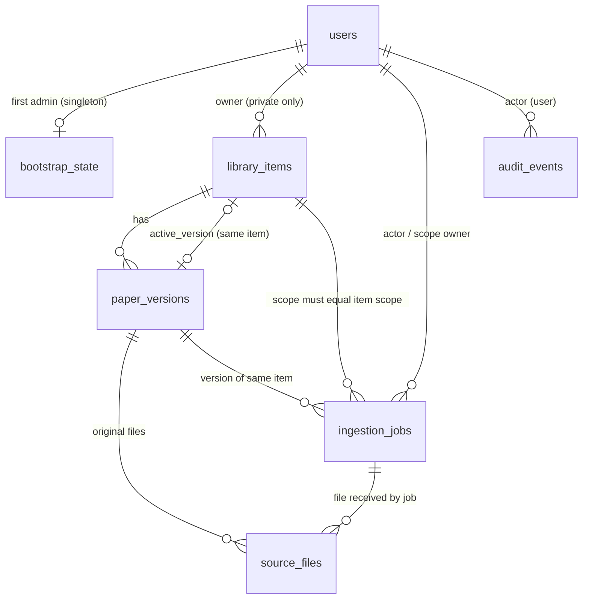

# Môi trường phát triển và schema nền (M1a)

[Mục lục](README.md) · [Mô hình dữ liệu](data-model.md) · [Roadmap](roadmap.md)

Tài liệu này mô tả phần **đã triển khai ở M1a**: Docker Compose dev, migration nền và lệnh bootstrap Admin. M1a **chưa** có invite/login/session/reset (M1b), upload intent/lưu original (M1c), worker, provider, search hay RAG.

**Cách kiểm chứng (2026-09-24):** Windows 11, Docker Desktop 28.4 (Compose v2.39, engine Linux), Windows PowerShell 5.1 và Git Bash. Mỗi lệnh dưới đây đã được chạy trong shell ghi kèm, trừ các chỗ ghi rõ **chưa chạy trực tiếp**. Lệnh không ghi shell chạy giống nhau ở cả hai. Chạy mọi lệnh từ **gốc repo**; Windows PowerShell 5.1 không có `&&`, nên tài liệu không dùng `cd … &&`.

Python trên host luôn là Conda env `ras` theo [AGENTS.md](../AGENTS.md), không tạo venv:

```powershell
# PowerShell
$py = "$env:USERPROFILE\.conda\envs\ras\python.exe"
```

```bash
# Git Bash
PY="$USERPROFILE/.conda/envs/ras/python.exe"
```

## Cấu trúc

| Thư mục | Nội dung |
| --- | --- |
| `api/` | FastAPI (`app/main.py` chỉ có `/healthz`, `/readyz`), model SQLAlchemy (`app/models/`), cấu hình tập trung (`app/config.py`), bootstrap (`app/identity/`, `app/cli/bootstrap_admin.py`), Alembic (`migrations/`), test (`tests/`) |
| `web/` | Next.js tối thiểu: trang trạng thái gọi `API_INTERNAL_URL/readyz` phía server; không giữ secret, không quyết định quyền |
| `docker-compose.yml` | `db` (PostgreSQL 16 + pgvector), `redis`, `minio`, `migrate` (one-shot), `api`, `web` |
| `.env.example` | Mẫu cấu hình, các secret để trống |

## Dựng môi trường

1. Tạo `.env` từ mẫu (file bị git-ignore):

   ```powershell
   Copy-Item .env.example .env      # PowerShell
   ```

   ```bash
   cp .env.example .env             # Git Bash
   ```

   Mở `.env` bằng editor và điền **mọi** giá trị trống (`POSTGRES_PASSWORD`, `REDIS_PASSWORD`, `MINIO_ROOT_PASSWORD`) bằng chuỗi ngẫu nhiên riêng, sinh bằng `& $py -c "import secrets; print(secrets.token_urlsafe(24))"` (PowerShell) hoặc `"$PY" -c "import secrets; print(secrets.token_urlsafe(24))"` (Git Bash). Nếu giá trị có `$`, `#` hoặc khoảng trắng, bọc trong nháy đơn, ví dụ `POSTGRES_PASSWORD='...'`: nháy đơn tắt nội suy biến và cú pháp comment của Compose (đã kiểm với mật khẩu chứa `@ : / ? # % $` và dấu cách). Giá trị không được chứa chính dấu nháy đơn. Các ký tự `@ : / ? %` không cần escape, vì ứng dụng không ghép mật khẩu vào URL (xem [kết nối DB](#kết-nối-database)). Thiếu giá trị bắt buộc thì Compose dừng với lỗi `required variable ... is missing a value`.

2. Build và chạy, chờ mọi healthcheck đạt:

   ```bash
   docker compose up -d --build --wait
   docker compose ps -a
   ```

   Service `migrate` chạy `alembic upgrade head` rồi thoát `Exited (0)`; `api` chỉ khởi động sau khi migrate thành công. Port chỉ bind `127.0.0.1`: API `8000`, web `3000`, PostgreSQL `5432`, MinIO console `9001` (đổi qua `*_HOST_PORT` trong `.env`). Redis không mở port ra host và yêu cầu mật khẩu.

3. Kiểm tra nhanh. Dùng `curl.exe` vì trong PowerShell 5.1, `curl` là alias của `Invoke-WebRequest`:

   ```bash
   curl.exe -s http://127.0.0.1:8000/healthz   # {"status":"ok"}
   curl.exe -s http://127.0.0.1:8000/readyz    # {"status":"ready"} khi DB đã migrate
   ```

   Trang `http://127.0.0.1:3000/` hiển thị “Trạng thái API: sẵn sàng”.

## Kết nối database

API, Alembic và lệnh bootstrap cùng đọc `Settings` trong `api/app/config.py`. Kết nối được truyền theo **từng thành phần** `RAS_DB__HOST`, `RAS_DB__PORT`, `RAS_DB__USER`, `RAS_DB__PASSWORD`, `RAS_DB__NAME` (Compose tự đặt từ `.env`), rồi dựng bằng `sqlalchemy.engine.URL.create()`. Nhờ vậy mật khẩu chứa ký tự phân cách URL vẫn đúng. Có thể dùng `RAS_DATABASE_URL` thay thế, nhưng phải là URL **đã percent-encode** (ví dụ `@` → `%40`). Đặt cả hai hoặc không đặt cái nào đều bị từ chối.

## Migration

- Chạy lại migration (no-op nếu đã ở head): `docker compose run --rm migrate`.
- Xem revision hiện tại: `docker compose exec -T api alembic current`.
- Tạo revision mới sau khi sửa model: chạy bên trong container để dùng sẵn kết nối DB, không phải gõ mật khẩu trên host. Bind-mount code hiện tại vào container:

  ```powershell
  # PowerShell
  docker compose run --rm -v ./api/app:/srv/api/app:ro -v ./api/migrations:/srv/api/migrations migrate alembic revision --autogenerate -m "mo ta"
  ```

  ```bash
  # Git Bash: MSYS_NO_PATHCONV ngăn Git Bash đổi /srv/... thành đường dẫn Windows
  MSYS_NO_PATHCONV=1 docker compose run --rm -v ./api/app:/srv/api/app:ro -v ./api/migrations:/srv/api/migrations migrate alembic revision --autogenerate -m "mo ta"
  ```

  Sau đó **đọc và sửa tay** file sinh ra: autogenerate không sinh trigger/extension và đặt sai thứ tự FK vòng. Test `test_orm_models_match_migrated_schema` bắt lệch giữa model và migration.

## Bootstrap Admin đầu tiên

Chạy **một lần** cho mỗi database. Không có tài khoản/mật khẩu mặc định; không có tùy chọn `--password`. Không đặt mật khẩu trong đối số, trong lệnh sẽ lưu vào history, hay trong file của repo.

**Tương tác (khuyến nghị):** CLI hỏi mật khẩu hai lần, không echo. Lệnh cần TTY, nên không thêm `-T`:

```bash
docker compose exec api python -m app.cli.bootstrap_admin --email admin@example.org
```

*Giới hạn kiểm chứng:* nhánh prompt đã được kiểm bằng pseudo-TTY bên trong container (không echo, tạo Admin thành công). Lệnh `docker compose exec` tương tác từ PowerShell/Git Bash **chưa chạy trực tiếp**, vì môi trường agent không có terminal tương tác. Nếu terminal báo không phải TTY, dùng cách không tương tác bên dưới.

**Không tương tác (`--password-stdin`):** mật khẩu được nhập ẩn vào một biến trong phiên shell, rồi pipe qua stdin; không có file tạm và không vào history.

```powershell
# PowerShell 5.1
$pw = Read-Host -AsSecureString "Admin password"
$OutputEncoding = [System.Text.UTF8Encoding]::new($false)   # bắt buộc nếu mật khẩu có ký tự ngoài ASCII
[System.Net.NetworkCredential]::new('', $pw).Password | docker compose exec -T api python -m app.cli.bootstrap_admin --email admin@example.org --password-stdin
Remove-Variable pw
```

```bash
# Git Bash
read -rs -p 'Admin password: ' RAS_ADMIN_PW; echo
printf '%s\n' "$RAS_ADMIN_PW" | docker compose exec -T api python -m app.cli.bootstrap_admin --email admin@example.org --password-stdin
unset RAS_ADMIN_PW
```

*Đã kiểm:* phần pipe của cả hai khối, trên DB tạm, với mật khẩu có ký tự `ü`: bootstrap thoát `0`, lần hai thoát `3`, verifier khớp đúng mật khẩu. Riêng dòng nhập `Read-Host -AsSecureString` / `read -rs` cần người gõ nên được thay bằng giá trị sinh sẵn. **Không bỏ dòng `$OutputEncoding`:** thiếu nó, PowerShell 5.1 pipe dạng ASCII và âm thầm đổi `ü` thành `?` (đã tái hiện), tức Admin nhận một mật khẩu khác với mật khẩu đã gõ. Không dùng cú pháp `< file` trong PowerShell: toán tử `<` không được hỗ trợ ở đó.

Mã thoát: `0` tạo thành công; `3` đã bootstrap (hoặc đã có user) — không tạo gì, ghi audit `denied`; `2` input không hợp lệ (mật khẩu < 12 ký tự, > 1024 ký tự, toàn khoảng trắng, trùng email, nhập lại không khớp, không có TTY mà thiếu `--password-stdin`, hoặc có đối số lạ — lỗi không in lại giá trị đối số); `1` lỗi khác (chỉ in tên loại lỗi).

## Hạ môi trường

```bash
docker compose down      # dừng, giữ volume dữ liệu
docker compose down -v   # dừng và XÓA volume db/redis/minio (mất Admin đã bootstrap)
```

## Chạy test và build

Test API cần PostgreSQL của Compose (`docker compose up -d --wait db` là đủ). Mỗi test tạo database trống riêng `ras_test_*` (và role tạm cho test mật khẩu đặc biệt), rồi xóa sau khi chạy. Kết nối admin lấy từ `RAS_TEST_DATABASE_ADMIN_URL` (URL đã percent-encode); nếu không có thì đọc từng thành phần trong `.env` (`127.0.0.1:${POSTGRES_HOST_PORT:-5432}`, chấp nhận giá trị bọc nháy).

```powershell
# PowerShell
& $py -m pip install -e ".\api[dev]"     # một lần
& $py -m pytest api -q
npm ci --prefix web
npm run typecheck --prefix web
npm run build --prefix web
```

```bash
# Git Bash
"$PY" -m pip install -e "./api[dev]"     # một lần
"$PY" -m pytest api -q
npm ci --prefix web
npm run typecheck --prefix web
npm run build --prefix web
```

## Lựa chọn kỹ thuật ảnh hưởng M1b/M1c

- **Kết nối DB theo thành phần** (`RAS_DB__*` → `URL.create`) thay vì ghép URL, để mật khẩu có `@`, `%XX` hay tổ hợp ký tự phân cách không bị parse sai. M1b/M1c (và worker M2) phải lấy engine qua `app.db`/`Settings.sqlalchemy_url()`, không tự dựng chuỗi kết nối.
- **Alembic + SQLAlchemy 2 + psycopg 3.** Migration viết tay, có kiểm tự động model ↔ schema, downgrade về base và nâng lại. M1b/M1c thêm revision mới (`0002`, …) thay vì sửa `0001`.
- **Trạng thái/loại là `text` + `CHECK`**, không dùng PostgreSQL ENUM: thêm giá trị ở PR sau chỉ cần thay constraint, không vướng `ALTER TYPE` trong transaction.
- **Argon2id (argon2-cffi, tham số mặc định RFC 9106 low-memory)**, lưu chuỗi PHC trong `users.password_verifier`. DB có `CHECK` chỉ nhận `$argon2id$...` nên không thể lưu plaintext. M1b login dùng `verify_password`/`needs_rehash` trong `app/identity/passwords.py`; chính sách độ dài trong `Settings.password`.
- **Bootstrap đồng thời:** advisory lock giao dịch + hàng singleton `bootstrap_state` (khóa chính boolean chỉ nhận `true`) ghi cùng giao dịch với Admin; bootstrap cũng từ chối khi đã có bất kỳ user nào. Test 8 luồng đồng thời chỉ tạo đúng một Admin.
- **Cấu hình tập trung** ở `app/config.py` (`RAS_` prefix, nested `__`): thời hạn session/invite/reset, giới hạn file, ngưỡng PDF, cleanup/backup, budget ứng dụng và key cap. Phần lớn chưa được code dùng tới trước M1b–M3 nhưng đã có test giá trị mặc định/biên, để PR sau không hardcode rải rác.
- **Audit append-only** bằng trigger (chặn UPDATE/DELETE/TRUNCATE); `details` chỉ chứa định danh/mã lý do. Việc purge theo retention (M6) phải qua migration có review.
- **MinIO image** lấy từ `quay.io/minio/minio` (pin tag): Docker Hub không còn phục vụ `minio/minio` (lỗi `pull access denied` khi kiểm ngày 2026-09-24).

## Schema nền



| Bảng | Ràng buộc chính trong DB |
| --- | --- |
| `users` | email lưu dạng chuẩn hóa (lower/trim) + unique; `role ∈ {admin,user}` mặc định `user`; `status ∈ {active,disabled}`; verifier bắt buộc Argon2id; `password_changed_at` để M1b vô hiệu session sau reset |
| `bootstrap_state` | tối đa một hàng (`id = true`), trỏ Admin đầu tiên |
| `library_items` | `private` ⇔ có `owner_user_id`, `common` ⇔ không; visibility/owner **bất biến** (trigger) — promotion tạo item chung mới; `content_status ∈ {metadata_only, indexed}` mặc định `metadata_only`; `indexed` cần `active_version_id`, và version đó phải thuộc chính item (FK kép); `rights_epoch` cho thu hồi |
| `paper_versions` | thuộc một item; `coverage ∈ {complete,partial,none}`; khóa `(id, item_id)` làm đích FK kép |
| `source_files` | gắn version hoặc job; MIME đã xác minh ∈ {PDF, Markdown}; `byte_size > 0`; SHA-256 hex; các cột định danh **bất biến** (trigger), `version_id`/`job_id`/`page_count` chỉ điền một lần từ NULL; `storage_key` không unique vì một object vật lý có thể phục vụ nhiều item hợp lệ; khóa `(id, version_id)` cho AccessRights |
| `ingestion_jobs` | `origin`/`state` theo [kiến trúc](architecture.md#pipeline-và-trạng-thái), mặc định `received`; scope `private`⇔owner; `upload` luôn private; scope phải trùng scope của item (trigger); version phải thuộc item (FK kép); `idempotency_key` unique trong scope (`NULLS NOT DISTINCT` cho kho chung); `cancel_requested` nhất quán với `cancel_requested_at`; `rights_epoch_at_start` |
| `audit_events` | append-only; `actor_type='user'` ⇔ có `actor_user_id`; `outcome ∈ {success, denied, failure}` |

Mọi FK dùng `ON DELETE RESTRICT`: xóa/thu hồi đi qua tombstone và cleanup (M6), không cascade ngầm. Extension `vector` được tạo sẵn nhưng chưa có cột vector — số chiều phải kiểm khi tích hợp model (M3).

### Dành cho PR sau (chưa có trong migration `0001`)

| PR | Bảng/khóa sẽ thêm | Điểm nối đã chuẩn bị |
| --- | --- | --- |
| M1b | `invitations`, `sessions`, `password_reset_tokens` (token hash, expiry, used/revoked) | `users.id` UUID, `users.status`, `users.password_changed_at`; thời hạn trong `Settings.auth` |
| M1c | `processing_acknowledgements`, `upload_intents`; liên kết intent → item/job. **Bắt buộc trước khi mở đường tải file:** ràng buộc `source_files.job_id` và `source_files.version_id` cùng thuộc một item (hiện là hai FK độc lập, DB chưa chặn file gắn job của item A nhưng version của item B), kèm test khác User/khác scope | `library_items` private + owner, `ingestion_jobs` origin `upload` bắt buộc private, `source_files` gắn job; giới hạn file trong `Settings.files` |
| M2 | `step_attempts`, `sections`, `chunks`, `references`; trạng thái coverage chi tiết | `ingestion_jobs.state/attempt_count/warnings`, `paper_versions.coverage`; ngưỡng trong `Settings.pdf_body` |
| M3 | `embeddings` (pgvector theo model/dimensions), active index pointer, `provider_usage` | extension `vector`; `Settings.budget` |
| M5–M6 | `access_rights`, `discovery_*`, `promotion_requests`/`review_grants`, `deletion_tombstones`, backup manifest | khóa `(paper_versions.id, item_id)`, `(source_files.id, version_id)`, `checksum_sha256`, `library_items.rights_epoch`, `ingestion_jobs.cancel_requested` |
