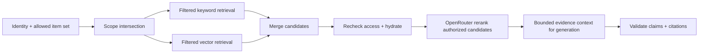

# Thiết kế search và RAG

[Mục lục](README.md) · [Quyền và dữ liệu](access-and-data.md) · [Kiểm thử](testing.md)

## Retrieval

**Đã xác nhận:** Có tìm kiếm kết hợp từ khóa và ngữ nghĩa; hỏi đáp trên một paper, collection hoặc toàn bộ phạm vi người dùng được phép. Câu trả lời dẫn đến vị trí nguồn cụ thể và biết nói không đủ bằng chứng. Index toàn văn không có nghĩa đưa toàn bộ paper vào một prompt.

**Đề xuất:** Server xác thực user, tính tập `allowed_item_ids` từ kho chung và item riêng của chính họ, rồi giao với scope yêu cầu (paper/collection/all). **Lọc quyền trong truy vấn keyword và vector trước khi lấy top-k**, không lấy hit toàn cục rồi lọc sau. Sau khi hợp nhất/rerank, hydrate từng chunk qua lớp dữ liệu có kiểm quyền lần nữa; nếu tập quyền đổi trong lúc chạy, loại hit và không gửi vào LLM. Count, facet, autocomplete, snippets, citation graph, cache và lỗi cũng áp dụng cùng scope. Không dùng collection membership làm quyền.

**Đã xác nhận:** PostgreSQL full-text search và pgvector phục vụ hybrid retrieval. Model OpenRouter được chọn trong config: embedding `openai/text-embedding-3-small`, rerank `qwen/qwen3-reranker-8b`, generation `openai/gpt-6-sol`. Query search/RAG phải embed bằng cùng model và kích thước vector với active index; số chiều được xác minh từ response/config trước khi tạo index. Paper daily `metadata_only` hiện ở **trang khám phá** nhưng không vào full-text search/RAG, kể cả result, count, facet, snippet, citation hoặc context gửi LLM. Chỉ paper `indexed` có active keyword/vector index và quyền phù hợp mới vào retrieval. Việc lọc metadata theo tiêu đề/chủ đề trên trang khám phá là luồng riêng, có nhãn chỉ metadata và link gốc; abstract/link gốc không là evidence của câu trả lời toàn văn.

**Hiện trạng M3b:** Chỉ index và tìm upload private của chính owner. `index_entries` có GIN keyword; `embedding_calls.vector` lưu pgvector với dimensions thực từ response, liên kết qua generation. `POST /search` có mode `keyword` hoặc `hybrid` tường minh; không có ANN index cố định chiều. Truy vấn lấy `active_index_generation_id`, xác nhận model/dimensions của query và lọc ACL theo item/version/file trước top-k. Bibliography không có entry trong index nội dung.

**M3c (PR #8 đã merge):** `POST /search` nhận `collection_id` tùy chọn, loại trừ với `item_id`. Không truyền thì giữ scope M3b. Collection phải thuộc caller; collection của người khác và ID không tồn tại cùng `404 not_found`. Keyword và vector giao membership với private owner, `indexed`, active version/file/generation/epoch **trong SQL trước mỗi top-k**. Hydrate kiểm lại membership/quyền trước rerank và response; khóa các hàng liên quan khi chuẩn bị response. Membership không cho phép đọc chunk hay file. Common `metadata_only` có thể hiện trong danh sách collection nhưng không vào full-text hit hoặc provider payload; common full text vẫn chờ `AccessRights` đúng version/file. M4 có thể dùng cùng scope collection cho evidence pack nhưng phải kiểm lại quyền và locator khi mở citation.

**M6b-2b2b:** bản chung có thể đạt `indexed` (generation `common-keyword-vector-v1`, embedding tính cho ngân sách ứng dụng), nhưng keyword/vector/rerank/RAG và chunk viewer vẫn chỉ đi gate private owner, nên bản chung **chưa vào retrieval** với ai. PR search/RAG chung thêm clause riêng trước top-k/count theo [hợp đồng bàn giao](decisions.md#quyết-định-triển-khai-m6b-2b2b-2026-09-30).

**M6b-2b3a — search bản chung:** `POST /search` và `GET /search/chunks/{id}` opt-in `include_common=True`; audience của mọi truy vấn là `(private owner) OR (i, v, f, g) IN common_fulltext_sql` ([quyền](access-and-data.md), [decisions](decisions.md#quyết-định-triển-khai-m6b-2b3a-2026-09-30)), đặt trong subquery keyword và truy vấn vector **trước** `ORDER BY … LIMIT`, trong `_scope` (item scope + model/dimensions) và mọi hydrate. Subquery không tương quan (PostgreSQL chạy thành hashed subplan một lần mỗi câu lệnh). Hit và chunk viewer thêm `visibility` và `original_url` (chỉ khi gate tải file cho phép). Rerank chỉ gửi candidate `provider_ok` (private, hoặc bản chung có `permits_external_processing` còn hiệu lực), phần còn lại giữ thứ tự fusion sau nhóm đã rerank; response thêm `rerank_withheld` và trạng thái `degraded_not_permitted` khi không còn gì để gửi. Hydrate lại trước khi gửi (so epoch, generation, text, `provider_ok`), sau rerank và dưới khóa trước response; lệch → `409 search_scope_changed`. **RAG không opt-in:** `app.rag` gọi `search`/`hydrate`/`_scope` không truyền cờ, nên SQL của RAG giống hệt trước và không lấy/gửi chunk chung; mở RAG chung là M6b-2b3b theo [hợp đồng bàn giao](decisions.md#quyết-định-triển-khai-m6b-2b3a-2026-09-30).

M3b dùng `plainto_tsquery('simple', query)` và `ts_rank_cd` cho keyword (M4d-1 thay bằng [truy vấn từ khóa giới hạn](#m4d-1--keyword-query-giới-hạn)), pgvector cosine `<=>` cho vector exact scan. Mỗi danh sách lấy top-k **sau** gate private owner, `indexed`, active version/file/generation/epoch và vector model/dimensions; hợp nhất bằng reciprocal rank fusion `1/(60+rank)`, tie theo rank keyword, rank vector, UUID. `count` là số hit trả về, không là tổng khớp toàn kho. Hydrate lại trước rerank và response; response gồm item/version/file/chunk/locator/text và coverage. Link `/sources/{chunkId}` mở đúng chunk qua `GET /search/chunks/{chunkId}` có gate lại; file gốc qua API kiểm quyền riêng. Không lấy reference entry làm evidence. Rerank chỉ gửi tối đa candidate/text theo config; lỗi provider/budget/unverified giữ thứ tự fusion, response ghi `rerank_status=degraded_*`. Keyword mode không embed query; nếu bật rerank, query và candidate được phép vẫn có thể gửi provider.

Review PR #7: rerank mặc định tắt trên web và API. Khi User bật, **câu tìm kiếm và các candidate chunks được phép** mới gửi provider; response sai định dạng sau khi provider nhận request suy giảm có kiểm soát và giữ reservation nếu chưa biết usage. Query embedding chia giới hạn concurrency với document embedding, rerank có giới hạn riêng. Warning near-limit của bucket embedding/rerank được ghi tại reservation theo tổng đã commit và còn giữ chỗ, trả trong `cost.*.warnings`.

Review lease PR #7: reservation provider có thời hạn và được gia hạn khi lời gọi còn chạy. Reservation quá hạn chuyển `uncertain` trước khi xét slot mới, kể cả ngày khác; USD dự phòng vẫn giữ đến đối soát, không tự retry. Warning quota embedding của User tính cả document và query, cùng phần đã commit và đang dự phòng; query warning được trả qua `cost.embed_query.warnings`.

Sau live smoke bằng dữ liệu tổng hợp, adapter dùng ánh xạ chính xác model yêu cầu → response model/provider được xác minh: embedding `openai/text-embedding-3-small` → `text-embedding-3-small`/`Azure`; rerank `qwen/qwen3-reranker-8b` → `accounts/fireworks/models/qwen3-reranker-8b`/`Fireworks`. Tên/provider lạ hoặc thiếu bị từ chối có kiểm soát và audit trong ledger. Vector embedding được quan sát 1536 chiều nhưng code tiếp tục lấy chiều từ response và đối chiếu active index. Giá thực trên key chưa đối soát, nên cờ xác minh giá vẫn tắt cho dữ liệu riêng.

**Đề xuất:** Chuẩn hóa điểm/ghép hạng (ví dụ reciprocal rank fusion), hydrate và kiểm quyền **trước** khi gửi query cùng các candidate chunk đã cho phép tới `qwen/qwen3-reranker-8b`. Giữ thứ tự ứng viên và locator để map score về đúng chunk; giới hạn số candidate/token/chi phí. Đo chất lượng, latency và chi phí có/không rerank trên bộ đánh giá; nếu provider lỗi hoặc budget hết, phản hồi theo chính sách suy giảm được log rõ và không bỏ kiểm quyền. Giới hạn số chunk/token gửi model generation theo ngân sách và diversity paper/section. Ưu tiên thân bài/abstract khi trả lời nội dung; bibliography/references mặc định không làm bằng chứng khoa học. Câu hỏi về danh mục tài liệu có thể truy hồi bibliography với nhãn “reference entry”, không suy thành nội dung/sự đồng ý của paper được trích. [OpenRouter rerank API](https://openrouter.ai/docs/api/api-reference/rerank/create-rerank) nhận query và danh sách document, nên thông báo xử lý ngoài phải bao gồm bước này.

**Đề xuất:** Bản ghi embedding gồm model ID, dimensions, chunk hash và pipeline/index version. Kiểm model/dimensions của query với active index trước khi tìm; khi đổi model tạo index song song, reembed có giới hạn concurrency và đo chi phí rồi chuyển active version sau evaluation. Theo dõi token/units, provider và chi phí của embed document, embed query, rerank, generation; chặn hoặc trì hoãn theo budget ứng dụng thử $10/ngày và quota request/user. Key cap $50/ngày là giới hạn chi tiêu của key, không là credit nạp mới. [OpenRouter embedding API](https://openrouter.ai/docs/api/api-reference/embeddings/submit-an-embedding-request) trả usage token; chi phí thực phụ thuộc model/provider tại thời điểm gọi.

## Dẫn nguồn và thiếu bằng chứng

**Đề xuất:** Citation trong câu trả lời gồm item/version/file, trang PDF hoặc dòng/heading Markdown (thêm offset nếu có), đoạn trích ngắn và link viewer được cấp quyền lúc mở. Prompt chỉ có chunk đã kiểm quyền; metadata, title hay citation edge không thay thế bằng chứng từ thân paper. Sau sinh, kiểm citation ID thuộc tập evidence, locator còn hợp lệ và từng khẳng định quan trọng có nguồn hỗ trợ; không thể xác nhận thì bỏ khẳng định hoặc trả lời thiếu bằng chứng. Nói rõ khi bản trích xuất chỉ một phần hoặc không có toàn văn. Với câu hỏi so sánh, phân biệt nguồn cho từng paper và ý kiến của tác giả với kết luận của hệ thống.

**Đề xuất:** `insufficient_evidence` là trạng thái sản phẩm rõ ràng, không phải câu trả lời tự chế. Kích hoạt khi không có chunk liên quan, nguồn chỉ là bibliography/metadata, mâu thuẫn không giải được, hoặc coverage thiếu ngay vùng cần trả lời. Có thể trình bày những gì đã tìm thấy và giới hạn, nhưng không bịa phần thiếu. Evaluation ở [testing](testing.md).

**Thu hồi khi request đang chạy — đề xuất:** `t_rev` là commit thu hồi/xóa quyền. Request search/RAG **mới** sau mốc này phải bị chặn bằng kiểm tombstone/rights epoch kể cả cache hay index chưa kịp dọn. Request RAG đã bắt đầu kiểm lại trước khi gửi candidate/prompt tới provider, trước khi trả answer/citation và trước từng phần stream; nếu phát hiện thu hồi thì ngừng phát, hủy lời gọi provider nếu có thể và trả trạng thái phù hợp mà không tiết lộ nội dung. Không thể lấy lại chunk đã gửi provider hoặc token/bytes đã phát cho client trước khi phát hiện; không cam kết hủy hồi tố. Viewer/citation dùng API kiểm quyền theo mỗi lần mở, không là link object tồn tại lâu. Xem [hợp đồng quyền](access-and-data.md#hợp-đồng-thu-hồi-và-xóa) và [kiểm thử](testing.md).

**M5b-1:** Link citation và bibliography không vào `index_entries`, embedding document/query, rerank, evidence pack, prompt, answer hay citation của câu trả lời. Test đặt canary ở raw citation, arXiv ID, title và abstract của paper discovery rồi kiểm search keyword/hybrid, payload generation giả, câu trả lời và text đã embed; không canary nào xuất hiện. Đề xuất truy hồi bibliography cho câu hỏi danh mục tài liệu vẫn mở.

- Nội dung paper và prompt retrieval là dữ liệu không tin cậy: chống prompt injection, không cho lệnh trong paper thay đổi quyền, scope hoặc quy tắc dẫn nguồn.
- Cache key gồm identity/scope, index/model version; không dùng cache answer xuyên quyền. Xóa/thu hồi quyền phải vô hiệu cache và index liên quan.
- PDF scan hoặc không có body text bị từ chối full-text index; không OCR. File partial, bảng, công thức, figure hoặc layout phức tạp có thể trích xuất thiếu. UI hiển thị coverage và link file gốc; RAG không khẳng định dựa trên phần chưa index.
- Citation edge biểu diễn “citing paper liệt kê cited work” và confidence match; không biểu diễn tán thành, kiểm chứng hay nội dung paper được trích.

**Đã xác nhận:** Trước **mỗi upload riêng**, thông báo rõ việc gửi toàn bộ text trích xuất cho embedding, candidate chunk cho rerank và câu hỏi/chunk được chọn cho RAG generation tới OpenRouter/provider; User xác nhận tường minh. **Cần kiểm khi tích hợp:** khả dụng của ba model, provider routing/retention, số chiều vector và chi phí/độ trễ thực theo baseline. Xem [decisions](decisions.md).

## M4a — một paper riêng

`POST /rag/ask` nhận `item_id`, `question`, `mode=keyword|hybrid`; không nhận collection/toàn kho. Scope là private owner có active `indexed` generation cùng version/file/rights epoch. M3b lọc quyền trong SQL trước top-k, M4a hydrate lại trước khi gửi evidence và trước response. ID trái quyền và ID vắng mặt cùng `404`. Evidence chỉ gồm chunk body/abstract đã index, có giới hạn số chunk, byte và token ước lượng trong config; bibliography, metadata và reference edge không phải chứng cứ.

OpenRouter chat completions được gọi không streaming với `openai/gpt-6-sol`. Paper text được đặt trong JSON evidence và chỉ được coi là dữ liệu không tin cậy. Model trả claims riêng, mỗi claim phải có citation ID thuộc evidence và quote khớp nguyên văn chunk; API dựng citation với item/version/file/locator và link `/sources/{chunk_id}` (viewer kiểm quyền lại). Sai cấu trúc, ID hay quote trả `insufficient_evidence`. Kiểm tra này xác minh liên kết và nguyên văn quote, **chưa chứng minh nghĩa của mọi claim**; bộ đánh giá ≥80 câu với người đọc đối chiếu là bước riêng sau PR M4b scope. `coverage=partial` đi kèm response khi extraction thiếu. Không có evidence trả trạng thái thiếu bằng chứng và không gọi generation.

Bucket generation $5/ngày nằm trong budget ứng dụng $10/ngày, có reservation bền, quota User/ngày, giới hạn concurrency và request. Timeout/response không chắc chuyển `uncertain` giữ trần; 429 chắc bị từ chối hoàn chỗ. Giá input/output là cấu hình ước tính, `pricing_verified=false` mặc định; thiếu xác minh trả lỗi trước khi gửi paper riêng. Response không streaming nên **chưa đo được mục tiêu thời gian token đầu**. Trình duyệt gọi `POST /rag/ask` qua proxy web cùng origin với deadline riêng (mặc định 120 giây, lớn hơn tổng timeout embedding + generation của API); deadline này là giới hạn an toàn, không phải mục tiêu latency ([dev-setup](dev-setup.md#proxy-web-json-search-collections-và-rag)).

## M4b — RAG theo scope

`POST /rag/ask` yêu cầu đúng một trong `item_id`, `collection_id`, hoặc `scope: "all"`, cùng `question` và `mode: "keyword" | "hybrid"`. Lời gọi M4a với `item_id` giữ nguyên. Collection không tồn tại hoặc không thuộc User đều trả `404`. API trả `scope` đã dùng, `status`, `coverage`, `claims` và `cost`. Citation chứa `item_id`, `title`, `version_id`, `source_file_id`, locator và URL viewer; viewer kiểm lại quyền trên mỗi request.

Keyword/vector retrieval dùng ACL private owner, membership nếu có, active generation, version/file và trạng thái `indexed` trong SQL trước top-k. Trước provider và sau provider, từng evidence được hydrate lại, so text, locator, quyền, membership, version/file, generation và rights epoch. Evidence pack giới hạn `RAS_GENERATION__MAX_EVIDENCE_CHUNKS`, `MAX_EVIDENCE_PAPERS`, `MAX_EVIDENCE_BYTES`; với câu so sánh, dành trước một chunk hợp lệ cho mỗi paper trong giới hạn trước khi thêm các hit còn lại theo thứ hạng. Bibliography và metadata không vào content evidence. Answer so sánh cần ít nhất một claim đánh dấu `comparison=true`, có diễn đạt so sánh và citation hợp lệ của cả hai paper **trong cùng claim**; hai claim độc lập, mỗi claim dẫn một paper, không đủ. Nếu thiếu, trả `insufficient_evidence` với `reason=comparison_requires_multiple_papers`. Đây là kiểm tra cấu trúc, **chưa chứng minh nội dung claim đúng**; bộ đánh giá ≥80 câu và người đọc đối chiếu nằm sau PR M4b scope. Hiện chỉ có private full text của owner; common item `metadata_only` có thể ở collection nhưng không vào evidence. Common full text cần rights gate đúng file version ở milestone công bố.

Response vẫn không streaming. Nếu membership/quyền thay đổi khi provider xử lý, kiểm lại trước response và trả `409 rag_scope_changed` mà không phát answer. Nội dung đã gửi provider trước thu hồi không lấy lại được. `pricing_verified`, quota, reservation và concurrency giữ như M4a; provider thật chưa bật khi chưa đối soát charge. Streaming và bộ đánh giá ≥80 câu cần bước riêng.

## M4c — đo trên bộ đánh giá ban đầu

[Bộ đánh giá](rag-evaluation.md) chạy `POST /search` và `POST /rag/ask` trên corpus tổng hợp. Ở baseline M4c, keyword mode gần như không truy hồi câu hỏi tự nhiên vì `plainto_tsquery('simple', câu hỏi)` yêu cầu mọi token (kể cả “what”, “the”) có trong chunk; RAG keyword vì thế thường trả `insufficient_evidence` trước generation do không có hit, không phải do đánh giá bằng chứng. Hybrid luôn có vector hit nên với câu không có đáp án vẫn gửi evidence tới generation; tính đúng của abstention phụ thuộc model và chưa đo. Pack so sánh (≤ 3 paper, ≤ 6 chunk) có thể bỏ paper hoặc chunk đúng khi chúng đứng sau trong thứ hạng. Regex nhận diện so sánh không bắt câu dùng “differ”. Đây là phát hiện M4c lịch sử, không phải hành vi hiện tại; số liệu chỉ đúng cho corpus nhỏ và embedder băm, không đại diện `openai/text-embedding-3-small`. Cách dựng keyword query được đổi ở M4d-1, nhận diện “differ” ở M4d-2 và chọn pack ở M4d-3 (dưới).

## M4d-1 — keyword query giới hạn

`/search` mode `keyword`, nhánh keyword của `hybrid` và RAG mode `keyword` dùng chung `app.keyword_query` qua `app.search._rank`; không có đường keyword thứ hai.

- **Tokenize bằng PostgreSQL.** `ts_debug('simple', câu hỏi)` tách token bằng đúng parser và cấu hình `simple` đã dựng `index_entries.keywords` (migration `0009`), nên lexeme của query và `tsvector` được chuẩn hóa như nhau. Không đổi cấu hình text search, không reindex, không migration. Cấu hình `simple` không có stop word và không stem; M4d-1 giữ nguyên điều đó ở index.
- **Thuật ngữ hữu ích.** Bỏ stop word (danh sách Snowball tiếng Anh mà PostgreSQL dùng trong `english.stop`, thêm vài từ hỏi và một ít hư từ tiếng Việt; không có từ chủ đề), bỏ lexeme ngắn hơn `RAS_SEARCH__KEYWORD_MIN_TERM_CHARS` (2) hoặc dài hơn `RAS_SEARCH__KEYWORD_MAX_TERM_CHARS` (64). Từ ghép có gạch nối (`load-balancing`) thành **một** term gồm các phần (`'load' & 'balancing'`), khớp cả “load balancing” lẫn “load-balancing”. Giữ tối đa `RAS_SEARCH__KEYWORD_MAX_TERMS` (8) term khác nhau theo thứ tự xuất hiện; phần vượt bị bỏ và báo `dropped_terms`, không mở rộng thành OR không giới hạn. Độ dài input vẫn bị chặn bởi `max_query_bytes`/`max_question_bytes` (1.024 byte); input chứa NUL trả `422 search_query_invalid` / `rag_question_invalid` vì PostgreSQL `text` không nhận NUL.
- **Ngưỡng khớp.** Chunk phải khớp ít nhất `min_match = min(n, max(RAS_SEARCH__KEYWORD_MIN_MATCH_TERMS, ⌈RAS_SEARCH__KEYWORD_MIN_MATCH_FRACTION × n⌉))` trong `n` term (mặc định: một nửa, tối thiểu 2, nên truy vấn hai từ vẫn là AND). Ngưỡng tính trên term của câu hỏi, không trên term có mặt trong scope: từ vắng mặt ở mọi paper là tín hiệu thiếu đáp án và phải giữ.
- **An toàn SQL.** Mỗi term được dựng thành toán hạng tsquery có quote (`'` nhân đôi, `\` escape) từ lexeme PostgreSQL trả về, truyền qua bind parameter rồi `CAST(... AS tsquery)`; không ghép input vào SQL. `websearch_to_tsquery`/`plainto_tsquery` cũng an toàn nhưng AND mọi token; `to_tsquery` trực tiếp trên input sẽ lỗi cú pháp, nên không dùng ([PostgreSQL 16, 12.3.2](https://www.postgresql.org/docs/16/textsearch-controls.html)).
- **SQL và quyền.** Một câu lệnh: subquery áp toàn bộ gate `BASE` (private owner, membership collection, `indexed`, active version/file/generation, rights epoch, section body/abstract, embedding hợp lệ) và điều kiện `keywords @@ (term1 | term2 | …)` (dùng GIN), tính số term khớp; ngoài subquery lọc `matched >= min_match`, sắp `matched DESC, ts_rank_cd DESC, chunk_id` rồi mới `LIMIT keyword_top_k`. Như vậy lọc quyền/scope vẫn **trước top-k**, và thứ hạng xác định trong một trạng thái DB. Hydrate, rerank, evidence pack và viewer giữ nguyên.
- **Không có thuật ngữ hữu ích** (chỉ từ phổ biến, dấu câu, token 1 ký tự): keyword không chạy SQL, trả 0 hit và `keyword_query.status = "no_terms"`; hybrid vẫn có nhánh vector; RAG keyword trả `insufficient_evidence` với `reason = "keyword_query_without_terms"` và không gọi generation. Response `/search` có thêm `keyword_query: {status, terms, min_match, dropped_terms}`; web hiển thị ngưỡng và gợi ý thêm thuật ngữ.
- **Provider.** Keyword retrieval không embed, không rerank, không gọi LLM để viết lại câu hỏi; RAG keyword vẫn gọi generation như trước khi có evidence, với gate `pricing_verified`, budget, quota và citation không đổi. `metadata_only` và common chưa có rights vẫn không vào keyword.
- **Có hit không phải có bằng chứng.** Ngưỡng một nửa vẫn cho candidate với câu không có đáp án có chung từ vựng (trên bộ M4c: 10/15 câu `no_answer` có candidate, TB ~1 hit); RAG chỉ `answered` khi generation trả claim có citation hợp lệ.

Đo trước/sau và các phương án đã thử ở [rag-evaluation](rag-evaluation.md#m4d-1--keyword-query-cho-câu-hỏi-tự-nhiên-đo-trướcsau). Giới hạn: đếm term ngang nhau, không trọng số độ hiếm hay cụm từ; stop word tiếng Việt chưa được đo (bộ câu hỏi toàn tiếng Anh); latency truy vấn đếm term trên workload 1.000 paper chưa đo; tie-break `chunk_id` làm thứ tự các chunk hòa điểm khác nhau giữa hai lần ingest.

## M4d-2 — nhận diện câu so sánh

`app.rag.is_comparison` quyết định một câu hỏi ở scope `collection`/`all` có đi nhánh so sánh hay không; scope `item_id` không bao giờ đi nhánh này (giữ hành vi M4a). Câu được coi là so sánh khi khớp một trong hai luật:

- **Từ chỉ so sánh (không đổi từ M4b):** `compare`, `comparison`, `versus`, `vs`, `contrast`, “so sánh”, “đối chiếu”, “khác nhau”, “giống nhau”.
- **“differ” có đủ hai phía (mới):** dạng `differ`/`differs`/`differed`/`differing` hoặc `difference(s)` chỉ tính khi hai phía được nêu trong cùng mệnh đề: “A **and** B differ”, “A differs **from** B” (tối đa 3 từ giữa “differ” và “from”), “differ/difference(s) **between** A **and** B”. Với “differ … from”, phía A phải là từ được nêu trong **cùng mệnh đề** (từ đầu câu, sau `,`/`;`/`:` hoặc sau do/does/did/how, 1–6 từ) và không là đại từ (`it`, `this`, `that`, `they`, `which`, `what`…); phía B sau `from` cũng không là đại từ. Đại từ hay cụm ở mệnh đề trước không được suy thành phía A: “Does it differ from baseline?”, “What is the method, and does it differ from baseline?”, “What is GSR, and how does DAS differ from it?” không phải câu so sánh. Không tính: “differential”, “different”, “What difference did X make?”, “Is the difference significant?”, “Did BLEU differ across seeds?”, “…, and does it differ across layers?”. `compared with` không thuộc luật (PP-05 là câu một paper).

Khi là câu so sánh, hợp đồng M4b giữ nguyên: search đã lọc ACL/membership/active version/file/generation/rights epoch trong SQL trước top-k; pack dành trước một chunk hợp lệ cho mỗi paper; nếu pack có ít hơn hai paper thì trả `insufficient_evidence`, `reason=comparison_requires_multiple_papers` **trước** khi reserve/gọi generation; evidence được hydrate lại trước provider và trước response. Answer chỉ `answered` khi có một claim `comparison=true`, có từ so sánh và citation hợp lệ của ít nhất hai paper **trong cùng claim**. Danh sách từ so sánh của claim (`COMPARATIVE_ASSERTION`) nhận cùng các dạng `differ`/`differs`/`differed`/`differing`/`difference(s)` như luật câu hỏi; trước đây chỉ nhận đúng `differ`, nên claim “A differs from B” không có từ khác bị từ chối.

Mode `keyword` bỏ các từ chỉ so sánh (luật từ vựng ở trên và các dạng “differ”, `COMPARISON_CUE`) khỏi **câu truy vấn retrieval**, vì chúng mô tả tác vụ chứ không phải nội dung; `hybrid` dùng câu hỏi nguyên văn cho cả hai nhánh như trước. Payload generation luôn chứa câu hỏi gốc. Việc bỏ từ ở mode keyword đã có từ M4b nhưng docs M4b chưa ghi; M4d-2 ghi lại và mở rộng sang “differ”.

Giới hạn: luật là từ vựng, không biết hai phía là hai paper hay hai điều kiện trong một paper. “How does recall differ between 2 lux and 0.5 lux?” ở scope collection/all sẽ bị coi là so sánh và có thể trả `comparison_requires_multiple_papers` dù một paper trả lời được; `compare` có cùng giới hạn từ M4b. Hỏi trong scope `item_id` để tránh. Tiếng Việt chỉ có luật từ vựng cũ (“khác nhau”); “khác gì”, “khác biệt giữa”, “khác với” chưa được nhận và chưa đo (bộ đánh giá toàn tiếng Anh). Kiểm claim vẫn là kiểm cấu trúc, không chứng minh nội dung claim đúng. Đo trước/sau ở [rag-evaluation](rag-evaluation.md#m4d-2--nhận-diện-câu-so-sánh-đo-trướcsau).

## M4d-3 — chọn evidence pack cho câu so sánh

Sau retrieval đã lọc quyền, `_pack` chỉ xét hit `body`/`abstract` còn trong danh sách search trả về. Với câu so sánh, luật tìm hai đoạn nhắc tên riêng biệt trong câu hỏi: cụm title đầy đủ theo đúng thứ tự (cho phép tối đa một từ xen giữa hai từ title), viết tắt tường minh hoặc từ title đặc trưng cạnh từ chỉ paper như `study`/`benchmark`. Viết tắt ở title có qualifier không chiếm tên viết tắt của một title khác mở rộng cùng chữ cái (ví dụ `GSR replication` và `Gated Sparse Routing`); cụm gạch nối chỉ tạo viết tắt khi có ít nhất ba thành tố, như `mixture-of-experts` → `moe`. Tiền tố tên file kiểu `p07` không là tín hiệu. Luật chọn cặp có tín hiệu mạnh nhất mà không dùng thứ hạng hit để quyết định danh tính paper; các cặp đồng hạng hoặc không phân giải rõ sẽ trả `insufficient_evidence` trước generation. Scope có đúng hai paper chỉ xác định cặp khi câu hỏi quy chiếu tới cả hai theo ngữ cảnh, chẳng hạn `these two papers`, và không nêu tên/viết tắt cụ thể khác; một cặp tên nối bằng `and`/`versus`/`vs` cũng chặn fallback này dù viết chữ thường. Câu `Compare GSR and DAS` phải phân giải GSR/DAS đến đúng hai paper bằng title/alias dù scope chỉ có hai paper; nếu không thì từ chối trước generation. Title chỉ dùng để chọn paper, không dùng làm bằng chứng cho claim.

Trong hai paper đó, pack luân phiên lấy các chunk của section `Results`, `Methods`, `Limitations`, `Analysis`, `Discussion`, `Abstract` rồi các section còn lại, giữ thứ hạng search bên trong mỗi section. Nhờ vậy một chunk đúng nằm sâu trong paper còn cơ hội vào pack. Pack chỉ có một paper vẫn trả `insufficient_evidence` trước provider. Mọi nhánh giữ trần 3 paper/6 chunk/12.000 byte và trần prompt/reservation cũ; hit trùng không chiếm thêm slot. Quy tắc không đọc nhãn đánh giá, ID câu hỏi hay gold span. Báo cáo chỉ gọi số byte UTF-8 của messages JSON là **trần ước lượng token** theo phép đo hiện hành của pipeline, không phải usage provider.

ACL trước retrieval, hydrate/so khớp membership, version/file, generation, rights epoch, text và locator trước provider và trước response, cùng kiểm citation/viewer giữ nguyên. Reference list, bibliography và `metadata_only` không vào pack. Claim so sánh cần citation hợp lệ từ **đúng hai paper đã phân giải** trong cùng một claim. Đo và giới hạn của corpus tổng hợp ở [rag-evaluation](rag-evaluation.md#m4d-3--chọn-evidence-pack-cho-câu-so-sánh).
