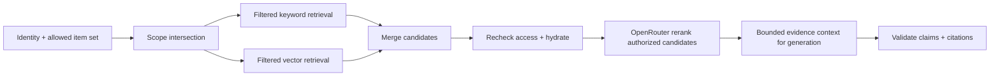

# Thiết kế search và RAG

[Mục lục](README.md) · [Quyền và dữ liệu](access-and-data.md) · [Kiểm thử](testing.md)

## Retrieval

**Đã xác nhận:** Có tìm kiếm kết hợp từ khóa và ngữ nghĩa; hỏi đáp trên một paper, collection hoặc toàn bộ phạm vi người dùng được phép. Câu trả lời dẫn đến vị trí nguồn cụ thể và biết nói không đủ bằng chứng. Index toàn văn không có nghĩa đưa toàn bộ paper vào một prompt.

**Đề xuất:** Server xác thực user, tính tập `allowed_item_ids` từ kho chung và item riêng của chính họ, rồi giao với scope yêu cầu (paper/collection/all). **Lọc quyền trong truy vấn keyword và vector trước khi lấy top-k**, không lấy hit toàn cục rồi lọc sau. Sau khi hợp nhất/rerank, hydrate từng chunk qua lớp dữ liệu có kiểm quyền lần nữa; nếu tập quyền đổi trong lúc chạy, loại hit và không gửi vào LLM. Count, facet, autocomplete, snippets, citation graph, cache và lỗi cũng áp dụng cùng scope. Không dùng collection membership làm quyền.

**Đã xác nhận:** PostgreSQL full-text search và pgvector phục vụ hybrid retrieval. Model OpenRouter được chọn trong config: embedding `openai/text-embedding-3-small`, rerank `qwen/qwen3-reranker-8b`, generation `openai/gpt-6-sol`. Query search/RAG phải embed bằng cùng model và kích thước vector với active index; số chiều được xác minh từ response/config trước khi tạo index. Paper daily `metadata_only` hiện ở **trang khám phá** nhưng không vào full-text search/RAG, kể cả result, count, facet, snippet, citation hoặc context gửi LLM. Chỉ paper `indexed` có active keyword/vector index và quyền phù hợp mới vào retrieval. Việc lọc metadata theo tiêu đề/chủ đề trên trang khám phá là luồng riêng, có nhãn chỉ metadata và link gốc; abstract/link gốc không là evidence của câu trả lời toàn văn.

**Hiện trạng M3a:** Chỉ index upload private. `index_entries` có GIN keyword; `embedding_calls.vector` lưu pgvector với dimensions thực từ response, liên kết qua generation. Không có API retrieval/query embedding hay ANN index cố định chiều trong PR này. M3b phải lấy `active_index_generation_id`, xác nhận model/dimensions của query và lọc ACL theo item/version/file trước khi đọc entry hoặc vector. Bibliography không có entry trong index nội dung.

**Đề xuất:** Chuẩn hóa điểm/ghép hạng (ví dụ reciprocal rank fusion), hydrate và kiểm quyền **trước** khi gửi query cùng các candidate chunk đã cho phép tới `qwen/qwen3-reranker-8b`. Giữ thứ tự ứng viên và locator để map score về đúng chunk; giới hạn số candidate/token/chi phí. Đo chất lượng, latency và chi phí có/không rerank trên bộ đánh giá; nếu provider lỗi hoặc budget hết, phản hồi theo chính sách suy giảm được log rõ và không bỏ kiểm quyền. Giới hạn số chunk/token gửi model generation theo ngân sách và diversity paper/section. Ưu tiên thân bài/abstract khi trả lời nội dung; bibliography/references mặc định không làm bằng chứng khoa học. Câu hỏi về danh mục tài liệu có thể truy hồi bibliography với nhãn “reference entry”, không suy thành nội dung/sự đồng ý của paper được trích. [OpenRouter rerank API](https://openrouter.ai/docs/api/api-reference/rerank/create-rerank) nhận query và danh sách document, nên thông báo xử lý ngoài phải bao gồm bước này.

**Đề xuất:** Bản ghi embedding gồm model ID, dimensions, chunk hash và pipeline/index version. Kiểm model/dimensions của query với active index trước khi tìm; khi đổi model tạo index song song, reembed có giới hạn concurrency và đo chi phí rồi chuyển active version sau evaluation. Theo dõi token/units, provider và chi phí của embed document, embed query, rerank, generation; chặn hoặc trì hoãn theo budget ứng dụng thử $10/ngày và quota request/user. Key cap $50/ngày là giới hạn chi tiêu của key, không là credit nạp mới. [OpenRouter embedding API](https://openrouter.ai/docs/api/api-reference/embeddings/submit-an-embedding-request) trả usage token; chi phí thực phụ thuộc model/provider tại thời điểm gọi.

## Dẫn nguồn và thiếu bằng chứng

**Đề xuất:** Citation trong câu trả lời gồm item/version/file, trang PDF hoặc dòng/heading Markdown (thêm offset nếu có), đoạn trích ngắn và link viewer được cấp quyền lúc mở. Prompt chỉ có chunk đã kiểm quyền; metadata, title hay citation edge không thay thế bằng chứng từ thân paper. Sau sinh, kiểm citation ID thuộc tập evidence, locator còn hợp lệ và từng khẳng định quan trọng có nguồn hỗ trợ; không thể xác nhận thì bỏ khẳng định hoặc trả lời thiếu bằng chứng. Nói rõ khi bản trích xuất chỉ một phần hoặc không có toàn văn. Với câu hỏi so sánh, phân biệt nguồn cho từng paper và ý kiến của tác giả với kết luận của hệ thống.

**Đề xuất:** `insufficient_evidence` là trạng thái sản phẩm rõ ràng, không phải câu trả lời tự chế. Kích hoạt khi không có chunk liên quan, nguồn chỉ là bibliography/metadata, mâu thuẫn không giải được, hoặc coverage thiếu ngay vùng cần trả lời. Có thể trình bày những gì đã tìm thấy và giới hạn, nhưng không bịa phần thiếu. Evaluation ở [testing](testing.md).

**Thu hồi khi request đang chạy — đề xuất:** `t_rev` là commit thu hồi/xóa quyền. Request search/RAG **mới** sau mốc này phải bị chặn bằng kiểm tombstone/rights epoch kể cả cache hay index chưa kịp dọn. Request RAG đã bắt đầu kiểm lại trước khi gửi candidate/prompt tới provider, trước khi trả answer/citation và trước từng phần stream; nếu phát hiện thu hồi thì ngừng phát, hủy lời gọi provider nếu có thể và trả trạng thái phù hợp mà không tiết lộ nội dung. Không thể lấy lại chunk đã gửi provider hoặc token/bytes đã phát cho client trước khi phát hiện; không cam kết hủy hồi tố. Viewer/citation dùng API kiểm quyền theo mỗi lần mở, không là link object tồn tại lâu. Xem [hợp đồng quyền](access-and-data.md#hợp-đồng-thu-hồi-và-xóa) và [kiểm thử](testing.md).

## Nguy cơ và giới hạn

- Nội dung paper và prompt retrieval là dữ liệu không tin cậy: chống prompt injection, không cho lệnh trong paper thay đổi quyền, scope hoặc quy tắc dẫn nguồn.
- Cache key gồm identity/scope, index/model version; không dùng cache answer xuyên quyền. Xóa/thu hồi quyền phải vô hiệu cache và index liên quan.
- PDF scan hoặc không có body text bị từ chối full-text index; không OCR. File partial, bảng, công thức, figure hoặc layout phức tạp có thể trích xuất thiếu. UI hiển thị coverage và link file gốc; RAG không khẳng định dựa trên phần chưa index.
- Citation edge biểu diễn “citing paper liệt kê cited work” và confidence match; không biểu diễn tán thành, kiểm chứng hay nội dung paper được trích.

**Đã xác nhận:** Trước **mỗi upload riêng**, thông báo rõ việc gửi toàn bộ text trích xuất cho embedding, candidate chunk cho rerank và câu hỏi/chunk được chọn cho RAG generation tới OpenRouter/provider; User xác nhận tường minh. **Cần kiểm khi tích hợp:** khả dụng của ba model, provider routing/retention, số chiều vector và chi phí/độ trễ thực theo baseline. Xem [decisions](decisions.md).
